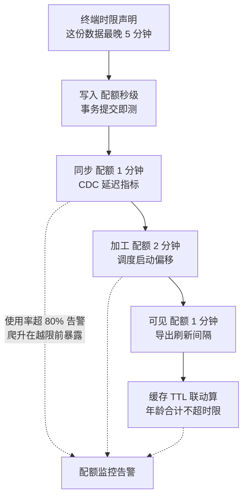
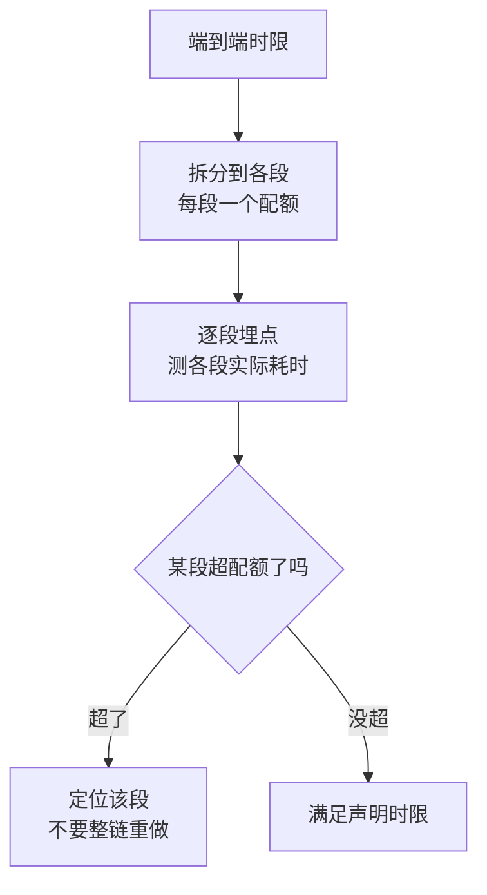
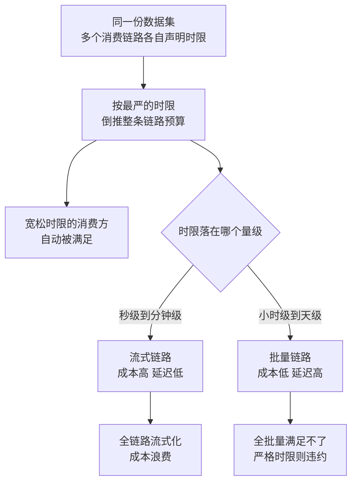

# 数据新鲜度是一组配额：每个消费链路声明自己的时限

**数据从产生到被看到，每个环节都在加延迟，用户感受到的慢是全链路加在一起的结果**。读完这一页你能**为每条消费链路声明时限，再把它拆成各环节的延迟配额，按配额告警而不是等有人说慢**。

> **要点**：**数据从生产到消费的每个环节（写入、同步、加工、缓存、导出）都加延迟**，**终端用户感受到的新鲜度是全链路延迟之和**——**新鲜度治理按消费链路声明时限（这份表的数据最晚多久算新鲜）**，**时限沿链路分解到各环节的延迟配额**，**监控按配额告警而不是按"感觉慢了"**。

## 背景与本质：为什么新鲜度是全链路的和

数据新鲜度要解决的问题是：终端那句"这份数据是新吗"没有直接的答案，**答案藏在一条链上**：**源库写入（事务提交）→ 同步管道抽取 → 加工层计算（批处理周期、流处理延迟）→ 存储层可见（导出、索引刷新）→ 消费端缓存**。其中两环最值得单独说明。同步管道抽取靠 **CDC（Change Data Capture，变更数据捕获：把数据库的增量改动当成事件流发出去）**，把数据库的改动实时抽出来，**其延迟与批量调度间隔是这环的账**。

消费端缓存的报表缓存有 TTL（Time To Live，存活时间：到期后自动失效或删除），即数据的存活时间，到期后数据可被自动删除，应用层缓存同理。**每一环都往"数据年龄"上加自己的延迟，终端感受到的年龄是各环之和**——**任何一环的延迟波动（同步堆积、调度延迟、缓存未失效）都直接体现为"数据不新鲜"**，而排查从终端开始逐环回溯时，每一环都说"我这环没变"。

**新鲜度问题的病根在时限缺位**：**没有消费链路声明过"我需要多新的数据"**，**各环节按自己的方便默认**（同步每小时跑一次、缓存 TTL——记录在缓存里的有效期——定为六小时），终端的抱怨来时无人知道该优化哪一环。**时限声明把新鲜度从感觉变成配额**——本库可观测性域"指标、日志、Trace（一次请求在各服务间的完整调用链）与剖析各答一问"讲过证据分工；本篇把新鲜度当作数据链路的 SLO（服务等级目标，对外部承诺的量化指标来治理）。

## 它是怎么做到的：时限的声明、分解与监控

**声明按消费链路走**：**同一份数据的不同消费方时限不同（实时风控要秒级、日报表要小时级）**——**时限挂在消费链路上，不挂在数据集上**；**一份多消费的数据集，按最严的时限倒推链路预算，宽松时限的消费方自动被满足**。

**分解按链路环节配额**：终端时限 5 分钟，链路五环——写入秒级、同步 1 分钟、加工 2 分钟、可见 1 分钟、缓存 TTL 不超过终端时限（缓存返回的数据年龄 + 链路年龄 ≤ 5 分钟，**缓存 TTL 与链路延迟要联动算**，**各配各的超时限是常态错误**）。**每环的配额是这一环允许的最大延迟**，**超配额的环节是链路的瓶颈点，优化顺序按超配额幅度排**。

终端时限沿五环分解，配额与告警各归各位，见下图：



配额怎么把时限变成可执行的监控：终端时限拆成五环各自的延迟上限，每环测自己的实际延迟、与配额比对，使用率逼近上限即告警——缓存的配额单独算（TTL 要按终端时限减链路延迟倒推），各配各的总量相加超出时限是这道分解要防的常态错误。

**监控按配额告警**：**每环监测自己的实际延迟（CDC 延迟指标、调度实际启动时间、缓存年龄）**，**配额使用率（实际 ÷ 配额）超 80% 告警**——**延迟曲线的缓慢爬升在越限前暴露，终端抱怨之前先收到告警**。上游 BookKeeper 的一个同类改进是垃圾回收线程记录所有错误（把静默失败变可见信号），同一原则：**链路环节的静默延迟（任务失败后下次调度"自动追平"）是新鲜度劣化的主源，要靠配额监控显式暴露**。


来源：[腾讯云开发者社区《消息队列：听我解释，我真的不是只有Kafka！》](https://cloud.tencent.com.cn/developer/article/1866156)（CC 4.0 BY-SA）


## 读完这一段你能判断什么：治理动作与常见误判



**超配额时的优化顺序**：**先看配额分配是否合理（写 2 分钟同步 1 分钟的配额错位要重分）**，再看环节实际性能（同步管道的吞吐瓶颈、加工任务的重算范围）——**重分配配额与优化环节性能是两个不同的动作**，混在一起做会归因错位。

**新鲜度与一致性的分界**：**新鲜度回答"数据多旧"，一致性回答"多个副本看到的是否同一份"**——**缓存里的旧数据可以完全新鲜度达标（在时限内）且一致性弱（与源库有偏差）**；**两个维度都要声明，混为一谈的"数据没问题"会漏掉其中一边**。

**时限与更新模式的匹配**：**终端时限 5 分钟的数据走流式链路（成本高、延迟低），时限 1 天的走批量（成本低、延迟高）**——**按时限选链路模式是成本最大的决策点**，**全链路流式化的成本浪费与全批量的时限违约都源于这一步没做匹配**。

时限的定法与链路模式的选择画进同一张图：



取最严时限这一步容易引发争论——宽松的消费方会觉得为自己多付了成本。但**同一份数据集走两条链路的成本通常高于统一按最严的那条来**：**链路数量比链路延迟更花钱**。**真正要分开做的是按量级选模式，这一步错了才是成本失控的主因**。

批量链路的环节形态是一张经典的 ETL（Extract-Transform-Load，把数据搬家并加工的流程）图：抽取、清洗、加载三段各自有调度与暂存，**新鲜度配额就挂在这三段的边界上**：


*ETL 三步流程：抽取、转换、加载，源系统到目标数据库之间的中间环节决定链路延迟（图源：CSDN 博客）*

**流式链路把这三段压缩成连续处理，代价是每一环都要常驻计算资源**——**时限量级是选哪种形态的依据**。

## 这套说法在哪儿会失效

三条边界防止防线走形。

**新鲜度不承诺正确性**：**时限内的数据可能因上游错误而错误（同步管道把坏数据准时送到）**——**新鲜度 SLO 与质量校验并行**，按时限到货的数据照常过质量门。

**时钟偏差影响年龄计算**：**数据年龄按时间戳差值算，各环节机器的时钟偏差直接混入年龄**——**跨机时钟要统一NTP（Network Time Protocol，网络对时协议）校准**，偏差本身也要进监控。

**时限声明要跟业务变更走**：业务的时限需求随策略变化（风控从小时级收紧到分钟级）——**时限是活配置**，**声明放在可更新的配置处，固定写在代码里的时限在业务收紧时变成静默违约**。

## 怎么自己动手验证

配额体系是否成立，端到端测一次就知道：

1. 端到端年龄验证：**在源库写入带时间戳的标记记录，测量它出现在终端的耗时，预期 ≤ 声明时限（多次测量取 P95）**；
2. 配额分解验证：**逐环注入延迟（暂停调度、拉长缓存 TTL），预期对应环节的配额告警触发、终端年龄按注入量增长**——链路分解与实际对得上；
3. 联动验证：**缓存 TTL 调大到超过链路配额，预期终端年龄越限被监控捕捉**——联动核算的规则被验证；
4. 断言锚点：**每个消费链路有时限声明、各环有延迟配额与使用率监控、时限与链路模式的匹配有决策记录**——三件齐备，"数据不新鲜"从模糊抱怨变成按配额定位的工程问题。

```text
端到端断言 = 标记记录 P95 年龄 ≤ 时限
配额断言 = 注入延迟被对应环节告警捕捉
联动断言 = 缓存年龄计入终端时限
```

**新鲜度的治理结构是把"数据要新"翻译成一组配额**：终端时限声明、链路环节分解、配额使用率监控——**配额齐了，每一环的延迟都有了名字，优化与告警各就各位**。

## 接着读哪几篇：缓存环节的年龄机制

- [[工程知识/后端系统：在并发、失败与变化中维持服务/基础设施/CDN的回源与边缘缓存：静态加速背后的机制]] —— 缓存环节的年龄机制
- [[工程知识/后端系统：在并发、失败与变化中维持服务/服务设计/缓存改变读写路径、一致性与故障模式]] —— 新鲜度与一致性的分界
- [[工程知识/性能工程：从用户等待到资源瓶颈/观测与诊断/指标、日志、Trace与剖析各答一问，合起来才构成证据]] —— 链路延迟的取证分工
- [[工程知识/AI 系统工程：从模型能力到生产能力/数据与MLOps/数据集、特征与模型版本必须可追溯]] —— 数据链路的可追溯面
