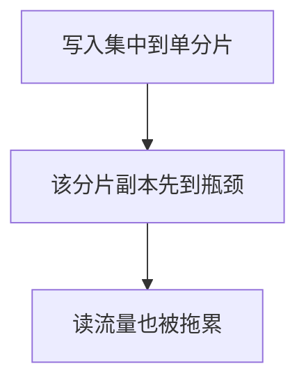
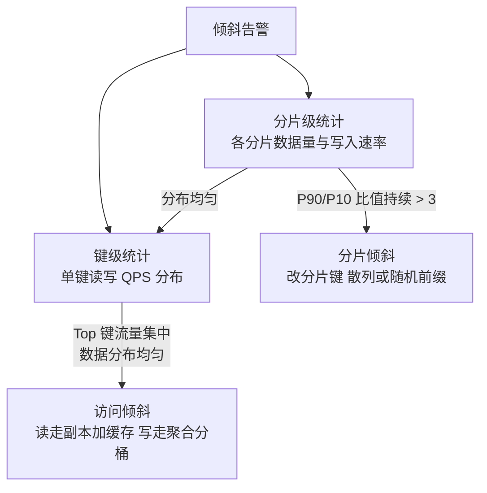

# 热点副本与流量倾斜：读写热点要按分片维度分开治理

> **要点**：**倾斜的治理入口是分片键与放置策略**——**写热点靠分片键打散与二次随机化**，**读热点靠副本放置与本地化调整**，**热门单键（大 V、爆款）超出分片能力时靠应用层缓存与分桶**；**"均匀分片但流量倾斜"与"分片倾斜"是两种病，诊断先分清再开方**。

## 要解决的问题



读写热点要分开治理：


分布式存储的容量线性扩展依赖一个前提：**负载在分片间均匀**。现实经常违背这个前提——**某几个分片（把数据或负载按规则切分到多个节点的方法）的磁盘、网卡、CPU 长期满载，其余分片闲着**，**集群容量利用率看着健康（平均 40%），实际已经在热点分片上排队**。本库后端域"数据分布不均让分片失去意义"讲过倾斜的机制根源；本篇回答治理端：**倾斜的两种形态（分片倾斜与访问倾斜）各自的诊断信号与治理手段**——**手段用错方向（用加节点治分片倾斜），扩容的钱花出去，热点还在原地**。

## 它是怎么做到的：两种倾斜的诊断与治理

**读热点与写热点的成因不同，治理手段也不同**。etcd（分布式键值存储，Kubernetes 用它存集群状态）的分区示意图展示的是另一种倾斜：节点被网络隔离后，新加入的成员恰好与 leader 同侧时，多数派仍然成立，集群继续工作；反之则停滞。副本之间的流量分配一旦不均，同样会出现这种"一侧满负荷、一侧空闲"的形态。


*图源：[etcd 官方文档 · Learner 设计](https://etcd.io/docs/v3.5/learning/design-learner/)。*

**分片倾斜（数据分布的问题）**：**分片键选择不当（按时间戳、按递增 ID 顺序写），写入集中在最新分片**——诊断信号是**各分片的数据量与写入速率的分布**（P90 分片与 P10 分片的比值，持续大于 3 即倾斜）。治理手段按根源选：**分片键改成散列（写入按哈希摊开，代价是范围查询失效）**、**复合键加随机前缀（写入打散，读取端聚合）**、**分片数与写入并行度重新匹配**。

**访问倾斜（流量分布的问题）**：**数据分布均匀，但某些键的访问量天然集中（热门用户、爆款商品）**——诊断信号是**单键的读写 QPS（每秒查询数，系统每秒处理的请求量）分布**（Top 键占比）。治理手段按读与写分别开方：**读热点**靠副本放置（热门键的副本分散到多节点，客户端轮询读）与应用层缓存（热门读不进入存储层）；**写热点**靠分片内聚合（批量提交摊平单键写放大）、异步化（写延迟容忍的场景转异步队列），**单键写热点超出一切存储手段时（每秒数万次写同一个键），靠应用层分桶（按子键分桶、按时间分片）**。

**两者叠加的形态**：**分片倾斜 + 访问倾斜的热点分片是容量事故的高发区**——**治理顺序先治分片倾斜（分布正常后访问倾斜的量级才看得清），再治访问倾斜**。**一次只动一个变量**：同时改分片键与缓存策略，倾斜缓解的归因无从判定。



诊断的第一道分岔：两套统计各查一种病——**分片级统计查数据分布（P90/P10 比值大于 3 即分片倾斜），键级统计查流量集中（分布均匀但单键 QPS 集中即访问倾斜）**。**分片级统计正常才轮到键级统计说话**，**只有集群总量的监控两种病都查不出来**，这是「诊断的数据基础」一节的判据来源。

单机装不下时怎么切是分片治理的第一张图：Redis 切片集群把 15G 数据拆成 3 个 5G 实例，每个实例扛一部分槽位与流量——读写热点要按分片维度分开治理的前提，就是先有这样的分片形态摆在那里：


来源：小林coding《Redis 集群模式是怎么保证高可用的？》，https://www.xiaolincoding.com/redis/cluster/cluster_problem.html。**热点治理的手段（分桶、加盐、副本放置）全部作用在这张图的右半边**——**键落在哪个实例，由分片键与槽位映射决定**。

槽位数量为什么是 16384 而不是更大的数，antirez 本人在 GitHub 的 Redis（开源的内存键值数据库，常当缓存与队列使用）仓库里给过官方回答（编号 2597 的讨论串，讲心跳包大小与集群规模上限的权衡）——**分片维度治理里那些「槽位怎么分」的默认值，出处就在这里**：


来源：antirez 于 GitHub redis 仓库讨论串（github.com/redis/redis/issues/2597）的回答截图。普通槽位按 CRC16 取模分配，这张图解释的是位图压缩后心跳（节点定期互发的存活信号，超时收不到就判定故障）包的上限从哪来——集群规模与心跳成本的边界条件。


## 读完这一段你能判断什么：治理手段的选择树

**第一问：倾斜在分片间还是键间？**分片间的数据/流量分布不均 → 分片倾斜，治理在分片键与再平衡；**分片均匀但单键流量集中 → 访问倾斜，治理在副本放置与应用层**。**诊断的数据基础是分片级与键级两套统计**，**只有集群总量的监控看不出任何一种倾斜**。

**第二问：热点是稳定的还是轮动的？**稳定热点（固定的热门键）→ 长期手段（缓存、副本放置）一次配好；**轮动热点（今天的爆款与明天不同）→ 自动化手段（热点检测 + 自动副本迁移）**，上游 BookKeeper 的 region-aware 放置策略按磁盘权重分配写流量的改进正属此类——**轮动热点的治理必须是自动的**，人工响应追不上轮动周期。

**第三问：热点键（被高频访问的少数键、聚集成局部瓶颈）能否分桶？**键的业务语义允许分（会话、订单可以按子键分桶）→ 应用层分桶治本；**不允许分（单条记录的计数器）→ 聚合与异步治标，容量按热点峰值单独预算**。

## 这套说法在哪儿会失效

三条边界防止防线走形。

**缓存引入自己的热点形态**：**热门键缓存失效（缓存里的数据过期或不一致、需要回源加载）的瞬间（缓存击穿），存储层承受全部读流量**——**热点键的缓存续期与互斥重建**（只放一个请求回源）是缓存方案的必要配套，**不带配套的缓存把读热点变成读脉冲**。

**打散与顺序的交换要业务确认**：**随机前缀打散写入，同时破坏同键写入了顺序保证**——**键的顺序语义在打散前要跟业务核对**（消息按 key 分区保序是常见的隐藏依赖），**打散不能破坏业务依赖的顺序**。

**热点治理的度量在客户端不在服务端**：**服务端看热点分片的负载，客户端看请求延迟的分布**——**治理效果以客户端 P99（把所有请求响应时间从小到大排，第 99 百分位的值，99% 的请求比它快）的收敛为准**，**服务端负载均匀但客户端延迟没降，说明瓶颈在别处（网络、客户端自身）**。

## 怎么自己动手验证

可复现的验证路径：

1. 倾斜复现：**构造顺序键写入与热门单键访问两个场景，预期分片统计与键统计分别呈现两种倾斜形态**——诊断信号与形态对得上；
2. 治理验证：**打散分片键后写入分布的 P90/P10 比值收敛；热门键加副本放置后客户端读延迟收敛**；
3. 击穿（热点缓存过期瞬间，大量请求同时涌向存储）防护验证：**热门缓存失效瞬间，存储层读流量预期被互斥重建限制在单请求量级**；
4. 断言锚点：**分片级与键级两套统计在管、倾斜比值有基线（正常状态下的指标水平、用来对比异常）、治理效果以客户端 P99 判定**——三件齐备，**倾斜从"偶尔的容量事故"变成"有指标的持续治理"**。

```text
诊断断言 = 两套统计能区分两种倾斜
治理断言 = P90/P10 与客户端 P99 双收敛
防护断言 = 击穿瞬间回源被互斥限制
```

倾斜治理的路径从诊断开始：**先分清两种病，再按稳定性与可分性选手段**——**顺序对了，每一步的投入都用在瓶颈上**。

## 接着读哪几篇：再平衡与放置策略的机制层

- [[工程知识/数据系统：在并发与故障中保存事实/事务与存储/数据分布不均是分片集群的第一大故障源]] —— 倾斜的机制根源，本篇是治理端
- [[工程知识/数据系统：在并发与故障中保存事实/可靠性与运维/分区再平衡的三种策略：固定取模与一致性哈希]] —— 再平衡与放置策略的机制层
- [[工程知识/后端系统：在并发、失败与变化中维持服务/服务设计/缓存穿透击穿与雪崩是三种不同的失效模式]] —— 读热点缓存的失效防护
- [[工程知识/数据系统：在并发与故障中保存事实/查询与索引/慢查询治理从发现到索引闭环]] —— 存储层热点诊断的姊妹场景
