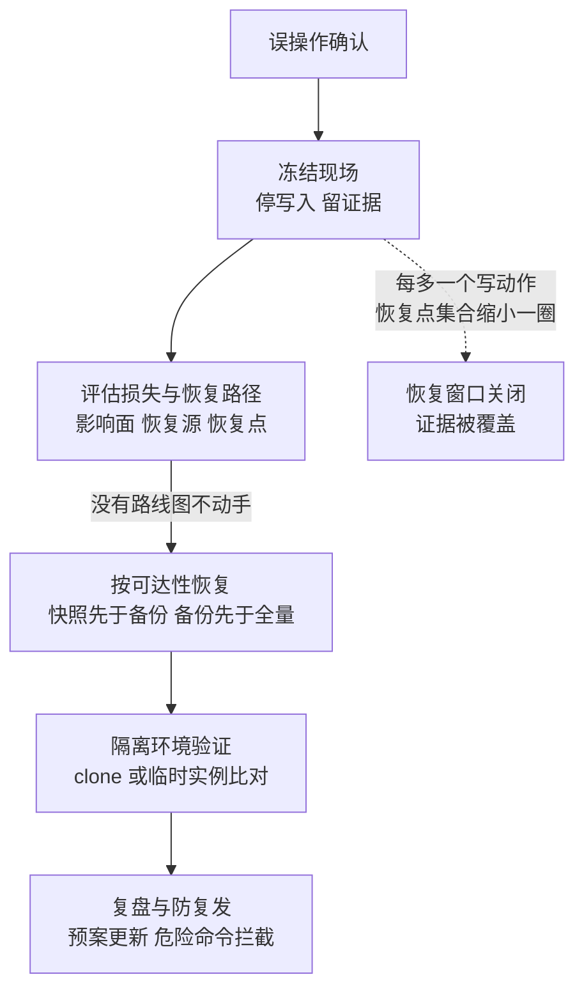
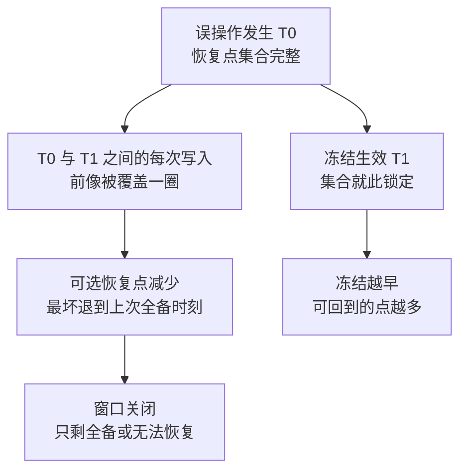

# 误操作的第一响应是冻结现场：恢复顺序与时间赛跑

> **要点**：**误删、误改、误提交的第一响应是冻结现场（停止写入、保留证据、不做任何"顺手修复"）**，**恢复动作按"可达性优先"排序**——Git 靠 reflog 找回悬空提交、文件系统靠快照与备份的时间边界、数据库靠 PITR（Point-In-Time Recovery，按时间点恢复：恢复到事故发生前的任一时刻）回到误操作前一秒；**恢复窗口随写入持续关闭，冻结每早一分钟，可选的恢复点就多一分钟**。

## 要解决的问题

**误操作事故的二次损害往往大于首次**：**误删表后慌忙重跑任务（把恢复需要的前像覆盖掉）、误提交后 force push 抹掉团队提交、rm -rf 后继续在同盘写入（数据块被复用）**——**恢复的可能性随每一次新写入衰减**。本库可靠性与运维域有备份与恢复的体系文（备份演练、时间边界）；本篇给**误操作发生后的标准动作序列**：**冻结、评估、恢复、复盘**，按场景给恢复工具的选择。

## 它是怎么做到的：四步动作序列

**第一步：冻结现场（停写入、留证据）**。误操作确认后立即：**停止受影响系统的写入（应用侧降级——主动牺牲部分功能或精度，保住核心链路——或摘流量，存储侧只读挂起）**、**保留操作证据**（shell history、审计日志、Git 侧 `git fsck --lost-found` 输出、操作时间点记录）——**冻结的纪律是"不做任何未被要求的修复动作"（不重跑、不重建、不 force push）**，**每多一个写动作，恢复点的集合就缩小一圈**。**冻结的授权**：**响应人是否有权停写入要预授权（事故时刻才找人批权限，窗口就关了，预案里写明冻结的触发条件与决策人）**。

冻结现场的实物形态是机房里的停用封条与维护模式标签：故障盘下线后插上「DO NOT REMOVE（删除操作） / 故障盘，待取证」的标签、存储卷切只读、控制台锁定——设备功能完好，只等处置决定：


*图源：Wikimedia Commons，Victor Grigas，CC BY-SA 3.0，https://commons.wikimedia.org/wiki/File:Wikimedia_Foundation_Servers-80.jpg。*

封锁带的含义正是冻结的全部纪律：**圈内器材与平时一样完好，但任何人都不得再碰**——数据现场被圈起来时同理，**每一次未经计划的触碰都在缩小后面所有人的选择余地**。

**第二步：评估损失与恢复路径（不动手，先画图）**。三个问题定恢复方案：**影响面**（哪些数据/提交/表受影响——读操作随便做，写操作全停）；**恢复源**（有什么可用——Git 的 reflog/远程分支、文件系统的快照、数据库的 WAL、备份、对象存储的版本控制）；**恢复点**（误操作前一秒的最近可用状态——**备份的新鲜度决定损失量**，本库"备份恢复是可验证的时间边界"的时间账）。**评估的输出是一张恢复路线图（从哪个源、到哪个点、经过哪些步骤、每步可回退吗）**——**没有路线图不动手**，逐步试验式恢复是二次损害的主要来源。

**第三步：按可达性恢复（从最便宜的源开始）**。Git 场景：**`git reflog` 列出 HEAD 的移动历史，误 reset/rebase 的提交都在（reflog 默认保留 90 天）**——`git reset --hard <reflog位置>` 或建新分支挂住（`git branch rescue <sha>`，先挂住再慢慢理）；已 force push 抹掉的提交在协作者的本地仓库与远程的 reflog 里还有（远程服务器的 `git fsck` 可挖悬空对象）。文件系统场景：**快照（某一时刻的完整只读副本）先于备份（恢复粒度细、速度快）**，**`rm` 后的同盘写入是最大威胁（应急动作含"立即停用该盘"）**。数据库场景：**PITR（基于基础备份 + WAL 重放到误操作前一秒）**——**恢复演练过的 PITR 才算数**（本库备份演练篇的时长预算），**没演练过的恢复流程在真事故时的耗时是演练的数倍**。

**第四步：复盘与防复发（冻结的那套纪律回写预案）**。**复盘回答三个问题：误操作为什么可能（权限？流程？工具的确认缺失？）、为什么响应慢（冻结授权？恢复源不明？）、怎么让同类操作不再发生（危险命令的别名拦截 `rm -i`/`git confirm` 类、高危操作的二次确认与审批、备份新鲜度提升）**——**防复发靠预案更新**（冻结动作、恢复路线图、联系人进文档），不靠口头保证。



四步的先后与铁律的挂钩位置：冻结守住恢复点集合（虚线是反面——跳过冻结直接修复，每一步写入都在缩小可选恢复点），评估产出路线图（没有路线图不动手写进边条件），恢复从可达性最细的源开始且先进隔离环境，复盘把教训回写预案。顺手的修复动作在图上没有通路，这正是动作序列要表达的全部。

「恢复点」在支持快照的表格式里有直接对应物：Apache Iceberg 每次写操作产生一个快照，快照链按时间排开，任何一个历史快照都可以被分支引用回去——误操作后的恢复点就是链上误操作前一刻的那个快照：


来源：Apache Iceberg 官方文档《Branching and Tagging》，Apache-2.0，https://iceberg.apache.org/docs/latest/branching/。**快照链越长，可回去的恢复点越多**——但清理过期快照的保留策略同样在这条链上生效，**冻结的价值正是让链上那个点在被清理前被引用住**。


## 读完这一段你能判断什么：恢复源的优先级

| 场景 | 第一恢复源 | 第二恢复源 | 时间窗口 |
| --- | --- | --- | --- |
| 误 reset / rebase | 本地 reflog | 协作者仓库 + 远程 fsck | reflog 过期前（默认 90 天） |
| 误 force push | 远程服务器的对象库 | 团队成员本地分支 | gc 触发前 |
| 误删文件 | 同文件系统快照 | 备份 + 停盘保数据块 | 写入复用前 |
| 误删表/库 | WAL + PITR | 最近全量备份 | 备份保留期内 |
| 误覆盖对象存储 | 版本控制旧版本 | 跨区副本 | 版本保留期内 |

表里「时间窗口」一列的机制底座，是恢复源记录操作的时刻与操作执行时刻的先后。Redis 的 AOF（Append Only File，追加式持久化日志）把「先记日志再执行」与「先执行再记日志」的差别画成了对照：**写前日志（如 MySQL——关系数据库）的 redo log（InnoDB 重做日志：记录物理修改、崩溃后重放保证持久性）在写入前先记，崩溃时已记录的操作可重放**；**AOF 选了写后日志——先执行写命令再记日志，好处是记进日志的命令必然执行成功、不阻塞当前写操作**，**代价是执行完还没记日志的窗口内崩溃，这条命令就丢了**。**恢复源的时间窗口宽窄，根子在这个记录时点的选择**：


*图源：[小林 coding《AOF 日志是怎么实现的》](https://www.xiaolincoding.com/redis/storage/aof.html)，原创图注明出处转载。*

**恢复顺序的原则**：**从"恢复粒度最细、副作用（操作对外部状态产生的额外影响）最小"的源开始（快照 → 增量 → 全量）**，**每步先在隔离环境验证（恢复出的 Git 仓库先 clone 一份检查，数据库先恢复到临时实例比对）**——**直接在产线恢复源上动手是最后手段**。


恢复窗口是连续量——**从误操作发生到冻结生效之间每多一次写入，能回到的恢复点就少一圈**：



冻结的价值可以直接折算成时间：T1 比 T0（第 0 层缓存）晚一分钟，恢复点集合就少一分钟的写入，这正是两分钟黄金动作清单要抢的东西。

**两分钟的黄金动作清单**（印在值班手册第一页）：停写入、记时间、`reflog`/`fsck` 留输出、找最近的快照与备份时间戳、呼叫备份负责人——**五件事十分钟内做完，恢复选项最大化**。

## 这套说法在哪儿会失效

三条边界防止防线走形。

**reflog 不进远程克隆**：**reflog 是本地引用日志，clone 不带过去**——**"提交只在被 reset 的本地"是最险的情形**（机器一坏全没了），**第一恢复动作里包含"先把悬空提交推到远程或打 tag 挂住"**。

**冻结有成本，按影响面分级**：**全量停写的代价高时按影响面分级冻结（误删的表级只读、误提交的分支锁定）**——**分级的依据在评估步，不在冻结步**（冻结先做最保守的，评估后再放宽，反向操作会丢数据）。

**恢复演练覆盖误操作场景**：常规演练测"机器坏了怎么恢复"，**误操作场景要单列（误删表的 PITR、误 reset 的 reflog 找回各演练一遍）**——**恢复源的可用性在演练中验证**，**文档里写的恢复步骤与实际不符是恢复失败的高频原因**。

## 怎么自己动手验证

可复现的验证路径：

1. reflog 找回演练：**强制 reset 掉一批提交后按手册恢复，预期十分钟内找回全部提交且无丢失**；
2. PITR 演练：**误删表后按预案做时间点恢复到误操作前，预期损失为零、耗时与演练基线（正常状态下的指标水平、用来对比异常）一致**；
3. 冻结演练：误操作注入后计时，**预期"停写入 + 留证据"两分钟内完成（黄金动作清单的可执行性验证）**；
4. 断言锚点：**冻结的预授权在预案里、恢复路线图模板存在（源/点/步骤/回退）、误操作场景进季度演练清单**——三件齐备，**误操作从慌乱现场变成按手册执行的标准响应**。

```text
冻结断言 = 停写留证先于一切修复
顺序断言 = 细粒度源优先隔离验证
演练断言 = 误操作场景定期实跑
```

误操作恢复的胜负手在响应速度与恢复源的新鲜度：**冻结保住窗口，评估选定路线，演练保证路线可行**——**四步动作序列把"手抖的一秒"与"损失的全部"之间的距离，变成一套可训练的流程**。

## 接着读哪几篇：恢复点与时间账的机制层

- [[工程知识/数据系统：在并发与故障中保存事实/可靠性与运维/备份恢复是可验证的时间边界.md]] —— 恢复点与时间账的机制层
- [[工程知识/数据系统：在并发与故障中保存事实/可靠性与运维/备份的价值由恢复演练来验证.md]] —— 恢复流程可信度的来源
- [[工程知识/软件构建：让变化可以理解、验证与交付/开发工具/Git操作先区分工作区、索引与历史.md]] —— reflog 与对象库的机制层
- [[工程知识/软件构建：让变化可以理解、验证与交付/开发工具/Linux调查先收集事实再改变状态.md]] —— 冻结与留证的动作纪律
