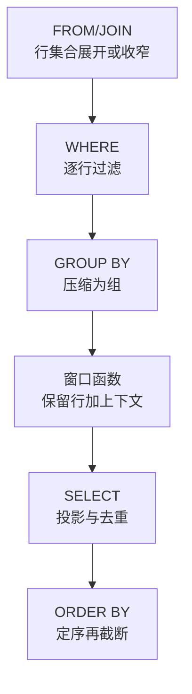
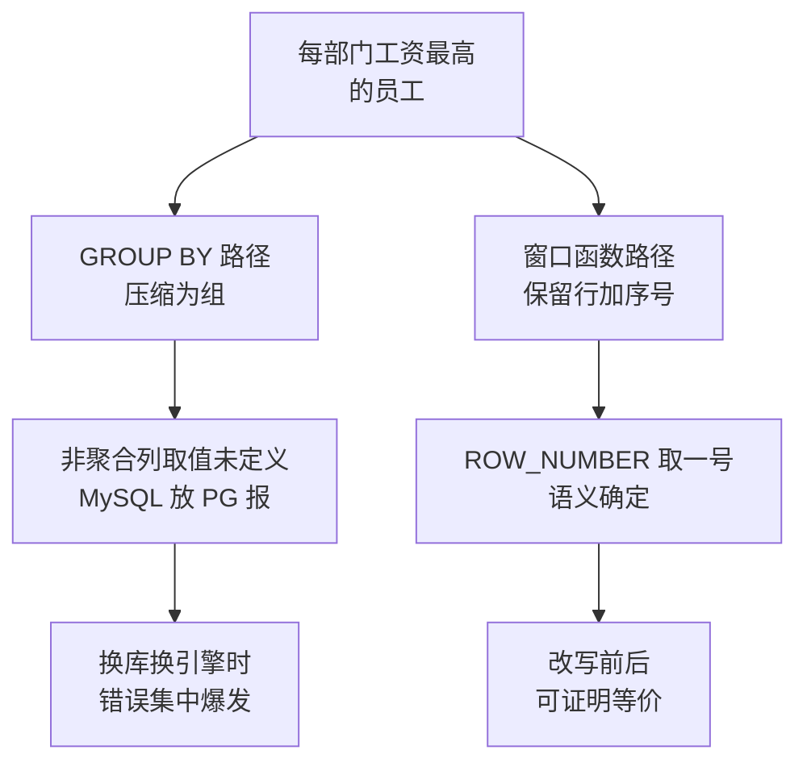

# SQL 语义由关系、集合和窗口共同决定

**读完这一篇，你能在写查询前先明确连接基数、NULL 和分页的语义，避免把「语义写错」的查询优化得更快**。**报表里少了一行、金额被放大一倍、翻页时看到重复数据，多数时候数据库没有算错——是你写的这条 SQL（Structured Query Language，用来描述「要哪些数据」的语言）被按另一种语义解释了**。

**报表中的一行少了、金额被放大或分页重复，多数时候数据库没有算错——连接基数、NULL（缺失或未知的值标记，参与比较与聚合时有独立规则）、窗口和排序语义没有写清楚，查询自然返回了另一种语义下的正确结果**。**先理解逻辑结果，再讨论索引和执行计划，才能避免把语义错误优化得更快**。

**SQL 可以想成一张点菜单：你写的是「要什么菜」，后厨（优化器）自己决定用什么顺序、用哪口锅做出来**。这个比方到「结果怎么算出来」这一步为止——菜单只管你要的菜，不管你用哪条路径做出来，而 SQL 的语义决定了**"菜是什么"**，优化器只决定"怎么做这道菜"，**两者一旦混淆，就会出现「我明明写了 ORDER BY，翻页还是乱」这类问题**。

## 先记住哪几句

| 维度 | 回答 |
| --- | --- |
| 要解决的问题 | 业务问题需要把关系数据转换成确定的集合、分组和序列结果，而查询表面顺序很容易掩盖 NULL、重复和连接基数。|
| 本质 | SQL 描述关系上的集合变换；逻辑语义决定结果，优化器再选择不同的物理执行路径。|
| 做法 | 先写出关系基数、NULL、时间和分页语义，再区分 WHERE/HAVING、GROUP BY/窗口、逻辑顺序/物理计划，并用参数化查询。|
| 效果与代价 | 结果更可解释，改写和优化有等价性依据；代价是需要显式处理三值逻辑、重复行、时区和执行计划差异。|
| 边界 | 执行计划改变性能而非应有语义，但隐式类型、非确定排序、并发更新和数据库方言会改变实际结果或观察时点。|
| 验证 | 用空值、重复、一对多、无匹配、边界日期、并发更新和大分页样本，比较结果断言、实际行数和 p95 延迟。|

**连接、过滤、分组、聚合、窗口、排序和分页各自改变行集合；NULL、重复行、三值逻辑和隐式类型会让「看起来合理」的查询产生不同结果**。

## 一条查询为什么会得到另一种结果

```text
FROM/JOIN（SQL 多表关联查询） -> WHERE -> GROUP BY -> HAVING
     -> WINDOW -> SELECT -> DISTINCT
     -> ORDER BY -> LIMIT/OFFSET
```

**这是语义理解的近似顺序，不是优化器必须采用的物理顺序。`LEFT JOIN`（左外连接，保留左表全部行、右表没匹配的地方填 NULL）后在 `WHERE` 过滤右表字段可能把它变成内连接；没有稳定 `ORDER BY` 的分页没有确定顺序；`LIMIT` 不是快照（某一时刻的完整只读副本）**。

链条的第一步 FROM/JOIN（SQL 多表关联查询）决定的就是行集合的基数，而不同连接类型保留哪些行、丢弃哪些行，用集合关系画出来最直观：


*SQL 连接类型的文氏图对照：内连接、左连接、右连接、全连接各自保留哪个集合的行（图源：CSDN 博客）*

*图源：Wikimedia Commons，作者 Arbeck，CC BY 3.0，https://commons.wikimedia.org/wiki/File:SQL_Joins.svg。内连接只留两表都有匹配的行，左外连接保留左表全部行并把右表缺失处补为 NULL，这个差别正是"一对多连接把明细放大"与"LEFT JOIN 被 WHERE 改写成内连接"两类错误的语义源头。*



**「每一步把行集合变成了什么」：FROM 定起点，WHERE 把行过滤掉一批，GROUP BY 把行压缩成组，窗口函数在保留行的前提下附加上下文，SELECT 投影列，ORDER BY 与 LIMIT（SQL 限制返回行数的关键字）最后定顺序截断**。**理解链条之后，三个常见错误各有出处——WHERE 过滤右表字段让 LEFT（JOIN 的左表方向） JOIN 退化成内连接（B 步吃掉了 A 步保留的行）、无稳定排序的分页翻页重复或丢行（F 步没定顺序就截断）、分组列与投影列不一致的取值由实现决定（C 与 E 两步语义断裂）**。

## 什么时候该盯住这些语义

集合语义不止连接一种：`INTERSECT`（交集，两查询结果都有的行）、`UNION`（并集）与 `EXCEPT`（差集）把两条查询的结果集再做一次集合运算，SQL 的交集与集合论里的 A∩B 是同一件事，只有**同时出现在两个结果集里的行**才保留：


*图源：同上（Wikimedia Commons），「Venn0001.svg」。*

**报表与对账场景里，连接基数错一档金额就翻倍：一对多连接未先聚合，明细数直接放大；`NOT IN` 遇 NULL 少返回一半行（上面案例回流的实录形态）**。**分页场景里，用户反馈「翻页看到重复行」，根因多为排序键不唯一——加唯一列进 ORDER BY 即可修复**。**跨库迁移场景里，MySQL（开源关系型数据库）对 GROUP BY 非聚合列宽松（值由实现决定）、PostgreSQL 严格报错，同一句 SQL 的行为差异要在迁移前按方言核对**。**排查顺序按链走：行数对不上先查 JOIN 基数，值对不上先查 NULL 与聚合边界，顺序不对先查 ORDER BY 稳定性**。

## 哪些写法会让结果悄悄变掉

- **NULL 代表未知/缺失，不等于空字符串或零；`NOT IN` 遇 NULL 尤其容易产生意外**。
- **聚合前的重复行来自连接基数；先确认一对多关系，再计算金额/数量**。
- **窗口函数保留行并增加上下文，`GROUP BY` 则压缩集合；两者不能互换**。
- **业务时间、时区、精度和舍入必须显式，不能依赖数据库/语言默认**。
- **参数化查询保护值，不会自动使动态表名、排序字段或权限过滤安全**。

## 同一个需求为什么两种写法结果不同

同一个「每个部门工资最高的员工」，走 GROUP BY 与走窗口函数分出两条语义路径，分岔点就在行是否被压缩：



**两条路径的差异在语义是否确定，性能差异反倒次要，所以改写前先证明结果等价，再谈谁跑得更快**。

关系代数层面这两条路径的差别一眼可见：聚合把一组行压成一行，窗口保留原来的行数、只给每一行附加上下文：


*图源：同上（Wikimedia Commons），作者 Kowarschick。*

**落到具体数据上，两条路径的差别更直观——同一个 4 行的员工表，GROUP BY 把 4 行压成 2 行汇总，`SUM(...) OVER (PARTITION BY dept)` 保留全部 4 行、把分区小计附加到每一行**：


*图源：本库依据 Varsity Tutors《Windowed Aggregates》一课的视觉解释重绘（partition 分区，dept_total 部门小计）。右侧输出是输入的严格超集——明细列一列不少，多的只是附加列；GROUP BY 则把明细压没了。这就是"两者不能互换"在数据流上的样子。*

**窗口函数与 GROUP BY 的语义混用是慢查询与错值的高发来源——"每个部门工资最高的员工"用 GROUP BY 写会把非聚合列的取值交给实现决定（MySQL 允许但语义未定义，PostgreSQL 直接报错），用窗口函数写（`ROW_NUMBER() OVER (PARTITION BY dept ORDER BY salary DESC)` 取 1 号）语义完全确定**。这类差异在 [[工程知识/数据系统：在并发与故障中保存事实/数据建模与SQL/关系模型用约束表达业务事实.md]] 的约束视角下是同一件事：**语义未定义的写法就是没写约束，错误在换库、升级、换执行引擎时集中爆发**。

## 怎么自己动手验证

**查询改写要与结果等价对账——预写改写前后在空值与重复样本上返回相同行集，结果不一致时与预期对不上，性能对比就不成立**。

**为查询准备空值、重复、无匹配、多匹配、边界日期、并发更新和大分页样本；同时比较结果断言、执行计划、实际行数和 p95 延迟。查询改写后先证明结果等价，再比较性能**。

关系：[[工程知识/数据系统：在并发与故障中保存事实/查询与索引/一条SQL如何穿过优化器与存储引擎]] · [[工程知识/数据系统：在并发与故障中保存事实/数据建模与SQL/关系模型用约束表达业务事实]]
