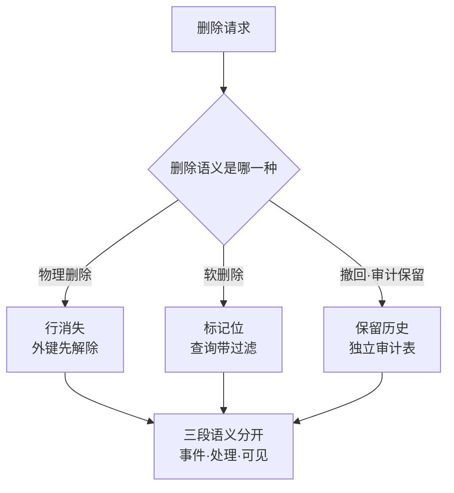
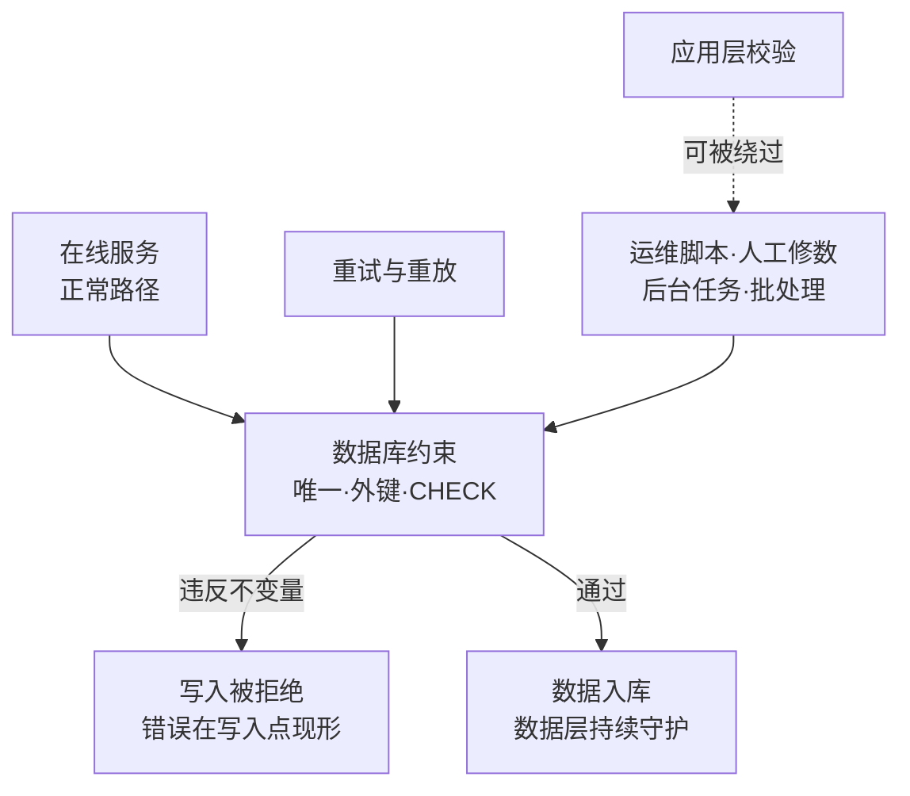

# 关系模型用约束表达业务事实

**业务规则只写在应用代码里，换一条写入路径就会被绕过；写进约束，则由数据层每次都守住**。读完这篇你能把不允许的状态翻译成主键、外键、唯一和检查约束，也能判断哪些跨服务规则约束管不了。

## 先记住哪几句

| 维度 | 回答 |
| --- | --- |
| 要解决的问题 | 并发请求和多个代码路径会共同修改数据，若业务不变量只写在应用约定里，重复、孤儿和非法状态就会悄悄产生。|
| 本质 | 把实体身份、关系基数、允许状态和不可违反的不变量编码为 schema 与约束，让事实由数据层持续守护。|
| 做法 | 先写业务事实和生命周期，再决定主键、外键、唯一、非空、检查、版本和删除语义，最后按访问模式设计物理结构。|
| 效果与代价 | 降低重复事实和并发竞态，错误更早暴露；代价是迁移、写入校验、跨系统规则和反规范化同步成本。|
| 边界 | 约束不能表达所有外部 API、时间和跨服务规则；JSON 或应用逻辑不能自动获得数据库约束的原子性。|
| 验证 | 用重复请求、并发写入、部分失败、迁移中读写和删除/恢复场景，检查不变量、状态转移和约束错误。|

读完这一篇，你能判断一条业务规则该交给数据库守卫，还是只能留在代码里，以及两者的代价各是什么。

**数据库里的约束（主键、外键、唯一、非空、检查）是把「什么算合法数据」写成数据库自己执行、任何写入路径都无法绕过的规则**。
数据建模（把业务写成表结构这件事）的第一件事是明确实体、关系、基数、生命周期和不变量，表名与列名只是这些事实的书写形式。主键、外键、唯一、非空、检查和版本字段把一部分业务事实交给数据库守护，减少并发代码中的隐含假设。

打个日常的比方：这些规则像小区的门禁系统——每个人进门都必须刷的那道闸，而不是**贴在门口给自觉的人看的告示**。

这个比喻到「谁来执行」这一步为止：门禁只管「能不能进」，数据库约束也只管「这行数据合不合法」，至于业务上更复杂的规则（比如积分够不够、审批走没走完），门禁和约束都管不了，那要靠各自的业务代码。

如果「唯一」「必须存在」或「不能为负」只写在某个服务函数里，**后台任务、脚本和重试路径就可能绕过它**；**约束的价值在于让所有写入者面对同一事实边界**。

例如「每个用户只能有一个生效订阅」若只靠应用先查再插入，**两个并发请求都可能看到空结果**；**唯一约束或带版本的条件写入，才把这个不变量放到所有写入路径都能观察到的边界**。这里的主键、外键、唯一、非空、检查和版本字段，就是关系模型这套理论落到具体数据库上的五个零件，本文下面逐个拆开它们各自管什么、不管什么。

## 建模为什么应该先写事实，再画表

关系模型把业务事实写成三样东西：表的列（属性）、带下划线的键（身份）、以及一个表里的键出现在另一个表里（关系）。下面的示意图把这三样放在一起——ID 是主键，加粗的 Name 是唯一候选键，CustomerID 是外键，它指回另一个表的 ID：


*关系模型的基本术语对照：关系（表）、关系模式（表头）、元组（行）、属性（列）。图源：CSDN 博客。*

*图源：Wikimedia Commons，美国交通部原作矢量化，公有领域，https://commons.wikimedia.org/wiki/File:Relational_Model.svg。"业务事实"在关系模型里就是这些带标注的键：哪一列唯一确定一行、哪一列必须指向另一张表里存在的行。约束（PRIMARY KEY、UNIQUE、FOREIGN KEY（外键：引用另一张表主键的约束）不过是把这些标注交给数据库执行。*

1. 写出业务事实和允许的状态，而不是先画表。
2. 区分实体身份、属性、事件和派生值；决定谁是事实来源。
3. 定义一对一、一对多、多对多、可选关系和删除语义。
4. 用约束表达不可违反的不变量，用应用逻辑表达需要外部信息的规则。
5. 按查询、写入、保留、审计和迁移需求设计物理结构。

「先写事实再画表」在建模工具里的实物现场：MySQL Workbench（开源关系型数据库 MySQL 官方的建模工具） 把模型画成 EER 图（Enhanced Entity-Relationship，增强实体联系图），表、列、类型在图上定义一次，DDL（Data Definition Language，建表改表类 SQL）由工具正向推导，应用层不再手写建表脚本：


*图：MySQL Workbench 官方入门教程的 EER Diagram 界面。左侧 Catalog Tree 是模型的目录（dvd_collection > Tables > movies），中央 Diagram 画布上的 movies 表展示三列定义（movie_id INT 主键自增、title VARCHAR(45)、release_date DATE）——这就是第 1 步「写出业务事实」的落笔处，第 5 步的物理结构由 Forward Engineer 从模型推导。*

*图源：MySQL 官方文档，[MySQL Workbench Tutorial: Creating a Model](https://dev.mysql.com/doc/workbench/en/wb-getting-started-tutorial-creating-a-model.html)。*

**规范化减少更新异常和重复事实；反规范化可以换取读取路径，但必须说明同步、重建和陈旧边界**。JSON（一种可以嵌套的文本数据格式，字段随数据走，不适合当核心字段的容器）与文档字段适合变化或整体读取的结构，**不应逃避核心字段的约束和索引设计**。


来源：[小林coding《索引常见面试题》](https://www.xiaolincoding.com/mysql/index/index_interview.html)


## 删除为什么不止一种，时间字段该怎么分开记

「删除」有四种并列语义，选错一种，后面的时间字段与审计边界就跟着错：



这四种形态决定的不只是删不删，还包括时间字段怎么记：**一个混合了事件时间与处理时间的 updated_at（更新时间字段），撑不起其中任何一种**。

**状态表要区分当前投影与不可变事件**；「删除」可能是物理删除、软删除、撤回或保留审计。**时间字段要说明事件时间、处理时间和可见时间，不能用一个 `updated_at` 混合所有语义**。

## 动手跑一遍会看到什么：让数据库替你拒绝坏数据

DDL 先写下约束与事后补数据的差别：

```sql
CREATE TABLE orders (
 id      BIGINT PRIMARY KEY,
 external_id  VARCHAR(64) NOT NULL,
 user_id    BIGINT NOT NULL REFERENCES users(id),  -- 业务事实：订单必有用户
 amount_cents BIGINT NOT NULL CHECK (amount_cents > 0), -- 业务事实：金额为正
 status    VARCHAR(16) NOT NULL CHECK (status IN ('created','paid','refunded')),
 UNIQUE (external_id)                  -- 业务事实：外部单号不重复
);

-- 写入方 bug 造成重复消息 → 第二条被 UNIQUE 拒绝，脏数据进不来
-- 上游把负数金额传下来 → CHECK 拒绝，错误在写入点现形而非月结时
-- 应用层校验可以被绕过（新脚本、人工修复、上游变更），数据库约束不能
```

跑一遍的收获：**约束是业务事实的机器可执行形式——每条 CHECK、UNIQUE、FOREIGN KEY 都是一句"这永远成立"的断言，断言越全，能漏进来的坏数据越少**。代价是**写入路径多一次校验**（微秒级），以及约束变更要走 DDL 流程——**这两笔开销买的是"所有写入路径共享同一套防线"**。



「约束防线覆盖多少条写入路径」：在线服务、重试重放、脚本修数、后台任务四条路径都汇进数据库约束这道闸，违反不变量的写入在任何一条路径上都被拒绝；应用层校验只覆盖走应用的那条路（虚线），新脚本与人工修数天然绕过它。这正是「所有写入者面对同一事实边界」的图形表达。

## 真实案例里发生了什么：约束缺位的实录

约束失守的实录在缺陷域有直接对应：[[工程知识/缺陷分析：从个案到体系/正确性/案例三十九：身份在改写中丢失——RLS 子查询与视图 DEFAULT 的静默失真]] 里按位置写入列的 INSERT 之所以能把身份写错列，正是因为该路径上没有 NOT NULL 与外键拦住语义错误——**约束是最后防线，缺了它，上游每一层的小 bug 都能直达数据**。与 [[工程知识/数据系统：在并发与故障中保存事实/查询与索引/列式存储把扫描与压缩交给分析路径]] 的衔接：分析型库（列存、数仓）对约束的支持弱于事务库，**约束策略要按库分治——事务库上约束全开，分析库上靠"入库前校验任务 + 行数与主键对账"补位**（见 [[工程知识/数据系统：在并发与故障中保存事实/数据治理/数据质量与血缘让指标可以被解释]] 的质量规则）。

## 怎么自己动手验证

约束表达要与违规写入对账——**预写并发插入同一业务键只应成功一次、删除仍被引用的父记录应被拒绝，实测放行，与预期对不上**。

用并发写入、重复请求、部分失败、迁移中读写和删除/恢复测试约束。对每个模型写出允许状态转移、唯一身份、外键生命周期和查询必须满足的断言，并用数据库约束或属性测试持续验证。

最小实验：并发插入同一业务键、删除仍被引用的父记录、迁移中读取旧字段，并分别观察无约束、应用校验和数据库约束的结果。记录失败类型、提交顺序和重试行为，确认约束错误能被调用方区分并安全处理。

关系：[[工程知识/数据系统：在并发与故障中保存事实/数据建模与SQL/SQL语义由关系、集合和窗口共同决定]] · [[工程知识/数据系统：在并发与故障中保存事实/事务与存储/事务隔离决定并发读写能观察到什么]]
- [[工程知识/数据系统：在并发与故障中保存事实/数据建模与SQL/消失的数值：浮点格式与精度陷阱.md]] —— 金额字段的 decimal 约定与约束表达
