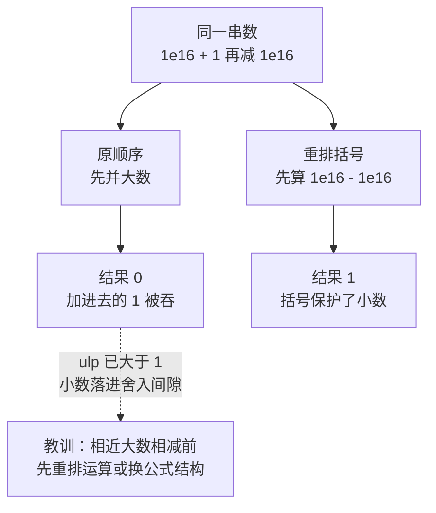
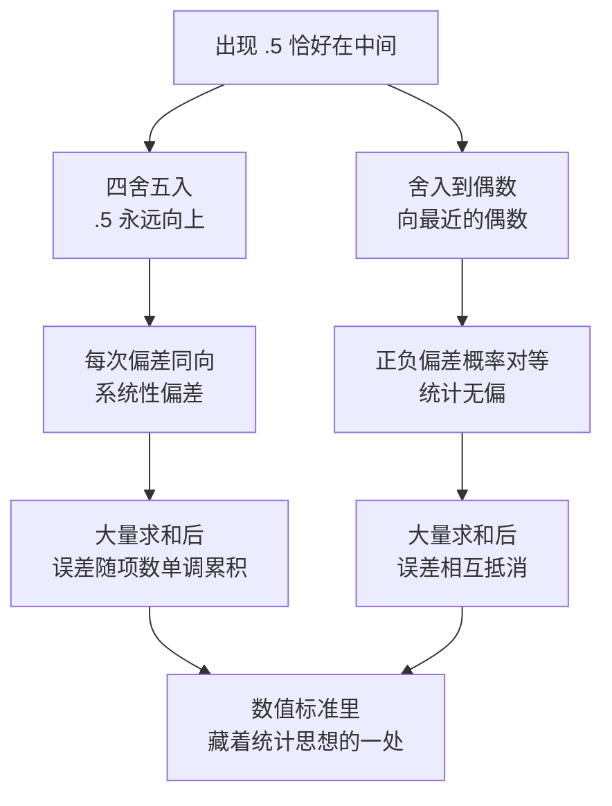

# 消失的数值：浮点格式与精度陷阱

## 要解决的问题

浮点要解决的问题，是**用有限位数表示无限精度的实数**。IEEE 754 标准的答案是把数分成符号、指数、尾数，用指数浮动小数点位置——能表示的数值范围极大（double 从 1e-308 到 1e308），但每个数只有 52 位尾数（约 15-16 位十进制有效数字）。

这带来两类工程陷阱：**表示误差（0.1 在二进制里是无限循环小数，存不精确）与运算误差累积（每次运算引入舍入，误差随运算链放大）。钱的账目、比例的累加、两个"相等"的数比较——浮点在这些场景的失真是静默的：不报错、不异常，值就是悄悄不对。**

静默失真的检测靠对账与不变量而不是报错[[工程知识/缺陷分析：从个案到体系/正确性/静默失真的检测靠对账与不变量而不是报错.md]]把静默失真列为缺陷分析的核心形态，本文写浮点这个最古老、最普遍的静默失真源。

## 误差从哪来：格式与运算的机制

**先把形状说成一件事：浮点数像用一把刻度间距会变的尺子量东西——量小物件时刻度密（精度高），量大物件时刻度被拉宽（精度低），但尺子上的刻度总数（52 位尾数，约 15-16 位十进制有效数字）始终只有那么多。0.1 这样在二进制里写不尽的数，就像用毫米尺去量一个恰好落在两刻度中间的长度，只能取最近刻度——尺子没有坏，刻度天然就这么密。**这个比喻到"取最近刻度"为止——**尺子的误差每次测量独立，浮点的误差却会沿运算链传递放大，两次大数相减能把误差突然放大几个量级（灾难性抵消），这是比喻之外要单独防的东西。**

**格式：以 double 为例**。1 位符号 + 11 位指数 + 52 位尾数。**数值 = ±1.尾数 × 2^指数。**三个特殊值：0（尾数指数全零）、无穷（溢出的结果）、NaN（0/0、inf-inf 等未定义运算）。**NaN 的特性：不等于任何值包括自己（x != x 是 NaN 的经典判据），且 NaN 参与的运算结果仍是 NaN（传染性）——一条脏数据毒化整条聚合流水线，SUM 出 NaN 是数据质量问题不是算术问题。**

位布局与可表示精度是同一件事的两面，图上把单双精度的差距量了出来：


*图示：单精度与双精度的可表示精度随数值量级的变化，横轴为浮点数值，纵轴为最小可分辨间隔，蓝线为单精度（32 位）、红线为双精度（64 位）。图源：Wikimedia Commons《Precision of IEEE754 Floating Point Values.svg》，CC BY-SA 4.0，https://commons.wikimedia.org/wiki/File:Precision_of_IEEE754_Floating_Point_Values.svg。*
同一数值位置两条线的纵向距离，就是「float64 够用、float32 在累加里不够用」的量化依据：精度随数值增大按比例下降，两条线永远平行，差距来自尾数位数。

**表示误差：十进制小数的二进制宿命**。**0.1 的二进制是无限循环，存进 52 位尾数必然截断。0.1 + 0.2 = 0.30000000000000004（不是 0.3）。**这个误差是确定性的（同格式同值必同结果），但**跨语言跨平台比较（JSON 序列化、跨库传输）时，舍入策略差异让"同值"变"不同值"。**

**运算误差：累积与灾难性抵消**。**两个大数相近相减，有效位大量丢失（灾难性抵消，catastrophic cancellation）：1e16 + 1 - 1e16 = 0（1 被吞），因为 1e16 的 ulp（unit in the last place）已经大于 1。**累加的顺序也影响结果：**浮点加法不满足结合律，百万个数求和，顺序不同结果在尾数上不同。**Kahan 求和（补偿求和）用一个同宽度的补偿变量累计被丢掉的低位，下一轮再加回去，**把误差从 O(n) 压到 O(1)。**

误差随累加项数的增长差异可以实测出来：朴素求和的相对误差随项数 N 单调爬升，Kahan 补偿求和全程贴在机器精度水平线上不再增长：


*图源：PHYS 305 Computational Physics 课程实验（ua-2025q1-phys305.github.io），0.1 累加实验的相对误差曲线，课程页公开教学材料。*



「同一串数为什么两种括号算出不同结果」：**先并大数再算，加进去的 1 落进 1e16 的舍入间隙里消失；先让两个相等的大数相减，括号在小数进位之前保护了它。**两种结果都来自格式按规则执行的确定性行为——**防御手段在运算顺序与公式结构上，不在换更贵的硬件上。**

**工程对策的分野**。**钱：绝不用浮点，用定点整数（以"分"为单位）或十进制定点（decimal 类型，数据库的 DECIMAL）。**科学计算：**接受误差但控制它（误差分析、Kahan、先小后大排序求和）。**比较：**不用 ==，用容差比较（fabs(a-b) < eps），eps 的选择要按量纲（绝对容差对大数失效，相对容差对零附近失效，混合容差才稳）。**

## 这套格式怎么来的、付什么价：背景与代价

精度损失是累积的，而累积发生在每一趟往返里。用户态（普通程序运行的低权限受限状态）与内核态（内核代码运行的高权限状态）之间的每一趟切换都在搬运数据，搬得越多，出问题的机会越多。

上文的精度对比图量出的是单双精度的差距，单精度自己的 32 个位怎么切分，Oracle 官方数值计算指南把布局画了出来——最高 1 位符号 s，中间 8 位偏置指数 e[30:23]，低 23 位尾数 f[22:0]，隐含前导 1 不占位。0.1 存不进去的原因就在这份布局里：23 位尾数装不下 0.1 的无限循环二进制展开，必然在某个位截断：

![IEEE 754 单精度存储格式：最高位符号 s、中间 8 位偏置指数 e[30:23]、低 23 位尾数 f[22:0]](/static/figures/ieee754-bit-layout.png)

*图源：Oracle《数值计算指南》图 2-1 单精度存储格式，https://docs.oracle.com/cd/E19059-01/stud.10/819-1615/819-1615.pdf。*


浮点格式标准化（IEEE 754，1985）之前的黑暗年代——每厂商一套格式，同一段代码在不同机器上结果不同，数值计算的可移植性为零。**Kahan（格式的核心贡献者）的设计目标就是"结果可预测"：舍入规则统一（round to nearest even 与 round half to even 同义：恰在中间时向偶数舍入）、运算结果确定性、异常行为标准化。这个标准如此成功，以至于 40 年没换根基（2008/2019 修订只加类型不改语义）。**

**舍入到偶数（round half to even）**。**0.5 恰好在中间时舍到偶数（2.5 → 2），不是四舍五入的"五入"。**理由：**对大量数据的求和，四舍五入有系统性偏差（.5 永远向上），舍到偶数让正负偏差概率对等，统计意义上无偏。这个细节体现了数值标准里藏着的统计思想。**代价：**浮点的速度红利建立在"硬件直接执行"上，decimal 定点（钱的正解）没有这个红利——软件模拟或协处理器，慢一到两个数量级。金额列改 decimal 后的报表变慢，是格式选择的真实代价，容量与索引设计要同步重估。**

## 这套说法在哪儿会失效

- **double 不是 double 精度的一切**。**15-16 位有效数字的边界：身份证号（18 位）存 double 会吞尾数，大整数（>2^53）在 double 里不精确。**整数用整数类型，**越过 2^53 的计数（雪花 ID、时间戳纳秒）用字符串或 64 位整数（且 JSON 序列化要防 JS 的 Number 陷阱——JS 的 number 就是 double，64 位整数过 JSON 会失真）。**
- **跨语言的浮点传输最容易出问题**。JSON 规范不区分整数与浮点，1.0 与 1 的传输后表示因解析器而异；**JSON 这类文本编码路径上，同一个数值经不同语言序列化（把内存对象转成可存储或传输的字节格式的过程）再解析，尾数可能变化。**跨系统数值对账（两边各自 SUM 对不上）**先查传输路径的精度损失，再查存储格式，最后才是业务逻辑。**
- **NaN 与 NULL 在聚合里的不同毒化方式**。**SQL 的 SUM 遇 NULL 跳过（不传染），遇 NaN 结果为 NaN。**数据管道里 NaN 的来源（脏数据、除零、解析失败）要单独监控，**聚合前的 NaN 筛查（isnan 检查）是标准防线**，见静默失真（上文链接）的对账思路。
- **不要用浮点做标识与排序键**。**浮点等值比较不可靠（见上），排序键用浮点则边界记录（相等的键）在分页时的归属不稳定。分页与去重键用整数或字符串，浮点只做值不做键。**

两种舍入规则的差别不在单次结果，在累加之后：



单看一次，四舍五入给 3 反而更符合直觉；但**求和从来不是只做一次，同向偏差会在项数增长时单调累积。把规则改成向偶数，等于用"单次结果可能反直觉"换取"累加后不漂移"。**

两种格式的相对精度差多少，可以直接量出来。下面这张图横轴是数值量级、纵轴是最小可分辨的相对间隔，binary32 那条线与 binary64 那条线平行下移，纵向间距就是 23 位尾数与 52 位尾数之间的差；虚线标出的是 7 位、8 位、16 位、17 位十进制有效数字对应的水平，双精度全程贴在 16 位与 17 位两条线之间，单精度在 7 位那条线附近：


*图示：单精度与双精度的相对精度随数值量级变化的实测曲线，锯齿的每个下降段对应指数加一、每个跳回点对应对齐到 2 的幂，两条线的纵向间距来自尾数位数的差异。图源：Wikimedia Commons《IEEE 754 relative precision.svg》，CC BY-SA 4.0，https://commons.wikimedia.org/wiki/File:IEEE_754_relative_precision.svg。*

## 怎么自己动手验证

- **表示误差复现：`print(0.1 + 0.2 == 0.3)` 预期 False（Python/JS/C 同样），`print(0.1 + 0.2)` 预期 0.30000000000000004。跨语言跑同一实验（Python、JS、Go），预期值一致（IEEE 754 的确定性红利）；不一致则查某语言是否用了扩展精度（x87 的 80 位中间值，历史坑）。**
- **灾难性抵消实测：`(1e16 + 1) - 1e16` 预期 0 而不是 1；对照组 `1 + (1e16 - 1e16)` 重排（布局或尺寸变化触发重新计算排版）括号后预期 1。一组对照实验展示"运算顺序影响结果"与"大数吞小数"两个陷阱。**
- **Kahan 求和对照：百万个 0.1 相加，朴素求和预期误差累积（结果与 100000 的差在 1e-10 量级），Kahan 求和预期误差压到 1e-13 以下。差值即补偿算法的价值证据。**

## 误差的账怎么算：可运行示例与案例回流

```text
二进制浮点表示不了 0.1 的推演（通用形态）：

  0.1 + 0.2 = 0.30000000000000004（二进制无法精确表示十分之一）
  金额用 float：10000 笔 0.1 累加 → 1000.0000000000001 级别的偏差
    对账差异在分位上放大：百万笔交易累计偏差可达数元
  0.1 × 3 = 0.30000000000000004 ≠ 0.3 → 等值比较恒失败

  正确姿势的账：
    金额：整数分存储（100 分）或十进制类型（DECIMAL/BigDecimal）
    累加：Kahan 补偿求和（误差从 O(n·ε) 降到 O(ε)）
    比较：容差比较 |a-b| < 1e-9，绝不用 ==
    科学计算：float64 够用（相对误差 1e-16），但要防灾难性抵消
      （相近数相减丢有效位：1.0000001 - 1.0 只剩 1 位有效数字）
```

**float 记账的实录——营销系统用 float 累加用户返现，月底对账差三百多元（单笔误差微小但亿级累加显形）；改整数分后对账归零。等值比较的实录——数据管道用 `==` 比对两次计算的指标，偶发不一致告警刷屏（浮点噪声），改容差比较后告警归真；同类陷阱还有 SQL 里 `WHERE price = 0.1` 查不到行（字段是 float，字面量 0.1 对应到不同的二进制近似值）。灾难性抵消的实录——风控（识别并拦截欺诈与异常行为的风险控制）公式里两个相近大数相减，结果波动放大千倍，数值不稳的指标误导策略调参；改公式结构（先减后乘）规避。**精度问题的源头在格式选择，见 [[工程知识/数据系统：在并发与故障中保存事实/数据建模与SQL/关系模型用约束表达业务事实.md]]（字段类型是建模决策）。

## 接着读哪几篇：静默失真的检测体系

- [[工程知识/缺陷分析：从个案到体系/正确性/静默失真的检测靠对账与不变量而不是报错.md]] —— 静默失真的检测体系，浮点是其一
- [[工程知识/性能工程：从用户等待到资源瓶颈/处理器与内存/ECC内存把单比特错误挡在报告之前.md]] —— 硬件位翻转与数值精度的两种"数值不实"
- [[工程知识/数据系统：在并发与故障中保存事实/数据建模与SQL/关系模型用约束表达业务事实.md]] —— 金额字段的 decimal 约定与约束表达
