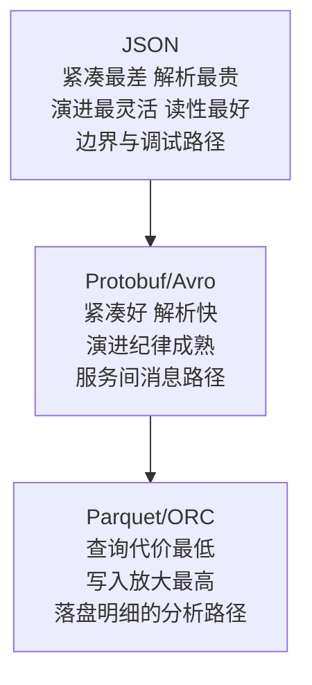

# 编码与演进的三角权衡：紧凑、写入放大与查询代价

> **要点**：**数据编码在紧凑、写入放大、查询代价三角里取舍**，**模式演进的前后兼容决定升级路径的形状**——**按数据的读写寿命选编码，按演进方向选兼容方向，两问定了编码选择就从推理变成核对**。

## 要解决的问题与本质：编码问题为什么存在

**内存里的对象与哈希表这类数据结构，与磁盘字节、网络字节之间存在一道翻译**：序列化（把内存对象转成可存储或传输的字节格式的过程）。这道翻译带来一个待解决的问题：**三个目标互相冲突**——**更紧凑的字节**（省存储与带宽）通常要求**更复杂的解码**（查询时逐字段还原，CPU 代价高）或**更重的编码**（写路径要计算压缩与字典）；**更快的查询**（列存裁剪）通常要求**更大的写入放大**（字典、索引块、统计信息都要在写时构建）。

本库性能工程域"存储 I/O 性能取决于访问模式、队列与持久化语义"讲过访问模式决定 I/O 形态；本篇把"模式"深入到编码层：**数据的读写寿命（写一次读多次，还是持续更新）决定哪个角值得付出**。

本质层面，编码选择是**数据寿命的选择**：**行存把一行的全部字段放在一起，写路径短（一次追加），读宽行快（一页取整行），适合持续更新的事务负载**；**列存把一列的全部值放在一起，读窄列快（只碰需要的列，压缩率高），写路径重（一行分散写入多个列块），适合写一次读多列子集的分析负载**。**没有全场景最优编码，只有与访问模式匹配的编码**。

## 它是怎么做到的：三种编码形态的取舍结构

**自描述文本（JSON）**：模式内嵌在数据里，可读性与演进灵活性最好（加字段不改 schema），紧凑度最差（字段名重复存储）、解析代价最高。**适合边界（对外 API、调试输出）、不适合海量内部数据路径**。

**二进制带 schema 的编码**：Avro（带 schema 的二进制序列化格式）与 Protobuf（Google 的二进制序列化格式，按字段编号编码）**把字段以编号或顺序编码，字节占用与解析开销比 JSON 明显下降**。**模式演进规则是这类编码最重要的部分**：**Avro 按字段顺序 + 读写双方 schema 相互协调，加字段必须给默认值或只加在读方**；Protobuf 按字段编号，**编号一经使用永不复用**（复用会让旧数据的新解释错位）。前后兼容的判定：**新代码读旧数据（向前兼容）与旧代码读新数据（向后兼容）各自要求不同的演进纪律**——**只加字段 + 不复用编号 + 默认值兜底，能同时满足两个方向**。

**列存（Parquet/ORC 等列式存储格式）**：按列组织 + 每列块编码（字典、RLE、位打包）+ 嵌套结构支持。**查询代价最低（谓词下推、列裁剪、压缩后扫描的字节数骤减），写入放大最高（写一行要更新多个列块与统计）**。**列存的演进纪律在 schema 演进之上多一层：列的增删要与统计元数据一致**。列存的物理布局在官方文档里是明文的：一个文件由 M 个行组拼成，每个行组内按列切片（Column Chunk）连续存放，文件末尾是 File Metadata 与 magic number——"一行分散写入多个列块"的写放大（实际写入量是逻辑写入量的多倍）来源就摆在这个结构里：


*图源：Apache Parquet 官方文档《File Format》布局段逐行转录渲染，https://parquet.apache.org/docs/file-format/（Apache-2.0）。同一行的 N 个字段被拆进 M 个行组的 N 个列块——**「写一行要更新多处」的结构性来源；读时只碰需要的列块，正是列裁剪省 IO 的原因**。*

三者的取舍落在路径分工上，不需要在三个角里挑一个：**服务间消息用 Protobuf，取其紧凑与成熟的演进规则**；**写入磁盘的明细用 Parquet，对分析查询友好**；**边界与调试用 JSON，可读性优先**。**同一数据在不同路径换编码，schema 的单一事实源要独立管理**，**这正是 schema registry 承担的角色，否则多形态漂移成对账灾难**。



「三种编码各站在三角的哪个角、各自被哪条路径用」：**JSON 用紧凑度换可读与演进灵活，Protobuf 在紧凑与解析速度上取胜但要求演进纪律，Parquet 把查询代价压到最低而把代价挪到写路径**。右侧三条路径是分工结论的来历——**同一个系统里三种编码并存属于常态，schema 的单一事实源独立管理才能防止多形态漂移**。

「编号一经使用永不复用」的实物原型是里耶秦简的物资簿：**每一简的格式是"物名 + 数量 + 年月"，简上的刻齿与笔画一旦刻下就不再改刻**——**后来废掉的条目只能整简削去重写（字段下线走宽限期），占着的简号不能腾给新条目（编号不复用），否则旧账对不上新账**：


*图源：Wikimedia Commons，作者 Gary Todd，CC0，https://commons.wikimedia.org/wiki/File:Qin_Bamboo_Slips_(10160678273).jpg。*

Protobuf 的字段编号与秦简的简号是同一条纪律：**旧数据（已入档的简）永远按原编号解读，新数据复用旧号等于把新物产记到旧物产的账目上**——**三步演进流程（新增字段、停写旧字段、下线旧字段）就是"另简新记、旧简留档、到期销毁"的档案纪律**。

## 读完这一段你能判断什么：两个问题的决策顺序

**第一问：数据的读写寿命是什么？** **写多读少、持续更新（OLTP，联机事务处理：短小高频的单行读写）→ 行存 + 二进制行格式**；**写一次读多列（OLAP，联机分析处理：面向聚合与扫描的分析型负载）→ 列存**；**消息路径 → 二进制带 schema**。**寿命判断错了，后面全错**。

**第二问：演进方向要兼容哪边？** **先升级读方（新代码先上，读旧数据）→ 需要向前兼容（新读旧）**；**先升级写方（新数据先出，旧代码还在读）→ 需要向后兼容（旧读新）**。**方向定了，"能不能删字段、能不能改字段类型、要不要默认值"全部变成核对题**—— Avro/Protobuf 的文档给出每种操作的兼容性结论，**不需要推理**。

两问之后的执行纪律：Protobuf 的字段编号不复用，**Avro 的加字段要带默认值、类型变更走"新增字段 + 停写旧字段 + 下线旧字段"三步（宽限期跨版本）**、**schema 变更进评审**（与 API 变更同级，本库软构域"API 演进的兼容性纪律"的同构纪律）。

## 这套说法在哪儿会失效

三条边界防止防线走形。

**兼容性有方向，"兼容"不是一句话**：**向前/向后/全兼容（backward+forward）是三种不同的演进承诺，schema registry 按主题配置兼容级别**——**配置了错误级别的 registry 会放行破坏读方的变更**。

**压缩与编码是两层**：**Parquet 的列编码（字典、RLE）与整块压缩（snappy（Google 的快速压缩算法）/zstd，两者都是通用压缩算法，zstd 压缩比与速度更好）是先后两步，各自影响查询与 CPU**——**把两者混为一谈会在调参时改错旋钮**。

**模式演进不覆盖语义演进**：**字段名不变、类型不变，业务含义变了（"status" 从枚举 0/1 变成 0/1/2）**——**编码层管不了语义兼容，语义变更要走数据双跑对账确认**（本库缺陷分析域"数据对比工具的双人裁决"）。

## 怎么自己动手验证

可复现的验证路径：

1. 兼容性验证：旧 schema 写样本数据 → 新 schema 读（向前）；新 schema 写 → 旧 schema 读（向后）——**两个方向的读写样本集常驻为回归测试（改动后重跑旧用例、确认没有破坏既有功能），schema 变更必跑**；
2. 紧凑度与代价度量：**同一数据集按候选编码写入磁盘，比大小（存储）、比写入耗时（写放大）、比典型查询耗时（查询代价）——三个数进选型文档**。写放大这一项在分层存储引擎里是可见的结构量：每一层能放多少文件有上限，超过就要向下合并，合并的量直接决定写入被放大多少倍。


*图示：RocksDB 分层合并（Leveled Compaction）的层级结构。图源：[RocksDB Wiki · Leveled Compaction](https://github.com/facebook/rocksdb/wiki/Leveled-Compaction)。*
3. 编号复用验证：**Protobuf 删字段后复用编号构造新旧数据混读样本，预期出现字段错位——验证"编号永不复用"纪律的机制依据**；
4. 断言锚点：**schema 变更的双向读写样本集与三数量化进评审**，缺任一不通过。

```text
兼容断言 = 读写样本集双向通过
代价断言 = 大小/写耗时/查询耗时三数齐备
演进断言 = 删字段走三步宽限流程
```

编码选择的推理空间其实很小：**寿命定形态，方向定纪律，样本集定验证**——**三角的三个角各管一件事，判断顺序对了就不需要纠结**。

## 接着读哪几篇：访问模式决定 I/O 形态的上游原则

- [[工程知识/性能工程：从用户等待到资源瓶颈/存储与网络/存储IO性能取决于访问模式、队列与持久化语义]] —— 访问模式决定 I/O 形态的上游原则
- [[工程知识/软件构建：让变化可以理解、验证与交付/架构与代码/API演进的兼容性纪律：废弃流程与版本策略]] —— 接口层演进纪律的同构场景
- [[工程知识/缺陷分析：从个案到体系/正确性/数据对比工具的双人裁决：比对逻辑与判定标准要分开看]] —— 语义演进的验证工具
- [[工程知识/数据系统：在并发与故障中保存事实/事务与存储/存储引擎的两大路线：B树与LSM的写读取舍]] —— 存储引擎层的同类取舍结构（读写放大三角）
