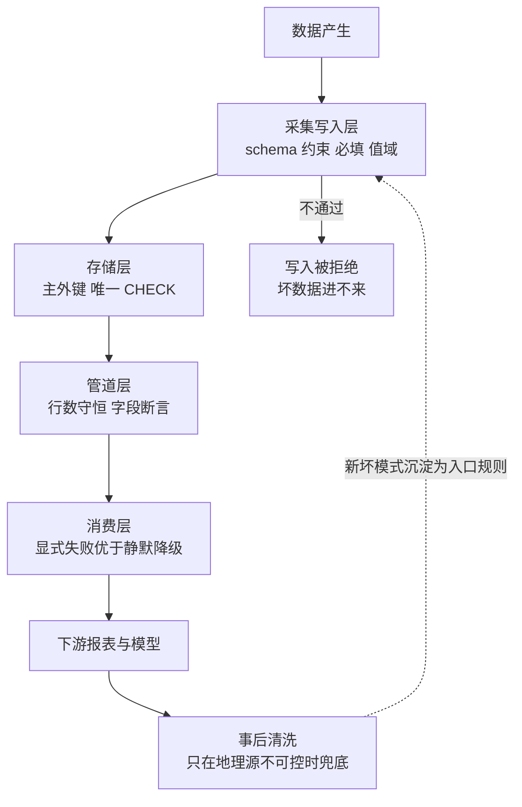
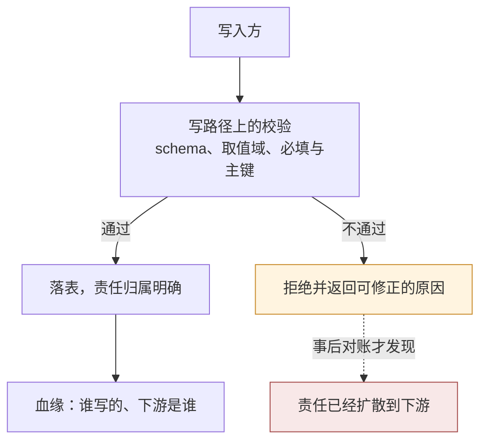

# 数据治理把质量责任放到写路径上

**报表错了就写个清洗任务修数，这种事后清洗永远修不完——新的坏数据还在源源不断地进来**。**读完这篇你能把质量规则前移到数据产生的地方，让坏数据进不来**。

数据质量问题（指标对不上、字段缺失、脏数据污染报表）的治理惯性是事后清洗：发现报表错了，写一个清洗任务修数。事后清洗永远修不完，因为**新的坏数据还在源源不断地进来**——**治理的杠杆点在写路径：质量规则前移到数据产生的地方（约束、校验、约定），让坏数据进不来，而不是进来后再捞**。

「在源头一次到位」的水利原型是都江堰：李冰把分水点设在岷江出山口的鱼嘴，按季节自动把江水按四六比例分入内江与外江——分水在水的入口一次完成，下游两千年的成都平原灌区都吃这个入口红利的利息：


*图源：Wikimedia Commons，作者 Hugh Llewelyn，CC BY-SA 2.0，https://commons.wikimedia.org/wiki/File:Dujiangyan_Irrigation_System_(50620244551).jpg。*

**泥沙进了灌区再捞，每条渠道都要设捞沙的人；在入口处分掉，下游渠系一个都不用管**。**质量规则放进写路径的那一行校验，就是数据流里的鱼嘴**。

这个原则与发布门禁绑定真实证据同构（见 [[工程知识/软件构建：让变化可以理解、验证与交付/测试与交付/发布门禁必须绑定真实证据]]）：**门禁拦在合并前，比拦在线上便宜一个量级**。**数据质量的"门禁"就是写路径校验**。

## 要解决的问题是什么：质量责任该放哪一层

| 层 | 责任 | 机制 |
| --- | --- | --- |
| 采集/写入层 | 数据进来时就该对 | schema 约束、必填校验、值域检查 |
| 存储层 | 违反不变量的写不写入数据库 | 主外键、唯一约束、CHECK（检查约束，写入前由数据库校验的条件）约束 |
| 管道层 | 每级出口校验后再传递 | 行数守恒、字段级断言 |
| 消费层 | 发现问题上报而不是容错吞掉 | 显式失败优于静默降级（压力过大时关闭次要功能，保住主流程） |

写路径校验的具体形态：**数据库约束是最古老也最有效的一层**（关系模型用约束表达业务事实，见 [[工程知识/数据系统：在并发与故障中保存事实/数据建模与SQL/关系模型用约束表达业务事实]]）；**管道层用行数守恒（每级入口行数 = 出口行数 + 显式丢弃数，差异即缺陷信号）与字段断言（金额非负、时间戳在窗口内）**；**消费层最常见的反面做法是 try-except 吞异常继续跑——这把发现质量问题的最后机会也放弃了**，静默失真的机制见 [[工程知识/缺陷分析：从个案到体系/正确性/静默失真的检测靠对账与不变量而不是报错]]。



「质量责任落在哪几层、坏数据在哪一环被拦住」：**四层从采集到消费依次设闸，每层拦自己职责内的错，坏数据在最早能判定的那一层被拒绝**；底部的清洗通道只保留给外部数据源这类不可控输入，而且**清洗中发现的新坏模式要沉淀为入口规则，让同一类坏数据以后进不来**。**这正是「事后清洗永远修不完」的机制原因**。

质量责任放在写路径上，意味着**校验发生在数据产生的那一刻，而不是事后对账：**



## 所有权怎么定：每张表有人对质量负责

机制之外是组织问题：**没有 owner 的表必然腐烂**（**没人决定它的 schema 演进、没人修它的质量告警、没人判断它的下线**）。**治理实施的第一步是每张核心表登记 owner，质量告警直接路由到 owner——告警发给"数据组"等于没发**。

owner 的职责边界：schema 变更走 owner 评审，流程见 [[工程知识/数据系统：在并发与故障中保存事实/可靠性与运维/在线schema变更走expand与contract，不锁表是底线]]；质量规则由 owner 维护、下游消费纠纷由 owner 裁决。这与应用侧"模块 owner 对接口演进负责"的责任划分一致（见 [[工程知识/软件构建：让变化可以理解、验证与交付/架构与代码/API与Schema演进必须兼容新旧消费者]]）。

## 为什么说血缘是治理的导航图

治理要落到写路径上，绕不开新旧并存：老表还在写，新表开始接。请求逐步切到新的写入路径，数据层随迁移同步切换，全程两套同时在跑。


*图源：Microsoft Learn 中文文档，CC BY 4.0，https://learn.microsoft.com/zh-cn/azure/architecture/patterns/strangler。*

**修一个坏指标，先要知道它从哪些表算出来、上游谁写、坏了多久——血缘把这条链路显式化**。血缘的构建在管道层埋点（每级任务记录输入输出表），消费侧的指标可解释性要求见 [[工程知识/数据系统：在并发与故障中保存事实/数据治理/数据质量与血缘让指标可以被解释]]。

一个可运行的血缘系统长什么样，Marquez 的官方架构图给出参考：采集 API 从 Airflow、Spark（分布式计算引擎，靠内存计算加速大规模数据处理）、dbt 这类管道任务里收运行时元数据，血缘仓库存下任务间的输入输出关系，用户经 UI（User Interface，用户界面）与查询 API 追问任意一张表的上游与下游。


*图源：Marquez 官网（marquezproject.ai），Marquez 项目以 Apache-2.0 许可开源。*

血缘与影响面估算直接衔接：上游表的缺陷暴露后，沿血缘正向扫受影响下游（见 [[工程知识/缺陷分析：从个案到体系/影响判断/影响面估算先于修复——从改一行到伤多少服务]]），两张图是同一张图的两个方向。

## AI 场景要怎么延伸治理

训练与评测数据的治理是同一套原则的延伸：**数据集的版本、来源、许可要可追溯**（见 [[工程知识/AI 系统工程：从模型能力到生产能力/数据与MLOps/数据集、特征与模型版本必须可追溯]]），**评测集的维护责任同样要有 owner**（见 [[工程知识/AI 系统工程：从模型能力到生产能力/质量与运营/评测集的构建与维护决定所有评测的地基]]）——**模型把数据质量问题放大成行为问题，治理门槛比传统管道更高**。

## 动手跑一遍会看到什么：写路径责任的账

```text
同一张订单表，质量责任两个位置的对照：

读路径治理（事后清洗，旧形态）：
  写入不管 → 脏数据入库 → 每天跑清洗任务 → 报表先洗后用
  代价：清洗任务 × N 张表 × 每天跑；每个下游各自防御同一批脏数据
  洗过的数据与源头不一致 → 对不上账成为常态

写路径治理（事前拦截，目标形态）：
  写入路径三道闸：
    schema 闸：字段缺失/类型错 → 写入即拒绝（fail-fast）
    业务闸：金额为负、状态机不合法 → 写入即拒绝
    对账闸：跨表外键存在性、日切行数波动率 → 异常告警阻断发布
  脏数据进不了库 → 下游零清洗成本，账永远对得上

  代价转移：写入延迟 +1-5ms、写入方要改代码（一次性），
  换来所有下游的永久防御——责任前移是一次性成本换持续性收益
```

读路径治理的实录——**数仓三张核心表各挂一套清洗任务，某天上游改字段名，三套清洗逻辑各自以不同方式失败（两套静默空跑一套报错），同一张表三个下游看到三个版本**；**治理前移到写路径后（schema 注册中心 + 写入校验），字段变更在写入点就被拒绝，下游无感**。血缘的实录——**没有血缘时一次字段枚举值变更，排查"谁在用这个值"花三天（全链路人工问）；带血缘后一条依赖查询回答完**（与 [[工程知识/数据系统：在并发与故障中保存事实/数据治理/数据质量与血缘让指标可以被解释.md]] 的可解释性衔接）。写路径拦截与 [[工程知识/数据系统：在并发与故障中保存事实/数据建模与SQL/关系模型用约束表达业务事实.md]] 的约束先行的关系：**数据库约束是写路径闸门里最靠底的一道**。

## 这套说法在哪儿会失效

写路径校验有性能与灵活性代价：**高吞吐场景全字段校验会增加延迟，约束太严会拒绝合法的边界数据**。**校验的取舍按数据价值分层：核心账务数据全约束，分析型数据放宽到抽样校验，实验性数据允许无校验但显式标注"未治理"（下游可见信任级别）**。

治理无法完全前置：**外部数据源（第三方接口、用户上传）质量不可控，这部分只能事后清洗——但清洗规则要沉淀回写路径（第一次发现的坏模式变成以后的入口校验规则），形成"事后发现 → 前移拦截"的循环**。

## 怎么自己动手验证

行数守恒检查：给一条三级的管道，人为在第二级丢 1% 的行（不报错），确认守恒断言能报警。对照实现（无守恒）则静默通过——这个实验与静默失真的检测判据一致。

约束有效性验证：尝试向带约束的表写入违反数据（负金额、重复键），确认数据库拒绝且错误信息可定位。再验证消费层：向下游喂一条已知脏数据，确认显式报错而不是吞掉。

## 接着读哪几篇：约束作为质量机制的表达层

- 关系：[[工程知识/数据系统：在并发与故障中保存事实/数据治理/数据质量与血缘让指标可以被解释]] · [[工程知识/缺陷分析：从个案到体系/正确性/静默失真的检测靠对账与不变量而不是报错]] · [[工程知识/软件构建：让变化可以理解、验证与交付/测试与交付/发布门禁必须绑定真实证据]]
- [[工程知识/数据系统：在并发与故障中保存事实/数据建模与SQL/关系模型用约束表达业务事实]] —— 约束作为质量机制的表达层
- [[工程知识/数据系统：在并发与故障中保存事实/数据管道与流处理/CDC把数据库变化传播为可重放事实]] —— 管道血缘的构建载体
- [[工程知识/AI 系统工程：从模型能力到生产能力/数据与MLOps/数据集、特征与模型版本必须可追溯]] —— AI 数据的版本治理
- [[工程知识/缺陷分析：从个案到体系/影响判断/影响面估算先于修复——从改一行到伤多少服务]] —— 血缘正向扫描的用途
- [[工程知识/数据系统：在并发与故障中保存事实/数据治理/数据质量的三重校验：完整性时效与一致性.md]] —— 写路径防线与本篇三重校验的关系
