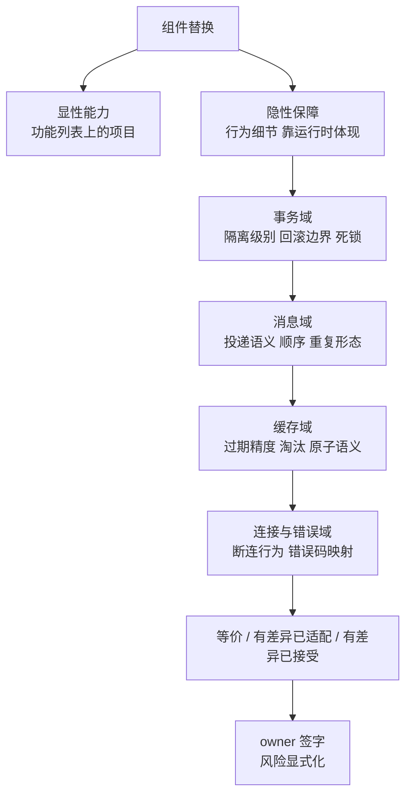
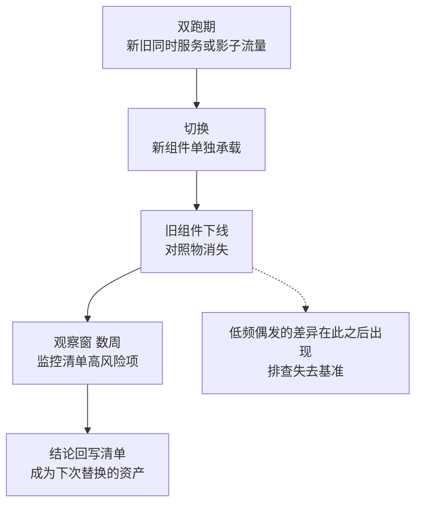

# 数据组件的迁移清单：能力等价按逐项核对建立，不按名称对应

> **要点**：**更换数据库、队列、缓存时，"功能类似"是最危险的等式**——**每个组件有自己的一组隐性保障（事务边界、投递语义、过期行为、隔离级别）**，**迁移清单要按能力逐项核对，缺失项要么补齐要么显式接受风险**。

## 要解决的问题

**组件替换（MySQL 换 PostgreSQL、RabbitMQ 换 Kafka、自建缓存换云缓存）的验收有一类结构事故**：**功能对照都对上了，运行数周后在意料外的路径上出问题**。形态五花八门：**新库的默认隔离级别不同，原依赖"可重复读"的查询开始读到不一样的结果**；**新队列的投递语义从"至少一次（消息不丢但可能重复、靠消费幂等兜底）带去重"变成"至少一次无去重"**，**下游幂等（同一个操作执行一次和执行多次的结果相同，重复执行不会产生额外副作用）没配，重复消费出现**；**新缓存的过期精度不同，原本"到点即失效"的键多活了几秒，击穿（热点缓存过期瞬间，大量请求同时涌向存储）了本已防好的缓存**。

本库数据系统域"SQLite（嵌入式单文件数据库）与 MySQL（开源关系型数据库）代表不同的并发与运维边界"讲过并发与运维边界的差异是选型依据；本篇讲替换工程的验收方法：**把"隐性保障"显式化成迁移清单，逐项核对等价性**。

## 它是怎么做到的：隐性保障从哪里漏掉

替换前先认清几个组件的定位：PostgreSQL 是开源关系型数据库，RabbitMQ 是经典消息队列（生产者写入、消费者读取的缓冲中间层），Kafka 是分布式日志流平台，本篇的替换场景以它们为例。

**能力等价不能按名称对应，因为读方看到的是视图，写方维护的是源**。**视图按查询需要重新组织数据形状，换一个源，视图的重建规则未必还能产出同样的结果**。


*图源：Microsoft Learn 中文文档，CC BY 4.0，https://learn.microsoft.com/zh-cn/azure/architecture/patterns/materialized-view。*

每个成熟组件的能力面分两层：

**显性能力**：功能列表上的东西——支持 SQL、支持事务、支持发布订阅（发送方不指定接收者、由订阅关系分发的消息模式）、支持过期。**迁移时天然会对照（"新组件支持这些功能吗"），漏掉的概率低**。

**隐性保障**：功能的行为细节——事务的默认隔离级别、回滚（把系统状态退回到改动之前的版本）的边界、投递语义的精确形态（重复时消息头长什么样）、过期与淘汰（空间不足时按策略移除部分条目）的触发时机与精度、错误码的语义、连接断开时在途请求的结局。**这些保障不在功能列表上，靠运行时行为体现**，迁移对照时**"支持事务"一个勾就覆盖了隔离级别、回滚边界、死锁（多个执行流互相等待对方释放资源）检测行为等十几个隐性项**——**每个未核对项都是一次行为漂移的机会**。

漏掉的机制还有一个放大器：**隐性保障的差异不报错**。**隔离级别差异表现为"偶发读到旧值"，投递语义差异表现为"偶尔重复消费"，过期精度差异表现为"偶发击穿"**——全部以低频、难复现的形态出现，且**发生在替换完成、旧组件已下线、对照物已消失之后**，排查失去基准。

最容易漏核对的一项就是隔离级别：下图的时序里，事务 B 插入并提交之后，事务 A 两次同样的范围查询读到的结果集完全一致（ID 7 与 ID 9 两行，没有新插入的 ID 12）——**"同一事务内重复范围读结果不变"正是可重复读级别的隐性保障**，**换一个默认隔离级别不同的库，这条保障就变成"偶发读到旧值"的低频差异**。


*图源：小林coding《事务隔离级别（可重复读）》教程截图，https://www.xiaolincoding.com/mysql/transaction/phantom.html。*


## 修完之后靠什么防住复发

**迁移清单按能力域逐项展开**：把隐性保障按域列成核对清单——**事务域（隔离级别、回滚边界、死锁行为）、消息域（投递语义、顺序保证、重复形态、死信行为）、缓存域（过期精度、淘汰策略、原子操作语义）、连接域（断连时在途请求行为、超时语义）、错误域（错误码映射、重试语义）**。**每项三种结论：等价 / 有差异但已适配 / 有差异已接受风险**——**"已接受"要有 owner 签字**，风险显式化是清单的意义所在。

**双跑期对照真实流量**：替换过渡期双跑（新旧组件同时服务或影子流量），**对照的重点按清单里的高风险项设计（隔离级别差异用并发读对照、投递语义差异用消息 ID 去重率统计）**——**双跑对照的观察项与清单核对项一一对应**，而不是笼统的"看有没有异常"。

**行为差异进适配层**：**清单标出的差异项在代码里显式适配（新组件的重复消息在消费端统一去重、隔离级别差异在查询里显式加锁）**——适配代码集中、注释指向清单项，**让"组件差异"在代码里有唯一的出处可查**。

**替换后的回归观察窗**：**切换完成后设观察窗（数周），监控口径覆盖清单高风险项（重复消费率、锁等待、缓存击穿计数）**——**观察窗的结论回写清单（"该项差异实际影响为 X"），清单成为组织资产，下次替换复用**。



「清单展开到哪些域、每一项收敛到什么结论」：显性能力在功能对照时天然被覆盖，隐性保障要靠运行行为逐项核对，落到事务、消息、缓存、连接与错误五个能力域；每个域里的每一项只能给出等价、有差异已适配、有差异已接受三种结论之一，其中「已接受」必须有人签字。**清单的意义在于把不报错的差异变成显式的评审对象**。

## 这套说法在哪儿会失效

三条边界防止防线走形。

**清单的粒度按风险定**：**核心数据路径的组件清单展开到行为细节，边缘组件（非关键路径上的存储，如本地开发与一次性任务的临时库）核对到显性能力即可**——**全组件同粒度会让清单的成本淹没在低风险项上，清单反被弃用**。

**版本升级同用清单**：同组件的大版本升级（MySQL 5.7 → 8.0）与跨组件替换共享同一份清单方法——**版本间的行为漂移同样以隐性保障为载体（默认值变化、错误码调整、废弃行为移除）**，**"升级不是替换"的侥幸是漏核对的主因**。

**适配层不是万金油**：**能力缺失项能适配的（去重、重试、显式加锁）适配，不能适配的（隔离级别根本不同的事务语义）要回到选型层重新评估**——**适配层兜得住行为差异，兜不住能力鸿沟**，**清单上"有差异已适配"的项要定期复审适配是否仍然成立**。

## 怎么自己动手验证

可复现的验证路径：

1. 清单完备性验证：**按能力域清单逐项核对，三个结论的分布可见，"已接受"项有 owner 签字记录**；
2. 双跑对照验证：**高风险项的对照指标在双跑期可读（去重率、锁等待、击穿计数），与切换前基线（正常状态下的指标水平、用来对比异常）同口径**；
3. 观察窗验证：切换后数周内高风险项监控无异常，结论回写清单；
4. 断言锚点：**迁移/升级变更必附能力清单，无清单不评审；高风险项有双跑对照数据；观察窗结论回写**。

```text
清单断言 = 每项三结论之一，接受项有签字
双跑断言 = 高风险项对照指标与基线同口径可读
回写断言 = 观察窗结论更新清单版本
```

隐性差异的暴露时点排在时间轴的哪一格——为什么它总在对照物消失之后才现形：



所以双跑对照的观察项必须与清单核对项一一对应，观察窗的结论还要回写清单——替换工程才从赌行为一致变成验证行为一致。

**能力等价是逐项核对出来的结论，账面对上的"功能类似"只是起点**——**迁移清单把隐性保障变成显式评审对象，替换工程才从"赌行为一致"变成"验证行为一致"**。验证时预期与实际的对照规则提前写明：双跑期高风险项对照指标预期与切换前基线同口径，**对不上（去重率升高、锁等待变长、击穿计数增加）即对应清单项的差异未经适配或适配不成立，替换不得推进**；观察窗内预期无新高风险项告警，对不上即回滚并回到清单逐项重核。

## 接着读哪几篇：并发与运维边界差异的具体形态

- [[工程知识/数据系统：在并发与故障中保存事实/事务与存储/SQLite与MySQL代表不同的并发与运维边界]] —— 并发与运维边界差异的具体形态，清单方法的核对对象示例
- [[工程知识/数据系统：在并发与故障中保存事实/事务与存储/事务隔离决定并发读写能观察到什么]] —— 隔离级别作为首要隐性保障的机制背景
- [[工程知识/后端系统：在并发、失败与变化中维持服务/任务与并发/幂等性的完整谱系：从操作语义到删除接口的天然陷阱]] —— 投递语义差异的下游适配（去重）的纪律来源
- [[工程知识/软件构建：让变化可以理解、验证与交付/架构与代码/API演进的兼容性纪律：废弃流程与版本策略]] —— 版本间行为漂移的姊妹场景
