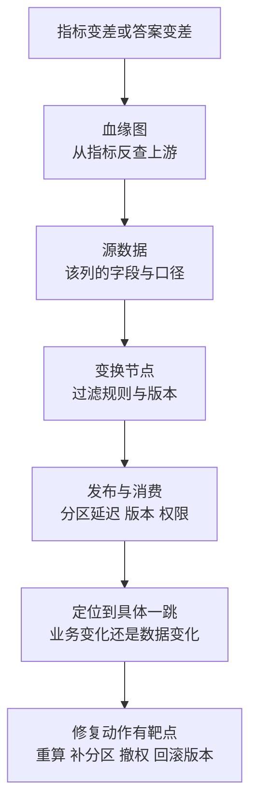
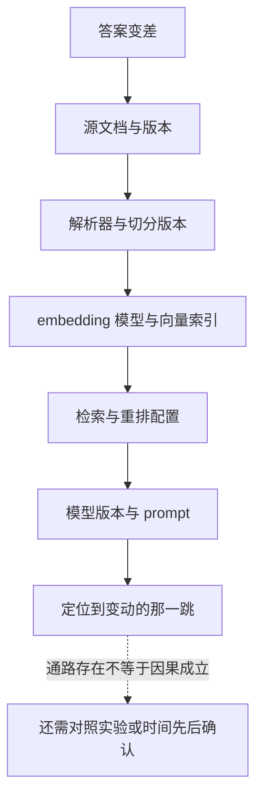

# 数据质量与血缘让指标可以被解释

**报表数字变了，第一件难事是判断这是业务真的变了，还是数据坏了；第二件是知道坏了会影响哪些下游**。读完这篇你能给关键数据集登记该记哪些元数据，能用血缘算出影响范围，也知道**完整性检查证明不了什么**。

## 先记住哪几句

| 维度 | 回答 |
| --- | --- |
| 要解决的问题 | 指标异常或模型效果下降时，如果不知道数据来自哪里、经过哪些变换、是否新鲜，就无法判断是业务变化还是数据故障。 |
| 本质 | 质量约定定义数据是否满足用途，血缘把来源、变换、版本和消费者连成可追溯图。 |
| 做法 | 为关键数据集登记 schema、主键、范围、分布、延迟、删除语义、敏感级别和所有者，并让失败状态传播到下游。 |
| 效果与代价 | 指标可解释、影响范围可计算、坏数据能被隔离；代价是采集元数据、维护约定和处理误报的成本。 |
| 边界 | 完整性检查不等于业务准确性；血缘能说明传播路径，不能单独证明因果或模型回答正确。 |
| 验证 | 持续注入 schema 漂移、迟到、重复、权限撤销和样本污染，抽样回到来源并检查质量报告、版本和下游阻断。 |

数据质量的含义是：**数据在特定使用场景下满足及时性、完整性、唯一性、准确性、一致性、合法性和可追溯性，"表里没有 NULL"只是其中最窄的一项**。血缘把来源、变换、版本和消费者连接起来，**才能解释指标变化和影响范围**。

## 数据质量要约定哪些条款

每个关键数据集定义 **schema、主键/唯一性、范围、分布、时间延迟、删除语义、敏感级别、所有者和失败动作**。约定失败时要**阻止下游发布、隔离坏分区或标记不可信，不能只发告警后继续喂模型**。



「指标对不上时按什么顺序反查」：血缘图把指标沿着变换链反推到源数据、变换节点、发布与消费三段，**每一段的检查项各自固定（字段口径、过滤规则版本、分区延迟与权限）**。追查的价值在于**把"数对不上"从全链路盲查收敛到某一跳，修复动作才有靶点**；没有这张图，**任何"模型回归"或"业务变化"的结论都只是猜**。


*图源：Software Ideas Modeler 官方文档《Chen ER Diagram》页内实体关系图记号示例（softwareideas.net/chen-er-diagram-erd）。*

## AI 场景的血缘比表血缘多出什么


AI 场景的血缘比表血缘长一截：**从源文档一路排到 prompt 共五跳，任何一跳的版本变动都能让答案变差**，而「通路存在不等于因果成立」这条虚边提醒**定位到那一跳之后还要另做确认**：



所以**训练集、评测集、embedding（把文本转成向量的表示）、RAG（检索增强生成，先从外部资料里检索再让模型据此回答）索引与在线特征都要有血缘**——没有这条链，**「模型回归」只是对五跳中最显眼的那一跳的猜测**。

训练集、评测集、embedding、RAG 索引和在线特征都需要血缘。一个答案变差时，**应能追到源文档、解析器、切分、embedding、索引、模型和 prompt；没有这条链路，任何「模型回归」结论都可能是数据变化**。

质量检查应服务于用途：**用于财务结算的数据需要完整、可审计和可重放，用于探索性推荐的数据可能允许迟到但必须标注新鲜度**。把所有数据集套同一阈值**会制造告警噪声，也会掩盖真正影响决策的字段**。

## 血缘的代价和边界在哪里

血缘最完整的形态是端到端的：从源系统一路跟到消费它的报表，中间每一道加工都留痕。


*图源：Microsoft Learn 中文文档，CC BY 4.0，https://learn.microsoft.com/zh-cn/purview/concept-data-lineage。*

再往下走一层是列级血缘——不再是「这张表来自那张表」，而是「这一列由那几列算出来」：


*图源：同上（Microsoft Learn 中文文档），CC BY 4.0。*

两级血缘的代价差别很大。表级血缘多数系统自动就能给出，列级血缘要么靠解析 SQL，要么靠人工标注，代价随表数量线性增长。所以边界很清楚：指标对账频繁的字段上列级血缘，其余字段停在表级。

采集元数据的成本集中在三处：管道埋点（在代码里插入统计上报语句、收集用户行为数据）要改每个任务的代码（记录输入输出表与版本号）、血缘图要把命名归一（同一张表在不同任务里的别名归到同一节点）、变更时的维护（表改名、任务拆分、临时表清理都会让图上的节点与边过期）。这三项成本与管道数量成正比，也是血缘系统上线后最常见的退化点——图建起来半年，节点对不上的比例就上去了。

**血缘能说明传播路径，回答不了"这一定是原因"**：指标变差时血缘指出 A 表到 B 指标存在通路，**通路的存在不等于因果成立，还需要对照实验或时间先后关系来确认**。**完整性检查同样不等于业务准确性——行数、空值率、枚举值域都过了，业务口径仍可能错（口径错在上游定义，不在数据形态）**。可追溯性的下限是**能回答"这个数字从哪来、经过谁的手、什么时候可查"**，上限受限于埋点覆盖率；**覆盖率不足时，图上缺失的那一段正是事故发生时最想查的那一段，所以覆盖率的元指标要跟血缘图一起维护**。

## 动手跑一遍会看到什么：一个指标的对账全链路

"昨日 GMV（成交总额，一定时间内的订单金额合计）"对不上，血缘图给出三条检查路径：

```sql
-- 指标定义：GMV = sum(order_amount) where status = 'paid'
-- 上游 A：订单表（源头）
SELECT count(*), sum(amount) FROM ods.orders
WHERE dt = '2026-09-22' AND status = 'paid';
--   → 1,204,000 条 / 8.9 亿

-- 上游 B：清洗任务（dwd 层，过滤了测试订单）
SELECT count(*) FROM dwd.orders WHERE dt = '2026-09-22' AND status = 'paid';
--   → 1,198,000 条，差 6,000 条 = 测试订单剔除（血缘显示 dwd 的过滤规则 v7 生效）

-- 指标层：ads.gmv_daily = 8.83 亿 ≠ 报表 8.61 亿
-- 差 0.22 亿 → 血缘第三跳：报表还叠了一层"剔除已退款"，refund 表当天分区缺失（上游延迟 2 小时）
```

跑一遍的收获：**三跳差异各自有名（过滤规则、退款分区延迟），血缘把"数对不上"从排查玄学变成按图索骥——每跳的质量规则（行数波动阈值、主键唯一、枚举值域）都在跳变处拦截**。

## 这些量在什么数量级：质量规则的成本收益

**行数波动监控（环比 ±15% 告警）是性价比最高的规则：一张表一条规则，拦住分区缺失与上游断流两类最常见事故；主键唯一性次之（防重复写入）**。全字段值域检查的成本随列数线性涨，**只对进指标的列配——按"指标口径依赖的列"圈范围，质量规则的维护成本与指标数量成正比，与表总数无关**。

## 怎么自己动手验证

数据可信度要与质量报告对账——**预写每批数据发布都带质量报告、版本与下游影响清单，缺失或与预期对不上时不能作为指标依据**。

持续检查 **schema、唯一性、分布漂移、迟到、重复、权限、删除传播和样本污染**；**随机抽样回到原始来源**。给每次数据发布生成**质量报告、版本和影响下游列表，并将失败状态传播到消费方**。

最小实验：故意引入一列类型变化、重复主键、迟到分区和一条已撤权文档，跟踪质量门禁、血缘图、下游指标和 RAG 索引。**检查坏数据是否被隔离、影响范围是否可定位，以及恢复后报告是否保留原始版本**。

关系：[[工程知识/数据系统：在并发与故障中保存事实/数据治理/数据治理把质量责任放到写路径上]] · [[工程知识/AI 系统工程：从模型能力到生产能力/数据与MLOps/数据集、特征与模型版本必须可追溯]] · [[工程知识/数据系统：在并发与故障中保存事实/数据管道与流处理/CDC把数据库变化传播为可重放事实]]
- [[工程知识/数据系统：在并发与故障中保存事实/数据治理/数据质量的三重校验：完整性时效与一致性.md]] —— 口径与血缘的可解释性视角
- [[工程知识/数据系统：在并发与故障中保存事实/数据治理/数据质量规则挂在管道上：每条规则有等级与动作，不只有报警.md]] —— 质量规则的执行面：挂载点、等级-动作矩阵与坏区间可见性
