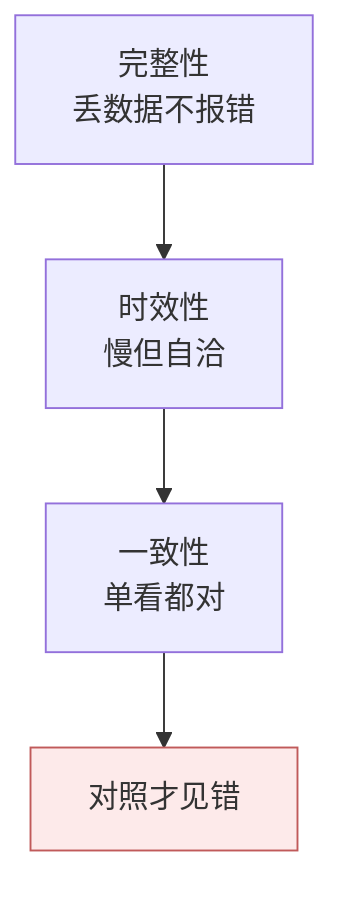
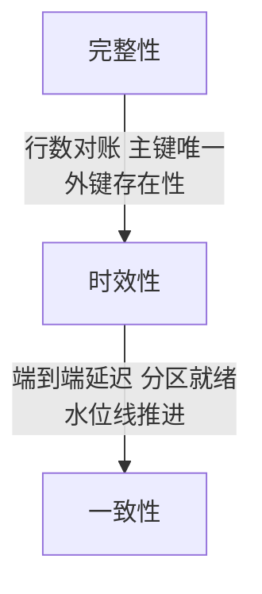
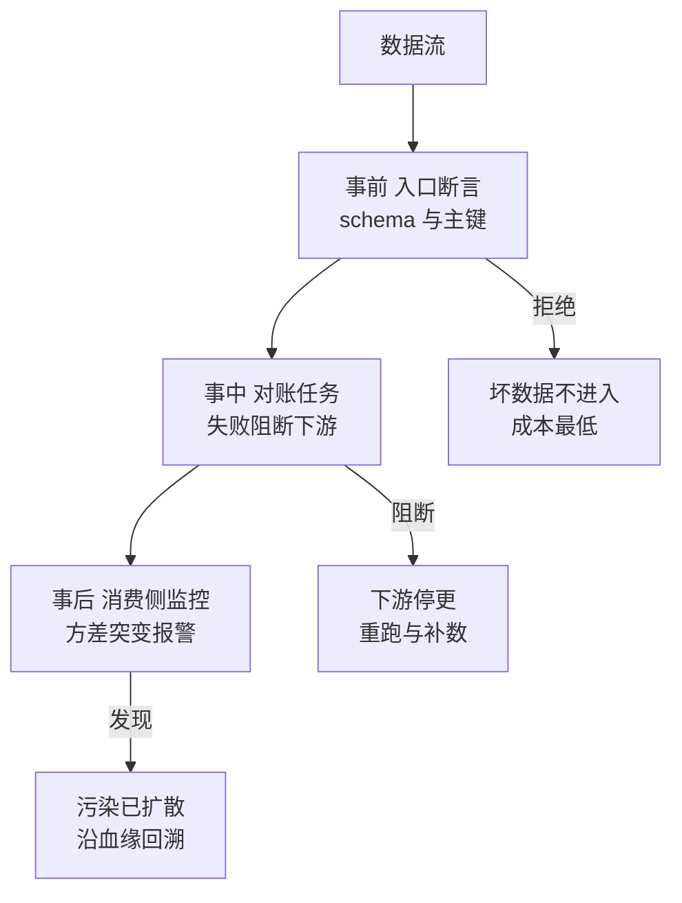

# 数据质量的三重校验：完整性时效与一致性

## 要解决的问题

数据管道的产出被下游当事实消费，但**数据在采集、传输、转换、存储的每一环都可能坏**：**丢数据（完整性）、慢数据（时效性）、错数据（一致性）**。三重校验要解决的问题，是**给数据质量一个可执行的验收体系**，**让「数据是好的」从感觉变成可度量、可报警、可复盘的工程判断**。静默失真的检测靠对账与不变量而不是报错[[工程知识/缺陷分析：从个案到体系/正确性/静默失真的检测靠对账与不变量而不是报错.md]]写的是通用检测思想，本文把三重校验对应到数据管道的具体形态。

## 三个维度各拦哪些坏数据：机制

先把形状说成一件事：**数据管道像连锁超市的进货链路——产地装车、干线运输、门店入库、上架销售**。货物可能在每一环出问题：车厢漏装（完整性，丢数据）、冷链慢了（时效性，数据过时）、贴错价签（一致性，数据对不上）。**超市验收不靠供货商自己说"货是好的"，而是开箱点数、查温度记录、对账价格表**——三个动作正好对应三重校验。这个比喻到"点数对账"为止——超市丢一箱货看得见摸得着，**数据管道丢 1% 的事件不留任何现场痕迹**，所以**校验必须做成持续运行的自动化断言**，不能像巡店那样靠人抽查。

**完整性：该来的都来了**。校验维度：**行数对账（上游事件数 vs 下游入库数，传输丢包/过滤规则的意外剔除都体现在差值）**；主键唯一与非空（**重复消费破坏幂等**，即同一操作执行一次和执行多次结果相同、重复执行不产生额外副作用，是失效的直接信号）；外键存在性（**维度表缺行导致 join 丢行**）。完整性问题的隐蔽性：**丢 1% 的事件不报错，报表数字略小，无对照就无感知**。

**时效性：数据新到能用**。校验维度：端到端延迟——**事件产生到可查询的时延**——超过 SLA（服务等级协议，对时效或可用性的正式承诺）就报警；分区就绪——批处理（把多个请求合并成一批同时计算、提高硬件利用率）分区要在约定时间前可读，**迟到分区阻塞下游全部任务**；水位（队列或资源的当前占用程度）线推进——**流处理的 event time 水位停滞说明迟到或反压**。时效性问题的隐蔽性：**慢一天的数据照样自洽（内部一致），下游拿它做当天决策就是错的**。

**一致性：数据对得上**。校验维度：**口径对账（同一指标在两个系统算出来不等——sum/avg 逻辑差异、时区边界、null 处理）**；快照（某一时刻的完整只读副本）对账（源库总量 vs 数仓总量，批间增量对得上总量变化）；业务不变量（金额恒等式：订单总额 = 明细求和 + 优惠 - 退款，违反即有环节错）。一致性问题的隐蔽性：**单独看每个系统都对，对照才见错**。

三个维度拦的东西不同，失效时的表现也不同：



三个维度各有自己的判定信号，缺了对应信号那一维就等于没校验：



三者的共同点是**都不会主动报错**：**表少了一部分行，系统的反应和正常时没有区别**。所以**校验必须靠外部对照，不能等数据自己声明有问题**。

**校验的三个层次**。事前（写路径）：**入口断言（schema 校验、值域检查、主键冲突拒收），把坏数据挡在门外**，数据治理把质量责任放到写路径上[[工程知识/数据系统：在并发与故障中保存事实/数据治理/数据治理把质量责任放到写路径上.md]]。事中（管道）：对账任务（每个作业后跑断言，失败阻断下游），**失败要止损（坏数据污染下游比数据晚到更糟）**。事后（消费侧）：**指标监控（核心指标的方差/环比突变报警）**。三层防线分别对应**「防止进入、及时发现、影响面控制」**。

**三层防线不是三个并列检查点（定期保存进度、故障后从最近一次保存处恢复），它们排在数据流的先后位置上**：**同一批坏数据越晚被撞上，处置代价越高**——**事前只是拒绝一次写入，事后就要沿血缘（数据血缘：一条数据从哪个上游来、被哪些下游消费的沿路记录）回溯已扩散的影响面**。


三层防线各自的判定动作与代价摆在同一张表里会更清楚：事前是拒绝写入（代价是**一次失败返回**），事中是阻断下游（代价是**重跑与补数**），事后是回溯影响面（代价是**已扩散区间的订正**）。因此**每批数据在进入管道时都应当带上它的校验记录**，**让三层共享同一份断言结论，而不是各自重算一遍**。

多层验证不是抽象口号，GE（Great Expectations）官方博客的这张图把验证环节摆进了真实管道：源数据提取到暂存环境前验一次，转换前再验一次，提升为生产前第三次验证，三次各有 Pass 与 Fail 两个出口，Fail 都汇到同一个 Response 处置：


*图源：Great Expectations 官方博客数据质量文章配图，https://greatexpectations.io/（ctfassets 直链），文章插图。**三次验证对应正文「校验的三个层次」**：验证点分布在管道的先后位置上，越靠后 Fail 的处置代价越高——图上从暂存到生产的推进方向，就是处置代价上升的方向。*

数据平台把这条防线做成了产品形态。下面这张图是阿里云 DataWorks 数据质量的官方工作流程：数据源经同步节点进入 STG（Staging，预发布环境）层表，质量检验通过后进入 ODS（Operational Data Store，操作数据层）层，ODS 层表再经一次质量检验才流向 DW（Data Warehouse，数据仓库）层；两次检验各带一个出口，右边两块分别是质量告警的多渠道通知与「强保障质量规则出问题后阻断任务流」的处置动作：


*图示：数据质量检验分布在数据流的多个层次上，每次检验都有告警与阻断两条处置路径，阻断的作用是「避免脏数据流向下游」。图源：阿里云 DataWorks 官方文档《数据质量概述》，https://help.aliyun.com/zh/dataworks/user-guide/data-quality/。*

图上有两处值得对照本篇来看：一是**检验点不止一个，每经过一层就重新验一次**，这正对应「每批数据带上校验记录，让多层共享同一份断言结论」；二是**检验失败后分告警与阻断两条路，强规则直接阻断任务流**——阻断的代价是**下游停更**，收益是**把问题数据拦在扩散之前**，**这条取舍就是上表里事中那一行的具体形态**。


## 这套校验怎么来的、要付哪些代价

**数据质量的概念体系从制造业的质量管理（Juran 的 fitness for use，1980s）借来**，2010s 随大数据管道复杂化成为独立工程学科。Google 与 Uber 曾在公开技术分享中介绍过各自的数据质量平台，**开源侧的 Great Expectations、dbt test 把断言式校验做成声明式配置**。**变化的是工具形态，不变的是三问：该来的来了吗、新吗、对吗**。

**质量维度随数据来源的形态而扩展**：下图把传统百科全书、维基百科与 Web 2.0 三类来源的质量要求叠在一张图上，完整性、时效性处于三类来源的交集，可信度、可读性等维度只在特定形态下被强调：


*图源：Wikimedia Commons《Wiki-quality-dimensions》，CC BY-SA 4.0。*

**对数据管道做验收时同样按来源形态挑维度**：**内部数仓看行数对账与口径一致，用户行为埋点（在代码里插入统计上报语句、收集用户行为数据）还要多看采集完整性与事件时效**。

**业务不变量作为一致性校验的高地**。**口径对账与快照对账验证「数据与数据」的和谐**，**业务不变量验证「数据与现实」的和谐**（金额恒等式、状态机合法转换、时间戳因果）。**不变量是业务知识的编码**——**写下「退款金额 ≤ 订单金额」这条断言，就是写下对业务的理解**；**断言失败即业务理解与数据现实脱节**。**不变量校验让数据质量从数据工程问题升维到业务知识工程**。代价：**三重校验本身也是管道，也有成本**——**对账任务消耗计算资源，全量对账贵、抽样对账有漏检**；报警风暴——**敏感阈值产生噪音，团队报警疲劳后忽略真报警**。校验体系自身也要治理：**断言覆盖率（关键表有多少断言）、报警信噪比、断言失败的处理 SLA，这些元指标常被漏掉**。

## 这套说法在哪儿会失效

- **三重校验不覆盖正确性的全部**。数值精度（浮点累积误差，见 [[工程知识/数据系统：在并发与故障中保存事实/数据建模与SQL/消失的数值：浮点格式与精度陷阱.md]]）、时区与夏令时（时间口径的一致性陷阱）、语义漂移（**上游字段含义悄然变化，值域检查不报**）。补位：schema 演进管理、语义层（指标定义集中化，见 [[工程知识/数据系统：在并发与故障中保存事实/数据治理/数据质量与血缘让指标可以被解释.md]]）。
- **抽样对账的漏检率要心里有数**。**99% 抽样漏掉恰好 1% 的环节数据，按分区抽样漏分区级故障**。**大分区全查、小分区抽检的分层抽样与日抽样 + 周全量的周期组合是成本与覆盖的折中**。
- **「准时」与「新鲜」是两个指标**。**分区就绪与数据新鲜的语义不同：前者是批处理可用性，后者是事件时间滞后**。**分区准时但内容旧——上游断流后批处理照跑，产出空分区或旧数据——是真实故障形态**。**两个指标分开监控，行数为 0 的分区报警是必备断言**。
- **断言失败的处理要预演**。**断言失败阻断下游（数据晚到比坏数据传播好），但阻断本身也是生产事故（下游报表停更）**。**失败处理的决策树：自动阻断哪些（关键表）、告警人工决策哪些（次要表）、重跑与修复路径（从哪个位点重放，见 CDC的位点机制）**。

## 怎么自己动手验证

- **完整性对账实测**：**上游埋点事件数与下游表行数对账（分组统计）**，**人为丢一批事件（停消费者 5 分钟），预期：差值报警触发；恢复重放后差值归零**。**差值与故障时长的关系曲线是阈值设定依据**。
- **时效 SLA 实验**：**标注事件时间与入库时间的差值分布（P50/P99），预期：分布双峰（正常秒级 + 异常小时级），异常峰即 SLA 违反样本**；**上游反压（限速）重跑，预期 P99（99% 的请求耗时不超过这个值） 劣化**。**分布数据是 SLA 承诺的依据**。
- **不变量断言实验**：**金额恒等式断言跑历史 30 天数据，预期：发现既有历史脏数据（历史违约率非零），修复后新数据违约率为 0**。**历史违约率的清零曲线是断言上线的效果证据**。

## 规则集长什么样：可运行示例与案例回流

```text
订单日表的三重校验规则集（通用推演）：

完整性（该有的有没有）：
  行数波动率：今日行数 / 近 7 日均值 ∈ [0.7, 1.3]，出界告警
  主键唯一：order_id 重复数 = 0
  关键字段空值率：amount/user_id 空值率 < 0.1%
  粒度完整：32 个渠道每日都有数据（渠道级 max-行数校验）

时效性（来得够不够快）：
  分区就绪时间：每日 03:00 前就绪，超时告警升级（03:30 电话）
  数据新鲜度：表内 max(created_at) 距今 < 26 小时

一致性（对得上对不上）：
  跨表对账：订单表日总额 = 支付流水表日总额（差 > 0.1% 告警）
  跨源对账：数仓订单数 vs 业务库订单数（容忍上游延迟窗口）
  口径一致：同一指标在两张报表的定义必须同源（字段级血缘保证）
```

**只校验行数的实录**——行数正常但金额字段被上游改成分单位（同一数值按分计后数值位数整体抬升一位），**报表 GMV（Gross Merchandise Volume，成交总额） 虚高、三小时无人发现（完整性过了、一致性没设金额对账）**；**补跨表金额对账后同类错误在五分钟内被拦**。**时效告警不升级的实录**——**分区 6 点才就绪，03:00 的告警在群里没人看，下游等着数开早会（告警有、升级机制无等于没有）**；**分级告警（群消息→值班电话）后同类事故零复发**。三重校验是写路径责任在数仓侧的承接位置，见 [[工程知识/数据系统：在并发与故障中保存事实/数据治理/数据治理把质量责任放到写路径上.md]]（源头拦截）与 [[工程知识/数据系统：在并发与故障中保存事实/数据治理/数据质量与血缘让指标可以被解释.md]]（口径可解释）。

## 接着读哪几篇：静默失真检测的通用思想

- [[工程知识/缺陷分析：从个案到体系/正确性/静默失真的检测靠对账与不变量而不是报错.md]] —— 静默失真检测的通用思想
- [[工程知识/数据系统：在并发与故障中保存事实/数据治理/数据治理把质量责任放到写路径上.md]] —— 写路径防线的治理视角
- [[工程知识/数据系统：在并发与故障中保存事实/数据治理/数据质量与血缘让指标可以被解释.md]] —— 口径与血缘的指标可解释性
- [[工程知识/AI 系统工程：从模型能力到生产能力/数据与MLOps/数据飞轮的工程闭环：日志回流清洗与标注.md]] —— 清洗漏斗的质量校验同源思想
