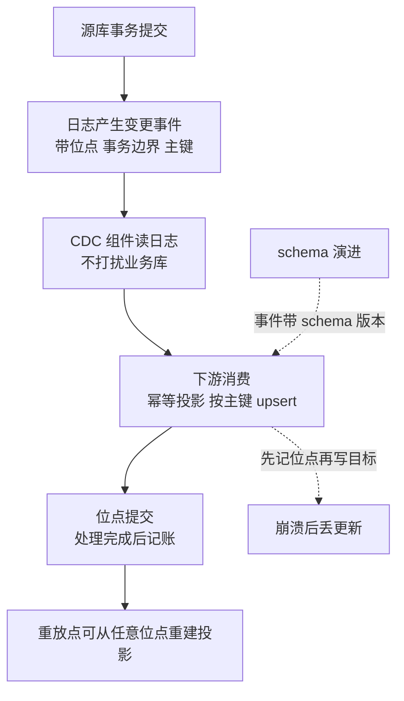

# CDC把数据库变化传播为可重放事实

**它解决的是下游需要知道数据库状态变化，却不应反复扫描全表或把业务代码复制到每个消费者的问题。核心机制是从提交日志捕获带位点、事务和主键的变更事件，再由消费者幂等（同一个操作执行一次和执行多次的结果相同，重复执行不会产生额外副作用）投影**；收益是**可重放、可追踪的增量传播**，代价是**顺序、删除、schema 演进、延迟和重复处理都要治理**。用断点恢复、乱序、重复、删除和 schema 变更验证投影一致性。

**Change Data Capture 读取数据库日志或变更流，把 insert/update/delete 转成带位点的事件，供搜索、缓存、数仓和 RAG（检索增强生成：先从资料库里找出相关片段，再让模型照着这些片段回答）索引消费。CDC（变更数据捕获，从提交日志读取数据库变化）事件是数据库提交后的观察，不是跨系统事务自动完成**。


*图源：Wikimedia Commons「Shadowbase Replication - Change Data Capture Log Scanner」，作者 Prholenstein，许可 CC BY-SA 4.0。*

## 要解决的问题：变更事件要携带哪些信息才能被重放

**下游需要感知数据库状态的变化，反复扫描全表代价过高，把业务写入逻辑复制到每个消费者又会造成多处不一致**。本篇回答：变更事件要携带哪些信息才能被重放、消费者怎样做幂等投影、顺序与删除与结构演进与延迟各自怎样治理，以及断点恢复之后投影结果怎样核对。

工业级 CDC 组件把这条链路做成了标准产品形态：connector 部署在 Kafka Connect 集群里（Kafka：分布式消息队列，靠日志追加支撑高吞吐订阅；Connect 是其连接外部系统的集成组件）读源库日志，把变更事件写入 Kafka topics，sink connector 再把事件投递给搜索、缓存或数仓。Debezium 官方架构图给出了完整链路：


*图源：Debezium 官方文档「Architecture」章节架构图，https://debezium.io/documentation/reference/stable/architecture.html，Debezium by Red Hat，CC BY 4.0（文档许可）。*

## 事件至少要带什么字段

```text
source + table/entity + key + operation
before/after（按隐私需要）+ commit position + event time + schema version
```

**消费者要保存位点、幂等键（请求自带唯一标识，重复提交只生效一次）和目标版本；重放、乱序、重复、schema 变化、快照（某一时刻的完整只读副本）与增量衔接都必须有语义。删除和撤权不能被当成「无数据」，需要明确传播和完成证明**。


## 常见错误

- **只发送 after，没有 delete 或 before，无法重建和审计**。
- **先把位点提交给消息系统，再写目标，崩溃后丢更新；反过来则需要幂等**。
- **用处理时间代替源库提交顺序，跨分区后产生错误状态**。
- **RAG 索引只追加新版本，没有使旧版本停止可见**。



**「一份变更从提交到投影要过哪几道」：源库提交后事件携带位点、事务边界与主键进入日志，CDC 组件只读日志，下游按主键做幂等投影，最后才记位点——位点与写入的先后顺序决定崩溃后是丢更新还是重复（虚线是错误顺序的结局）**。**事件里的 schema 版本让结构演进与投影逻辑保持一致，重放则从任意位点重建，这就是「可重放事实」的完整结构**。

**位点这笔账的结构，Canal（阿里开源的 MySQL binlog 订阅工具）官方仓库的复制原理图画得最直白：Canal 把自己伪装成 MySQL（开源关系型数据库）的从库，主库把数据变更写入 binlog（MySQL 服务层日志：记录逻辑变更、用于主从复制与恢复），Canal 通过 dump 协议拉取 binlog 增量再投递给下游——CDC「读日志而非问业务」的机制在这张图里一目了然**：


*图源：alibaba/canal 官方仓库「简介」页，https://github.com/alibaba/canal（GitHub）。*

**binlog lag 的两个端点就落在这张图上：生产位点写到 binlog 的哪个位置、消费位点（消费者在分区里读到哪里的记录标记）回放到哪个位置，两份位点之差（时间差与行数差两个口径）就是滞后账——1 亿行的回填滞后，就是这段位点之间还没回放完的增量**。

## 这些量在什么数量级：日志位点的滞后账

**CDC 链路的健康度看一个数：消费位点与生产位点的差（binlog lag）。正常态秒级；下游消费阻塞（大事务、下游写冲突）时滞后线性涨，追平速度受下游批量写吞吐限制——1 亿行的回填，下游每秒写 5 万行要 33 分钟，这期间下游读到的全是旧数据**。**滞后监控的两个口径（时间差与行数差）都要有，时间差对业务可解释，行数差对排障可执行**。

## 真实案例里发生了什么：时间语义的衔接

**CDC 产生的事件流进入流处理后就面对 [[工程知识/数据系统：在并发与故障中保存事实/数据管道与流处理/批处理与流处理共享逻辑但不共享时间语义]] 的时间语义问题：binlog 的事件时间（事务提交时间）与处理时间（CDC 读取时间）天然有差，大事务的行事件在日志里连续、在时间轴上同刻——按事件时间开窗是对的，但水位（队列或资源的当前占用程度）线要按 binlog 位点推进，用墙钟会错，这是 CDC 接 Flink（流式计算引擎）的标准坑**。同构的教训在缺陷域：[[工程知识/缺陷分析：从个案到体系/正确性/案例十六：数据被自己人删掉——entry log 头里的假账]] 讲的是"日志的元数据与数据本体不一致"，**CDC 消费端对位点账本的处理错误是同一类病（账本说读过、数据没处理）**。

## 什么时候该用 CDC、什么时候会赔：怎么判断

**值得用的场景有三类：搜索与缓存需要与库近实时一致（改一次同步一次，避免双写不一致）；数仓要做增量入湖而不想每天全量导（全量导的窗口越拉越长，增量把成本压到与变更量成正比）；审计与合规需要保留每次变更的完整历史（日志本身就是审计证据，不用另建触发器表）**。

**用了会更糟的场景同样有三类：只有一个消费者且它就在同一个应用进程里，直接调函数比绕一圈日志便宜；下游需要的是强一致读取（读到的必须是刚提交的值），CDC 是提交后的观察，天然是异步的，用它做一致性读会引入新的等待语义；变更量极小（一天几百行）却要为此维护一套 CDC 组件与其监控，运维成本超过它省下的扫描成本**。

判据可以收成一句：**下游要的是"变化的事实"且能接受异步，CDC 划算；下游要的是"当前的值"或"同一进程内的函数调用"，CDC 是绕远路**。**判断依据是数据一致性语义与部署形态，不是组件流行度**。

## 怎么自己动手验证

**变化传播要与源库事实对账——预写从任意位点重放后目标投影应与源库一致，重放后出现重复或缺失，与预期对不上**。

**测试初始快照与增量边界、事务批量、重复/乱序、删除/撤权、消费者重启、目标不可用、schema 演进和从任意位点重放。比较源库事实、事件日志和目标投影的一致性与延迟**。

关系：[[工程知识/后端系统：在并发、失败与变化中维持服务/任务与并发/队列和流系统用时间与容量换取解耦]] · [[工程知识/AI 系统工程：从模型能力到生产能力/知识与检索/RAG数据管道从文档到可引用证据]]
- [[工程知识/数据系统：在并发与故障中保存事实/可靠性与运维/复制的三种模式：主从、多主与无主的失败形态.md]] —— 从库作为数据出口的复制下游

