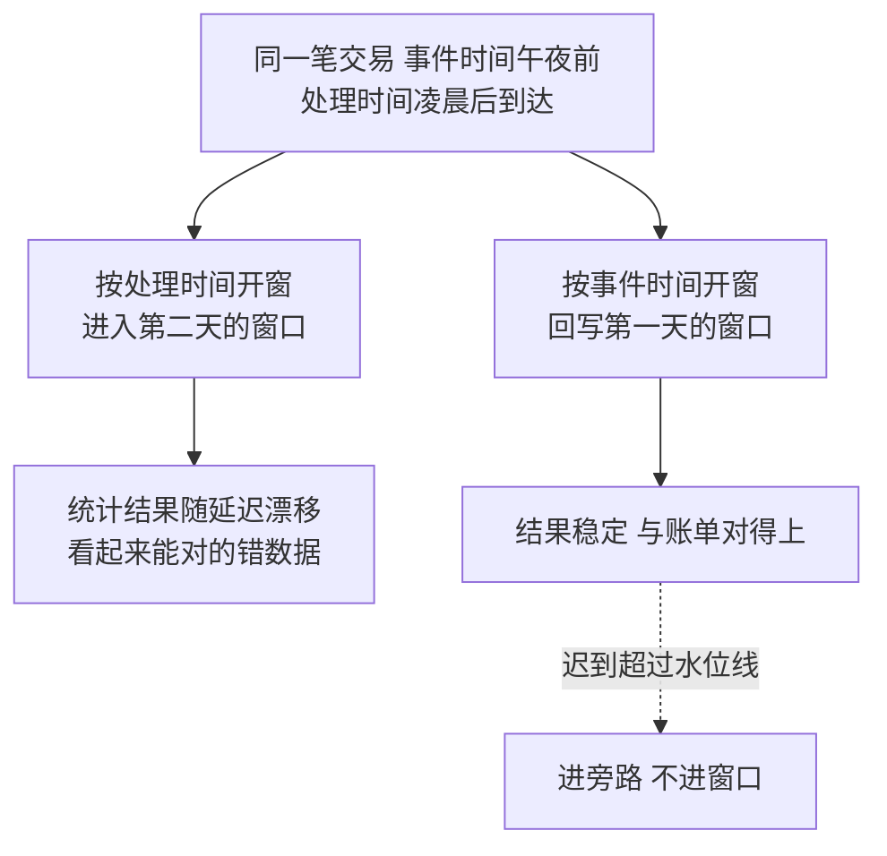
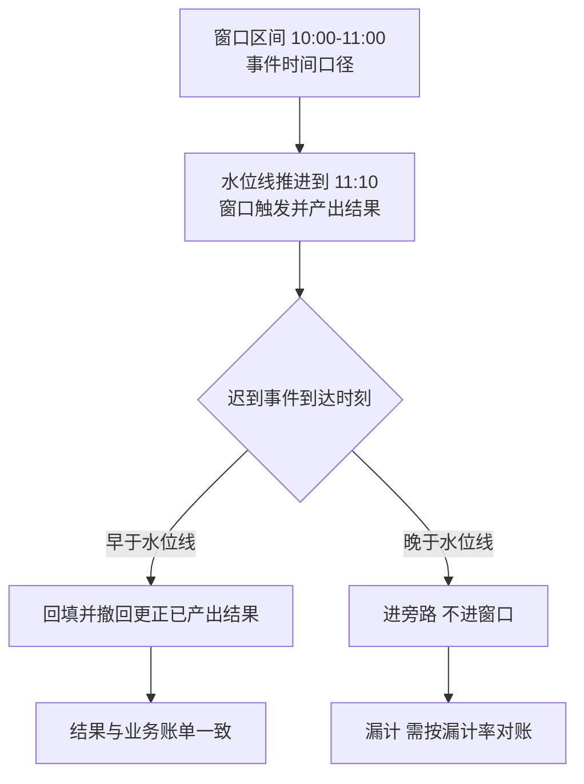

# 批处理与流处理共享逻辑但不共享时间语义

**批处理在有限数据集上计算，流处理面对持续到达、迟到、重复和无界数据**。**相同的聚合逻辑，若没有定义事件时间、处理时间、窗口、水位（队列或资源的当前占用程度）线和修正策略，在两种模式下可能得到不同结论**。**读完你能判断一段聚合逻辑换到流模式下结论会不会变，并知道要先补齐哪些时间语义的定义**。

**同一笔交易在午夜前发生、凌晨后到达时，按处理时间会进入第二天，按事件时间可能回写第一天的窗口；这属于指标口径，需要被明确选择**。**选择批或流之前先决定允许多晚的迟到、是否修正历史和谁能看到中间结果**。

## 要解决的问题：有限数据集与持续到达的数据在时间维度上差在哪里

同一份聚合逻辑在批处理与流处理两处实现，得到的结果不一致，而两边的代码看起来相同。本篇回答：有限数据集与持续到达的数据在时间维度上差在哪里、事件时间与处理时间与窗口与水印与修正策略各自定义什么、哪些逻辑可以共享、哪些必须分开处理，以及两侧结果怎样核对一致。

批与流的差别在 Flink（流式计算引擎）官方这张图上一眼可见：有界流的区块在时间轴上有明确的终点，无界流一路延伸进未来——批处理只是有界流的特例：


*图源：Apache Flink 官网，Apache-2.0，https://flink.apache.org/docs/stable/concepts/time。*

批任务与流任务的运行时没有形状差别（后文运行时进程图会展开这一点），**差别只在输入有没有终点——这正是「共享逻辑」的依据，也是时间语义必须单独定义的原因**。

## 最小时间实验怎么做

**构造同一批事件的正常、乱序、迟到和重复版本，分别用批处理和流处理运行；记录窗口结果、水位线推进、修正次数、状态大小和端到端延迟**。**若两者结果不同，先解释时间语义，再决定是否需要统一逻辑或接受差异**。

乱序正是时间语义分歧的现场：Flink 官方图里，乱序到达的流水线上，水印（W marks the max event time seen so far）沿着管道推进，**迟到的元素只能在水印已越过的窗口里被按迟到策略处理——处理时间的「先到先算」与事件时间的「按发生时刻归窗」在这里分岔**：


*图源：[Apache Flink 1.17 官方文档《Event Time》](https://nightlies.apache.org/flink/flink-docs-release-1.17/docs/concepts/time/)，Apache 2.0，文档引用。*

## 时间口径和窗口该怎么选

- **事件时间**：**事件实际发生时间，适合业务事实和迟到处理**。
- **处理时间**：**系统看到事件的时间，简单但受网络和重试影响**。
- **窗口**：**滚动、滑动或会话窗口，把无界流变成可计算片段**。
- **水位线（watermark）**：**系统对事件时间进度的估计——「10:00 之前的数据应该都到齐了」的时钟，决定窗口何时产出和允许更新**。

迟到数据可能需要**更新已有结果、发送撤回/更正或进入旁路**。**exactly-once 通常是处理状态与检查点（定期保存进度、故障后从最近一次保存处恢复）的一致语义，不自动保证外部数据库/邮件/支付副作用（操作对外部状态产生的额外影响）只发生一次**。

## 动手跑一遍会看到什么：一段代码看见时间语义的差别

同一条事件流（支付事件：事件时间、金额），分别按事件时间与处理时间开 1 小时滚动窗口求和，乱序与迟到数据是输入的一部分：

```python
# Flink DataStream API（Java/Scala 同构，此处用 Py4J 语义示意）
events = [("10:05", 100), ("10:40", 200), ("10:20", 50), ("11:10", 300), ("10:30", 70)]
# 10:20 与 10:30 是迟到事件：到达顺序排在 10:40 之后

# 处理时间窗口：按到达顺序切窗，10:05/10:40/10:20 位于窗口一（到达都在 10:xx 段）
# 窗口一结果 = 100+200+50 = 350；10:30 到达时窗口一已关闭，进入窗口二 → 11:00-12:00 窗口被污染
# 事件时间窗口 + 水位线（允许 10 分钟乱序）：
# 窗口 10:00-11:00 = 100+200+50+70 = 420，与业务账单（420）一致；窗口 11:00-12:00 = 300

# 两种口径的差 = 350 vs 420：差的 70 就是"按谁的时间算"的价格
```

跑一遍的收获：**水位线之前的迟到会被回填，水位线之后的迟到进旁路（side output），处理时间口径下两者都被错误分配**。Beam 的 notebook（`apache_beam` 的 `window.PeriodicImpulse` 模拟事件流）可以零部署复现同样结论。



「按谁的时间算」的分岔：**同一笔交易在两种时间轴下落进不同窗口——处理时间按到达切窗，延迟与积压都会改变结果；事件时间按发生时刻归属，配合水位线回填迟到、超出容忍的进旁路**。**两种口径的差不会报错，只在业务对账时暴露，所以时间轴的选择要在管道设计期锁定**。

## 这些量在什么数量级：迟到容忍的价格

乱序容忍的具体价格是「水位线推迟多久触发」——迟到事件落在水位线之前还是之后，决定它被回填还是被旁路：



容忍度就是水位线向后推迟的那段长度：推迟得越久，M 支路越空、U 支路越满，代价是**端到端延迟与状态存活时间同步变长**。

**迟到容忍度直接决定状态与延迟的预算：允许 10 分钟乱序，窗口触发前要等满 10 分钟水位线（端到端延迟至少多 10 分钟），窗口状态多保留一个窗口期（1 小时滚动窗 + 10 分钟 = 状态存活约 70 分钟）**。**把容忍从 10 分钟压到 1 分钟，延迟预算省 9 分钟，代价是 1-10 分钟之间的迟到全部进旁路——按业务漏计率对账（支付类业务通常要求漏计率 < 0.1%），容忍度是算出来的，不是拍出来的**。

**同一套聚合逻辑在批与流两侧跑，共享的是运行时**：Flink 官方文档把运行时画成一张进程图，Client 提交 Dataflow graph，JobManager 调度，TaskManager 执行——**批任务与流任务在这张图上没有形状差别，差别只在输入流有界还是无界**：


*图：Flink 运行时进程模型（来源：[Flink 官方中文文档「Flink 架构」](https://nightlies.apache.org/flink/flink-docs-stable/zh/docs/concepts/flink-architecture/)，Apache-2.0）。同一运行时既跑批也跑流：有界流就是批任务，调度与 checkpoint 机制完全相同。*

**时间语义的差异被压到了算子层**。官方文档的槽共享图显示，一个 TaskManager 的每个 slot 可以装下 source、map、window、sink 的整条链——**同一任务里共享时间轴的算子挤在同一线程，而时间口径的选择（事件时间还是处理时间）就发生在 window 这个算子的参数里**：


*图：TaskManager 槽共享（来源同上）。批与流的执行引擎是同一张图，切换时间口径不改运行时形态——这正是「逻辑共享、语义分家」的结构基础。*

并行流水线下，**事件时间的水印还要跨分区对齐——每个 Source 并行度各自生成水印，下游算子按分区取最小值推进，任何一个分区的迟滞都会拖住全局水位**：


*图源：同上（[Apache Flink 1.17 官方文档《Event Time》]）。*

## 时间口径选错在生产里是什么样

三种现场都在生产里出现过。**对账时数字差一截：夜间对账任务按处理时间汇总，跨零点的支付被算进第二天，与银行流水按自然日的口径差出一批记录，双方各自都"算对了"**。**看板在补数据后回退：上游断流两小时后重放，按处理时间开的窗口产出两个小窗口，看板上的曲线先凹下去再补回一个尖峰，业务方以为系统有问题——这正是窗口口径与业务口径的错位现场**。**回填与实时互相覆盖：回填任务按事件时间写出第一天的最终值，实时任务按处理时间还在往第一天的窗口里追加，同一个分区被两个口径轮流改写**。

这三类的修复方向相同：**把口径选择写进管道设计文档，指标名带口径后缀（`orders_by_event_time` 与 `orders_by_process_time` 是两个指标），看板上标注该指标用的是哪条时间轴**。**选择本身没有对错，未声明才有问题**。

## 怎么自己动手验证

**时间语义要与乱序注入对账——预写按事件时间开窗时迟到数据应触发结果修正，实测结果与预期对不上就说明该窗口用错了时间基准**。

**注入乱序、迟到、重复、断点恢复、时间跳变、窗口边界和 schema 变化；检查结果修正、状态大小、checkpoint、端到端延迟和重放一致性**。**指标必须说明是事件时间还是处理时间**。

关系：[[工程知识/数据系统：在并发与故障中保存事实/数据管道与流处理/CDC把数据库变化传播为可重放事实]] · [[工程知识/后端系统：在并发、失败与变化中维持服务/分布式可靠性/消息投递与业务提交需要显式的一致性边界]] · [[工程知识/数据系统：在并发与故障中保存事实/数据管道与流处理/批处理与流处理的取舍：时序语义与一次性投入决定路径]]——本篇讲时间语义机制，取舍篇讲路径选择与保障清单

