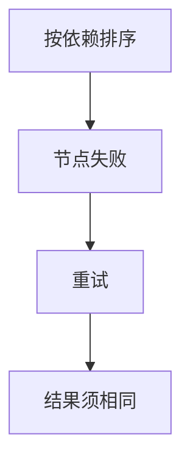
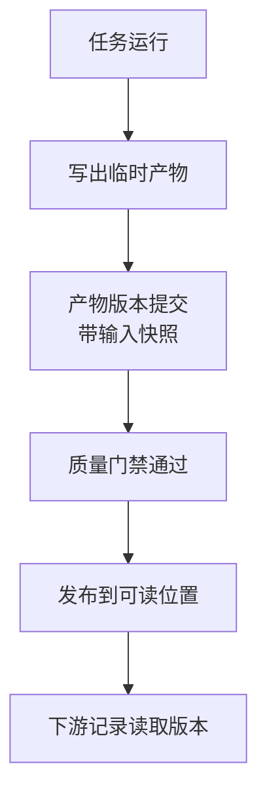
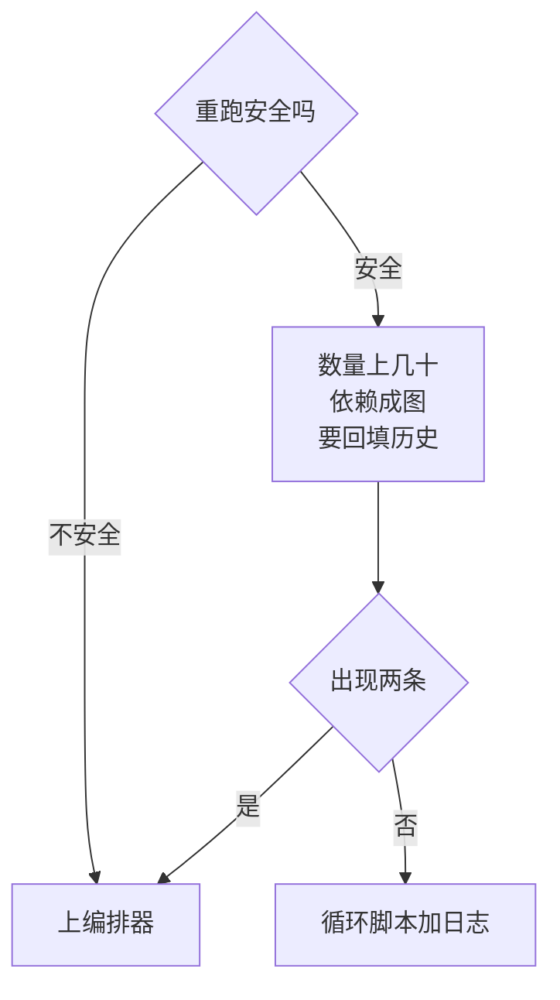

# 数据编排要保证依赖、重试与幂等

**任务之间有依赖、有分区、有时间窗口，一次迟到或崩溃就可能产出缺失、重复或覆盖新结果的产物**。读完这篇你能定义任务身份让重跑安全，能安排临时写入加原子提交，也能判断编排器成功之后的哪些事仍要自己验。

## 先记住哪几句



**重试能安全进行的前提是幂等（同一操作执行一次和执行多次结果相同）**：


| 维度 | 回答 |
| --- | --- |
| 要解决的问题 | 多个数据任务有依赖、分区和时间窗口，迟到、崩溃或重复触发会导致产物缺失、重复写入或覆盖新结果。 |
| 本质 | 编排器维护带输入快照（某一时刻的完整只读副本）和产物版本的状态图；重试的意义建立在同一输入下可安全重放这一前提上。 |
| 做法 | 用数据集、分区、窗口、代码 revision 和输入快照定义任务身份，临时写入后原子提交，显式记录 attempt、回填和失败状态。 |
| 效果与代价 | 任务可重跑、补数、恢复和审计；代价是版本存储、调度状态、资源竞争和幂等设计复杂度。 |
| 边界 | 调度成功不等于业务指标正确或下游已消费；无限重试、跳过和部分成功不能替代数据质量与发布门禁。 |
| 验证 | 注入 worker 崩溃、依赖迟到、重复触发、空分区、schema 变化和回填并发，核对产物版本、下游可见性和重建能力。 |

**数据任务是带输入版本、分区、时间窗口和产物的有向图。调度器负责依赖、触发、重试、并发和状态；它不负责证明业务指标正确或下游已经消费新数据**。

一个任务显示成功，可能只是文件写完，尚未通过质量门禁或被下游读取；如果重试没有绑定输入快照，还可能用新数据覆盖旧版本。编排的核心是**让「这次运行处理了什么、产出了什么、谁可以看到」可追**踪。

**这也是为什么数据平台的绿色任务状态不能直接当成指标可信：任务完成、质量通过、索引发布和下游可见是不同状态，必须在图中分别表示**。



「终端上那个绿色对勾覆盖了几种状态」：临时产物写出、产物版本提交、质量门禁通过、下游可见是四个不同状态，编排器的任务成功通常只表示第三步之前完成。下游看到的可见性与业务可信度取决于**后两步是否执行**，把四步在图上分开表示，才能避免把「任务跑完了」直接当成「指标可信了」。

## 任务身份怎么定

```text
dataset + partition/window + code revision + input snapshot -> output version
```

重试必须幂等：（同一操作执行一次与执行多次结果相同）写临时产物后原子提交、使用分区/版本键、记录 attempt 和输入快照。回填会与实时任务竞争资源；暂停、跳过、失败、部分成功和手工重跑必须是显式状态。


来源：[CSDN @bjmayor《图解分布式事务模式》](https://bjmayor.blog.csdn.net/article/details/154004146)（CC 4.0 BY-SA）


来源：[CSDN @bjmayor《图解分布式事务模式》MQ 事务消息一图](https://bjmayor.blog.csdn.net/article/details/154004146)（CC 4.0 BY-SA）


## 动手跑一遍会看到什么：一个会重复执行的调度任务

同一段写库任务，有幂等键（请求自带唯一标识，重复提交只生效一次）与没有幂等键在重试下的不同结局：

```python
# 任务：把昨天的订单汇总写入 ads 表（每天调度，失败自动重试 3 次）

# 无幂等：重试后 ads 表出现两份 9-22 的汇总（INSERT 直接追加）
#   count(*) where dt = '2026-09-22' → 2 行，下游 SUM 翻倍

# 有幂等：任务身份 = (task_name, partition_date)，写入前先删后插或 INSERT OVERWRITE
DELETE FROM ads.daily_summary WHERE dt = '{partition}';
INSERT INTO ads.daily_summary SELECT ... WHERE dt = '{partition}';
#   重试 N 次结果一致——幂等的定义是"重复执行无副作用"
```

跑一遍的收获：**幂等键的选择决定重试的安全性——按分区重算的任务天然可幂等，增量追加类任务要靠业务键去重（external_id 唯一约束）**。**编排器给的重试是杠杆，幂等是支点，缺支点的重试把小故障放大成数据事故**。

## 这些结论的量级靠什么数字支撑

重试的退避账：**指数退避（1s → 2s → 4s → 8s，上限 5 次）覆盖 99% 的瞬时故障，总等待 15 秒；不退避的立即重试 3 次对瞬时故障的修复贡献接近零，反而把下游打得更痛**——重试风暴（重试流量层层放大、让故障雪上加霜）的数学是：**下游恢复到 80% 容量时，积压的重试集中涌入，利用率瞬间回到 100%，再次过载**。**退避要加抖动（±20%），否则同批任务的整齐重试等于一次同步洪峰**。

与 [[工程知识/数据系统：在并发与故障中保存事实/数据管道与流处理/CDC把数据库变化传播为可重放事实]] 的衔接：CDC（变更数据捕获，把数据库变更抽成可订阅的事件流） 的位点（消费进度的记账标记，记录处理到哪一条）重放与调度的分区重算**共用同一条幂等纪律——重放安全来自"任务身份 + 覆盖语义"**；[[工程知识/AI 系统工程：从模型能力到生产能力/Agent与工作流/Agent状态机与任务恢复：进度是状态不是聊天记录]] 的外部动作幂等键是同构设计在 Agent 域的形态。

## 依赖到什么规模才值得上编排器：怎么判断

编排器传递的是任务身份与依赖信号，不是数据本身。大载荷单独存放、消息里只带引用凭据，是这个原则的标准形态：

「任务身份带输入快照」在计算集群里的实物形态是作业系统的任务指纹：调度器为每个作业记录数据集快照版本、代码版本与分区标识，重试时按同一指纹重放——产物与前一次逐字节一致（重试幂等）；快照版本变了就是新任务，不许覆盖前一批的产物：


*图源：Wikimedia Commons，Mixabest，公有领域，https://commons.wikimedia.org/wiki/File:Salle_des_machines_1.jpg。*

编排器任务身份四元组——数据集、分区、代码版本、输入快照——与《营造法式》「卷次 + 工作名 + 料例版本」同理：照原样重做可复现，料例变了还盖旧版的印，就是用新数据冒充旧版本。

这条原则同样解释了编排器的适用边界。依赖只有三五条、重试靠脚本重跑就能解决时，引入编排器只是把复杂度换了个地方；依赖成网、且需要区分「这次重试是同一任务还是新任务」时，任务身份才必须被显式建模。

任务数量少、依赖是线性的、失败靠人看日志重跑，**这几条同时成立时，用调度器维护状态图的成本高于它带来的收益——一个带日志的循环脚本就够**。任务数量上升、依赖成为一张图（多个上游汇聚到同一个下游、下游又分叉）、需要按分区回填历史，**这三条里出现两条，手写脚本的失败处理就会失控：谁在等谁、哪些分区跑过、重跑会不会覆盖别人的产物，全靠人记**。

上不上编排器看这三条是否出现两条、以及「重跑是否安全」这一问落在哪一侧，不看任务个数



**中间地带的分界点落在「重跑是否安全」这一问上：重跑安全的任务可以先用脚本凑合，重跑不安全的任务必须由编排器提供身份与状态记录**。

**判断的依据是失败重试的复杂度，不是任务数量本身**。三个互相依赖的任务、每天跑一次、失败就人工重跑，用调度器属于过度设计；**三十个任务、依赖深度五层、每周要回填一个月的分区，手写脚本的失败路径会有组合级的遗漏**。中间地带的分界点在「重跑是否安全」这一问上——重跑安全的任务可以用脚本凑合，重跑不安全的任务需要编排器提供任务身份与状态记录。

## 怎么自己动手验证

编排可靠性要与重复触发对账——**预写 worker 崩溃后重跑不应覆盖出错误产物、任务可从任意版本重建，实测出现半成品，与预期对不上**。

注入 worker 崩溃、依赖迟到、重复触发、上游空数据、schema 变化、分区缺失、重试和回填并发；检查是否重复/覆盖错误产物、是否可从任意版本重建、下游是否看到一致快照。AI/RAG（检索增强生成）索引构建也应使用相同的任务身份和发布门禁。

关系：[[工程知识/数据系统：在并发与故障中保存事实/数据管道与流处理/CDC把数据库变化传播为可重放事实]] · [[工程知识/后端系统：在并发、失败与变化中维持服务/任务与并发/任务生命周期必须覆盖进程、日志、超时与清理]]
- [[工程知识/后端系统：在并发、失败与变化中维持服务/任务与并发/分布式锁的正确与错误用法：fencing与租约.md]] —— 锁失效的兜底：幂等设计
- [[工程知识/后端系统：在并发、失败与变化中维持服务/服务设计/优雅停机的完成语义：排空连接与任务交接.md]] —— 消息交接的幂等兜底
- [[工程知识/后端系统：在并发、失败与变化中维持服务/服务设计/事件驱动架构的解耦代价：最终一致与可追溯性.md]] —— 消费侧的重试与幂等
