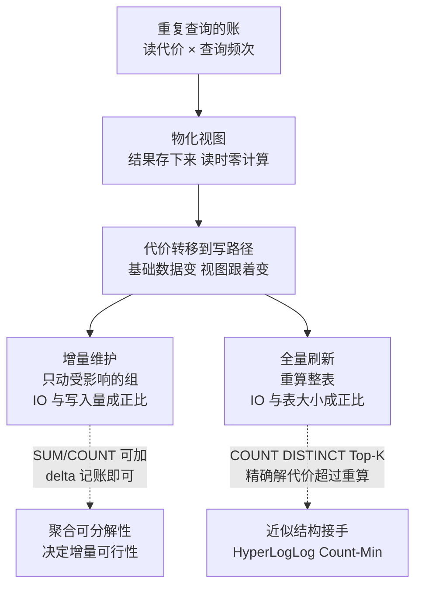

# 物化视图把重复计算变成增量维护

每五分钟跑一次的报表 SQL，读同一批数据、算同一个聚合，每次从零扫描。**要解决的问题是：查询代价与查询频次的乘积被重复支付。**读完这篇你能判断该不该把计算从读时挪到写时。

物化视图（materialized view）把查询结果存下来，读时零计算；代价转移到写路径——基础数据每次变化，视图要跟着更新。它本质是**把计算从读时挪到写时**，与 [[工程知识/数据系统：在并发与故障中保存事实/数据建模与SQL/聚合边界由业务不变量而不是ER图决定]] 的"读时计算 vs 写时计算"是同一取舍家族。

## 它是怎么做到的：三种维护策略

| 策略 | 刷新时机 | 一致性窗口 | 适用 |
| --- | --- | --- | --- |
| 定时全量 | cron（Unix 的定时任务调度器）/手动 REFRESH | 两次刷新之间 | 小表、可容忍滞后 |
| 增量维护 | 基础表写入触发 delta 更新 | 秒级 | 聚合可分解（SUM/COUNT 可加） |
| 流式物化 | Flink/流引擎持续算 | 毫秒级 | 实时大屏、风控 |

代价从读路径挪到写路径的完整账：



物化视图的核心交换：**查询代价与频次的乘积一次性换成写路径的持续维护**——**增量维护按写入量记账**（每次只动受影响的组），**全量刷新按表大小记账**（每次重算整表），两条虚线把可行性判据挂出来：**聚合函数可分解（SUM/COUNT/AVG（SQL 求平均的聚合函数）分量）走增量，不可分解（COUNT DISTINCT、Top-K）用近似结构换**。选错维护策略的形态在刷新风暴一节展开。

**聚合可分解性决定增量可行性：SUM/COUNT/MIN（SQL 求最小值的聚合函数）可加，delta 记账即可；AVG 存 SUM+COUNT 两个分量再相除；COUNT DISTINCT 与 Top-K 需要近似结构（HyperLogLog、Count-Min Sketch），精确解的增量维护代价可能超过重算。**

增量维护在原理层面的样子是这样的——不重算整份结果，而是拿上一次的旧结果加上输入的变化量（Δ），推出这一次的新结果：


*图源：Wikimedia Commons「Incremental computing」，作者 Evithyan，许可 [CC BY-SA 4.0](https://creativecommons.org/licenses/by-sa/4.0/)。图上只有 Δ 这一个箭头参与从旧输出到新输出的推导，这正是增量维护能按写入量记账的原因；中间那个虚线框提醒的是前提——只有运算能被拆成"旧结果 + 变化量"的形式，这条路才走得通，COUNT DISTINCT 这类运算就在这一步被挡下。*

「汇总页跟着流水走」的实物原型是账房的誊抄册：流水账每天记，总账房把"每渠道每月销售额"誊在单独的汇总册上——流水新增一笔，只改汇总册上对应那一格的数，不必把整本流水重算一遍；誊抄的规则（哪些格子可加、哪些要重算）就是聚合可分解性：


*图源：Wikimedia Commons，作者 Mannequin-，CC BY 2.0，https://commons.wikimedia.org/wiki/File:Old_book_-_Basking_Ridge_Historical_Society.jpg。*

物化视图就是那本汇总册：定时全量是每逢月初重誊一遍，增量维护是流水进一笔改一格——SUM/COUNT 这类可加的格子誊起来最省，COUNT DISTINCT 这类"数人头不重样"的格子誊不准，得靠 HyperLogLog（用极小内存估算去重个数的近似算法）那样的近似记法。

这套「逐级把重复计算预拼好」的思路，在数据仓库（面向分析、按主题整理好的历史数据存储）的分层架构里是标配画法：业务库的数据先进 ODS（贴源层），经集成层进入数据仓库主体，再往下切出一块块面向具体主题的数据集市——每一层的输出都是下一层的「已算好的表」，查询打到哪一层，哪一层就不用重算上游的账：


*图源：Wikimedia Commons《Data Warehouse & Data-Marts overview.svg》，作者 MarsJson，CC BY-SA 4.0，https://commons.wikimedia.org/wiki/File:Data_Warehouse_%26_Data-Marts_overview.svg 。从左到右每一段 ETL（Extract-Transform-Load，抽取、转换、加载：把数据从源头搬运整理进目标存储的流程） 都是一次「算好再存」：数据集市就是业务主题级的物化视图，报表查询打到 Mart 上，不必回头扫 Data Vault 与 ODS——**分层架构把「重复计算」在空间上切成层级，物化视图把「重复计算」在时间上换成写入时的增量维护，两者是同一个思想在不同维度上的展开**。*

## 刷新风暴与并发读写怎么处理

全量刷新的问题：**扫全表期间视图被锁或读到半新半旧**。PostgreSQL 的 REFRESH CONCURRENTLY 走临时结果 + 原子切换；流式引擎用 checkpoint 保证视图版本与基础表位点（消费进度的记账标记，记录处理到哪一条）一致。**CONCURRENTLY 的约束条件在官方文档里写得很具体——不带它时刷新会阻塞并发读，带它时要求视图上至少有一个覆盖全部行的 UNIQUE 索引，且同一视图同一时刻只允许一个 REFRESH 在跑**：


*图源：[PostgreSQL 官方文档 · REFRESH MATERIALIZED VIEW](https://www.postgresql.org/docs/current/sql-refreshmaterializedview.html)（页面截图，2026-09-27）。临时结果加原子切换的代价写在参数要求里：UNIQUE 索引是并发刷新的前置成本，「刷新期间读不阻塞」不是白来的。并发读的隔离语义：读到的视图对应基础表的某个一致快照，不是"正在变化的部分状态"，这与 [[工程知识/数据系统：在并发与故障中保存事实/事务与存储/事务隔离决定并发读写能观察到什么]] 的快照读同族。*

## 动手跑一遍会看到什么：增量维护的账

可运行示例：一个"每渠道每日销售额"的物化视图，两种维护方式的代价：

```sql
-- 定义：物化视图 = 预算好的查询结果
CREATE MATERIALIZED VIEW sales_by_channel AS
SELECT dt, channel, SUM(amount) AS total, COUNT(*) AS cnt
FROM orders GROUP BY dt, channel;

-- 方式 A：全量刷新（每小时重算整表）
REFRESH MATERIALIZED VIEW sales_by_channel;
-- 10 亿行基表 → 每小时扫全表一次，IO 与 CPU 恒定高企

-- 方式 B：增量维护（基表写入时只动受影响的组）
-- 新写入：orders 追加 (2026-09-23, app, 88) 一行
-- 维护动作：只对 (2026-09-23, app) 这一组做聚合合并
--   total += 88, cnt += 1   → IO 与写入量成正比，与表大小无关
-- 支持增量聚合的函数：SUM/COUNT/AVG，MIN/MAX（可比较合并）
-- 不支持的：MEDIAN、COUNT(DISTINCT)（需 HLL 等近似结构替代）
```

物化视图与源表不一致的实录形态——刷新延迟窗口内读到旧值（最终一致），报表对不上实时大屏，两种读法要对同一延迟语义达成一致（要么都读视图，要么标刷新时间戳）；[[工程知识/数据系统：在并发与故障中保存事实/数据管道与流处理/数据编排要保证依赖、重试与幂等.md]] 的幂等（同一操作执行多次与执行一次效果相同）纪律直接适用——增量维护的合并动作天然可重放（加两次同一行会算重），任务身份与去重键在这里同样是安全线。

## 怎么自己动手验证

增量维护要与全量重算对账——预写写入已知增减量后刷新得到的视图值应与全量重算完全相等，不等即与预期对不上，说明增量逻辑漏了分支。

- PostgreSQL：EXPLAIN ANALYZE 对比物化前后的查询计划与耗时；刷新期间并发 SELECT 是否阻塞（锁等待事件）。
- 增量正确性：基础表写入已知 delta（+10 条、-3 条），刷新后视图值与全量重算值必须相等——这是不变量检查，方法见 [[工程知识/缺陷分析：从个案到体系/正确性/静默失真的检测靠对账与不变量而不是报错]]。
- ClickHouse/Flink（流式计算引擎）：物化视图的滞后（view lag）作为 SLI（服务等级指标，衡量 SLO 的原始信号）持续监控，滞后超过 SLO（Service Level Objective，服务等级目标：内部设定的具体指标值）的刷新周期要报警。

## 这套说法在哪儿会失效

- 物化视图是读优化的空间换时间，不是正确性保证：视图与基础表的一致性靠刷新机制承诺，机制坏了就是静默失真，对账是必须的防线。
- 复杂连接的增量维护可能退化为重算：join 键分布变化、多级视图级联刷新，代价结构在 [[工程知识/数据系统：在并发与故障中保存事实/数据管道与流处理/批处理与流处理共享逻辑但不共享时间语义]] 的时间语义下才谈得清。
- 写入洪峰时增量维护自身成为瓶颈：视图更新的写放大（实际写入量是逻辑写入量的多倍）与 LSM（日志结构合并树：先把写入攒在内存里，再批量顺序写盘）的 compaction 竞争同一批 I/O（[[工程知识/数据系统：在并发与故障中保存事实/事务与存储/LSM树用写放大换取顺序写和可扩展性]]）。

## 接着读哪几篇：宽行预拼的物化方案

- [[工程知识/数据系统：在并发与故障中保存事实/数据建模与SQL/聚合边界由业务不变量而不是ER图决定]]：物化视图物化的往往就是聚合，聚合边界决定哪些视图可物化
- [[工程知识/数据系统：在并发与故障中保存事实/数据治理/数据质量与血缘让指标可以被解释]]：视图是血缘链的节点，级联刷新的血缘（数据血缘：一条数据从哪个上游来、被哪些下游消费的沿路记录）导航
- [[工程知识/数据系统：在并发与故障中保存事实/查询与索引/列式存储把扫描与压缩交给分析路径]]：分析型物化视图的存储底座
- [[工程知识/数据系统：在并发与故障中保存事实/查询与索引/列存与向量化执行：OLAP引擎快的两个来源.md]] —— 宽行预拼的物化方案
