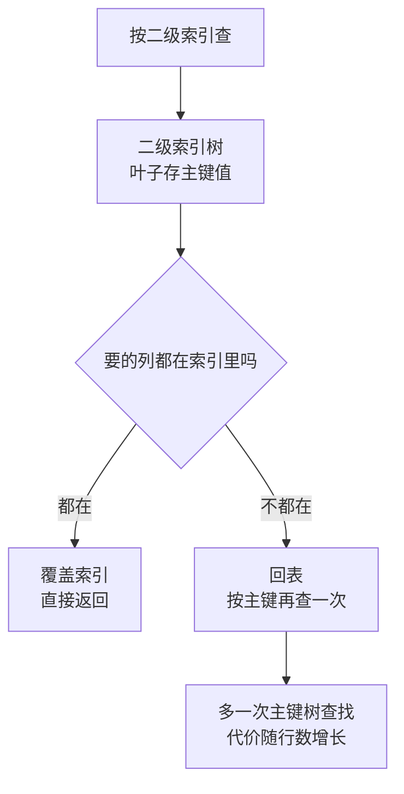
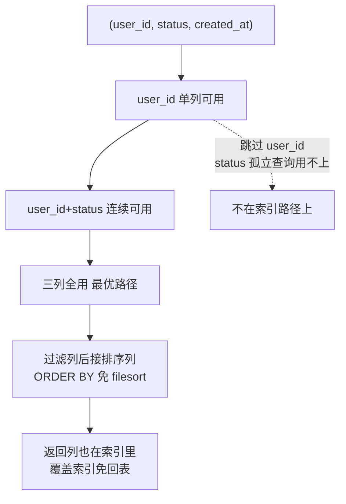
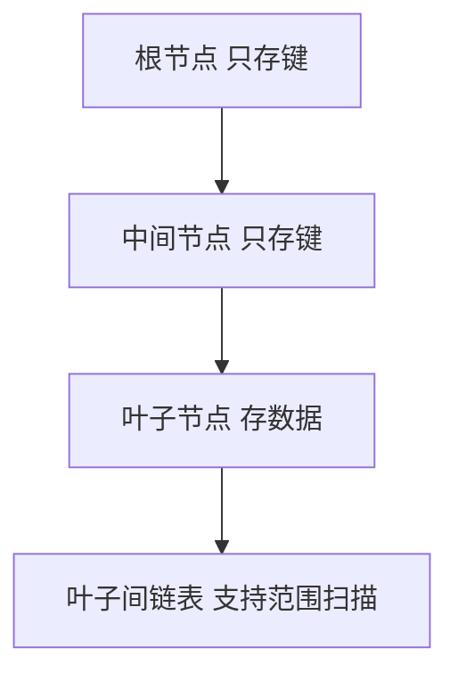

# B+Tree 索引为访问路径服务

**索引为特定过滤、连接、排序和覆盖路径保存有序导航结构；它用写放大（一次逻辑写入引发多次物理写入）、空间和维护时间换取读取时少扫描一些页，「越多越快」不成立。**一个索引是否有效，只能在真实数据分布和查询计划下判断。**读完你能判断一个索引是为哪条查询路径服务的，以及回表（通过二级索引找到主键、再回主键索引取整行数据）次数多时该加覆盖列还是改查询。**

## 要解决的问题：索引为哪几类访问路径服务：查询为什么要走索引

好比餐馆的菜单越印越厚（索引越建越多），客人点菜却没觉得更快（查询没变快），厨房备菜反而更慢了（写入变慢）、菜谱柜也塞满了（空间增长），没人说得清哪几页菜单真的被翻过。**索引数量持续增加而查询没有变快，写入反而变慢，占用的空间也在增长，无法判断哪个索引真的被查询使用。**本篇回答：**索引为哪几类访问路径服务、它用哪些代价换取读取时的扫描减少、有效性依据什么判断、以及真实数据分布下应当核对执行计划的哪些部分。**比喻到「没人翻的菜单」为止，索引为哪几类路径服务看下文。

## 索引快在哪儿、贵在哪儿：最小索引实验

**固定数据量和缓存状态，比较无索引、单列、联合和覆盖索引（查询所需字段全在索引里、不必回表取数据）的实际扫描行数、回表次数、写入成本与 p95；再改变选择性、排序和分页深度。**若估算行数与实际行数偏离，**先检查统计信息和数据分布，不要仅凭 `EXPLAIN` 的一行 `key` 宣布优化成功。**


来源：[腾讯云开发者社区《一篇文章讲透MySQL为什么要用B+树实现索引》查找流程一图](https://cloud.tencent.com/developer/article/1543335)（CC 4.0 BY-SA）


来源：[腾讯云开发者社区《一篇文章讲透MySQL为什么要用B+树实现索引》结构对比一图](https://cloud.tencent.com/developer/article/1543335)（CC 4.0 BY-SA）


## 查了索引为什么还要回表：B+Tree 与回表

**先把形状说成一件事：B+Tree 像图书馆的书目卡片柜——卡片按书名排好（索引有序），每张卡片上写着书架号（主键）。查"某书名的书"先翻卡片柜（查二级索引），卡片上只有书架号，要拿到书本身还得跑去书架取（回表）。如果卡片背面把作者、出版社也抄全了（覆盖索引），翻完卡片就不用跑书架。**这个比喻到"跑书架"为止——**现实里卡片柜查询是纳秒到毫秒级，回表是按主键再到聚簇索引（叶子节点直接存放整行数据、表本身就按主键组织）树走一遍，扫描行数多时来回次数才是性能大头**，这正是下面执行流程图要展开的。



**回表是按主键再走一次索引树**，是否触发取决于**要取的列是否都在索引里：**


InnoDB 是索引组织表：主键索引（聚簇索引）的叶子节点保存整行，二级索引叶子节点保存索引列和主键值。**二级索引命中后再查主键索引称为回表；只查询二级索引已有列则是覆盖索引，可减少随机 I/O。**

```text
二级索引 -> 主键值 -> 主键索引 -> 整行
覆盖索引 -> 二级索引叶子节点直接返回
```

**主键应尽量短、稳定、单调递增**。随机、宽大的业务主键会**放大所有二级索引的空间和页分裂（页写满时把一页拆成两页的操作）成本**；是否使用业务字段做主键要结合唯一性、长度、写入顺序和迁移风险判断。

B+Tree 的两层结构——**内部节点只放导航键、叶子节点才挂数据指针、叶层从左到右串成链表**：


*B+ 树的索引集与顺序集（图源：Wikimedia Commons，Aexpedito 绘，CC BY-SA 3.0）*

三件事在图上各就各位：**范围扫描沿叶层链表从左走到右不用回爬树；InnoDB 的聚簇索引把图里的 d 指针换成整行数据，二级索引把 d 换成主键值——回表就是从二级索引的叶子拿到主键再走一遍这棵树；内部节点只存键不存数据，同样的 16KB 页能塞更多导航键，树的扇出（一个请求分发给多个下游并行处理）因此更大、三层能扛千万行。**

抽象结构落到具体行，小林 coding 的实例图把三要素画进了真实数据——根节点只放键值 1/10/20 做导航，中间节点放分隔键，叶子节点才挂完整数据行（0001 apple 6.00 一行三列），叶层之间的箭头就是范围扫描走的链表：


*图源：[小林 coding《从 B 树到 B+ 树》](https://www.xiaolincoding.com/mysql/index/index_interview.html)，原创图注明出处转载。*

## 多个条件怎么共用一个索引：联合索引设计

拿一个具体查询做例子：

```sql
SELECT id, amount, created_at
FROM orders
WHERE user_id = ? AND status = 'paid'
ORDER BY created_at DESC
LIMIT 20;
```

**分别给 `user_id`、`status`、`created_at` 建三个单列索引，通常仍要扫描、回表和排序大量候选行。更贴合访问路径的是 `(user_id, status, created_at DESC)`；若把返回列也纳入合适的覆盖结构，还能减少回表。「等值、范围、排序」只是排列时的参考次序，列序的最终依据是从真实查询、选择性和执行计划验证这条路径能否少读页、少排序。**

- **遵循最左前缀：`(a,b,c)` 可支持 `a`、`a,b`、`a,b,c` 的连续前缀，不能把 `b` 单独当作同等路径。**
- **字段顺序先看查询模式和选择性，再看排序、分组、覆盖和复用能力；不要只按「区分度从高到低」机械排列。**
- **让索引尽可能覆盖过滤、连接和排序，减少回表；同时控制索引数量，避免写放大、空间和维护成本。**
- **对低选择性字段（如状态）不要孤立建索引，除非与其他条件组成有效联合索引（对多个列组合建立的索引，遵循最左前缀）。**

联合索引的可用路径在键序上从左向右连续，这条规则的形状是这样的：



**最左前缀的几何形状：可用路径从最左列起逐列连续生长（竖向从上到下），断列即断路径——`status` 单独查询落在虚线分支，只能另建或改写。最优路径的两个延伸条件接在同一枝上：排序列紧跟过滤列免掉 filesort，返回列纳入索引免掉回表，这两个延伸正是覆盖索引设计的入口。**

## 长字符串怎么建索引：字符串索引

**就像图书馆书太多放不下完整书名，就按书名前几个字排架（前缀索引）：找书快了，但同前缀的书要一本本翻（候选行变多），而且光靠架子上的前缀没法确定这就是要的那本（不能覆盖）。**前缀索引 `INDEX(email(8))` **节省空间，但可能扫描更多候选行，且不能提供完整覆盖索引。**用实际数据测量不同前缀长度的 `COUNT(DISTINCT LEFT(col,n))`，并用线上查询验证。比喻到「前缀排架」为止，hash 列与倒序存储两种替代做法见下文。

只需要等值查找、又无法承受长字符串索引时，可考虑：

- 增加规范化后的 hash/CRC（循环冗余校验，用除法余数检查数据有没有损坏）列并建立索引，命中后再用原值校验；需要处理 hash 冲突。
- 倒序存储解决后缀等值查询，但不支持范围查询，并增加读写转换成本。

## 索引类型怎么选：普通、唯一与 change buffer

**普通索引像普通账本（先记着再批量回改，所以能攒一批一起记），唯一索引像公证处（办的时候就要当场查重，错一次都不行）。查询性能差异通常很小；唯一索引需要更早检查冲突。**

目标页不在 Buffer Pool（数据库在内存中缓存数据页的区域）时，普通二级索引的变更可以先写入 change buffer（缓存二级索引变更的暂存区），减少随机读，后台或访问该页时 merge（合并回索引树）。**写多读少收益较好，写后立即读会很快触发 merge，可能抵消收益。**

性能上的差距是可量化的摩擦，数据约束上的差距是**「错一行就出事」的硬边界**——摩擦可以调参数换，硬边界换不了。比喻到「账本与公证处的分工」为止。

**因此索引类型首先由业务约束决定：确实需要唯一性才用唯一索引；不能为了 change buffer 牺牲数据约束。对写多读少的历史/日志类表，再评估 change buffer 参数和磁盘类型。**

## 明明有索引为什么没用上：优化器选错的原因

相当于导航选了绕远的路，多数时候是它的路况估计过时了（统计信息失真），少数时候是你输入的目的地格式它读不懂（隐式转换、函数包住列）。**优化器根据基数、采样（只采集一部分数据以控制记录开销）统计、直方图（版本支持时）、回表成本和排序成本估算扫描行数。数据分布变化、相关列统计失真、参数化查询和索引过多都可能让估算偏离实际。**比喻到「估计过时」为止。排查时按下面的清单走：

1. **对照实际执行计划和数据分布，确认不是缓存、锁或 I/O 问题。**
2. **`ANALYZE TABLE` 更新统计信息，必要时补充直方图。**
3. **改写谓词或排序表达式，使目标索引的成本更清楚；检查隐式转换和函数。**
4. **索引提示的使用门槛：验证结果稳定、且有回归测试（改动后重跑旧用例、确认没有破坏既有功能）保护。长期方案是调整索引或数据模型，提示属于过渡手段。**

## 排序连接分页为什么也吃索引：排序、JOIN和分页

- **`ORDER BY` 若不能沿索引顺序输出，会出现 `Using filesort`；检查联合索引的过滤列、排序列和方向。**
- **大偏移分页会扫描并丢弃前面的行；优先使用基于稳定键的 seek/keyset pagination。**
- **JOIN（把多张表按关联字段拼在一起查询）不是原罪。保证连接列类型一致、有合适索引、驱动表过滤充分，并用执行计划确认嵌套循环的实际代价。**
- **多表大批量连接可评估 Multi-Range Read（多范围读，先收集主键再排序后回表）、Batched Key Access（批量键访问，成批回表减少随机读）或先缩小中间结果；靠改写 SQL 把语句分小并不能规避问题。**

## 改写查询时哪些不能碰：查询改写底线

```sql
-- 可能失去索引范围能力
WHERE YEAR(created_at) = 2026

-- 将范围改写为可搜索谓词
WHERE created_at >= '2026-01-01'
  AND created_at <  '2027-01-01'
```

同时检查字符串与数字的隐式类型转换、`LIKE '%x'`、无界 `ORDER BY`、`SELECT *` 和未限制的 `IN` 列表。任何改写都要以等价性测试和真实数据基准为准。

## 索引设计的结论怎么验证：验证哪些事



**B+Tree 的节点只放键换来更大的扇出，层数因此被压低**：


1. **使用情况核对：按 `performance_schema` 或引擎自带的索引统计，列出每个索引被查询使用的次数，预期长期未被使用的索引可以从候选名单里排除。**
2. **代价测量：在保留与删除某一索引两种状态下分别执行同一批写入，记录写入耗时与占用空间的变化，确认索引的写放大代价。**

3. **计划核对：对目标查询核对执行计划里的访问类型、命中的索引与扫描行数，确认走的是设计时预期的访问路径。**
4. **分布验证：在真实数据分布（含重复值与极值）上复跑同一查询，预期索引选择性在倾斜数据下仍然成立。**

5. **编码等价：核对查询参数类型与列类型一致，避免隐式转换让索引无法被使用。**
6. **断言锚点：每个索引都有对应的查询，执行计划与设计预期一致，写入代价经过测量，查询改写经过等价性验证。**

## 接着读哪几篇：索引是慢查询治理最常用的终点手段

- [[工程知识/数据系统：在并发与故障中保存事实/查询与索引/慢查询治理从发现到索引闭环|慢查询治理从发现到索引闭环]]——索引是慢查询治理最常用的终点手段
- [[工程知识/数据系统：在并发与故障中保存事实/查询与索引/一条SQL如何穿过优化器与存储引擎]]
- [[工程知识/数据系统：在并发与故障中保存事实/事务与存储/事务隔离决定并发读写能观察到什么]]
- [[工程知识/数据系统：在并发与故障中保存事实/可靠性与运维/MySQL空间、容量与在线运维]]
- [[工程知识/性能工程：从用户等待到资源瓶颈/观测与诊断/性能问题定位]]
- [[工程知识/数据系统：在并发与故障中保存事实/可靠性与运维/分区再平衡的三种策略：固定取模与一致性哈希.md]] —— 范围分区的索引基础
- [[工程知识/数据系统：在并发与故障中保存事实/事务与存储/存储引擎的两大路线：B树与LSM的写读取舍.md]] —— B 树索引机制与本篇的代价结构
- **索引选择的边界：B+ 树在等值与范围查询上最优，但写入要维护全部索引（每个索引都是一份有序结构）、空间翻倍、以及低选择性列上的索引无效（区分度低的列优化器会弃用）；数据倾斜（数据分布不均、部分节点过忙而其余闲置）与统计信息过期都会让优化器做出与预期不同的选择。**
- [[工程知识/缺陷分析：从个案到体系/硬件故障/读路径的排序要按裁剪后的集合算：请求级的过滤先于全局的排序.md]] —— 读路径上的过滤与排序有先后：裁剪后的集合才是排序的输入
