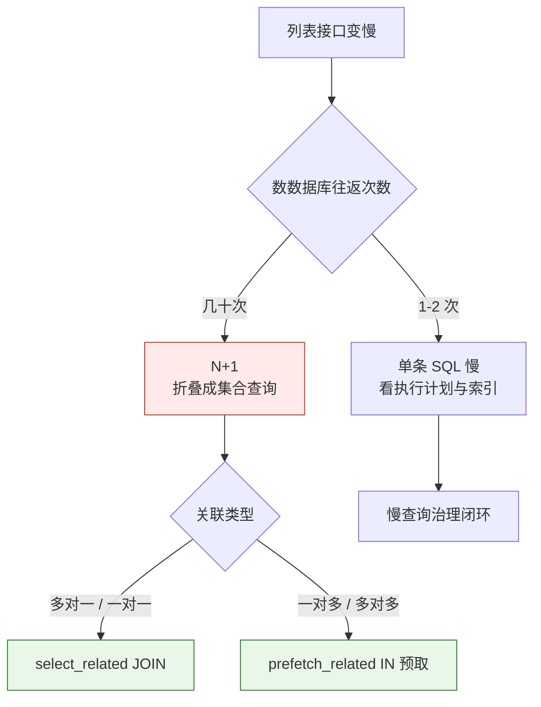

# N+1查询是ORM替你隐藏的循环：从列表页到批量化

**N+1 查询是「1 次列表查询 + N 次逐条关联查询」的执行形态，根源是 ORM 把关联读取变成了随取随发的隐式循环。** 读完你能回答：为什么列表页在测试环境正常、上线后超时，为什么 `select_related` 与 `prefetch_related` 是两类不同的解法，为什么循环里逐条 `UPDATE` 是同一疾病。

## 要解决的问题

```python
orders = Order.objects.all()[:50]        # 1 条 SQL
for o in orders:
    print(o.user.name)                   # 每次触发 1 条 SQL
```

第一行看着像一次查询，第二行在循环里又发了 50 次。ORM 的关联属性（`o.user`）访问时才发现没加载，于是现场补一条 `SELECT ... WHERE id = ?`。接口响应时间是 **51 次数据库往返的累加**：本地延迟 0.5ms 时 25ms 无感，跨可用区 2ms 时就是 100ms 起步，再乘上连接池排队，列表页超时。

这类缺陷**在功能测试里完全隐形——数据 10 条照样过，数据 10000 条才发作**。它是「接口为什么慢」的高频病因，原因不复杂：**成本不在任何一条 SQL，在往返次数。**

## 机制：三个层面的解法

### 数据层：把循环折叠成集合查询

| ORM 手法 | 生成的 SQL | 适用 |
| --- | --- | --- |
| `select_related`（SQL JOIN） | 1 条 JOIN 取回主表+关联表 | 外键（多对一），行数可控 |
| `prefetch_related`（两次查询+内存拼接） | 2 条：列表 1 条、`WHERE id IN (...)` 1 条 | 多对多、反向外键 |
| 显式字段 `only()` / `values()` | 减少列宽 | 配合上面两种用 |

两种手法方向相同：**把 N+1 折叠成常数次查询**。JOIN **在数据库侧一次完成，适合一对一与多对一**；`IN` 预取**把关联行一次拉回、在应用内存拼接，适合集合关系**——行数爆炸的 JOIN 会被预取的两段式压住。

### 应用层：循环里的逐条写是同一疾病

读方向的 N+1 最出名，写方向的同构形态同样常见：

```python
for uid in user_ids:
    conn.execute("UPDATE users SET last_seen = now() WHERE id = %s", (uid,))
```

1000 个 id 就是 1000 次往返。折叠手法是批量语句：`WHERE id = ANY(%s)` 一次更新、`executemany` / `COPY` 批量写入。判定句统一为：**循环体内出现数据库调用，先问这条调用能不能提到循环外变成一次集合操作。**

### 架构层：往返次数是延迟预算的单位

跨机房或云上 RDS 的单次往返 1-3ms，**一次请求里数据库往返次数直接乘出延迟下限**。慢查询治理看单条 SQL 的执行计划，N+1 治理看**往返计数**——两套度量，前者管「每条多快」，后者管「一共多少条」。观测手段：ORM 的查询计数钩子（Django 的 `connection.queries`、SQLAlchemy 的 `before_cursor_execute` 事件）在测试里断言单请求查询数不超阈值，**把 N+1 拦在 CI 而不是线上**。



## 案例：隐式行为的成本放大是同一结构

[[工程知识/缺陷分析：从个案到体系/性能/案例二十五：库自带了一支军队——OpenBLAS 的隐式线程]] 里，库在暗处自动开线程把资源占用放大了一个量级；N+1 里，ORM 在暗处自动补查询把往返放大了两个量级。两案共享同一条工程判据：**框架替你做的隐式动作，必须在度量里显式可见**——线程数、查询数、连接数，测不出来就治理不了。案例三十七（[[工程知识/缺陷分析：从个案到体系/性能/案例三十七：锁自己变成了瓶颈——争用背后的临界区错配]]）从另一头呼应：**放大出来的大量短查询挤进数据库，锁与连接池的争用把「每条都很快」变成「整体都慢」，单条 SQL 的执行计划永远解释不了这类慢**。

## 怎么测

- 查询计数断言：测试环境给每个接口挂 ORM 查询数上限（如列表接口 ≤ 5 条），CI 里超限即失败——**N+1 复发的主要防线**。
- 数据量矩阵：测试库灌 1 万行关联数据再跑用例，**N+1 的耗时形态（线性于列表长度）会自己暴露**。
- 慢日志与 APM：线上按「单位时间查询条数 ÷ 请求条数」算平均往返数，**突增即告警**。
- 执行计划核对：折叠后的 JOIN/IN 语句过一遍 `EXPLAIN`，确认关联列有索引——**N 次点查折叠成 1 次大查询后，缺索引会让折叠变成新瓶颈**。

## 哪些认识一看就错

- 「加缓存就能治 N+1」——**缓存的是结果，往返结构还在；折叠查询先治结构，缓存再治重复**。
- 「ORM 慢所以手写 SQL」——**慢的不是 ORM 是使用方式，`select_related` 一行折叠 N+1；手写 SQL 不带集合思维照样在应用层循环**。
- 「数据量小无所谓」——**N+1 的成本是往返次数 × 网络延迟，数据量只决定 N；上量之前结构已经错了**。
- 「`prefetch_related` 万能」——**它预取的是固定一种关联，循环里按条件再过滤触发二次查询**（`prefetch` 对象级定制）才知道真实场景。

## 效果从哪来、要付什么代价

折叠把往返次数从 N+1 压到常数，**接口延迟从线性累加变成单次查询成本，数据库的连接占用与锁持有时间同步下降**。代价是内存与代码可读性：**JOIN 一次取回的宽行、预取的全部关联行都要驻留应用内存，`select_related` 链太长会生成巨型 JOIN——折叠深度按页面真实需要的关联层级定，超出部分留给显式二次查询**。查询计数断言是长期的纪律成本，**也是唯一能防止 N+1 随代码演进悄悄回来的手段**。

关系：[[工程知识/数据系统：在并发与故障中保存事实/查询与索引/慢查询治理从发现到索引闭环]] —— 单条 SQL 的发现、归因与索引闭环，与往返计数构成慢的两套度量。[[工程知识/数据系统：在并发与故障中保存事实/查询与索引/一条SQL如何穿过优化器与存储引擎]] —— 折叠后的 JOIN 与 IN 语句如何被优化器接住，决定折叠是收益还是新瓶颈。[[工程知识/软件构建：让变化可以理解、验证与交付/语言与运行时/Python数据访问必须显式拥有连接与事务]] —— 连接与事务的显式边界：隐式获取资源与隐式补查询是同一家族的两种病。
