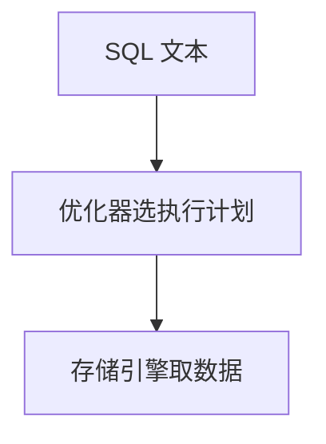
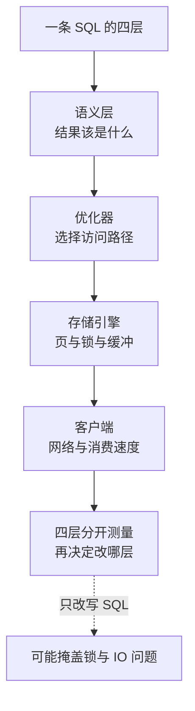
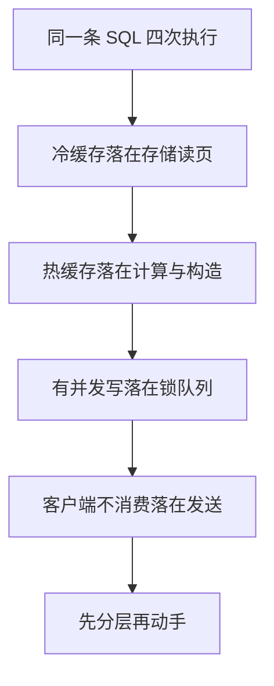

# 一条 SQL 如何穿过优化器与存储引擎

**一条 SQL 的结果和耗时是多层共同产物：语义决定「应该得到什么」，优化器决定「怎样访问」，存储引擎决定「怎样读写页和锁」，客户端还可能在等待网络或消费结果**。把这些层分别看清楚，才能避免用改写 SQL 掩盖锁、I/O 或连接池（预先建好连接反复取用、省去反复握手建连的开销）问题。

## 要解决的问题：慢 SQL 该怪哪一层



**一条查询变慢之后，团队直接改写 SQL，改写之后耗时变化但原因不明，锁等待、存储读写与客户端消费各自的影响无法区分**。本篇回答：语义、优化器、存储引擎与客户端四层各自决定什么、耗时在多处等待中的分布怎样观察、每一层的输出用什么方式核对，以及什么情况下改写语句会掩盖真正的问题。

## 一条 SQL 穿过哪几层：核心模型

**先把形状说成一件事：一条 SQL 像一张下到餐厅的订单——点菜的说法（SQL 语义）决定"应该上什么菜"；经理（优化器）决定哪个厨师、什么顺序做（执行计划）；后厨与仓库（存储引擎）决定食材从哪取、锅怎么占（页与锁）；菜做好还得有服务员端出去、客人动筷（结果传输与消费）**。菜上得慢，可能是经理排错了工单、可能是仓库没货要现去买（缓存未命中）、可能是两个厨师抢同一口锅（锁等待）、也可能只是客人自己吃得慢（客户端消费）。这个比喻到"客人吃得慢"为止——现实里四层各自有测量工具与核对方式，先分层再归因，下面展开。

```text
客户端/连接池
  -> 连接器：认证、权限、连接状态
  -> 解析器：词法和语法
  -> 预处理/语义检查：表列、权限、类型
  -> 优化器：重写、索引、JOIN（SQL 多表关联查询）顺序、访问路径
  -> 执行器
  -> 存储引擎（InnoDB）：页、索引、Buffer Pool、事务、锁
  -> 结果集/影响行数
```

**Server 层是 MySQL（开源关系型数据库）里处理连接、解析与优化的服务层，负责协议、解析、优化和 binlog（MySQL 服务层日志：记录逻辑变更、用于主从复制与恢复）；InnoDB 负责数据页、索引、MVCC（多版本并发控制，同一份数据保留多个版本，读写互不阻塞）、行锁、redo/undo**。排障时先判断问题属于哪一层，否则容易把「SQL 写法问题」和「磁盘/锁问题」混为一谈。

**同一条 SQL 变慢，可能是统计信息让优化器选了错误路径，也可能是锁等待、Buffer Pool（InnoDB 缓存数据页的内存区域）未命中、磁盘抖动（性能指标不稳定的起伏）或客户端读取过慢**。先把逻辑计划、物理执行、存储等待和结果传输分开测量，才能避免用改 SQL 掩盖系统层瓶颈。

**SQL 文本、执行计划和端到端耗时是三个不同观测面；只贴一张 `EXPLAIN` 不能证明线上瓶颈，也不能证明结果在并发下仍然正确**。



耗时的归属：同一句变慢可能出在四层任何一层——语义层是结果集设计，优化器是统计信息与成本估算，存储引擎是页读写与锁等待，客户端是结果消费速度。四层的测量手段不同（EXPLAIN、performance_schema、锁等待视图、应用侧计时），先把每层分开量，才能避免用改写 SQL 掩盖锁或 I/O 的真实瓶颈。


来源：[腾讯云开发者社区《一篇文章讲透MySQL为什么要用B+树实现索引》查找流程一图](https://cloud.tencent.com/developer/article/1543335)（CC 4.0 BY-SA）


来源：[腾讯云开发者社区《一篇文章讲透MySQL为什么要用B+树实现索引》二叉查找树一图](https://cloud.tencent.com/developer/article/1543335)（CC 4.0 BY-SA）


## 语句很简单为什么还慢：最小路径实验


**同一条 SQL 跑四遍、每次只变一个条件，耗时就落在不同层上——这个四分法决定后面该改索引、改事务还是改连接**：



**四条支路的耗时构成不同，治理动作也就不同：只有 A 支路指向索引，C 与 D 两条改 SQL 文本毫无作用**。

**用固定数据和参数分别执行一次冷缓存、热缓存、无竞争和有锁等待的查询，保存 `EXPLAIN ANALYZE`、实际行数、锁等待、Buffer Pool 命中、磁盘 I/O 和客户端耗时**。对照后再决定是改索引、改事务范围还是改连接/网络配置。

## 读一条数据经过哪些层：查询路径

**索引是一棵按页组织的多叉树：每个页里装着若干索引项，页与页之间用指针连接，非叶子页只负责指路，真正的指针落在最底层的叶子页上，叶子里存的是数据行的位置**。正是这套分层结构让范围扫描不必全表读一遍：定位起点 O(log n)，随后顺着叶子页的横向指针顺序取。


*图源：Wikimedia Commons，作者 Kelti，CC BY-SA 4.0，https://commons.wikimedia.org/wiki/File:PostgreSQL_B-tree.svg。图中标注了页内首项的高位边界（high key）、指向左孩子的负无穷哨兵（持续探测故障并触发切换的守护进程）项，以及叶子层里的行标识数组。*

1. **连接池复用连接，但长连接（建立后保持不断开、多次通信复用同一条连接）会积累会话状态和内存；连接池应设置上限、空闲回收和断开重连**。
2. 优化器根据统计信息估算扫描行数和成本。

**`EXPLAIN` 是估算计划，不能代替真实行数和线上指标。**
3. **InnoDB 以页为 I/O 单位，通常页大小为 16 KB。**

**Buffer Pool 命中时避免磁盘访问；二级索引命中后可能需要回表（通过二级索引找到主键、再回主键索引取整行数据）到主键索引**。
4. **普通 `SELECT` 使用一致性读，不主动加行锁；`FOR UPDATE`、`FOR SHARE` 和 DML（Data Manipulation Language，增删改查类 SQL） 使用当前读（读最新已提交版本并对记录加锁）并参与锁竞争（多个执行流争抢同一把锁造成的等待开销）**。

5. **结果返回还可能受排序、临时表、网络传输和客户端消费速度影响；`Sending data` 不是「正在发送」这一种含义，也可能代表扫描和计算**。

## 改一条数据要走哪几本账：更新路径

```text
定位目标行 -> 当前读/加锁 -> 修改 Buffer Pool 中的数据页
          -> 写 undo（回滚/MVCC）和 redo（崩溃恢复）
          -> 提交时与 binlog 协调（两阶段提交）
          -> 返回客户端，后台刷脏页
```

**提交成功不等于数据页已经同步写回表文件；在正确的持久性配置下，redo 已写入磁盘即可在崩溃后恢复**。更新索引列时还要维护相应 B+Tree，可能触发页分裂（页写满时把一页拆成两页的操作）和额外写放大（实际写入量是逻辑写入量的多倍）。

## 慢了先查哪几处：读写检查清单

- **用 `EXPLAIN`/`EXPLAIN ANALYZE`（版本支持时）核对访问类型、估算与实际行数、`key`、`rows`、`filtered`、`Extra`**。
- **`Using filesort`、`Using temporary`、大量回表、扫描行数远大于返回行数，都是进一步调查信号，不是单独的定罪结论**。
- **检查隐式类型转换、索引列函数、前导通配符、错误的 JOIN 顺序和过大的分页偏移**。
- **把慢日志按 digest（语句指纹，参数不同、结构相同的 SQL 归并成同一指纹）聚合，结合 `performance_schema`、锁等待、Buffer Pool 命中和磁盘 I/O 看完整链路**。
- **查询只取需要的列，限制结果集和超时；大结果集采用分页/流式读取，避免应用和数据库内存同时被打满**。

## 哪些结论一看就错：常见误区

- **查询缓存不是通用加速器；表一旦更新，相关缓存会大面积失效，MySQL 8.0 已移除查询缓存**。
- **`SELECT` 快不代表系统健康。连接排队、锁等待、磁盘抖动或客户端不消费结果，都可能让端到端延迟升高**。
- **优化器「选错索引」通常是统计信息、数据分布或成本估算不准，不要第一反应永久固定 `FORCE INDEX`；先更新统计、重写查询并验证**。

## 分层归因怎么验证：验证什么

**优化器的选择要与执行计划对账——`EXPLAIN` 看到的计划与手写 SQL 的预期对账（索引选没选、join 顺序对不对），统计信息过期导致的计划偏差用 `ANALYZE` 修正，hint 只作逃生门，日常手段靠统计信息与查询改写**。

1. **计划对照：对同一条查询先后执行 `EXPLAIN` 与 `EXPLAIN ANALYZE`，比对各节点的估算行数与实际行数、访问类型与命中的索引，偏差明显的节点即为统计信息或谓词写法的问题所在**。
2. **耗时分布：把慢日志按 digest 聚合，配合 `performance_schema` 的语句统计、锁等待与 Buffer Pool 命中，确认耗时出在优化器估算、存储读写还是客户端消费**。
3. **改写等价性：对每处查询改写，在相同数据上返回完全一致的结果集，再比对改写前后的执行计划与耗时**。
4. **客户端侧核对：在应用侧记录结果集消费用时，与数据库侧执行用时相比对，区分数据库繁忙与客户端未及时读取**。
5. **断言锚点：计划估算与实际行数逐节点核对过，耗时归因有数据支撑，改写经过等价性测试**。

## 接着读哪几篇：同在数据系统里的相邻问题

- [[工程知识/数据系统：在并发与故障中保存事实/查询与索引/B+Tree索引为访问路径服务]]
- [[工程知识/数据系统：在并发与故障中保存事实/事务与存储/事务隔离决定并发读写能观察到什么]]
- [[工程知识/数据系统：在并发与故障中保存事实/可靠性与运维/InnoDB用日志连接事务、恢复与复制]]
- [[工程知识/数据系统：在并发与故障中保存事实/可靠性与运维/MySQL空间、容量与在线运维]]
- **一条查询的执行路径由优化器按统计信息估算成本后选定，本质问题在于估算行数与实际行数偏离越大，选出的访问路径离最优越远**。
- 这条结论的适用边界是：**计划结论只在该表的数据分布与统计信息新鲜度下成立——数据量级或分布变化后要重新执行 `ANALYZE` 并复核计划**。
