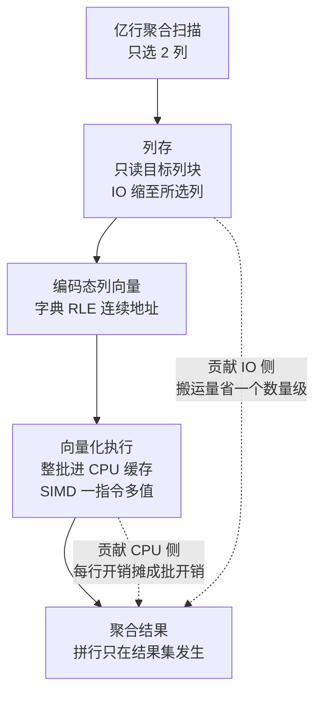
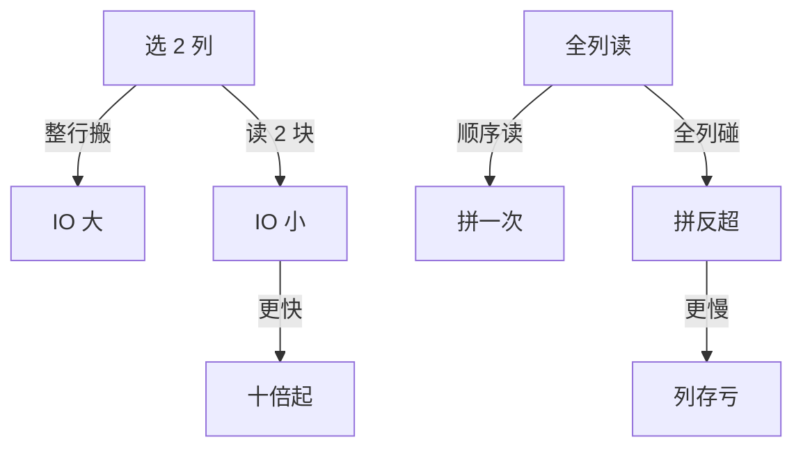

# 列存与向量化执行：OLAP引擎快的两个来源

## 要解决的问题

OLAP（联机分析处理，面向聚合与扫描的分析型负载）查询（聚合、扫描、过滤数亿行）在行存数据库上慢得无法用，索引帮不上忙，病根是**存储布局与执行模型的全面不匹配**。列存 + 向量化执行是现代 OLAP 引擎（ClickHouse、Doris、DuckDB）快的两个结构性来源：**列存解决「读的列远少于总列时不再读全部数据」，向量化解决「CPU 每次处理一批而非一行」。两者独立成立、组合最强。**本文写这两个机制与它们的代价，这是选型 OLAP 与理解「为什么同一个查询差百倍」的骨架。

## 它是怎么做到的


*图示：同一批数据的两种排布——行主序下要取某列得跨过整行，列主序下这一列的值是连续的。图源：Wikimedia Commons《Row and column major order》，作者 Cmglee，CC BY-SA 4.0，https://commons.wikimedia.org/wiki/File:Row_and_column_major_order.svg。这张图只画了布局，没画后果：连续排布带来的是压缩比和 SIMD（Single Instruction Multiple Data，单指令多数据：一条指令同时算多个数） 的批量处理——下面两条红利都从这一件事上长出来。*

**列存：按列物理聚集**。**同一列的值连续存储（ClickHouse 每列一个 `.bin` 文件，Parquet 按列块组织），扫描 age 列时只读 age 的数据块，其余 99 列的 IO 全省。**聚合查询（SELECT sum(amount) FROM orders WHERE city = 'X'）只碰 2 列，**读放大（一次逻辑读触发多倍实际读取）降低两个数量级。压缩红利：同列数据类型相同、局部性相似（相邻行同列值相似），RLE（游程编码，连续重复值只记一次加个数）、字典编码（重复值只存一份字典，行里记编号）、delta 编码（只存与前一个值的差）的压缩比远超行存的混合数据。压缩不只是省空间：压缩后的数据驻留缓存更多，解压又能用 SIMD 批量做，压缩即加速。**

ClickHouse（开源列式分析数据库）官方用同一张天气表把两种布局摆在一起：行存一行接一行连着存，列存按列切开各存各的——扫描只需少数几列时，两种布局要碰的数据量差出数量级：


*图源：ClickHouse 官方《What is a columnar database?》，https://clickhouse.com/resources/engineering/what-is-columnar-database（row-based 行存 / column-based 列存）。布局差异的直接后果：只查 temp 一列时，行存要把 location 到 humidity 整行搬过来，列存只读 temp 那一块。*

这套布局在文件格式层面长什么样，Parquet 官方格式文档的 FileLayout 图给出了权威答案：文件由 Row Group 横向切块，每个 Row Group 内每列一个 Column Chunk，Chunk 再按 Page 编码存储，文件尾部的 Footer 用 Thrift 元数据登记每个 Chunk 的位置与 min/max 统计——「按列物理聚集」落到磁盘上就是这棵两层结构树：


*图源：Apache Parquet 官方格式文档《File Format》FileLayout 图，https://parquet.apache.org/docs/file-format/（Apache-2.0，Apache Parquet 项目文档）。读法：查询只碰少数列时，Footer 里的 min/max 统计先裁掉不需要的 Row Group，再按 Column Chunk 偏移直读目标列块——列存的「读放大降两个数量级」就是这条路径的兑现。*

CSV（用逗号分隔字段、可直接用表格软件打开的纯文本格式） 与 Parquet 的布局差别用两棵树对照最直观：CSV 是一根从上到下的行序列（monolithic、row-oriented、无元数据），Parquet 是 file 之下先按行横向切 Row Group、组内再按列纵向切 Column Chunk 的两层树——同一份数据，树的形状决定了**扫描时碰多少字节：**


*图源：Torsten Grust《Tabular Database Systems》第 5 讲课件（Universität Tübingen，2026-03-17，教学材料引用，https://blobs.duckdb.org/slides/TaDa-05.pdf ）。左侧的行序列意味着取一列要跨过全部行，右侧的两层树意味着同一列的值彼此相邻——这正是下节「压缩红利与 SIMD 批量处理」的物理前提。*

**向量化执行：按批处理（把多个请求合并成一批同时计算、提高硬件利用率）**。**传统火山模型（volcano model，算子之间一行一迭代）每行的函数调用开销（虚函数、分支预测失败、缓存 miss）在 OLAP 的亿行扫描中被乘以亿。**向量化（MonetDB/X100，MonetDB 的向量化执行引擎原型，2005 论文）改为按批处理，数千行迭代：**一批数据装进 CPU 缓存，同一算子对整批循环，SIMD 指令一条处理 4-16 个值。缓存友好 + SIMD + 分支减少的三重红利，X100 论文报告的算子吞吐提升在一个数量级上下。**

**两个机制的组合**。**列存给向量化喂料：一列的连续值天然是 SIMD 友好的（同类型、连续地址），列存与向量化是共生关系。**执行层在两者之上做自适应：**编码感知执行（扫描时直接在编码态过滤，不解压）、延迟物化（join 与过滤尽量在编码列上完成，最后才拼出行）。**

两个来源各自管一段、在编码态列向量处汇合：



**缺了任何一个都只拿到一半：只有列存时计算端仍在逐行解释，只有向量化时 IO 端仍在搬全行，两个一半拼不出数量级加速。**

**代价面**。点查与小范围读：**列存要读多个列块拼回一行（读放大反向），行存的行内聚集对点查友好。**写入：列存的小批写（先写 WAL 再转成列文件，或先落到一个行式的 delta store 再定期合并）比行存的行追加复杂，**实时写入要专门机制（ClickHouse 的小文件合并、Doris 的 delta+compaction）。**事务：**列存引擎的高并发 OLTP（联机事务处理，短小高频的单行读写）事务弱（锁粒度与多版本并发控制的设计面向批，不面向行级事务），这也是 HTAP（同一套引擎同时扛交易与分析）的难点。**

## 它从哪儿来，要付什么代价

列存的思想萌芽在 1970 年代的"转置文件"研究，商业化起点是 Sybase IQ（1990 年代）。**MonetDB/X100 论文（CIDR 2005）是分水岭：它论证了行存的逐行迭代模型是 OLAP 慢的第二原因（第一是读放大），向量化执行自此成为 OLAP 标配。C-Store（2005，Vertica 前身）确立列存的工程形态（投影、排序键、稀疏索引），Parquet（2013）把列存格式标准化。**

**延迟物化（late materialization）**。**行存的执行早拼行（读一行处理一行），列存的执行晚拼行：过滤、聚合都在编码列上完成，只在最终输出时把少数存活行的各列拼起来。**一笔 5 列查询在亿行数据上，**拼行只发生在结果集（几千行），中间过程全是列向量。延迟物化把「列存的读红利」在执行层兑现成「拼行只付一次小代价」。**代价：**两个机制都有各自的领域边界——列存对宽表稀疏查询（选少数列）收益最大，全列查询（SELECT *）退化为行存的 IO 加上拼行开销；向量化对定长数值列红利全开，变长字符串、复杂类型（数组、JSON）的向量化执行引擎是难题：批内要先定位每个值的起止位置，复杂类型常退回逐值分支处理，OLAP 引擎的字符串函数慢于数值函数是常见现象。**

## 这套说法在哪儿会失效

- **快是结构性的，不依赖调参**。列存+向量化的组合对合适负载（聚合、扫描、少列）**带来数量级加速，这是「换引擎」的量级**，调参（内存、线程）只能再挤 20-50%。选型判断**先看负载形态（列选择性、聚合密度），再谈引擎**。
- **SELECT * 是列存的反模式**。宽行读（取全部列）在列存上**读每个列块，IO 与拼行开销超过行存**。报表查询**明确列清单**，常用的宽行组合用物化视图（预先算好并存下来的查询结果、读时免重算）预拼[[工程知识/数据系统：在并发与故障中保存事实/数据管道与流处理/物化视图把重复计算变成增量维护]]。
- **实时写入与查询性能的权衡是列存引擎调优主轴**。小批写产生小文件（查询要合并多个小段），**合并（compaction）又要 IO**。写入间隔与文件大小参数——ClickHouse 的 parts_to_delay_insert、Doris 的 cumulative compaction——**按写入吞吐与查询 SLA（服务等级协议，对外承诺的可用性与响应目标）平衡，没有普适值**。
- **向量化对部分算子无效**。点查（B 树定位单行）**不需要向量化**；join 的 hash 表探测向量化受益，但 build 侧的哈希（把任意长度数据压成固定长度指纹、不可逆）冲突处理仍是行级；字符串重计算（LIKE 模式匹配）**向量化后仍可能 CPU 密集**。慢查询定位要**先看算子层面的向量化覆盖（EXPLAIN 的向量化标记）**；行存两大路线的代价结构见 [[工程知识/数据系统：在并发与故障中保存事实/事务与存储/存储引擎的两大路线：B树与LSM的写读取舍]]。

## 怎么自己动手验证

**批量提交与批量收割的对照直接用向量批做**：同一条聚合查询分别按逐行迭代与按 1024 行一批执行，对比 CPU 时间与函数调用次数——**批内的循环展开与分支减少就是向量化的收益来源**，**逐行版的耗时应数倍于批版**。


- **列存读红利实测**：同一亿行宽表（100 列）**分别落成行式文件（CSV 或行式 Avro）与 Parquet 列存**，跑只选 2 列的聚合，再跑 SELECT * 全列读。**行存臂不能用行组开大的 Parquet 顶替**：Parquet 行组内每列仍是连续列块，按列裁剪照旧生效，测不出整行搬运。**两个方向的结果合起来才是选型依据**：



- **向量化对照实验**（如有环境）：同一聚合在向量化开启与关闭（Doris、ClickHouse 都有对应的会话变量）下对比，预期：**向量化吞吐数倍提升，数值列收益大于字符串列**。**算子级 EXPLAIN 确认向量化覆盖**。
- **压缩红利观测**：同一数据行存 CSV vs Parquet（字典+RLE）大小对比，预期：**压缩比 5-20 倍**；扫描吞吐对比，预期**压缩后扫描更快（解压吞吐 > 磁盘吞吐）**。**压缩比与扫描吞吐的正相关是「压缩即加速」的证据**。

## 推演账：列存怎样省、哪里反亏

```text
一条聚合查询的推演账（通用形态，量级为公开典型值）：

  行存读：SELECT avg(amount) FROM 10 亿行 → 每行整行读入内存，
    只用 1 列却搬运全部 30 列 → IO 放大 30 倍
  列存读：只读 amount 一列 → IO 缩 30 倍，且同列数据同构可压缩
    （字典/RLE 编码后再省 5-10 倍存储与带宽）
  向量化执行：每批 1024 行批量算，CPU 缓存友好 + SIMD 通道打满
    → 每行解释开销从"一次函数调用"摊成"一次批处理"
  两来源的配合：列存省搬运，向量化省计算，单独用只能拿到一半收益

  反面账：UPDATE 单行 → 行存改 1 处，列存要动 N 个列文件 → OLTP 场景列存是负资产
```

**这本账能推出三个可以拿去核对的形态**。一条只用 1 列的报表查询从行存迁到列存，按 30 倍读放大推，**秒级对几十秒是量级上合理的预期**，压缩是次要收益；这个收益的前提是**分析查询与交易查询已经分库**，混在一起时**点查会先被列存拖慢**。**引擎换了列存但执行器仍逐行解释，只能拿到 IO 那一半**，向量化执行器补上后才是完整的数量级。把高频单行更新的订单表整表迁列存，**每次更新要动 N 个列文件，写放大（实际写入量是逻辑写入量的多倍）把写入延迟推高**——**列存选场景，读多写少的分析负载才是它的主场**。通道级的机制账见 [[工程知识/性能工程：从用户等待到资源瓶颈/处理器与内存/SIMD与数据并行：一行代码的多个通道]]（向量化执行的 CPU 层基础），列类型的编码取舍见 [[工程知识/数据系统：在并发与故障中保存事实/数据建模与SQL/编码与演进的三角权衡：紧凑、写入放大与查询代价]]。

## 接着读哪几篇：行存两大路线与列存的谱系全景

- [[工程知识/数据系统：在并发与故障中保存事实/事务与存储/存储引擎的两大路线：B树与LSM的写读取舍]] —— 行存两大路线与列存的谱系全景
- [[工程知识/数据系统：在并发与故障中保存事实/数据管道与流处理/物化视图把重复计算变成增量维护]] —— 宽行预拼的物化方案
- [[工程知识/AI 系统工程：从模型能力到生产能力/模型基础与训练/GPU执行模型与显存层级：SIMT与合并访存]] —— SIMD 思想在 GPU 的极致形态
- [[工程知识/性能工程：从用户等待到资源瓶颈/处理器与内存/SIMD与数据并行：一行代码的多个通道]] —— 向量化执行是列存引擎快的第二个来源