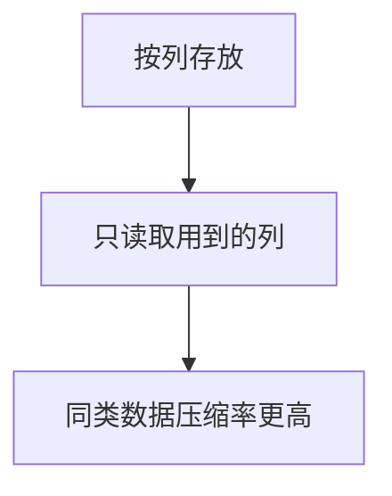
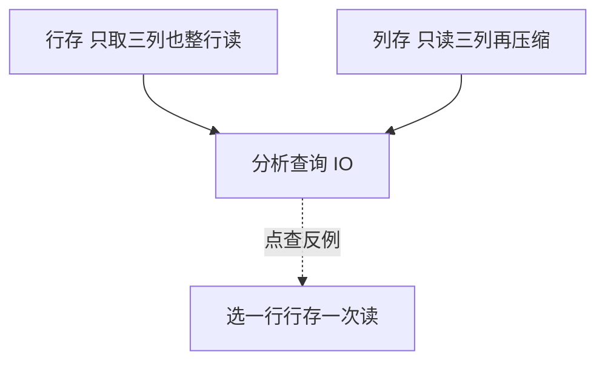

# 列式存储把扫描与压缩交给分析路径

**它解决的是分析查询只需要少数列，却被行式存储迫使读取整行和大量无关字节的问题**。核心机制是同列布局、编码压缩、分区和谓词下推；收益是**扫描带宽和 CPU**（中央处理器）占用降低，代价是**单行更新、事务交互、小文件合并和数据延迟更难**。用真实列选择性、更新比例、并发和缓存状态比较，而不是**只看压缩比**。

**OLTP（联机事务处理，面向单条记录的增删改）常按行读取和更新单个实体；OLAP（联机分析处理，面向批量数据的统计）常扫描少数列、聚合大量记录**。列式格式把同列值放在一起，**便于压缩、向量化和谓词下推，但不适合频繁单行更新和强事务交互**。

## 要解决的问题：同列布局与编码压缩与分区与谓词下推各自减少哪一部



列式的好处来自两点：


分析查询只取少数几列，行式存储却把整行读进来，扫描带宽与处理时间被无关数据占据。本篇回答：同列布局与编码压缩与分区与谓词下推各自减少哪一部分开销、单行更新与事务交互与数据延迟在这套结构下变难在哪里，以及比较方案时为什么不能只看压缩比。

## 它的主要机制是什么

列存的增量写入与 LSM（Log-Structured Merge，先把写入追加成日志再后台合并成有序文件的存储结构）类存储同构：新数据先进入内存表或小文件，再按层向下合并。层级结构决定了读放大（读一条数据实际触发的物理读次数）与写放大（写一份数据实际落盘的数据量倍数）的分布——每层内部按键值范围划分，层数越深，一次读取要碰的文件越多。


*图示：分层存储的层级结构（来源：RocksDB 官方 wiki 层级压缩页）。列存的合并 backlog 与这一结构同源。*

- **字典（把重复值换成编号）、RLE（行程长度编码，把连续相同值记成「值 × 次数」）、位图和编码利用同列相似性降低存储与带宽**。
- **分区、排序键、min/max 统计和 zone map 跳过无关数据**。
- **向量化执行按批处理列，减少解释和函数调用开销**。
- **增量写入通常先进入小文件/内存表，再合并；小文件和合并 backlog 会损害查询**。

## 数据架构的边界画在哪里

**数据仓库（面向分析、按主题整理好的历史数据存储）、湖表和实时 OLAP的事务、schema、更新、时间旅行和一致性承诺不同**。把主库 CDC（变更数据捕获，把数据库的增删改同步成事件流）原样堆到分析系统不等于**得到正确数仓**；**必须定义删除、迟到、重复、重放和指标口径**。

## 最小扫描实验怎么做

用同一数据分别做少列聚合、全列扫描、单行更新和高并发写入，比较扫描字节、CPU、压缩后空间、合并 backlog、p95 和结果新鲜度。列式方案的前提是**主要读取模式的扫描收益超过更新和合并代价**，**单一压缩比代表不了系统收益**。

## 这些量在什么数量级：压缩比与扫描量的账

同一次分析查询（sum(amount) where dt = '2026-09-22'）在两种布局下的扫描量：行存读整行（10 列全读，10GB 表读 10GB），列存只读 2 列（amount 与 dt，约 1.4GB）再乘压缩（数值列 RLE/字典编码典型 3-8 倍，实际 IO 约 0.2-0.5GB）——**扫描量差 20-50 倍，这就是分析查询在列存上快的主因，向量化执行是第二因**。代价同样可算：**行更新要改多个列段（写放大），事务型负载在列存上慢一个量级**，"行存管事务、列存管分析"的分野由这个账决定。

## 真实案例里发生了什么：缺陷域的同构教训

本库缺陷案例里 [[工程知识/缺陷分析：从个案到体系/正确性/案例二：静默错算——Spark SQL Union 的别名陷阱]] 出现在 Spark（分布式计算引擎，靠内存计算加速大规模数据处理）上：**错算的根源与存储布局无关，在 Schema 命名不一致——列存把「列」当作独立的存储与计算单元后，列序与列名的隐式依赖更容易被 union 这类操作放大成静默错值**。选列存时一并要做的就是把 Schema 演进纪律（显式命名、变更走 review）带上，**两者是配套工程**。

## 动手跑一遍会看到什么：同一查询行存与列存的 IO 账

一条"过去 30 天各渠道销售额"的分析查询，两种存储读的数据量：

```text
表：10 亿行 × 30 列（含大文本 remark），行存页 64KB，列存按列组织

行存：查询只用到 3 列（date, channel, amount）
  但最小读单位是行 → 每行的 30 列整行读出
  读 IO ≈ 10 亿行 × 整行大小 → 数百 GB 级，其中 27 列读完即丢

列存：每列独立存储与压缩
  date 列排序存储 + zone map（每段记录 min/max）→ 直接跳过 30 天外的段
  channel 列字典编码（100 个渠道 → 1 字节/值）
  amount 列 RLE/位图压缩（10:1 常见）
  读 IO ≈ 3 列 × 压缩后大小 → 个位数 GB 级，差两个数量级

代价同一张表上对称：单行点查（SELECT * WHERE id=?）
  行存 1 次页读；列存 30 次列读再拼装 → 点查是列存的天然弱项
```

跑一遍的收获：**列存的优势有精确来源（只读需要的列 + 压缩后更少 IO），弱项同样有精确来源（拼装整行的代价）——分析路径与事务路径的选型分界就在这个不对称上**。案例回流：[[工程知识/数据系统：在并发与故障中保存事实/查询与索引/慢查询治理从发现到索引闭环.md]] 的治理闭环在分析库的分支就是"确认查询形态适合列存路径"，**加索引救不了整行读的 IO 账**。



同一张表在两种布局下的 IO 账：**行存按行组织，查询只取 3 列也要把每行 30 列读出，27 列读完即丢；列存按列组织，同列相邻且自带编码（zone map 跳段、字典压渠道、RLE 压数值），扫描量差两个数量级——这就是分析查询在列存上快的主因**。虚线是对称的代价：**单行点查在列存要读 30 个列段再拼装整行，「行存管事务、列存管分析」的分界由这个不对称决定**。

两种布局在磁盘块上的实物排布，AWS（Amazon Web Services，亚马逊云服务）官方文档的两张示意最直观。行存块里躺的是一整行（SSN、Name、Age、Addr 拼在一起），取一列要扫过所有块：


*图：行存的磁盘块排布（图源：AWS Redshift 官方文档《Columnar storage》，https://docs.aws.amazon.com/redshift/latest/dg/c_columnar_storage_disk_mem_mgmnt.html ，AWS 文档引用）。图中高亮的 Block 2 是一整行六列的数据，取单列时其余五列一并被搬进来，这就是行存放在分析查询上的浪费形态。*

列存块里躺的是同一列的连续值，取一列只碰一个块：


*图：列存的磁盘块排布（图源：AWS Redshift 官方文档《Columnar storage》，https://docs.aws.amazon.com/redshift/latest/dg/c_columnar_storage_disk_mem_mgmnt.html ，AWS 文档引用）。两张图合起来就是上面那笔 IO 账的实物版：行存「取一列读全部块」、列存「取一列读一个块」——分析查询省下的扫描量与点查多付的拼装代价，都从这两个块排布里长出来。*

## 怎么自己动手验证

**列式收益要与扫描列数对账——预写只读少数列时扫描字节应远小于行式，实测两者持平，与预期对不上，说明该项目没有被真正按列存储**。

用真实扫描列数、选择性、分区命中、并发和数据更新比例测试；**记录扫描字节、压缩比、CPU、内存、合并、p95 和结果一致性**。比较列式与行式方案时**固定数据布局和缓存状态**。

关系：[[工程知识/数据系统：在并发与故障中保存事实/数据管道与流处理/CDC把数据库变化传播为可重放事实]] · [[工程知识/数据系统：在并发与故障中保存事实/数据系统：在并发与故障中保存事实]]
- [[工程知识/性能工程：从用户等待到资源瓶颈/存储与网络/cache分配策略与命中率：LFU与LRU的实证对比.md]] —— 扫描型负载的缓存收益趋零，分析路径是边界条件案例

