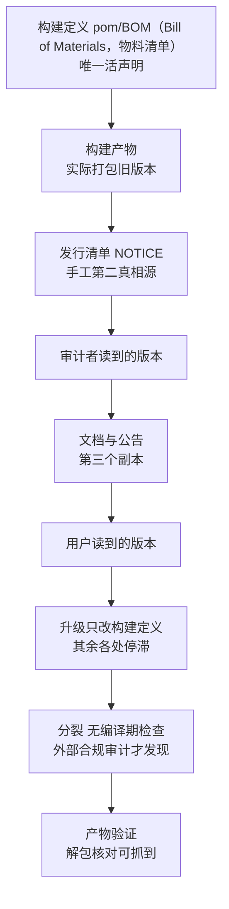
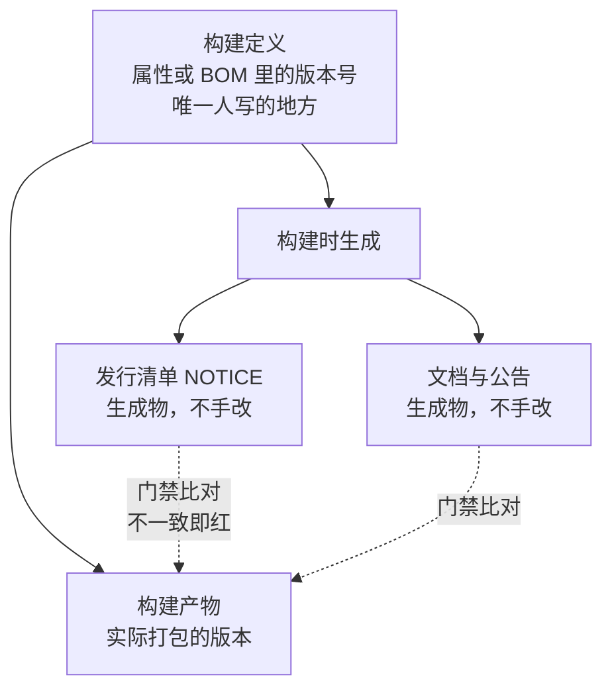

# 依赖版本的多处声明：升级只改一处，其余各处都是分裂的种子

**同一个依赖的版本写在两个地方，升级只改了一处，两处各自都对、合起来不一致**。**读完这一页你能把版本收敛到单一来源，并加一道检查防止再次分裂**。

> **要点**：同一个依赖的版本写在不同地方（构建定义与发行清单），**升级改了定义不改清单，发行物打包的是旧版本——两处声明各自正确、合起来不一致**，**这种分裂没有编译期检查，直到被外部审计发现**。

## 要解决的问题

构建系统里，一个依赖的版本号需要出现在多个地方：**构建定义（决定编译与打包时解析到什么版本）、发行清单（LICENSE/NOTICE 等合规文件里声明的组件版本）、文档与公告（告诉用户发行物里是什么）**。

**每处声明的读者不同、维护时机不同、漂移没有任何机制阻止**。Apache BookKeeper 的真实病例（上游修复 commit 818a37a8，可查）：上游把网络库版本从 4.1.111 提到 4.1.113，构建定义与发行清单各自声明。修复时两处都要改，而历史上"只改一处"的提交真实存在过：**构建定义已更新、发行清单停留在旧版本，发行物实际打包的组件与合规声明的版本不一致**。**这类分裂不影响运行（打包行为由构建定义决定），它藏在清单文件里**，**通常由外部合规审计或安全扫描发现**——**发现问题的人是别人，这对维护者是声誉与合规的双重成本**。

库内兼容与升级域已有两篇相邻文章：案例七讲"依赖版本落后，缺的是上游修复"（版本选得旧），案例四十三讲"升级把依赖行为前提带走"（版本升了行为变了）。本篇讲的是第三个独立形态：**版本声明本身的分裂**——**版本不旧、行为不变，只是"不同地方写的版本不一样"**。**它是发行工程（release engineering）的缺陷，与版本选择无关，与声明管理有关**。

## 它是怎么做到的：为什么多处声明必然漂移

多处声明的根源是同一个依赖被若干处各自记录。**收敛的办法是让唯一的提供方统一签发，其余各处都信任这一份，不再各自维护**——身份联合用的是同一个思路。


*图源：Microsoft Learn 中文文档，CC BY 4.0，https://learn.microsoft.com/zh-cn/azure/architecture/patterns/federated-identity。*

多处声明源于不同消费者的真实需求，理解这些需求才能设计版本收编方案。

**构建定义的读者是构建工具**：Maven/Gradle 需要精确坐标来解析依赖树。**这是唯一"活"的声明——它直接决定打包行为**。

**发行清单的读者是人与法务**：LICENSE/NOTICE 满足开源合规（Apache 基金会对发行物的强制要求），声明"发行物包含哪些组件、各是什么版本、什么许可"。它按理是构建产物的**投影**，手工维护时就成了第二真相源。

**漂移的必然性**：**两处声明由两个不同的动作维护（升级改 pom、发版改清单），中间没有一致性检查**。升级提交漏掉清单的理由永远存在——"清单只是文档""下个发版一起改"。**漂移不报错、不影响构建成功，分裂安静地随发行物流出仓库**。

**修复的叠加负担**：**分裂被发现时，修复提交要同时改多处**——818a37a8 的修复动作就是"根 pom 提版本 + 发行清单逐条重写版本行"。修复页上两个动作同屏可见：7 个文件改动里，pom.xml 提升版本号，LICENSE-all.bin.txt 一侧整块标红——52 行版本声明逐行从 4.1.111.Final 重写为 4.1.113.Final，**每一行都是发行清单作为"第二真相源"的维护成本**：


*图源：[apache/BookKeeper（Apache 的分布式日志存储，Pulsar 的底层存储） 提交 818a37a8](https://github.com/apache/bookkeeper/commit/818a37a8)（GitHub 页面实拍，Apache-2.0 项目文档引用）。升级只改一处时，这里整块标红的 52 行就是遗留的旧版本。*

分裂在依赖图上的直观形态，IDEA（国际数据加密算法） 的 Maven 依赖关系图给了一个真实样例：spring-petclinic 项目里 `checker-qual` 同时被 caffeine（带 3.37.0）与 postgresql（带 3.42.0）两条路径引入，红色虚线标出两版本并存的冲突。**同一组件的版本声明沿不同路径各自维护，正是「多处声明」在图上的形状**：


*图源：JetBrains 官方中文文档《Maven 依赖项》，https://www.jetbrains.com.cn/help/idea/work-with-maven-dependencies.html。*

三处声明各自的读者与维护路径，决定了漂移从哪裂开：



分裂的裂缝位置与唯一的兜底检查：三处声明各有一个读者群（构建工具、审计者、用户），**只有构建定义是"活"的（决定打包），清单与文档是手工副本**。**升级动作只改到构建定义时，两个副本停在旧值，产物与声明各说各话**。**编译期（代码编译成可执行文件时发生的阶段）没有任何检查能看见这处裂缝，能兜住的只有对最终产物的解包核对**。

## 修完之后靠什么防住复发

上游修复把两处声明的版本号改回一致；防线体系的目标是**让"正确答案只有一个"，其余全部变成派生物**：

**单一真相源 + 生成投影**：**版本只写在构建定义（属性或 BOM（Bill of Materials，物料清单），发行清单由构建产物生成或从 BOM 注入**（Maven 的 license 插件、Gradle 的 "generate NOTICE" 任务）。投影是生成物，提交进版本库便于审计，但**人不再手改**——改了也会在下次生成时被覆盖，这是特性。

修好之后的声明结构是这样：只有最上面那一份是人写的，下面全是它派生的：



虚线那两条把漂移的发现时机从外部审计提前到自己的持续集成里：**三处声明只要有一处与产物对不上，门禁当场变红，而不是等半年后的合规扫描**。

**升级动作清单化**：**改版本号的提交必须改到全部声明处**——**把"哪些文件声明了版本"做成脚本（ripgrep（快速文本搜索工具）全库搜版本串）**，升级 PR（Pull Request，拉取请求：请求把我的分支改动合入主干）里附脚本输出，评审核对每一处。**清单化把"记得改"从记忆负担变成可核对的动作**。

**一致性检查进门禁**：**持续集成里比对构建定义的版本与发行清单声明的版本，不一致即红**——这是防线的机械兜底，**把外部审计的发现时机提前到自己门禁里**。检查逻辑与生成投影互补：有生成则查生成流程没跑，无生成则查声明漂移。

**发行物构建后验证**：**对最终发行产物（tar 包、镜像）解包核对组件版本**——**验证对象是产物不是源码**，**清单与 pom 都对但打包配置抽错了版本的情形，只有产物验证能抓到**。

## 这套说法在哪儿会失效

三条边界防止防线走形。

**多版本并存是真实需求**：测试依赖的版本与发行依赖不同、shaded 重定位组件版本独立——**"单一真相源"按组件+用途组合算，不是全库一个版本号**。**BOM 管理的是同族组件的版本同步**（Netty（Java 的高性能网络框架）与 Netty-tcnative 必须同线），不要求异族组件共享版本。

**清单与定义的短暂不一致可容忍**：**大版本升级横跨多个提交时，中间提交可能清单滞后——门禁的严格性按分支定：主干必须一致，特性分支允许待同步标记**。一刀切会让升级流程与门禁打架。

**生成投影要有例外机制**：**合规文件偶尔需要手写补充（许可文本、免责声明），生成模板要留注入口**，**防止"全自动"逼着人绕过生成机制手改——绕过一开，投影的可信度就没了**。

## 怎么自己动手验证

可复现的验证路径：

1. **构造漂移：把构建定义里的版本更新、发行清单留在旧值（或用历史提交回放）**；
2. 未修复基线（正常状态下的指标水平、用来对比异常）：**构建成功、产物正常——门禁全绿，分裂潜伏，确认现有检查抓不到**；
3. 防线启用后重跑：**一致性检查报红，指出两处声明的差异**；
4. 产物验证：解包发行物核对组件版本与清单一致；
5. 断言锚点：**构建定义、发行清单、发行产物三者的版本号一致**；一致性检查在门禁中常驻。

```text
漂移注入 = pom 升级 && 清单不动
门禁断言 = 一致性检查报红（升级前抓不到的现在抓得到）
产物断言 = 解包版本 == 清单版本 == pom 版本
```

**"三处一致"是发行工程的终局不变量**——**它保护的对象是发行物的可信度：用户与审计者读到的版本，就是运行时的版本**。**验证时预期与实际的对照规则提前写明**：漂移注入后门禁预期报红，对不上（检查全绿）即一致性检查未生效或被绕过；产物解包读到的版本预期与清单、定义三方相等，对不上即打包配置有洞。

## 接着读哪几篇：版本选择与升级节奏的总纲

- [[工程知识/缺陷分析：从个案到体系/兼容与升级/案例七：兼容与性能——滞后的依赖与放大的日志]] —— 相邻形态：版本选得旧缺修复，本篇讲版本声明分裂
- [[工程知识/缺陷分析：从个案到体系/兼容与升级/案例四十三：升级把前提带走了——依赖行为变更引发的下游失效]] —— 相邻形态：版本升了行为变了
- [[工程知识/软件构建：让变化可以理解、验证与交付/开发工具/依赖升级的半衰期策略：跟随与锁定的平衡]] —— 版本选择与升级节奏的总纲
- [[工程知识/软件构建：让变化可以理解、验证与交付/测试与交付/CI流水线把反馈速度和发布证据连接起来]] —— 一致性检查进门禁的机制依据
