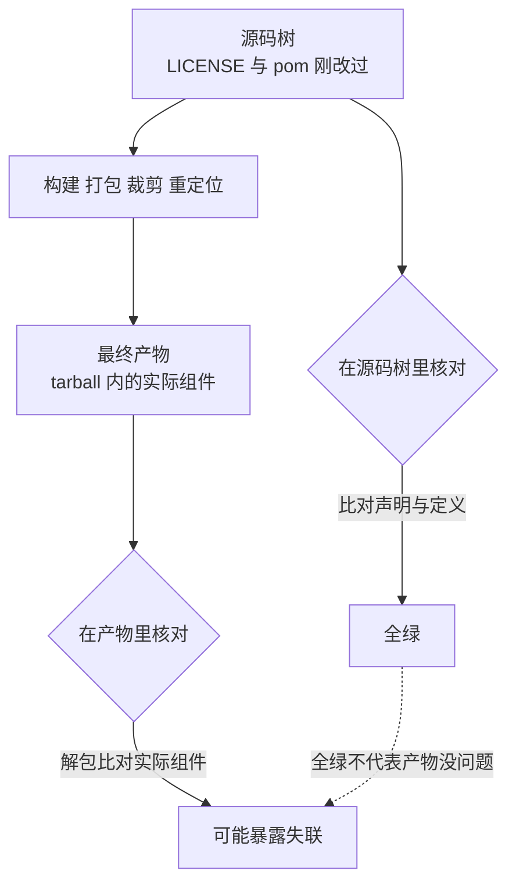
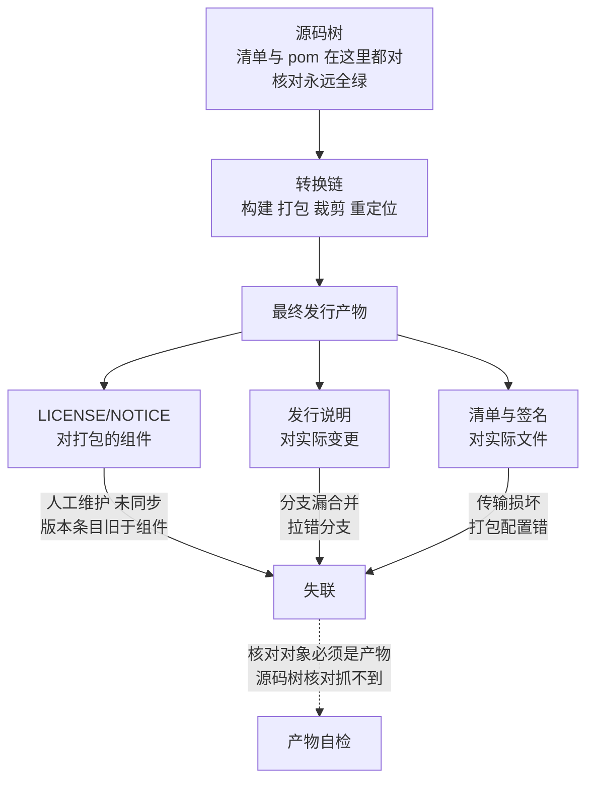
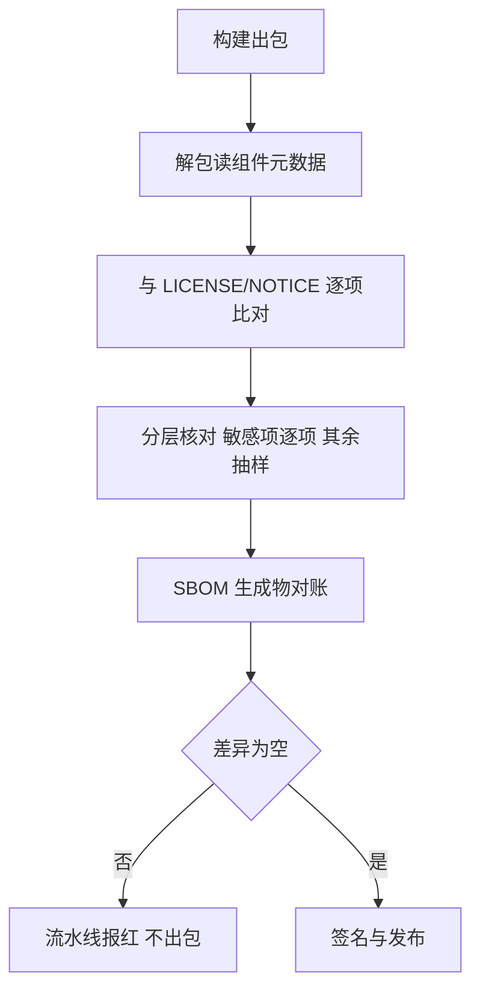

# 发行物自检：合规文件与实际产物要一起核对

**产物换了、合规清单没换，清单描述的就是一个并不存在的发行物**。读完这一页你能把验证对象定在最终产物上，而不是源码树，并让合规文件和产物一起过检查。

> **要点**：发行物是产物（jar 包、二进制）与合规文件（LICENSE、NOTICE）的合集，两者在发布流程里由不同环节维护——升级改了产物没同步清单，合规文件描述的就是一个不存在的发行物；验证对象必须是最终产物，不是源码树。

## 要解决的问题

开源项目的每次发版都要走一串环节：改代码、升依赖、更新合规文件、构建产物、签名（用私钥对数据生成可验证的防篡改标记）、发布。

**合规文件（LICENSE/NOTICE）在多数项目里靠手工维护**，它与"这次构建实际打进了什么"之间**没有任何机械联系**。Apache BookKeeper 的真实病例（上游修复 commit 48bcef70，可查）：网络库因安全公告（静态初始化无上限读取环境文件导致内存耗尽）从 4.1.113 升到 4.1.115，修复提交除了改版本，还**同步更新了发行包 LICENSE/NOTICE（开源许可证的声明文件，列出需要保留的版权信息） 里的组件版本条目**——这条"顺带"动作本身就是教训：**此前版本条目曾与产物脱节，合规文件描述的组件版本在发行物里并不存在**。

本篇与本批《依赖版本的多处声明》是姊妹篇：那篇讲版本号在构建定义与清单两处声明分裂（机制与防线：单一真相源 + 生成投影）；本篇把镜头拉到发行物的完整性上——**合规文件只是产物描述文件之一**，**发行物自检的通用形态是"对最终产物核对它自己声称的一切"**。Apache 基金会的发版检查清单把 LICENSE/NOTICE 完整性列为强制项，原因正在于：合规文件的读者是法务、审计与下游使用者，**描述失真的发行物会污染整条供应链的信任**。

## 它是怎么做到的：产物与描述如何失联
SBOM（Software Bill of Materials，软件物料清单）的数据从哪来、到哪去——它列出软件里的组件与版本，像食品包装上的配料表——openEuler 社区画成了一张完整的链路图——从代码资产与 CI（Continuous Integration，持续集成：代码合并后自动构建与测试）/CD 流水线（持续集成/持续交付，代码提交后自动构建与发布的流水线）自动生成 SBOM，随制品归档存储，到 SBOM 服务、漏洞服务、License 服务三路消费，最后在看板上可视化。这正是「SBOM 是生成的真相」的工业级形态：


*图源：[openEuler 社区《基于SBOM的开源社区软件供应链安全解决方案》](https://www.openeuler.org/zh/blog/robell/openEuler_SBOM_Practice.html)。*

产物与描述失联，通常是因为**它们由不同的环节产出、在不同的时间点生成，中间没有任何一步强制两者对齐**。


发行物内部有一组"描述与被描述"的关系，每对都可能失联，四对关系见下表：

**LICENSE/NOTICE ↔ 打包的组件**：合规文件声明组件与版本，构建打包组件——声明走人工维护、打包走构建系统，两个维护动作没有同步机制。失联形态：版本条目旧于实际组件（本病例）、组件已在而声明缺失、声明了已不打包的组件。

**发行说明 ↔ 实际变更**：公告"本版本包含修复 X"，产物里没有 X（**分支漏合并、构建拉错分支**）——描述与产物在功能粒度上失联。

**清单文件 ↔ 实际文件**：发行包的文件清单（sha512、签名）与包内文件不一致——**传输损坏或打包配置错误**。

失联的共同根源：**验证对象错位**。源码树里的清单是对的（刚改过），pom 里的版本是对的（刚升过）——但**源码树与产物之间隔着构建、打包、裁剪、重定位等多个转换，任何一环都可能引入偏差**。**描述文件在源码树里核对永远全绿，失联只存在于产物里**。

**同一个核对动作放在两个位置做，结论可能完全相反**——NIST（美国国家标准与技术研究院，发布密码与安全标准）的软件生命周期组装线把这条转换链画成了闭环：Plan、Procure、Develop、Build、Test、Release、Install、Configure、Maintain 一圈走完，Software as specified、as built、as distributed 三个状态的 BoM 在各站逐步组装。**核对放在哪一站做，看到的发行物就属于哪个状态**，左端全绿与右端失联的分歧正出在这条链的中间：


*图源：NIST《Software Security in Supply Chains: SBOM》Figure 2，https://www.nist.gov/itl/executive-order-14028-improving-nations-cybersecurity/software-supply-chain-security-guidance-20。*

位置一换结论就翻，下图演示位置怎么决定结论：



中间那几个转换就是偏差的来源：**源码树里的声明与产物里的实际组件之间，没有机制保证它们一致**。**核对必须在右端做**——解包看实际装了什么，而不是在左端看文件写了什么。

三对"描述与被描述"的关系**各自断在哪一环**，**对照下表逐对排查**：



失联为什么只在产物里：**源码树处于转换链的起点，这里的清单与版本必然正确，偏差由转换链引入**；三对描述关系各自对应产物内的一个核对面，同一个源码树状态能长出三种失联。**核对对象落在源码树时永远全绿，落在最终产物上才能看见偏差**——这就是"验证对象必须是产物"的由来。

## 修完之后靠什么防住复发

上游修复把合规条目与版本升级放进同一个提交；防线体系要让"产物自检"**成为发版流程的固定环节**：

**合规条目与依赖版本同提交变更**：升级依赖的 PR（Pull Request，拉取请求：请求把我的分支改动合入主干）**必须同步 LICENSE/NOTICE 条目**（与本批姊妹篇的一致性检查是同一道门禁的两种粒度——那篇管版本号相等，这篇管条目存在性与准确性）。

**自检卡在出包与签名之间**：「差异为空」这个判定不过，流水线走到「不出包」那条支路，**签名与发布根本不会发生**；核对深度则**按安全敏感组件逐项、其余抽样分层执行**：



**门禁位置决定了自检必须读产物内的组件元数据而不是打包目录名**。

**发版前产物自检脚本**：对最终产物执行核对——**解包列出实际组件与版本，与 LICENSE/NOTICE 条目逐项比对**；产物内关键组件的版本**用组件自带的元数据（MANIFEST、pom.properties）读取，不信任打包目录名**。**脚本进门禁，发版流水线不过自检不出包**。

**供应链元数据的机器核验**：SBOM工具从构建产物生成组件清单，与手工维护的合规文件对账——**SBOM 是生成的真相，合规文件是对照物；对不上即流程有洞**。

**发版演练**：大版本前用干跑（dry-run）完整走一遍发版流程，**自检脚本在演练里暴露所有失联**——**演练的成本是一次发版的时间，收益是正式发版不返工**。

## 这套说法在哪儿会失效

三条边界防止防线走形。

**自检核对的深度按风险定**：全组件逐项核对成本高，按"安全敏感组件（网络库、加密库、序列化库）逐项 + 其余抽样"**分层核对**——**安全公告活跃的组件恰是最常升级、最易失联的**。

**生成不替代人工审查**：SBOM 与投影生成解决"对得上"，**法务对许可兼容性的判断仍要人做**。**生成物回答"里面有什么"，人工回答"允许吗"，两个问题都不可省**。

**自检不拦运行时问题**：产物自检保证"包里是什么与说的一致"，**组件在运行时的行为缺陷（本病例的 CVE 本身）靠依赖升级与漏洞扫描**——**两道防线对象不同，不互斥也不互替**。

## 怎么自己动手验证

**防线的有效性也要验证**。可复现的验证路径：

1. **构造失联**：把发行清单里某组件版本改为旧值（或删除一条目），走构建出包；
2. **未修复基线**（正常状态下的指标水平、用来对比异常）：**源码树检查全绿（清单文件本身合法），产物与清单失联潜伏**——确认现有流程抓不到；
3. **自检启用后重跑**：**产物自检报红，指出清单与包内组件版本的差异**；
4. **断言锚点**：**解包产物读到的每个组件版本，与合规文件声明一致**；自检脚本在发版流水线常驻。

```text
失联注入 = 清单版本 ≠ 打包版本
自检断言 = 产物核对报红，指出具体差异
供应链断言 = SBOM 生成物 == 合规声明（逐项）
```

"产物即声明"**是发行物完整性的终局判据**——**供应链上每个读者（法务、审计、下游项目）信任的前提，都建立在这一条核对上**。

## 接着读哪几篇：姊妹篇：版本号一致性的一致性检查与单一真相源

- [[工程知识/缺陷分析：从个案到体系/兼容与升级/依赖版本的多处声明：升级只改一处，其余各处都是分裂的种子]] —— 姊妹篇：版本号一致性的一致性检查与单一真相源
- [[工程知识/缺陷分析：从个案到体系/稳定性/类初始化的隐式输入：静态块里的环境读取]] —— 本病例 CVE（48bcef70）缺陷本身的机制解剖
- [[工程知识/缺陷分析：从个案到体系/兼容与升级/案例七：兼容与性能——滞后的依赖与放大的日志]] —— 依赖版本管理的相邻病例
- [[工程知识/软件构建：让变化可以理解、验证与交付/测试与交付/CI流水线把反馈速度和发布证据连接起来]] —— 产物自检进流水线的机制依据
