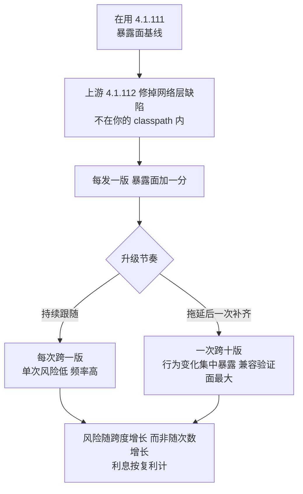
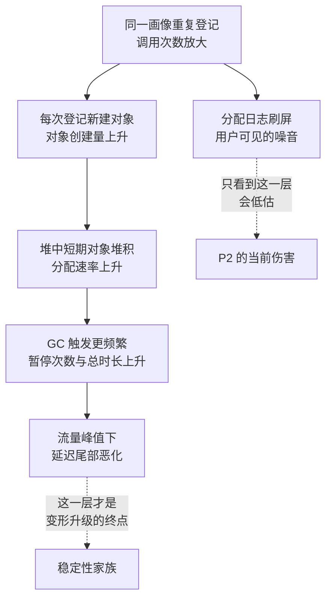

# 案例七：兼容与性能——滞后的依赖与放大的日志

**依赖落后上游十个版本，等于十个已修好的问题还留在你的系统里**；**日志刷屏则在悄悄加重垃圾回收**。**读完这一页你能用例行扫描和主动盘点把这两类低伤害缺陷兜住**。

> **要点**：**依赖落后上游十个版本，等于十个已修复的缺陷都不在你的 classpath 里**；**日志重复刷屏既是噪音，也在加重 GC（垃圾回收：运行时自动回收不再使用的内存的过程）**。**两类低伤害缺陷靠例行扫描和主动盘点兜住**。

**兼容类和性能类是八个家族里存在感最弱的两个：不崩溃、不丢数据、不泄密**，只是"你的依赖比社区旧了三版"或者"日志有点多"。它要解决的问题是：**怎样在缺陷还处于低伤害阶段时就发现它，而不是等它长成崩溃或漏洞。** 这两类缺陷的共同之处在于——**它们是随时可以升级成其他家族的种子**。**滞后的依赖里可能藏着安全漏洞（兼容变安全），放大的日志正在加重 GC**。这一篇解剖三个真实病例。

先把形状说成一件事：**兼容与性能类缺陷像体检报告上的「轻度脂肪肝」——不疼不痒（不崩溃不丢数据），但放着不管会发展成别的病**。滞后的依赖像三年没换的血压计（读数还能看，量程和精度已经跟不上新药方），放大的日志像每天多爬两层楼（单次没感觉，膝盖磨损在累积，突然某天上下楼就疼了——GC 停顿）。**体检的意义在于趁还是「种子」时处理**。这个比喻到「上下楼就疼了」为止——现实里三个病例各自的种子与长成的样子，下面逐案展开。

## 病例一：Netty 版本滞后为什么出事

**背景**：Bookie 的网络 I/O 与客户端路径依赖 Netty 4.1.111.Final，而上游社区已经发布 4.1.121.Final——**中间隔着十个版本的网络层缺陷修复**。

**缺陷**：你缺的是**已经暴露在其中的修复**，与是否缺新功能无关。**网络层是 Bookie 的咽喉——所有读写都走它**。**上游在 4.1.112 到 4.1.121 之间修掉的每一个网络层缺陷，对你的节点都成立**。

**修复**（[上游 commit c9dc52a4](https://github.com/apache/bookkeeper/commit/c9dc52a4f1eef9411c1da480b3c49b720b6e081d)）：**统一依赖版本到 4.1.121.Final，让网络层回到被维护的版本线上**。

## 病例二：打包的 Commons 过旧会怎样（P2）

**背景**：BookKeeper server 二进制里打包的 Apache Commons 依赖是多年前的旧版本。

**缺陷**：旧版依赖带来两个风险——组件间不兼容，以及**多年间缺失的安全修复**。**它躺在 LICENSE 文件里，运行时真的在被使用**。

**修复**（[上游 commit a01aa111](https://github.com/apache/bookkeeper/commit/a01aa111a4b10c779cd883a120e7ee3a2e3226d5)）：**随上游升级到经过兼容性验证的新版依赖**。


来源：[稀土掘金《深度解析 Raft 分布式一致性协议》](https://juejin.cn/post/6907151199141625870)（CC 4.0 BY-SA）


## 病例三：资源画像怎么就重复登记了（P2）

**背景**：Spark YARN 资源分配（Spark：分布式计算引擎，靠内存计算加速大规模数据处理；YARN：Hadoop 的资源调度器）在启用资源画像的作业上，会**反复重新登记同一个画像**——用户侧看到 executor 分配日志被重复刷屏。

**缺陷的机制**：**日志刷屏只是表象**。每次重复登记都在创建对象——**分配日志的量上去了，对象创建和 GC 的开销也上去了**。**分配结果和作业可用性没受影响，代价转嫁给了运行时**。

**修复**（[上游 commit 19450452](https://github.com/apache/spark/commit/19450452dcd6134853f6c0db8e755e78cddef922)）：**同一画像只登记一次，日志与对象开销回到正常量级**。

## 为什么这一类值得单独讲

**三个病例没有任何一个会造成立即的故障——这正是它们被普遍拖延的原因**。但它们的风险模型值得算清楚：

- **兼容类是"时间债"**。**上游每发一版，你的暴露面就多积累一分；拖得越久，升级跨的版本越多，升级本身的风险也越大**。**欠这债的利息按复利计**。
- **性能类会变形升级**。**日志刷屏在今天只是噪音，明天在流量峰值上就是 GC 风暴**。**性能缺陷是其他家族的放大器**。
- **两类都藏在"看不见的地方"**：依赖列表里、日志文件里。**没有用户会报告"你的 Netty 旧了"**。

时间债的利息为什么按复利计——把「上游每发一版」和「你要跨多少版」放到同一条轴上看：



**兼容类的处置节奏本身就是风险变量：跨版本数是利息，升级动作是还本，拖得越久，一次要还的越多**。

「拖延的搬家代价最大」的实物原型是搬家：每年小搬一次，东西少、路线熟，一天搬完；十年不搬，家当翻倍、一次跨城，家具磕碰、物品遗失集中爆发——搬家这件事的难度随拖延按复利涨：


*图源：Wikimedia Commons，作者 Riley，CC BY 2.0，https://commons.wikimedia.org/wiki/File:Bedford_TK_removals_truck_(13964457770).jpg。*

**依赖升级就是搬家：持续跟随是小步搬家（每次跨一版，风险低频次高），拖延后一次补齐是十年一搬（一次跨十版，行为变化集中暴露，兼容验证面最大）**——**例行扫描是"提醒你该搬家了"的日历，成本接近于零**。

**这两类缺陷没有任何一条告警会指向它们，只能靠主动盘点发现**。**把依赖扫描和日志量监控放进例行清单是可靠的做法**。同时也要看到另一面：**升级依赖有引入行为变化的风险，日志量治理要在可读性与开销之间取舍，处理这两类缺陷从来不是免费的**。

病例一的时间债用一条时间线看最直观：

```
在用：Netty 4.1.111.Final
上游：Netty 4.1.121.Final
中间 10 个版本的网络层缺陷修复，全部不在你的 classpath 里
```

病例三的伤害链说明性能缺陷为什么是其他家族的放大器，每一环的量级都翻一层：



"P2 级别为什么不能一直欠着"：**表面可见的只有日志刷屏这一层（当前伤害小），同一处重复劳动在运行时逐环放大——对象创建量、堆分配速率、GC 频率、延迟尾部，终点落在稳定性家族**。**低伤害是当前快照，放大链才是风险模型**，这也是兼容与性能两类要单独盘点的原因。

## 上游是怎么修的

三条修复的共同点：**修复动作是改版本或去掉重复劳动，逻辑本身没动**，**效果是把系统拉回它本该在的版本或量级**。**兼容类的修复动作是升级依赖并经过兼容性验证**。它们的"缺陷判定"依据是与合理预期的偏离，所以**这类缺陷的发现几乎完全依赖例行扫描：没有用户会主动报**。

## 这套防法在哪儿会失效：边界与教训

- **升级要按影响判断流程走**，安全修复也不例外——新版本可能带行为变化。
- **性能缺陷要找到"重复劳动"**。**日志刷屏、重复登记、重复计算——性能问题的第一嫌疑人是"同样的事做了不止一遍"**。
- **例行依赖扫描是最便宜的保险**。**两条兼容类病例，用工具对着 LICENSE 文件扫版本号就能发现，成本接近于零**。
- **别被 P2 骗了**。**风险级别排的是"当前伤害"，兼容与性能类的伤害是随时间累积的——级别低不等于可以一直欠着**。

## 接着读哪几篇：期望与现实的偏差

- [[工程知识/缺陷分析：从个案到体系/缺陷分析方法——三分离、判定树与五步法]]
- [[工程知识/缺陷分析：从个案到体系/安全/案例五：安全两例——认证绕过与带漏洞依赖]]
- [[工程知识/缺陷分析：从个案到体系/缺陷分析：从个案到体系——导读与开源地图]]
- [[工程知识/缺陷分析：从个案到体系/兼容与升级/依赖版本的多处声明：升级只改一处，其余各处都是分裂的种子]] 与 [[工程知识/缺陷分析：从个案到体系/兼容与升级/发行物自检：合规文件与实际产物要一起核对]] —— 同为版本管理家族的第三、第四形态：声明分裂与产物失联，发行工程的方法面
- 日志和指标在观测体系里各自承担什么——[[工程知识/性能工程：从用户等待到资源瓶颈/观测与诊断/系统指标与观测]]。
- 重复登记为什么直接加重 GC——[[工程知识/性能工程：从用户等待到资源瓶颈/操作系统与运行时/垃圾回收与内存分配决定延迟尾部]]。
