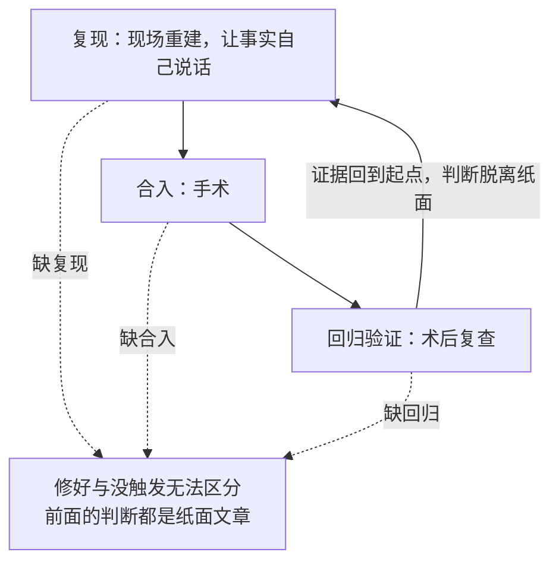
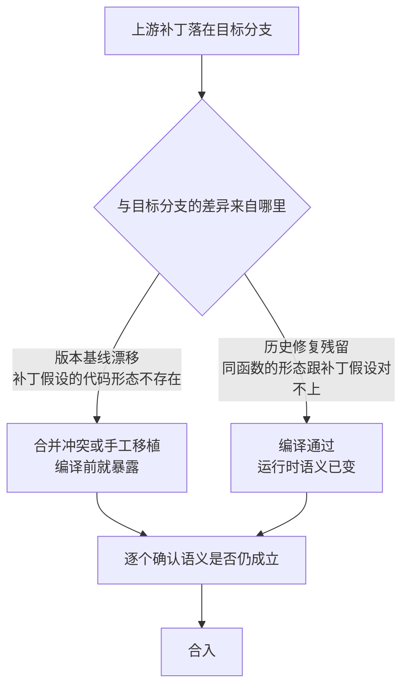
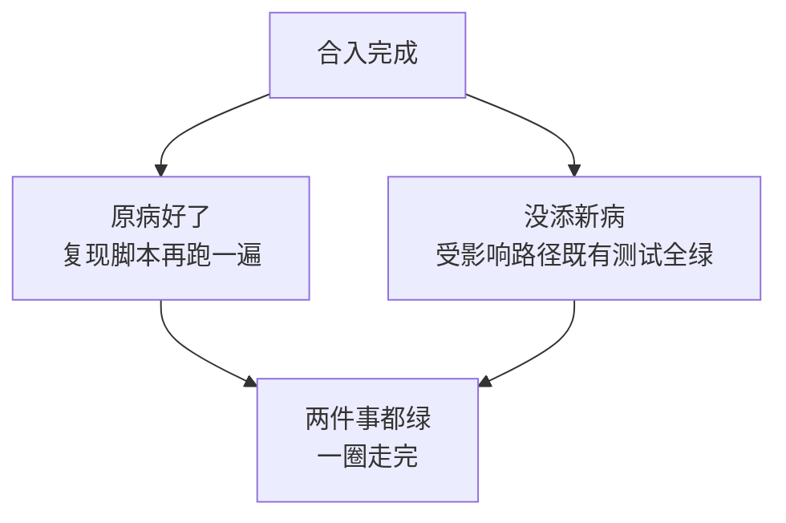

# 从复现到回归——让证据走完一圈

影响判断之后，值得跟的缺陷进入执行段。这一段有三步：复现、合入、回归。三步构成一个闭环——**证据从产生到消费要走完一整圈**，这个闭环的机制在于：**每一步的结论都依赖上一步留下的可核查产物，缺任何一段，链条断在哪里、前面的判断就停留在哪里，全部退回纸面文章**。

这一篇的法医比喻：报错截图和事故描述是**目击者口供**——有价值，但口供会记错、会遗漏、会各自矛盾。复现脚本是**现场重建**——按同样条件把过程跑一遍，让事实自己说话。修复合入是**手术**，回归验证是**术后复查**：**手术做完不是结束，复查确认没感染、功能恢复，病人才能出院**。

## 要解决的问题是什么：为什么先复现、再修

三步闭环缺任何一段，前面的判断都停留在纸面：





为什么复现在修复之前？因为**没有复现的修复是猜**。**你改了一处代码，故障不再出现了——是修好了，还是触发条件本来就没再出现？没有复现手段，这两者无法区分**。

不是每条缺陷都值得复现。BookKeeper（Apache 的分布式日志存储系统）那批扫到的提交里，需要复现的只是少数，**多数被标记为"不适用"——功能未启用、依赖特定硬件、需要多节点集群，复现成本超过缺陷本身的伤害**。**复现的资源投入跟着影响判断走**，这是上一篇的结论在这里的体现。

**复现脚本有三个要件，缺一个就不能算"真实复现"**：

把这套纪律写成最简形式，就是一段可交接的三行约定：

```
给定：BookKeeper 4.16.6 + 一份损坏的 entry log 文件
当：  后台垃圾回收扫描到该文件
则：  回收线程终止（修复前必失败）
      跳过损坏文件继续回收（修复后必通过）
```

- **确定的输入**：精确到版本、参数、数据文件。别人拿到手能原样跑，而不是"起一个集群，造一些数据"。
- **可判定的输出**：跑完之后有明确的是/非——进程退出了没有、返回的行对不对、磁盘有没有被回收。靠人眼看日志判断的不算。
- **失败的前后对照**：修复前跑必然失败，修复后跑必然通过。没有"修复前必失败"，你复现出来的可能不是这个缺陷。

把"偶尔发生"变成"必然发生"，靠的是**确定性控制**，四个控制点按序排查：

- **版本固定**：依赖、二进制、数据文件精确到 hash——"差不多同一个版本"是复现的大敌。
- **输入固定**：用同一份数据文件、同一组参数，杜绝"造一些数据"。
- **时钟与调度固定**：并发缺陷依赖交错顺序，用可控的调度点或插桩代替真实并发。
- **环境隔离**：确认观察到的行为来自缺陷本身，不是邻居进程的干扰。

**四个点逐个固定之后仍然偶现的，才需要考虑更深的因素（硬件、时钟漂移、外部竞态）**。

## 合入前要查补丁本身还是查排异

补丁到手，合入前查两样。

### 第一查：补丁本身改对地方了吗

**读 diff，确认它改的就是影响判断里认定的那几处，没有夹带无关变更**。**上游补丁偶尔会捆绑功能调整，你要的是那一片药，不是整个瓶子**。

### 第二查：合入后会不会起排异反应

**合入补丁像器官移植——补丁是健康的器官，目标分支是受体的身体**，**基线（正常状态下的指标水平、用来对比异常）和上游差得越远，器官未必贴得越牢**。

真实的排异形态有两种。一种是**版本基线漂移**：补丁按上游某个版本的代码形态写成，而目标分支停在更早的基线上，补丁假设存在的代码在分支上还不存在或已经改形——**把修复移植到老的 release 分支时这几乎是常态，上游自己跨分支搬运也常要手工解决冲突**。另一种是**历史修复残留**：同一个函数曾经被别的修复动过，跟补丁假设的形态对不上（某个分支专属的判空、一处提前返回、一段绕开缺陷的重写），**补丁原样套上，编译通过——但运行时语义已经变了**。

两种排异的可见性完全不同：**版本基线漂移在编译前就暴露，历史修复残留却能让补丁编译通过而运行时语义已经变了**，两条分支最终通向同一个查法。



**正因为历史修复残留那条分支在编译期（代码编译成可执行文件时发生的阶段）看不见，合入前的差异比对才不能省——它是在替编译器找语义冲突**。

**查法很机械，不需要灵感：把补丁触碰的每一个文件、每一个函数，在目标分支上做差异比对**。**形态对不上的位置，逐个确认语义还成立**；**扫描工具能自动标记"疑似冲突"，最终拍板靠人**。

## 回归要走到哪一步才算封口

**合入完成，缺陷分析只走到三分之二**。回归要同时证明两件事：

回归要同时拿到两个绿灯，少一个都不算封口：



- **原病好了**：复现脚本再跑一遍，这次必须通过。这是当初造它的全部意义。
- **没添新病**：受影响路径的既有测试全绿。**修复引入的新问题往往不在缺陷路径上，而在它顺手动过的共享代码里**。

**两件事都绿，这条缺陷才算走完一圈：从一条上游提交，变成一段带证据、带验证、可追溯的修复**。**任何一步省略，闭环就漏——漏出去的缺陷不会自己回来报告**。

这一篇涉及的基础概念：并发缺陷为什么依赖时序、原子性与可见性如何决定竞争结果，见 [[工程知识/软件构建：让变化可以理解、验证与交付/语言与运行时/内存模型决定并发读写何时可见]] 与 [[工程知识/后端系统：在并发、失败与变化中维持服务/任务与并发/并发控制先定义共享状态和完成条件]]；修复之后为什么还要主动注入故障做验证，见 [[工程知识/软件构建：让变化可以理解、验证与交付/测试与交付/混沌工程验证系统是否真的能处理故障]]。

**复现成立要与三要件对账——预写固定的输入、可判定的输出与修复前后的对照三者齐备，缺一项与预期对不上，就不算真实复现**。

消防演习给"在事故之前演练响应"提供了最普及的实物：警报拉响，所有人按预案走一遍撤离路线——真正的火警往往一次都没有，但每一次演习都在把"出事时第一分钟该做什么"写进肌肉记忆。缺陷复现与回归是同一件事的工程版：**故障场景在受控条件下演一遍（复现脚本），响应动作修好之后再审一遍（回归验证），等真实事故来临时，团队执行的是练过的动作而不是临场发挥**：


*图源：Wikimedia Commons，Tokumeigakarinoaoshima，CC0 1.0，https://commons.wikimedia.org/wiki/File:Fire_drill_in_Kansai_University.JPG。*

## 这套说法在哪儿会失效，容易踩的坑是什么

- **不要跳过复现直接修**。修完故障消失，你无法证明消失和修复有因果关系。
- **不要把"编译通过"当"合入成功"**。语义冲突（如上面的运维参数）编译器看不见。
- **不要只跑缺陷路径的回归**。修复动过的每一个共享函数，都在它自己的调用方里。
- **不要攒着不回归**。修复和回归之间隔得越久，中间混入的变量越多，"原病好了"的归因越弱。

## 怎么自己动手验证

复现实验的最小场景画出来就是竞争消费者的标准结构：多个应用实例产出消息进同一队列，消费者服务实例池从队列取消息分摊处理——「起单分区主题、两个消费者先后加入同一消费者组」的实验里，**加入新消费者改变的是分配而非负载**：


*图源：[Microsoft Learn 中文文档《竞争使用者模式》](https://learn.microsoft.com/zh-cn/azure/architecture/patterns/competing-consumers)，CC BY 4.0，文档引用。*

1. 复现三要件：确认复现脚本给出确定的输入（版本、参数、数据文件精确到 hash）、可判定的输出（明确的是/非结论）与修复前后的对照（修复前必失败、修复后必通过）；三项缺一即不算真实复现。
2. 确定性控制：按版本固定、输入固定、时钟与调度固定、环境隔离四个控制点逐项核对，确认偶发问题已被提高到必然复现；四点都固定后仍偶现时再考虑硬件与外部竞态（多个执行流争抢资源、结果取决于时序）。

3. 合入两查：读 diff 确认补丁改的就是影响判断认定的位置且没有夹带无关变更；对补丁触碰的每个文件与函数在目标分支做差异比对，确认历史修复残留处的语义仍然成立。
4. 回归两绿：复现脚本再跑一遍通过，受影响路径的既有测试全绿，两项记录一并留档。
5. 断言锚点：**复现可交接给他人跑通，合入前差异比对有结论，回归覆盖了共享代码的调用方**。

## 接着读哪几篇：证据闭环的回归思想
[[工程知识/缺陷分析：从个案到体系/复现与回归/读堆栈先找自己的帧：崩溃点、调用链与真因通常隔着两层.md]]
[[工程知识/缺陷分析：从个案到体系/复现与回归/断言要锚定在不变量上：注入前后该不变的数字与该变的数字.md]]

- [[工程知识/缺陷分析：从个案到体系/复现与回归/证据链的够用判据——从孤证到可裁决]] · [[工程知识/缺陷分析：从个案到体系/影响判断/影响判断——这条修复值不值得跟]] · [[工程知识/缺陷分析：从个案到体系/缺陷分析方法——三分离、判定树与五步法]] · [[工程知识/缺陷分析：从个案到体系/缺陷分析：从个案到体系——导读与开源地图]]


- [[工程知识/AI 系统工程：从模型能力到生产能力/质量与运营/评测集的构建与维护：从场景采样到难度分层.md]] —— 证据闭环的回归思想
- [[工程知识/软件构建：让变化可以理解、验证与交付/测试与交付/覆盖率的三种读法：行分支与路径覆盖的证据强度.md]] —— 覆盖率作为回归网守门员
- [[工程知识/缺陷分析：从个案到体系/并发/时间型缺陷的判定树：过期竞态与时钟依赖.md]] —— 时间型缺陷的复现依赖时钟注入手段
- [[工程知识/缺陷分析：从个案到体系/资源与容量/资源泄漏的三段式排查法：预筛确认与归因.md]] —— 三段产出都是证据链一环，方法论母篇
- [[工程知识/缺陷分析：从个案到体系/配置/配置类缺陷的静态防线：schema校验与默认值审计.md]] —— 配置缺陷复现依赖环境与配置快照（某一时刻的完整只读副本）
- [[工程知识/缺陷分析：从个案到体系/并发/并发缺陷的复现策略：压力放大与确定性调度.md]] —— 并发域的复现专门展开，最小用例衔接回归
- [[工程知识/缺陷分析：从个案到体系/复现与回归/回归风险评估的通用骨架：从变更面到测试选择.md]] —— 回归段的风险决策侧展开
