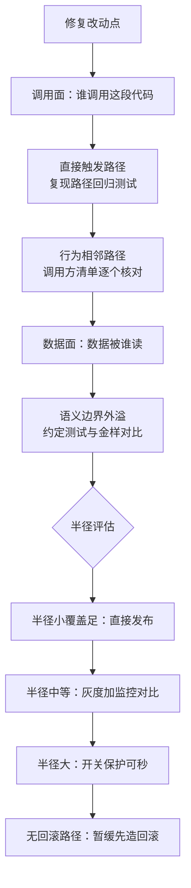
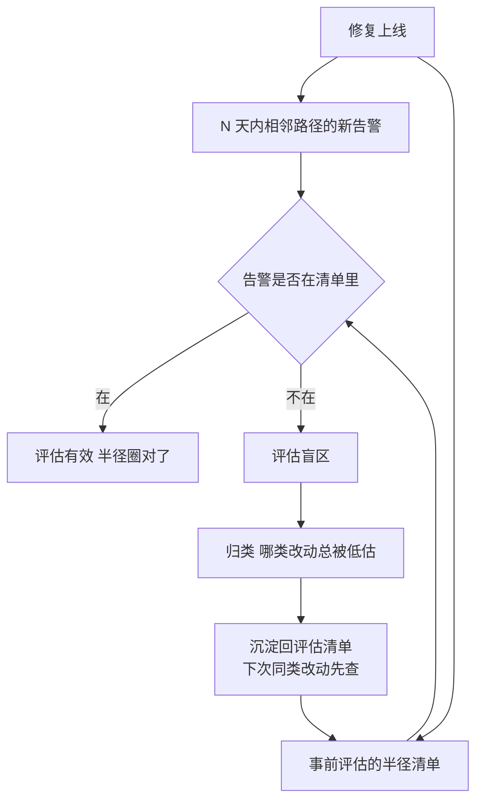

# 回归风险评估把修复的爆炸半径圈出来

**回归（修 bug 引入新 bug）是缺陷分析的高频模式**：优化引入新删除（案例三十四）、修复在别的路径打穿（案例十一的移植缺口）、配置改动让旧默认值失效（案例三十八）。所以每个修复上线前都要单独回答一个问题：**这个修复可能炸到哪、怎么提前知道**。这就是回归风险评估，**评估结果直接决定发布方式——直接上、灰度、开关保护还是暂缓是修复决策的一部分**；灰度即新版本先放一小部分流量验证再逐步放大到全量。

评估的核心机制是**沿调用面与数据面双向圈爆炸半径**：**改动点的调用面（谁调用这段代码、行为变化是否影响它们的假设）与数据面（改动接触的数据被谁读、格式或语义变化是否破坏下游）**。

## 要解决的问题是什么：修复的爆炸半径有多大，三个圈层

| 圈层 | 看什么 | 证据来源 |
| --- | --- | --- |
| 直接触发路径 | 原缺陷的复现路径，修复后行为正确 | 修复自带的回归测试 |
| 行为相邻路径 | 共享代码的其他调用方，行为变化是否符合其假设 | 调用方清单 + 各自的测试 |
| 语义边界外溢 | 数据格式/时序/默认值的隐性变化 | 接口约定测试 + 金样对比 |

**第二层最常被跳过**——"测试全绿"通常只覆盖第一层：**修复附带的测试只针对原缺陷路径**。第二层的做法：**ripgrep（快速文本搜索工具） 列出改动符号的全部调用方，逐个问"行为变化是否在其预期内"**。调用方多的改动（公共库、工具函数），**行为变化应做成开关或新接口而非静默改旧接口**——这正是 API 演进的兼容性纪律[[工程知识/软件构建：让变化可以理解、验证与交付/架构与代码/API与Schema演进必须兼容新旧消费者]]。

**第三层防的是隐性语义变化**：修复改了时间戳的时区处理、字段的默认值、错误码的语义——**类型系统全过、测试全绿，但下游按旧语义消费**。防御手段是**接口约定测试（把隐含约定显式化为断言）与金样对比（输出快照 diff 出语义变化）**。

## 发布方式怎么和影响半径匹配

「按半径选择发布载体」的官方形态是部署戳加流量路由：修复后的版本先部署到部分部署戳（Stamp），Front Door 按租户把流量路由过去——新版本先接住一小部分租户（Stamp 1 的 A、B、C），其余租户还跑旧版，爆炸半径被路由层圈在一小片里：

*图源：[Microsoft Learn 中文文档《部署戳模式》](https://learn.microsoft.com/zh-cn/azure/architecture/patterns/deployment-stamp)，CC BY 4.0，文档引用。*

评估产出半径后，发布方式按半径选：

| 半径评估 | 发布方式 | 理由 |
| --- | --- | --- |
| 半径小且测试覆盖充分 | 直接发布 | 灰度成本大于收益 |
| 半径中等或覆盖不确定 | 灰度 + 监控对比 | 部分流量先验证 |
| 半径大（公共路径、语义变化） | 开关保护，可秒回滚 | 出问题立刻关 |
| 半径大且无回滚路径 | 暂缓，先造回滚路径 | 不可逆风险不接受 |

开关与部署分离的原则见 [[工程知识/软件构建：让变化可以理解、验证与交付/测试与交付/配置与特性开关分离部署与发布]]，发布门禁的证据要求见 [[工程知识/软件构建：让变化可以理解、验证与交付/测试与交付/发布门禁必须绑定真实证据]]。

## 回归测试按什么策略选取

回归测试（改动后重跑旧用例、确认没有破坏既有功能）按半径选取：**复现路径的确定性测试（必选）+ 相邻路径的抽样测试 + 约定断言**。全量回归（改动后重跑全部既有用例）交给发布流水线跑（成本由 CI（Continuous Integration，持续集成：代码合并后自动构建与测试）承担），**人的判断只回答"哪些相邻路径最可能被波及"——这个判断的质量决定回归捕获率**。

复现条件如何沉淀为测试，见 [[工程知识/缺陷分析：从个案到体系/复现与回归/从复现到回归——让证据走完一圈]]；证据何时算够用，见 [[工程知识/缺陷分析：从个案到体系/复现与回归/证据链的够用判据——从孤证到可裁决]]。

## 修复动作本身带哪些风险

圈半径不只是影响面，还是资源约束。多个服务共享一个连接池（预先建好连接反复取用、省去反复握手建连的开销）时，一处耗尽会拖垮全部；按服务切开之后，故障被关在各自的池里：

*图源：Microsoft Learn「Bulkhead pattern」，https://learn.microsoft.com/en-us/azure/architecture/patterns/bulkhead ，CC BY 4.0。*

单个服务内部的资源同样要按调用方切分，否则一个调用方的突发会把整个服务占满：

*图源：同上。*

「一进失火不烧全宅」的实物原型是纵深布局的宅院：前后三进各自围合、以墙相隔——修复上线时最怕的正是「修这一进、烧了全宅」，隔舱（按调用方分的资源墙）把爆炸半径预先圈在单进之内。上面两张官方图里红色那条链就是「失火的一进」：它烧得再彻底，虚线框（舱壁）之外的部分照常服务。

**隔舱划定的是「影响停在哪」，限流（控制单位时间放进来的请求数量，超过配额就拒绝）划定的是「允许用多少」**。资源使用率越过阈值**后限流启动**，把负载压回阈值**以内**，**隔舱之内的资源也不会被单个调用方吃干**。

**两个机制回答不同的问题**。**隔舱回答修复失败时谁跟着遭殃，限流回答修复后的资源占用有没有上限**。**只做隔舱不限流，爆炸半径圈住了但资源仍可能被吃干；只限流不做隔舱，资源有上限但故障仍会横穿**。

高频的修复-回归模式，评估时逐条对：

1. **优化顺手化（案例三十四）**：修复时"顺手"改了别的——**一个修复一个变更，夹带改动是回归高发源**。
2. **分支移植缺口（案例十一）**：修复只进了部分分支/环境——**修复清单要覆盖全部活跃分支**。
3. **默认值变化（案例三十八）**：修复改默认配置，存量用户的行为静默变化——**默认值改动要当语义变化对待**。
4. **修复掩盖而非根除**：修了症状（加了 catch、调了阈值），根因还在——**回归会以新形态回来**。判据见证据链篇的确认证据要求。

## 这套说法在哪儿会失效

**评估有成本上限**：调用方清单可以无限展开，实际按影响面收敛（估算方法见 [[工程知识/缺陷分析：从个案到体系/影响判断/影响面估算先于修复——从改一行到伤多少服务]] 的二级消费者截止规则）。**评估产出要标注置信度**：**测试覆盖支撑的结论标高，靠人工通读代码得出的结论标注为低；标注为低的项用灰度观察补足证据，不强求评估完备**。

紧急修复（线上事故）的评估**压缩但不清零**：沿影响半径问三件事——**这个符号有谁调用、返回的数据有谁读取、改动能不能回滚（把系统恢复到上一个可用版本）**。**三件事在 30 秒内过一遍，答不出回滚路径的紧急修复本身就该再想想**。

## 怎么自己动手验证

评估方法本身也要有账：上线后的告警与事前的半径清单对不上时，差异往哪回流：

**盲区模式沉淀回清单，评估能力才随修复次数增长；否则每一次评估都是从零开始的主观判断**。

对最近的每次修复做事后复盘：**修复上线后 N 天内有没有相邻路径的新告警，对照事前评估的半径清单——清单里没预警的告警就是评估方法的盲区，盲区模式（哪类改动总被低估）沉淀回评估清单**。

**灰度验证的读法：灰度组与对照组的错误率、延迟、关键业务指标对比，差异显著即回滚**——**灰度期的监控项要在发布前配好，事后补监控等于没灰度**。

## 接着读哪几篇：半径大的修复的发布载体

- 关系：[[工程知识/缺陷分析：从个案到体系/复现与回归/从复现到回归——让证据走完一圈]] · [[工程知识/软件构建：让变化可以理解、验证与交付/测试与交付/发布门禁必须绑定真实证据]] · [[工程知识/缺陷分析：从个案到体系/正确性/案例三十四：省下的句柄与多出的删除——一次优化引入的回归]]
- [[工程知识/缺陷分析：从个案到体系/影响判断/影响面估算先于修复——从改一行到伤多少服务]] —— 半径估算的完整方法
- [[工程知识/软件构建：让变化可以理解、验证与交付/测试与交付/配置与特性开关分离部署与发布]] —— 半径大的修复的发布载体
- [[工程知识/软件构建：让变化可以理解、验证与交付/测试与交付/测试策略从风险选择证据]] —— 回归测试选取的通用原则
- [[工程知识/缺陷分析：从个案到体系/缺陷分析方法——三分离、判定树与五步法]] —— 回归发生后重新归类
