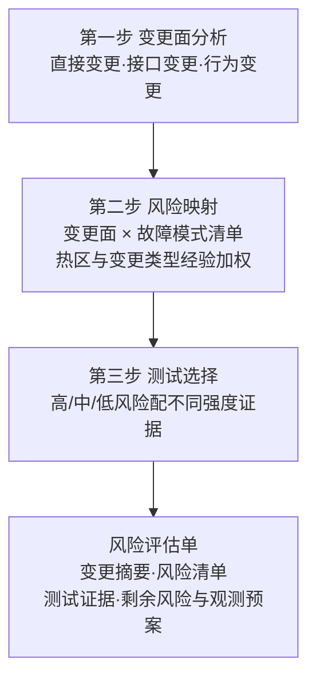
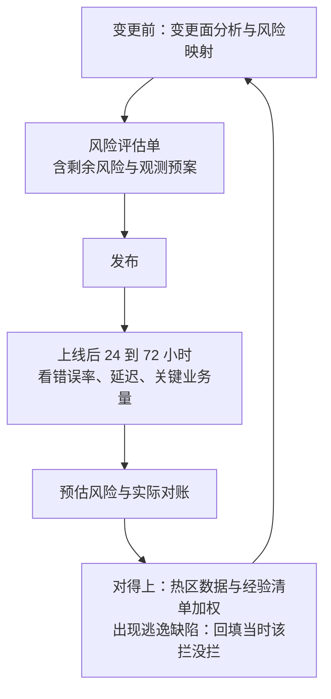

## 要解决的问题

每次发布都要回答"这版改动可能炸哪、要跑哪些测试才睡得着"。**全跑会拖垮发布节奏——回归套件一跑几小时，凭感觉跑则漏跑的那块恰好炸了**。**回归风险评估的骨架把这个回答变成推导：变更面分析（改了什么、影响半径多大）→ 风险映射（变更面与故障模式的交集）→ 测试选择（按风险选测试集与强度），三步每步有方法有证据，最后产出的答案是"这些风险被这些证据覆盖，剩余风险是这些"**。

## 三步骨架怎么起作用：机制

先把形状说成一件事：回归风险评估像医院手术前的核对单——第一步解剖是看这次手术动哪儿：直接变更问切口在哪，接口变更问碰到了哪根血管（血管通全身），行为变更问麻药剂量是不是改了；第二步风险映射是按切口位置推可能出什么意外（切到腿与切到头，备血方案不同）；第三步测试选择是按意外清单配监护仪（清单上要的才推，不做全病房普查）。这个比喻到「才推」为止——现实里三步各自的产出物，下面逐节展开。

### 第一步：怎么给改动做解剖（变更面分析）

**三个维度。直接变更**：代码 diff 的模块清单，列出改了哪些文件、函数、表结构、配置。

**接口变更**：对外约定的变化——API 字段、错误码、事件 schema、CLI（Command-Line Interface，命令行界面）命令行参数——**接口是爆炸半径的放大器，内部改动炸自己，接口改动炸别人**。**行为变更**：语义层面的变化，如超时从 1s 变 2s、日志格式、默认值——**行为变更藏在"重构"里最危险，diff 看不出、运行时才炸**。

**变更面的大小不看行数，看被依赖的方向数：被 200 处调用的底层库函数与零依赖的叶子页面，同是 50 行改动，风险差两个量级**。**依赖图把静态 import 与运行时调用链合起来，给变更面算影响半径**。

### 第二步：风险怎么映射（变更面 × 故障模式）

把变更放到故障模式的清单上扫：**这改动可能引发哪类故障（功能错、性能退化、兼容破坏、数据损坏、安全漏洞）**。**映射的加速器是历史**。**代码热区指模块或文件的历史缺陷密度**，用 Git blame（Git：分布式版本控制系统，blame 命令逐行显示每行最后的修改者）与缺陷单关联统计，**高缺陷密度的模块改动风险加权**。**变更类型经验：依赖升级的典型故障是兼容性、并发改动的典型故障是竞态（结果取决于执行时序、因而不可重现的并发缺陷）、配置改动的典型故障是环境差异，按变更类型查对应的故障模式清单**。**映射产出：风险清单（每条：变更点 × 可能故障 × 置信度）**。

### 第三步：测试怎么选才能覆盖风险（测试选择）

**按风险清单配测试，配比的逻辑是风险强度决定测试强度**。**高风险（接口变更 + 热区模块）：全量相关套件 + 兼容性专项（新旧消费者对照）+ 灰度（新版本先放一小部分流量验证，逐步放大到全量）发布（生产小流量验证）**。

**中风险即行为变更加一般模块：针对性测试——改哪测哪的精准测试选择，test selection 按依赖图挑受影响用例，加冒烟套件**。**低风险（纯内部重构 + 叶子模块）：编译 + 单测（针对最小可测单元的自动化测试） + 冒烟**。

**测试选择的两条数据线：精准测试选择（precision testing，从代码依赖反推该跑哪些用例）与测试影响分析（test impact analysis，历史记录每个用例捕过哪些模块的缺陷，高频捕手的用例优先）**。谷歌的发布工程实践公开过规模数据。

「按类型分发到不同强度的处理路径」这个结构，Anthropic 的 Agent 设计指南把它画成了 Routing 工作流的官方形态：一个 LLM Call Router 把输入分类，LLM Call 1/2/3 三条路径各接一种处理，结果各自汇入 Out——把它读成测试选择，Router 就是风险映射，三条路径就是高/中/低三档证据强度，分类器保证每份变更走对档位，而不是**所有变更挤同一条全量回归**（改动后重跑全部既有用例）通道：

*图源：[Anthropic《Building Effective Agents》](https://www.anthropic.com/engineering/building-effective-agents)，Anthropic 版权，文档引用。*

变更的波及形状像水滴入水的涟漪：落点是直接变更，第一圈是接口与直接调用方，外圈是间接消费者——波纹随半径衰减，测试强度也按圈层递减（落点全量、第一圈专项、外圈冒烟），把最贵的证据花在离落点最近的位置：

*图源：Wikimedia Commons，作者 Amos777eligius，CC BY 4.0，https://commons.wikimedia.org/wiki/File:Water_drop_ripple.jpg。*

风险映射就是判断"这一滴落在水面的哪个位置"：落在池心（被依赖的底层模块）波及全池，落在池边（叶子页面）只起小圈——同一行代码改动，涟漪半径差出量级，测试配比跟着半径走。

### 这一步的产出物是什么：风险评估单

**三步之外还有一段回路：风险评估单发出去之后，上线后 24 到 72 小时的观测数据要回来对账，逃逸缺陷回填进热区数据与经验清单，再变成下一次变更面分析的输入**。

这条回路之所以能回到起点，靠的就是剩余风险那一栏写的观测预案——没有它，预估准不准永远没人知道。

**发布前的一页纸：变更摘要三句话；风险清单列 Top 5 风险与证据等级；测试证据说明跑了什么、覆盖了哪些风险；剩余风险给没证据覆盖的风险配观测预案**——上线后盯哪些指标、怎么把系统状态退回到改动之前的版本，各配触发线。**剩余风险的显式声明是骨架的良心：不说"测完了没问题"，说"这两个风险没测到，靠这两个指标兜底"**。

## 它从哪儿来，要付什么代价

回归测试（改动后重跑旧用例、确认没有破坏既有功能）选择（Regression Test Selection, RTS）是软件工程研究的成熟分支（1990s 起大量论文，系统化综述可在 Engström 与 Runeson 的 RTS 系列工作中检索）；工业规模化样本是 Google 的发布工程实践，见 sources 的 SRE Book 发布工程章（SRE 即 Site Reliability Engineering，网站可靠性工程），精准选择流水线的规模数据出自该书；精准测试选择的论文侧见 sources 的 Google research 条目，跳过测试的科学出自 testing.googleblog 条目，是方法细节的两个入口；Martin Fowler 的"risk story"论述（见 sources 链接）把风险沟通拉进发布流程；CTA（continuous testing）与 test prioritization 按缺陷捕手历史排优先级，是配套技术。

**这套骨架把测试从动作改写成证据覆盖风险的映射关系：传统发布问答"测了吗"（测了等于安全，语义上把测试当保险费），骨架的问答是"这些风险分别被什么证据覆盖"**，证据包括测试、灰度、静态分析、观测兜底，几种证据配合使用。**这个改写让"不跑某测试"成为可辩护的决策——对应风险低或被其他证据覆盖，而非图省事的省略**。

代价：**精准选择的地基是依赖图与测试关联数据，两者都要基建投入：依赖图对动态语言、反射（程序在运行时读取和操作自身结构的机制）、运行时注入的覆盖是残缺的，图上没有的边就是漏掉的风险**。**风险评估单有官僚化风险（填表游戏：清单复制粘贴，风险评估变成仪式）**，对策是**把单子的字段与真实故障复盘挂钩——每次逃逸缺陷回填"当时风险评估漏了哪条"，单子的字段跟着事故演化**。**剩余风险声明的心理陷阱：写了剩余风险，团队的注意力就以为"被声明等于被接受"，声明要有配对的触发预案（指标+回滚线）才闭环**。

## 这套说法在哪儿会失效

- **骨架对"探索性改动"的适用打折**：**新功能的首版（无历史缺陷密度、无依赖图先例）、原型验证（本来就要推翻重来），风险评估的输入数据不存在，硬套骨架产出的是伪精确**。**这类改动走轻量版：变更摘要加冒烟加强观测**。
- **数据损坏类风险要专项**：迁移脚本、schema 变更、数据回填——**这类故障的爆炸半径是持久的（坏了修不回来，数据没了就是没了），不进普通风险档位，一律上备份验证与回滚（把系统恢复到上一个可用版本）演练，风险再低也是专项流程**。
- **依赖图断边的兜底**：**动态语言的运行时依赖（反射、依赖注入、字符串拼的类名）让影响半径被低估**。兜底手段：**全量冒烟套件永远跑——几小时的回归套件可以精准裁，冒烟的几百条不许裁，另配关键路径的端到端测试保留全量**。
- **发布后的风险回收**：**骨架不是发布前一次性动作**。上线后 24-72 小时的观测指标——错误率、延迟、关键业务量——**是风险评估的最终对账——当时的风险预估准不准，对账结果回填进热区数据与经验清单，骨架的输入数据随使用变准**。

## 怎么自己动手验证

- **影响半径实测**：对一次真实发布做变更面分析，用依赖图算影响模块数，发布后统计实际受影响的模块——告警、缺陷单指向的模块。**预期：漏报率即估计集没覆盖的实际故障点占比，落到个位数百分比，漏报集中在动态依赖断边处**。变更面方法的效度证据。
- **精准选择对照**：同一批变更，全量回归 vs 精准选择子集，对比捕获的缺陷与耗时。**预期：精准版耗时明显下降，捕获缺陷数接近（漏掉的集中在低风险区）**——**省时与漏检的交换曲线，决定组织可接受的裁剪档位**。
- **逃逸复盘回填**：取近半年测试没拦住、上线炸了的生产逃逸缺陷，逐条回填"风险评估当时该不该拦"。**预期：一部分是骨架覆盖内的执行走样（该跑没跑），一部分是骨架盲区（依赖断边、新故障模式）**——**两类占比指导骨架改进方向**。

## 接着读哪几篇：覆盖率读法是测试选择的证据强度依据

- [[工程知识/缺陷分析：从个案到体系/复现与回归/从复现到回归——让证据走完一圈.md]] —— 本篇在回归环节展开风险决策方法，母篇定义证据如何走完一圈
- [[工程知识/软件构建：让变化可以理解、验证与交付/测试与交付/覆盖率的三种读法：行分支与路径覆盖的证据强度.md]] —— 覆盖率读法是测试选择的证据强度依据
- [[工程知识/性能工程：从用户等待到资源瓶颈/观测与诊断/性能回归门禁：把性能预算写进CI.md]] —— 性能风险档的专门门禁，骨架里性能风险一档的具体实现