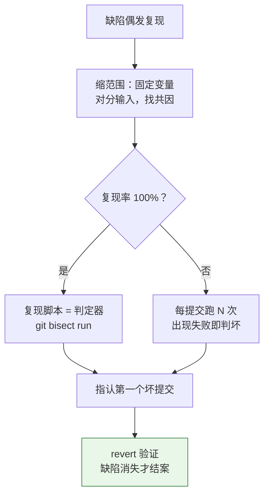

# 复现范围先于复现次数：坏提交的二分定位要靠可判定的复现条件

**git bisect 的前提不是「能复现很多次」，是「存在一个可自动判定的复现条件」——复现的稳定性决定二分会不会得出谎报的坏提交**。 读完你能回答：**为什么 bisect 前先缩范围、复现脚本怎么写才能当判定器**、不稳定缺陷怎么处理二分中的假阳性、`git bisect run` 的完整闭环。

## 要解决的问题

「这个 bug 偶尔出现」的直接冲动是多跑几遍碰运气。但二分定位（bisect，在提交历史里用二分查找定位引入缺陷的提交）需要的是**对任意一个提交给出确定的判定：好或坏**。**复现概率 50% 的缺陷，单次判定一半是错的，二分的对数收敛立刻失效——错误的「好」判定会把真实坏提交排除在搜索范围外，最终指认一个无辜的提交**。**复现范围（缺陷在什么条件下必然发生）先于复现次数（跑多少遍），缩范围就是给二分造判定器**。

## 机制：从概率复现到确定判定

### 第一步：缩范围，把概率变成条件

缺陷复现概率低的根源是某个未知条件没被控制。**缩范围的标准动作：固定变量（版本、配置、数据、并发时序）、对分搜索（去掉一半输入看缺陷还在不在）、查日志找共因（失败样本里总出现的那个前置事件）**。目标态是：**一个输入集合，在其上复现率 100%**。**缩到 100% 后，复现脚本输出退出码 0（好）/ 非 0（坏），二分的判定器就有了**。

### 第二步：bisect 自动化闭环

```bash
git bisect start HEAD v2.3.0        # 坏的终点与好的起点
git bisect run ./repro_test.sh      # 脚本退出码自动标注好/坏
```

`repro_test.sh` 是缩范围之后得到的复现脚本：**命中缺陷非零退出，通过则零退出**。**二分在 log(n) 次迭代内给出第一个坏提交**。手工 bisect 的每步 `git bisect good/bad` 同理，只是判定靠人——**判定器越客观，结论越可信**。

### 第三步：不稳定缺陷的假阳性处理

缩不到 100% 的缺陷（真随机、依赖外部时序），二分要显式防谎报：**判定脚本对每个提交跑 N 次，出现一次失败判「坏」（牺牲时间换不错杀）；或接受概率判定但对最终指认的坏提交跑额外验证（revert 它看缺陷是否消失，`git bisect log` 留档复核）**。**二分的每一步都继承上一步判定的可信度，任何一步的假阳性都污染整个搜索区间——不稳定缺陷的 bisect 结论必须以 revert 验证收尾**。



## 案例：判定条件先于定位手段

[[工程知识/缺陷分析：从个案到体系/复现与回归/断言要锚定在不变量上：注入前后该不变的数字与该变的数字]] 与本篇共享同一个根基：**判定要先锚定**。**断言锚在不变量上（故障注入前后什么数字不该变），bisect 锚在复现条件上（什么输入下必然失败）——两者都是把「感觉有问题」翻译成「可自动判定的命题」**。**翻译不出来，再多的定位工具都是空转**。[[工程知识/缺陷分析：从个案到体系/复现与回归/从复现到回归——让证据走完一圈]] 把复现条件延伸到回归防线：**缩出来的条件集直接变成回归测试用例，定位成果沉淀为防复发资产**。

## 怎么测

- **判定器稳定性：复现脚本在已知好提交上连续跑 20 次全通过、已知坏提交上全失败，稳定后才进 bisect**。
- **bisect 演练：在测试仓库故意埋坏提交，验证 `bisect run` 的指认正确性与迭代次数符合 log(n)**。
- **revert 验证：对指认结果执行 revert 后复现脚本转好，确认不是假阳性**。
- **概率模式核对：对缩不满的缺陷，验证「跑 N 次判坏」策略在坏提交上的漏判率可接受**。

## 哪些认识一看就错

- **「多复现几次就能定位」——复现次数不改变判定的确定性；没有条件的复现只是采样，采样不支撑二分**。
- **「bisect 结果可以直接信」——判定器的每个假阳性都污染区间，结论必须经 revert 验证；信工具不信验证是本末倒置**。
- **「环境差异先忽略」——环境变量正是复现条件的常见组成，先固定环境再谈复现；「我这里不出现」本身是范围信息**。
- **「缩范围是浪费时间」——缩范围产出的条件集同时是判定器、回归用例与根因线索；跳过它，定位工具全部空转**。

## 效果从哪来、要付什么代价

**可判定复现条件把二分的收敛性变成数学保证：n 个提交的定位成本从线性排查降到 log(n) 次构建与判定，自动化闭环让每次判定无人值守**。**代价全部付在缩范围阶段——固定变量、对分输入、日志比对，是智力密集而非算力密集的工作；付出一次，产出三样（判定器、回归用例、根因方向）**。**跳过缩范围直接跑 bisect 的团队，通常在第三次假阳性指认后回来补这一课**。

关系：[[工程知识/缺陷分析：从个案到体系/复现与回归/断言要锚定在不变量上：注入前后该不变的数字与该变的数字]] —— 判定锚定的另一面：断言锚在不变量。[[工程知识/缺陷分析：从个案到体系/复现与回归/从复现到回归——让证据走完一圈]] —— 复现条件沉淀为回归防线的完整闭环。[[工程知识/缺陷分析：从个案到体系/缺陷分析方法——三分离、判定树与五步法]] —— 定位在缺陷分析方法体系中的位置。
