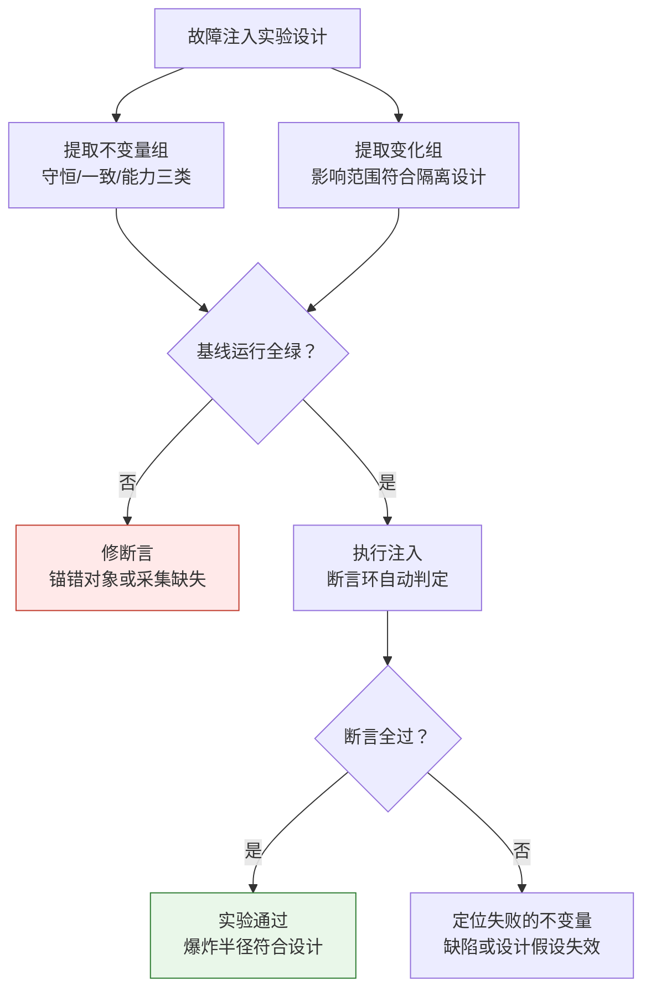

# 断言要锚定在不变量上：注入前后该不变的数字与该变的数字

**故障注入测试的价值不在注入本身，在注入后能自动判定「系统坏没坏」——判定锚（invariant，注入前后必须保持不变的量）没选对，测试只是制造流量，不是验证。** 读完你能回答：不变量怎么从业务语义里找、哪些数字该变哪些不该变、断言弱与断言错的两种失败形态、混沌实验的判定闭环怎么搭。

## 要解决的问题

混沌工程最常见的空转形态：注入执行完毕、看板截图、宣布「系统很稳」。问题在**判定环节缺失**——注入后系统「没崩」与「服务正确」之间隔着大量中间态：延迟劣化三倍、部分请求失败被重试掩盖、数据写了但少写一条字段。「没崩」是肉眼的判定，「正确」需要锚定不变量的自动断言。**没有断言的故障注入等于没有做。**

## 机制：从业务语义提取两组数字

### 不变量组：注入前后必须相等的数字

不变量的来源按可靠性排：

- **守恒类**：**请求总数 = 成功 + 失败 + 在途；库存扣减量 = 订单生成量；账户借贷平衡**。
- **一致类**：**副本间读值一致（最终一致域内给收敛窗口）；缓存与源数据在 TTL 内一致**。
- **能力类**：**注入期间服务仍满足 SLO（错误率 ≤ 阈值、P99 ≤ 上限）**——这是「注入中系统仍可用」的量化形态。

不变量断言的写法是精确比较：`assert success_count + failed_count == total_count`，**差一个都不行**。**模糊断言（「成功率大概还行」）是断言弱的第一个形态**。

### 变化组：注入应当只影响指定范围的数字

第二组断言验证「爆炸半径符合设计」：**杀了 A 实例，B、C 的错误率不得上升；限流生效，被限客户的其余接口不受影响**。变化组锚的是**隔离性**——故障影响被限制在设计允许的范围内。**没有这组断言，注入「通过」可能只是没有观测到扩散**。

### 两种失败形态：断言弱与断言错

断言弱（该断言的没断言）：**注入把数据搞坏了一半，测试全绿——因为只断言了进程活着**。断言错（锚错了对象）：**断言「响应时间不变」但注入本就会让降级路径变慢——锚到了设计允许变化的量上，测试永远红**。**两组断言都要在「无注入的基线运行」上先验证一遍：基线上就该绿的断言才允许进判定环。**

## 案例：断言失守与告警语义同源

[[工程知识/缺陷分析：从个案到体系/正确性/日志级别的语义：把提示当告警，告警就成了背景噪音]] 展示信号语义失真的代价；断言是测试域的信号——**断言弱化后测试全绿，坏代码带着「已验证」的凭证上线，比没有测试更危险（虚假信心）**。[[工程知识/缺陷分析：从个案到体系/复现与回归/复现范围先于复现次数：坏提交的二分定位要靠可判定的复现条件]] 从定位侧呼应：**bisect 的判定器与混沌实验的断言环是同一种东西**——**把「系统对不对」翻译成可自动执行的命题**，**翻译质量决定一切下游工具的价值**。

## 怎么测

- 断言基线验证：**无注入状态下跑完整断言环，预期全部绿色**；实测有非绿断言时对不上基线假设，**先修锚点再谈注入**。
- 断言强度核对：人为制造「少写一条字段」「延迟劣化三倍」，**预期断言环必须变红**——**红不了的断言是装饰**，预期与实测对不上就说明锚点选错了。
- 隔离验证：注入 A 实例故障，**变化组断言确认 B、C 无感**；**断言环要覆盖爆炸半径的全部边界，边界外的数字该不变**。
- 实验留档：每次实验记录注入方式、断言集、结果与发现，**不变量清单随系统演进而修订**。

## 哪些认识一看就错

- 「系统没报错就是稳」——**不变量断言要抓的是静默的错误（数据少写、部分失败被重试掩盖）**；**报错是进程层的信号，不是服务正确性的证明**。
- 「断言越多越好」——**锚错对象的断言永远红或永远绿，都是噪声**；每组断言都要通过基线验证与强度核对两道审查。
- 「混沌实验是演练不是测试」——**没有断言环的演练只产出演示价值；带断言的实验是回归防线，能拦截设计假设失效**。
- 「不变量只在故障时才重要」——**不变量清单本身就是系统设计文档的一部分**：**守恒与一致类断言写不出来，说明业务语义还没理清**。

## 效果从哪来、要付什么代价

**不变量断言把「注入后系统正确」从人工观察变成自动判定，混沌实验从演示活动升级为可进 CI 的验证手段，爆炸半径从「看起来没扩散」变成量化边界**。代价是断言体系的建设：**不变量要从业务语义逐条提取（守恒式要业务方确认）、采集要布点、基线要维护**。**断言清单的价值随系统成长——每次真实事故后把「当时本可自动发现」的判据补进不变量清单，防线逐轮加厚**。

关系：[[工程知识/缺陷分析：从个案到体系/复现与回归/复现范围先于复现次数：坏提交的二分定位要靠可判定的复现条件]] —— 判定锚定的定位侧应用：bisect 判定器。[[工程知识/缺陷分析：从个案到体系/正确性/日志级别的语义：把提示当告警，告警就成了背景噪音]] —— 信号语义失真的共通结构。[[工程知识/软件构建：让变化可以理解、验证与交付/测试与交付/测试环境与生产的差距要按维度补偿：并发、数据量、配置与故障注入的逃逸清单]] —— 故障注入在环境差距补偿里的位置。
