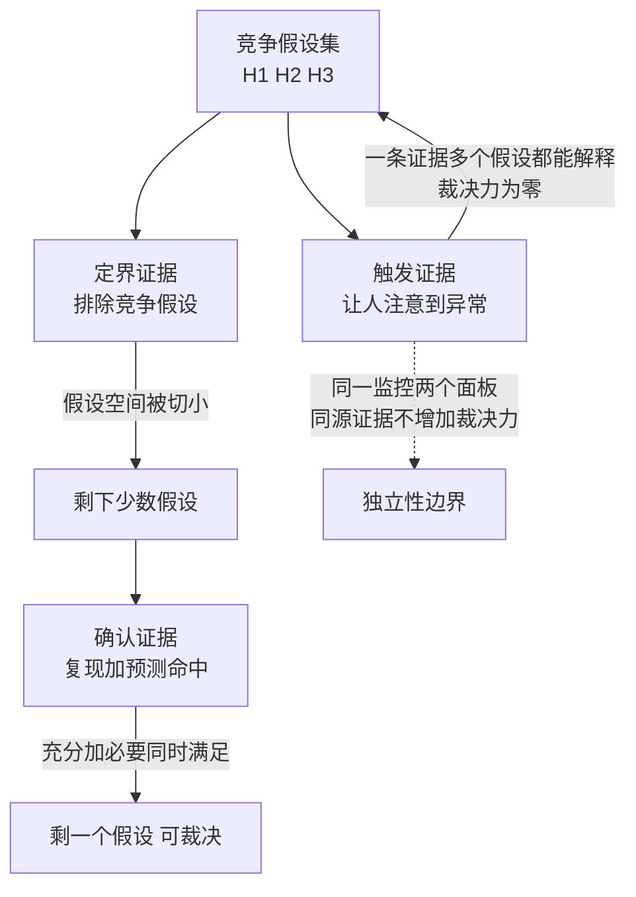
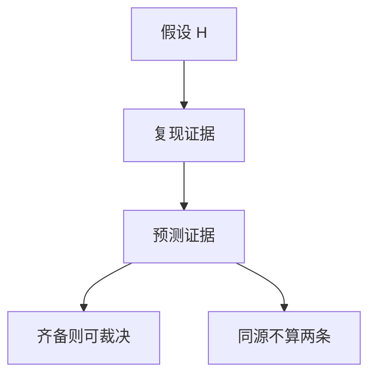

# 证据链的够用判据——从孤证到可裁决

排查缺陷时，证据够不够用没有天然标准：多采总是更安全，但排查有成本与时效；少采快出结论，但结论可能是错的。这个判据问题在复现（见 [[工程知识/缺陷分析：从个案到体系/复现与回归/从复现到回归——让证据走完一圈]]）与回归之间被反复遇到，这里给它一个显式标准：**证据链的够用判据是"能裁决假设"——每个竞争假设都有证据支持或排除，且证据间互相独立**。

孤证的真正问题是**不能裁决**：**一个现象可以同时被多个假设解释时，一条证据不改变假设间的相对可信度**。反之，**两条互相独立的证据可以把假设空间切到只剩一个**。

## 要解决的问题：够用判据怎样用裁决能力表达

排查缺陷时证据采到什么程度才算够用没有显式标准，多采总是更稳妥但要付出成本与时间，少采则结论可能建立在未被排除的其他可能性上。本篇回答：够用判据怎样用裁决能力表达、各类证据之间为什么要互相独立、止血动作与证据采集的先后怎样安排，以及只有单一触发证据的结论应当按什么处理。

## 证据可以扮演哪三种角色

| 角色 | 作用 | 缺失的后果 |
| --- | --- | --- |
| 触发证据 | 让人注意到异常存在 | 问题继续潜伏 |
| 定界证据 | 排除竞争假设 | 结论停留在"可能" |
| 确认证据 | 把因果关系确证（复现/预测命中） | 修复生效，但不知道为什么生效 |

常见失败形态是**只有触发证据就动手修**：监控报警（触发）→ 看到代码里有个可疑之处 → 改了 → 报警消失。**报警消失可能因为修复生效，也可能因为负载自然回落——没有确认证据（复现条件与预测命中），回归发生后无法判断是修复无效还是新问题**。库内案例二十四（并行度被自己折叠）的排查路径就是反面教材的对照：**从现象到配置到并行度证据，每一环都有下一环的预测验证**。

三种角色对假设空间的裁决力各不相同，孤证与完整链的对照：

裁决力怎么长出来：**触发证据只证明异常存在（一个现象多个假设都能解释，相对可信度不变）；定界证据把假设空间切小（排除掉的假设不再回来）；确认证据把充分与必要同时钉住（复现证明条件充分、预测证明条件必要），假设空间收敛到一个点**。虚线是独立性的反面样本：**同一个采集端的两个面板互相印证是同源证据，裁决力不增加，只增加确认感**。**三问都过才可出结论，任一不过标待证**。

## 凭什么说两条证据是独立的

「多源独立才可裁决」的诊断传统，中医的四诊合参是原型：老医生断症不靠单一把脉——望气色、闻声息、问症状、切脉象，四个信息通道各自独立采集，互相印证才能下结论；把脉一个通道的信息再丰富，也只是孤证：

*图源：Wikimedia Commons，Wellcome Collection 藏品，CC BY 4.0，https://commons.wikimedia.org/wiki/File:Watercolour,_Chinese_doctor_feeling_the_pulse_of_a_patient._Wellcome_L0004700.jpg。*

独立性可以做成机制：不同的证据来源各自拿一个凭据，凭据之间互不通用。这样即便某一条路径被污染，它也只能影响自己那份凭据覆盖的范围。

*图源：Microsoft Learn 中文文档，CC BY 4.0，https://learn.microsoft.com/zh-cn/azure/architecture/patterns/valet-key。*

「不同产生路径」长什么样，TCP/IP 的分层结构给了标准形状：同一份数据从应用层往下走，会话层（Cookie）、传输层（端口）、网络层（IP）各自产生一条独立的观察通道，链路层再到物理介质——每一层回答一个维度的问题（会话归属、进程归属、主机归属、本地链路），任何一层的信息都不由其他层代替产生。证据独立性要求的正是这种结构：各条证据像协议栈的各层一样各管一段，一段出错不会连带其余各段同时出错：

*图源：Wikimedia Commons《IP stack connections.drawio.png》，CC BY-SA 3.0，https://commons.wikimedia.org/wiki/File:IP_stack_connections.drawio.png。*

两条证据独立，指它们**不经过同一条产生路径**。典型反面：**用同一个监控系统的两个面板互相印证——采集端同一个 bug 会同时骗过两个面板**。独立性要沿证据产生链往上查：**日志 A 与日志 B 由同一进程写入，进程的日志逻辑有 bug 时两条日志会同时出错；日志与该进程的 Trace 由不同子系统产生，独立性更好**。

够用的判据是**充分与必要两条腿都踩实，且两条腿不来自同一条产生路径**：

这也解释了为什么「再多看几条日志」常被判为无益：同源证据只增加确认感，最小独立集要的是两个方向各一条。

最小独立集的构造：一个假设的确认至少要**一条复现证据 + 一条预测证据**——**复现证明"条件充分"（满足这些条件必然出错），预测证明"条件必要"（不满足时确实不出错）**。**只有复现没有预测，可能只是巧合；只有预测没有复现，可能只修掉了症状，没有触及根因**。

## "证据够用"要怎么变成可操作判据

对每个竞争假设问三个问题：

1. **有没有证据只与它一致（与其他假设矛盾）？**
2. **这些证据是否来自不同产生路径？**
3. **反向假设（"其实是 X"）有没有被证据排除而不是被直觉排除？**

**三问都过，证据链够用，可以出结论；任一不过，结论标"待证"继续采证**。这个判据也解释了为什么"再多看几条日志"经常无益：**新增日志与已有日志同源，不增加裁决力，只增加确认感**。

## 怎么从一个个案走到一套体系

证据链判据的体系价值在**回归防护**：**确认证据（复现条件）直接转化为回归测试（改动后重跑旧用例、确认没有破坏既有功能）的用例；定界证据里的排除项转化为测试的边界用例（证明修复没有顺带破坏相邻行为）**。**一条证据链的价值不止于本次排查，更在于它沉淀成的测试与监控**。这也是 [[工程知识/软件构建：让变化可以理解、验证与交付/测试与交付/发布门禁必须绑定真实证据]] 要求门禁绑定证据的原因——**门禁消费的就是证据链的产出**。

AI 系统里证据链同样成立且更紧迫：模型给出的结论（触发证据）必须配上执行证据才能采信，这条原则见 [[工程知识/AI 系统工程：从模型能力到生产能力/安全与治理/执行证据必须独立于AI结论]]。

## 这套说法在哪儿会失效

判据本身有成本边界：**三问用在值得深挖的缺陷上（复发型、伤业务底线、影响面大）**，一次性、低价值的环境问题**不值得构造完整证据链，快速验证后关闭即可**。判断标准与影响面估算衔接（见 [[工程知识/缺陷分析：从个案到体系/影响判断/影响面估算先于修复——从改一行到伤多少服务]]）：**影响面大才配得上完整证据链**。

另一个边界是**时效：线上事故优先止血**，证据链可以在止血后补齐——但**止血动作本身要记录（改了什么、何时）**，否则事后补齐证据链时，**止血动作已经污染了现场**。

## 怎么自己动手验证

结论可裁决要与三角色齐备对账——**预写触发、确认与排除三种证据都有对应，只有触发证据而确认缺失，与预期对不上，该结论降级为待证**。

对每个已结案的缺陷，**把证据链按三角色标注一遍，检验是否有角色缺失**。常见发现是**确认证据缺失（修好了但没复现证据），这类条目是回归风险清单的第一批候选**。

反向验证：拿一条只有触发证据的历史结论，找它的竞争假设，**检查该假设是否真的被排除过。找到未被排除的假设，说明当时判据不满足，该结论应降级为"待证"**。

## 接着读哪几篇：新缺陷的归类入口

- 关系：[[工程知识/缺陷分析：从个案到体系/复现与回归/从复现到回归——让证据走完一圈]] · [[工程知识/AI 系统工程：从模型能力到生产能力/安全与治理/执行证据必须独立于AI结论]] · [[工程知识/软件构建：让变化可以理解、验证与交付/测试与交付/发布门禁必须绑定真实证据]]
- [[工程知识/缺陷分析：从个案到体系/缺陷分析方法——三分离、判定树与五步法]] —— 证据采集前的归类
- [[工程知识/软件构建：让变化可以理解、验证与交付/测试与交付/调试从假设到最小复现]] —— 复现证据的构造方法
- [[工程知识/性能工程：从用户等待到资源瓶颈/观测与诊断/指标、日志、Trace与剖析各答一问，合起来才构成证据]] —— 证据类型选择的输入
