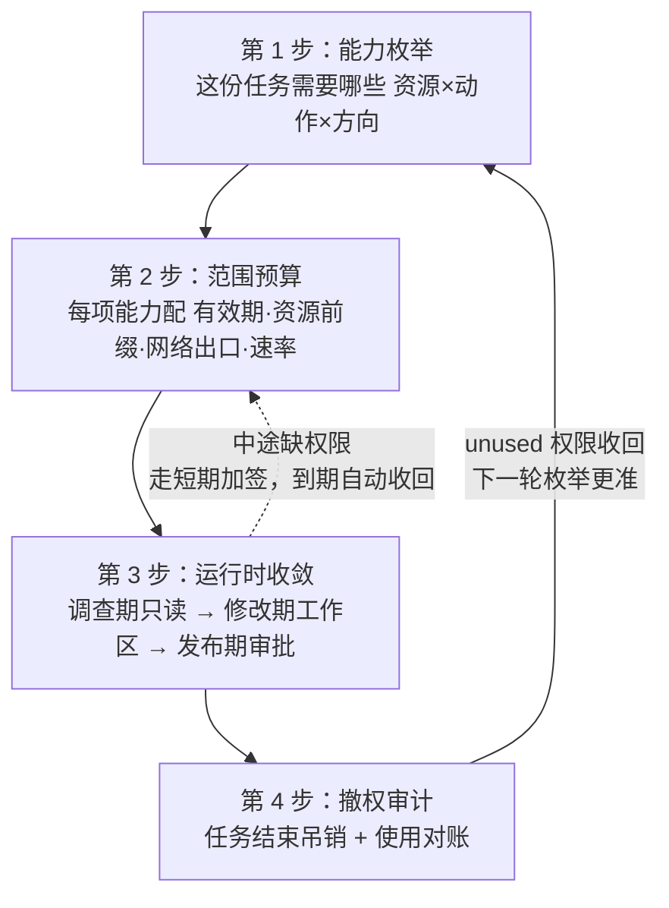

# 最小权限把爆炸半径变成设计输入：从能力枚举到撤权闭环

最小权限（least privilege，只给主体完成任务所需的最少能力）经常被当成一句口号：出事后把权限收一收。这篇要说明的是另一件事：**权限给出的那一刻，爆炸半径就已经定了**（blast radius，一次失陷所能波及的最大资产范围），**事后收紧只是在下一次事故前抢时间**。所以**最小权限必须是设计输入——写代码、建任务、开账号之前先算清楚这一份工作需要哪些能力**，事后收紧永远赶不上下一次事故。读完这篇你能为一个任务走完四步：**枚举它需要的能力、给每项能力配范围与期限、让能力随阶段收缩、任务结束撤权并对账**。

| 维度 | 内容 |
| --- | --- |
| 要解决的问题 | **权限过宽让任何一次泄露、误操作或注入的影响面等于全部资产** |
| 本质 | **默认拒绝 + 授予不可逆：给出去的权限没有机制压力就不会自己回来** |
| 机制 | **能力枚举 → 范围预算 → 运行时收敛 → 撤权审计的四步闭环** |
| 实践与效果 | 同一条闭环在 ACL（Access Control List，访问控制列表：逐条列出谁可以对资源做什么）、数据库账号、CI（Continuous Integration，持续集成：代码合并后自动构建与测试） 凭证、AI Agent 四个场景的具体形态 |
| 失败边界 | 反弹模式（收太紧导致共享管理员）、枚举缺口（紧急加签固化为常驻通道）、分类税、「最小」无绝对标准 |
| 测量与验证 | 越权回归集、使用对账、撤权即时性、泄露半径演练 |

配电箱是这条原则的实物原型：老房子一个总闸管全屋，任何一路短路全楼断电；现代配电箱每一路一个断路器（保险开关），厨房短路只跳厨房那一格。**最小权限就是把「一个总闸」换成「每路一个断路器」**。比喻到「每路有自己的开关」为止：**断路器装好后是固定接线，权限是逻辑配置，可以远程发放、按任务生成、随时收回——这一点配电箱比不了，也正是工程里最难的部分**。

## 要解决的问题是什么：权限给出的那一刻半径就定了

先看三个库内已经发生过的场景，它们共享同一个结构。

[[工程知识/缺陷分析：从个案到体系/安全/案例四十四：投毒不是写错，是写给你看——依赖投毒的三个真实剧本]] 里 **CI runner 凭证被窃取后横向扩散，病根是 GITHUB_TOKEN 的权限盖过了这一次构建的真实需要**——**只读仓库够用的任务领了写权限，攻击者改一个 tag 就能让下游仓库替他执行恶意代码**。[[工程知识/缺陷分析：从个案到体系/安全/案例二十六：公告栏没查门禁——Redis 的 ACL 键名泄露与解析崩溃]] 里**受限账号本不该看见的键名从广播路径泄露，如果账号从一开始就没有订阅通道，泄露无从发生**。

[[工程知识/AI 系统工程：从模型能力到生产能力/安全与治理/提示注入和工具越权是不同威胁]] 把同一件事说得更直白：**Agent 用管理员凭据跑任务，身份过宽让提示注入（把恶意指令夹带进输入、诱骗模型执行的攻击）的成功被放大成数据外传**——防线之一是**「最小权限工具集」，不存在的工具，模型调不出来**。

三个场景的主角分别是 CI 机器人、数据库账号、AI Agent，但失败都发生在同一时刻：**授权那一步给了超出任务需要的能力**。之后的攻击、泄露、注入只是把这个过宽的半径走满而已。这就是为什么最小权限是设计输入：**它决定的是还没发生的事故的规模**。

## 本质：默认拒绝与授予的不可逆性

RFC 4949（互联网安全词汇表标准，Internet Security Glossary，互联网安全术语表）对这一原则的定义可以拆成两个机制事实。

**事实一：默认拒绝是唯一的稳定起点。** 主体发出请求时，系统只有两种回答方式：**清单上有的才允许，清单上没有的一律拒绝**。**反过来（默认允许，禁止靠黑名单）意味着每出现一种新攻击就要补一条黑名单，黑名单永远落后于攻击**。Saltzer 与 Schroeder 在 1975 年《The Protection of Information in Computer Systems》里把「fail-safe defaults（失效时进入安全默认）」列为八条保护机制设计原则的第二条：**默认情形必须是拒绝许可。这条原则五十年没变过，因为它描述的力学与攻击技术无关**。

**事实二：授予不可逆，收回要靠外部压力。** **权限给出去之后，持有者不会主动报告「这个权限我用不到了」**。**没有使用统计、没有到期时间、没有认领清理责任的机制，权限只增不减**。 [[工程知识/后端系统：在并发、失败与变化中维持服务/服务设计/ACL 把权限挂在资源上]] 描述过这个现象：**一条 `alice: write` 挂三年没人用，从 ACL 本身看不出它该被收回，审计日志必须独立于权限表存在**。这就是为什么**闭环里必须有撤权审计这一步——它是给「授予不可逆」这个事实配的反向作用力**。

两个事实合起来，最小权限的工程定义就清楚了：**能力集以任务为单位生成，以使用证据为收缩依据**（capability set，一次任务被允许触达的资源、动作与方向的集合）。AWS（Amazon Web Services，亚马逊云服务）IAM（Identity and Access Management，身份与权限管理服务）官方最佳实践把同一件事表述为「**授予最小权限后用 Access Analyzer 与 last-used 信息持续收窄**」——工业界最大的权限系统在用同一套循环。

## 机制：四步闭环怎么转

四步首尾相接，第四步的产出（使用证据）喂给第一步的下一轮（更准的枚举）：



### 第 1 步：能力枚举——把「需要什么」写成清单

**能力枚举（capability enumeration，把任务需要触达的资源、动作与方向逐项写成清单）的单位是资源 × 动作 × 方向**。写法要从「需要数据库权限」这种笼统表述细化到「读 `orders` 表（2026-10 到 2026-12 分区）、写 `repair_log` 表、出站只到内网镜像仓库」。粒度到这一层，后面的预算、收敛、对账才有对象。**枚举的来源有三个，按可信度排：从任务的输入输出数据流推出（可信度最高，写代码之前就能画出来）；从同类任务的历史使用记录推出（次之，第 4 步的对账数据）；从执行者自报需要什么推出**，这条路最不可信：自报天然偏高，[[工程知识/缺陷分析：从个案到体系/安全/案例五：安全两例——认证绕过与带漏洞依赖]] 的教训正是**判定不能建立在请求方可自报的字段上**。

枚举最容易被跳过的部分是**反向能力**：谁能列举我（list）、谁能看到我存在（存在性泄露）、我的哪些出口会带出数据。[[工程知识/后端系统：在并发、失败与变化中维持服务/服务设计/ACL 把权限挂在资源上]] 专门区分了 read 与 list——**能读不等于能列举，最小权限要同时管住这两个动作**。

### 第 2 步：范围预算——每项能力配四个参数

枚举出的每一项能力都要配上参数，参数就是预算：

| 参数 | 回答的问题 | 典型形态 |
| --- | --- | --- |
| 有效期 | 这份能力允许存在多久 | 短期令牌、任务结束时过期的凭证 |
| 资源范围 | 能力覆盖哪些资源 | 表名、键前缀、bucket、目录白名单 |
| 网络出口 | 能力可以从哪里发出去 | 出站白名单、禁止访问云元数据接口 |
| 速率与量 | 单位时间最多用多少 | QPS 限制、单次查询行数上限 |

**没有参数的能力是裸权限——「能写」与「能写、每小时最多一千行、只写 10 月分区、只保留到本周五」的爆炸半径完全不同**。 [[工程知识/AI 系统工程：从模型能力到生产能力/安全与治理/沙箱限制能力，策略限制行为]] 给出了 AI 场景的同构做法：**按任务阶段生成能力集，凭据按资源和动作短时签发，主密钥不放进通用环境变量**。

### 第 3 步：运行时收敛——能力随任务阶段收缩

**任务是分阶段的，能力跟着阶段走：调查阶段只要读，修改阶段只写独立工作区，发布阶段要单独审批**。**每进入下一阶段，上一阶段不需要的能力立即收回**；**把清理统一留到任务结束的做法，会让中间任何一个时点被攻破时攻击者拿到的都是全量**。收敛的意义就在这里：**把「能力只在需要的时间窗内存在」变成机制行为**。 [[工程知识/AI 系统工程：从模型能力到生产能力/安全与治理/提示注入和工具越权是不同威胁]] 的说法是**「从最小权限开始，按需增加，给了就不会收」——所以增加必须走短期加签（到期自动收回的临时授权），让「按需增加」不会固化成「永久持有」**。

### 第 4 步：撤权审计——用使用证据关掉闭环

**任务结束，能力吊销，然后做对账：签发的能力集与实际使用的能力集逐项比对**。用过的项留下使用记录（哪次任务、什么时间、碰了哪些资源），**没用过的项是下一轮枚举要删掉的候选**。**对账让闭环转起来：第二轮任务的能力枚举以第一轮的使用证据为输入，能力集一轮比一轮准**。**没有对账，最小权限做一次就停在原地，权限表随着任务种类增加重新膨胀**。

## 实践与效果：四个场景里的同一条闭环

四步闭环在不同场景的形态不同，结构相同。

**场景一：数据修复任务。** [[工程知识/数据系统：在并发与故障中保存事实/可靠性与运维/数据修复要按失效半径分层：行级订正、分区重建、全量重导]] 的做法可以逐条映射：行级修复账号只授目标表（第 1 步枚举 + 第 2 步范围）、修复不走发布通道但走变更审批（第 3 步收敛）、执行环境与业务发布隔离（第 2 步出口预算）。下面这段 PostgreSQL（开源关系型数据库，以事务与扩展能力见长） 语义是同一闭环的最小可运行版本，逐条可以跑：

```sql
-- 第 1 步：能力枚举——修复任务需要读 orders、写 repair_log，别的都不要
CREATE ROLE repair_task LOGIN;

-- 第 2 步：范围预算——只授这两张表，库级与集群级权限一概不给
GRANT SELECT ON orders TO repair_task;
GRANT INSERT ON repair_log TO repair_task;

-- 验证默认拒绝：能力集之外一律拒绝
SET ROLE repair_task;
SELECT * FROM users;
-- ERROR:  permission denied for table users

-- 第 3 步：运行时收敛——核对完成，写能力立即收回
REVOKE INSERT ON repair_log FROM repair_task;

-- 第 4 步：撤权审计——任务结束，账号删除；对账用 information_schema.role_table_grants 核对残留授权
DROP ROLE repair_task;
```

效果是可断言的：这个账号无论被注入、被钓鱼还是被误用，**影响范围物理上等于两张表的动作集合，越权（访问了权限范围之外的资源）路径在第 2 步就被数据库拒绝，不依赖应用层代码的正确性**。

**场景二：CI 构建凭证。** [[工程知识/缺陷分析：从个案到体系/安全/案例四十四：投毒不是写错，是写给你看——依赖投毒的三个真实剧本]] 的修复清单就是闭环的四步：**GITHUB_TOKEN 权限最小化（枚举+预算）、per-job 的 OIDC（OpenID Connect，基于 OAuth2 之上加身份层的认证协议） 短期凭证替代长效 PAT**（Personal Access Token，个人访问令牌：用户手动生成、默认长期有效的仓库访问凭证）、一次性 runner（运行时收敛到单次构建）、**审计 workflow 日志里的出站请求（对账）**。

**场景三：AI Agent 任务。** [[工程知识/AI 系统工程：从模型能力到生产能力/安全与治理/沙箱限制能力，策略限制行为]] 的三层边界里，授权策略层就是这条闭环的 Agent 版本：按任务生成能力集（枚举+预算）、按阶段切换只读/工作区/审批（收敛）、**任务代际与参数哈希（把任意长度数据压成固定长度指纹、不可逆）绑定审批结果（对账的锚点）**。

**场景四：服务间调用。** [[工程知识/后端系统：在并发、失败与变化中维持服务/服务设计/认证授权决定请求能看什么和做什么]] 的 scope 机制是预算的一种形态：**令牌里写明「这张凭证只对哪类服务有效」，下游逐项验证，代理关系显式出现在凭据里**——糊涂代理人问题在预算这一步被拆解（此处指分解为显式字段）。

**四个场景的效果共享同一条因果链：能力集小 → 可被利用的入口少 → 攻击成功率与事故影响面同步缩小**。 [[工程知识/AI 系统工程：从模型能力到生产能力/安全与治理/沙箱限制能力，策略限制行为]] 引用的公开红队基准给出了量化口径：**全量工具集裁到少量工具后，提示注入成功率普遍下降约一个量级**。

## 失败边界：最小权限自己的失败方式

这条闭环不是免费的，它有四种自己的失败方式，设计时要提前想好对策。

**反弹模式。** 权限收得太紧，日常工单被权限拒绝卡住，运维为了赶进度把管理员凭据共享出去——半径反而比收之前更大。对策：**拒绝信息要给出「差哪一项能力、走哪条加签通道」的明确指引，让合规路径比违规路径更省事**；这条来自 AWS IAM 最佳实践的教训在库内 [[工程知识/AI 系统工程：从模型能力到生产能力/安全与治理/沙箱限制能力，策略限制行为]] 的「代价」段落有同样的表述：**控制的安全要让开发者愿意采用**。

**枚举缺口。** 第 1 步漏了一项能力，任务中途被权限拒绝，紧急加签通道打开。**如果加签没有到期时间，紧急通道就成了常驻通道，枚举的缺口永久化**。对策：**加签一律短有效期，到期自动收回，把「补能力」与「长能力」在机制上分开**。

**分类税。** 按任务生成能力集的前提是任务有分类体系。**任务类型越多，权限表越多，维护成本随任务种类线性增长；分类错则权限错**。对策：**能力枚举优先从数据流推导（场景无关），分类只作辅助；对账数据反过来修分类**。

**「最小」没有绝对标准。** **最小权限的最小是相对基线（正常状态下的指标水平、用来对比异常）：当前任务实际用到的能力，加上为不确定性留的安全余量**。余量给多少是业务判断（泄露代价高就给小，可用性代价高就给大），**工程能做的是把「给了什么、用了什么」的账摆出来供这个判断使用——这正是第 4 步存在的理由**。

还有一个边界必须说清楚：最小权限管的是**授权范围内的半径**，管不了授权之外的路径。 [[工程知识/缺陷分析：从个案到体系/安全/案例二十六：公告栏没查门禁——Redis 的 ACL 键名泄露与解析崩溃]] 的教训在这里适用：**命令路径上的 ACL 再小，推送路径没有当事人上下文照样泄露键名**。**每条接触数据的路径（命令、推送、备份、导出、日志、缓存预热）都要单独证明自己过了权限检查，最小权限不豁免这件事**。

## 测量与验证：半径怎么证明

最小权限做没做到位，靠五类断言来证明，每类都能进回归集。

```yaml
- name: 默认拒绝
  action: 用能力集之外的账号访问任何未枚举资源
  assert: 被拒绝，且错误信息不泄露资源存在性（404 而非 403）

- name: 越权路径回归
  action: 合法权限拼出不该有的操作链（读工具+写工具串联、跨租户检索、软链接逃逸）
  assert: 链条在能力缺口处断开，每条独立断言

- name: 撤权即时性
  action: 任务结束（或阶段切换）后立即用旧凭据重放全部动作
  assert: 全部被拒，不依赖缓存自然过期

- name: 泄露半径演练
  action: 把任务凭据交给模拟攻击者（红队），任其尝试横向移动
  assert: 影响范围等于能力集，出站流量只走白名单，事件被审计日志记录

- name: 使用对账
  action: 拉取本周期签发与使用的全部能力记录
  assert: unused 能力进入收回清单，下一轮枚举基于使用证据收窄
```

**第五项是闭环是否真的在转的证据：只做前四项是「配置正确」，加上第五项才是「持续最小」**。**这五项断言的用法都是先写预期再实测：预期拒绝的请求实测返回了 200，预期吊销的凭据实测还能写，实测与预期对不上就说明半径超出了设计，红线即触发**。红队演练的价值在 [[工程知识/AI 系统工程：从模型能力到生产能力/安全与治理/红队测试与越狱防御：提示注入的攻防工程]] 有完整方法论，本篇只强调一点：**演练的验收对象是「被攻破后的影响范围是否等于设计时的能力集」——半径是设计输入，就用半径验收**。

## 哪些做法一看就错

**错误 1：先给全量，出事后再收。** 半径在授权时刻就已定型，事后收紧赶不上下一次事故。

**错误 2：把最小权限当成一次性审计。** 没有使用对账，能力集只会膨胀回原样；闭环第 4 步不能省。

**错误 3：加签通道没有到期时间。** 紧急补的权限长期有效，枚举缺口永久化。

**错误 4：能力枚举靠执行者自报。** 自报天然偏高，用数据流推导与历史使用记录交叉验证。

**错误 5：管了授权路径就收工。** 推送、备份、导出、日志每条路径单独证明，主路径的 ACL 不覆盖旁支。

**错误 6：拒绝信息只说「没权限」。** 不告诉用户差什么、找谁加签，就是在把人推向共享管理员凭据的反弹模式。

**错误 7：只断言「进不去」，不断言「进去之后能碰多大」。** 半径才是验收对象，入口拒绝只是半径为零的特例。

## 接着读哪几篇

- 权限挂在资源上的清单结构——[[工程知识/后端系统：在并发、失败与变化中维持服务/服务设计/ACL 把权限挂在资源上]]。
- 能力集随任务动态生成的 AI 场景版本——[[工程知识/AI 系统工程：从模型能力到生产能力/安全与治理/沙箱限制能力，策略限制行为]]。
- 身份层任务级最小权限的防线表格——[[工程知识/AI 系统工程：从模型能力到生产能力/安全与治理/提示注入和工具越权是不同威胁]]。
- CI 凭证最小化与 OIDC 短期凭证的真实剧本——[[工程知识/缺陷分析：从个案到体系/安全/案例四十四：投毒不是写错，是写给你看——依赖投毒的三个真实剧本]]。
- 旁支路径泄露键名的元数据泄露病例——[[工程知识/缺陷分析：从个案到体系/安全/案例二十六：公告栏没查门禁——Redis 的 ACL 键名泄露与解析崩溃]]。
