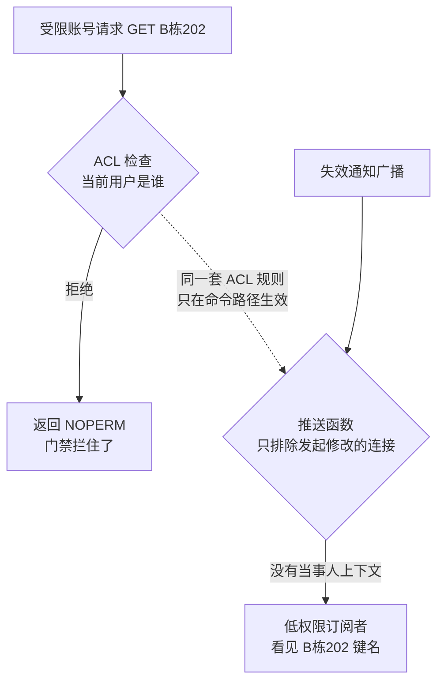
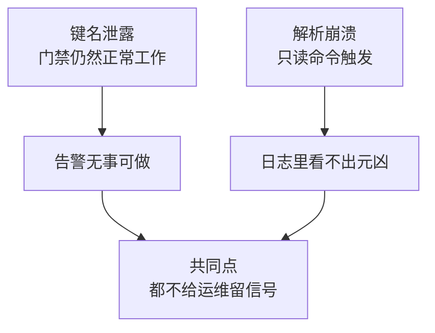
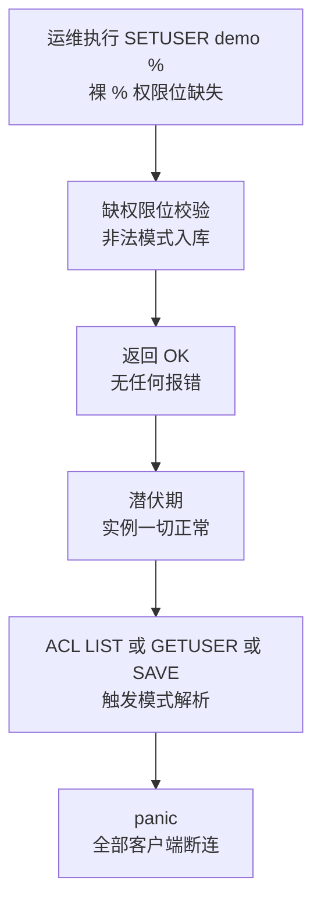

# 案例二十六：公告栏没查门禁——Redis 的 ACL 键名泄露与解析崩溃

> **要点**：ACL 即 Access Control List，访问控制列表，记录谁能执行哪些命令的规则表；ACL SETUSER 是其中增改用户权限规则的管理命令。Redis 的两个 ACL 病例——**客户端缓存广播失效通知时没按权限过滤，低权限账号收到了无权读取的键名（元数据泄露）**；**ACL SETUSER 收下裸 `%` 模式后，一条查询命令能让整个实例崩溃**。**门禁没坏，坏的是没走门禁的那条公告栏**。

## 这个案例发生在什么场景

**项目**：Redis——内存键值存储，ACL（Access Control List）负责"谁能对哪些键做什么"。

**两个病例同属 ACL 模块**（[上游 commit 3869512c](https://github.com/Redis/Redis/commit/3869512c920d4e865b54384bce5fcb6a4e06ae0d) 与 [上游 commit 4a95b300](https://github.com/redis/redis/commit/4a95b3005a140165bbb9df373ba61f775c936554)，均 P0，均已真实复现），**但坏的位置完全不同——这个对比本身就是本篇的教学价值**。

## 初看这段代码会冒出哪三个疑问

1. **"收到自己无权访问的键名"**——能收到，难道不应该等于能访问吗？这两个概念在这条通知里分开了。
2. **ACL 被绕过了？** **权限系统被绕过是大事，修复为什么只改了推送函数？**
3. **一个查询命令怎么能弄崩整个实例？** ACL LIST（把当前全部用户规则列出来的只读命令）只是读配置，读能崩？


来源：[腾讯云开发者社区《Redis系列：Redis主从、哨兵、集群介绍》](https://cloud.tencent.com/developer/article/2183910)（CC 4.0 BY-SA）
![Redis 数据库的字典结构：redisDb 指向 dict，dict 内含两个哈希表，ht[0] 平时用，ht[1] 在扩容时启用，字典项的 value 可指向字符串、列表、哈希、集合与有序集合](/static/figures/redis-db-dict-and-two-hash-tables.png)

来源：[小林coding《图解 Redis 数据结构》](https://www.xiaolincoding.com/redis/data_struct/data_struct.html)


## 打个什么比方：门禁与公告栏

**门禁与公告栏是两套东西：一个管谁能进，一个告诉别人里面有什么**。代客钥匙模式把两者的分工讲清楚——**服务端签发一个有时限与范围限制的令牌，客户端凭它直连存储，权限边界写在令牌里而不是靠调用方自觉**。


把 Redis 想成一栋公寓：键是房间，键值是房间里的东西，**键名是门牌号**，ACL 是门禁卡，服务端是物业。

受限账号的门禁卡只能刷开 A 栋。**门禁是好使的**——它去刷 B 栋 202，照样被拒绝。但物业有个大屏公告栏，滚动播放"某房间有变动"。推送失效通知的代码往大屏上贴公告之前，**没有查一遍"看到这条公告的人有没有资格知道这个房间"**。**于是低权限账号在公告栏上看到了 B 栋 202 这个门牌号**。

结果：它**进不去** B 栋 202（门禁还在拦，GET（HTTP 读取资源的请求方法）返回 NOPERM），但**它知道了这栋楼里有这么个房间**。泄露的是门牌号，房间里的东西一件没少，属于**元数据泄露**，越权（访问了权限范围之外的资源）访问没有发生。



两条病例共享的结构：**权限检查只挂在命令路径上，推送路径平行存在且没有"当事人"上下文，同样的 ACL 规则覆盖不到它**。**泄露与崩溃都发生在平行路径上**。

## 它是怎么做到的：推送路径上没有"当事人"

病例一的根因（[上游 commit 3869512c](https://github.com/redis/redis/commit/3869512c920d4e865b54384bce5fcb6a4e06ae0d)）：命令路径上有"当前用户是谁"（每个命令都过 ACL 检查），但**客户端缓存广播失效通知时，推送路径上根本没有"当事人"这个上下文**——**代码只排除了发起修改的那个连接，没想过还要按订阅者的权限逐键过滤**。**修复把订阅者身份显式传进推送函数，逐键过滤**。

命令路径上的这套检查本身是完备的，四道关卡串在一条线上：**连接先过身份认证，认证失败直接拒绝连接；认证通过后带上用户身份，每次执行命令前查命令权限与键模式两关**，命令不在授权范围内或键名不匹配模式，都以权限不足结束，只有两关都通过才真正执行。


*图示：Redis ACL 的命令执行校验流程，从连接认证到命令权限与键模式两级检查。图源：OneUptime 博客《How to Secure Redis with ACLs and RBAC（基于角色的访问控制：权限先绑定角色、用户再领角色）》，https://oneuptime.com/blog/post/2026-01-25-redis-acl-rbac-security/view，厂商公开技术资料。*

这张图同时说明了病例一为什么只修推送函数就够了：**门禁本身没坏，坏的是门禁之外的那条广播通道——失效通知不走这条流程，自然四道关卡一道也过不上**。

病例二（[上游 commit 4a95b300](https://github.com/redis/redis/commit/4a95b3005a140165bbb9df373ba61f775c936554)）更简单：**ACL SETUSER 收下一个裸 `%`（权限模式语法错了）时，解析缺少权限位校验——错误配置被存了进去**。之后任何一次 ACL LIST / GETUSER（查看单个用户规则）/ SAVE（把当前规则保存进配置文件）触发解析，实例 panic（进程崩溃），**全部客户端断连**。**修复是拒绝非法模式并返回明确错误**。

两条病例的对照放在一起看：

```text
病例一（键名泄露）：
  订阅者权限 = 只读 A 栋
  推送广播 = "B栋202 有变动"
  结果：订阅者看见了 B 栋202 的门牌号 → 元数据泄露

病例二（解析崩溃）：
  ACL SETUSER demo %     ← 裸 %，权限位缺失
  结果：错误配置入库 → 下一次 ACL LIST 触发解析 → 实例 panic

两条病例的形态差别比它们的根因差别更值得记住——一个安静地泄露，一个安静地潜伏，两者都不给运维留信号：



修复：病例一补逐键过滤；病例二当场拒绝非法模式
```


病例二为什么毫无征兆——把「写入时」与「读取时」两刻排到时间轴上，中间的潜伏期才是危险所在：



**非法输入在写入的第一秒拒绝，比让它潜伏到某次读取时崩溃便宜一百倍**；**事后日志里看不出元凶，正是这条时序的特征**。

这两条给运维出的难题是：泄露的那条**没有任何报错**——门禁在正常工作，告警无事可做；崩溃的那条**毫无征兆地倒下**——一条只读命令，事后日志里也看不出它是元凶。要解决的问题因此很明确：**把权限只在主路径校验升级为每条接触数据的路径都校验，把非法输入在写入的第一秒拒绝**。修复的收益也在这里：**前者保住共享实例的隔离边界，后者消除一颗定时炸弹**。

## 这类问题还在哪儿出现过

两条合在一起看，ACL 病例的分布规律是：**主路径上的检查最完善，围绕主路径的旁支（推送、解析）逐层失守**。**推送路径缺过滤，是该核对的没核对；解析缺校验，是该拒绝的没拒绝**——[[工程知识/缺陷分析：从个案到体系/安全/案例五：安全两例——认证绕过与带漏洞依赖]]的认证绕过也是"机制在但没被调到"。安全缺陷的三连问由此成立：**检查在哪？谁没调它？哪条路径绕开了它？**

## 上游怎么修

**修的方向是让权限检查发生在访问之前，而不是访问之后补**。守门人模式给了现成的形状：在客户端与业务服务之间放一个只做校验的主机，非法请求在到达业务前就被挡住。


*图源：Microsoft Learn 中文文档，CC BY 4.0，https://learn.microsoft.com/zh-cn/azure/architecture/patterns/gatekeeper。*


- 病例一：**推送函数签名增加订阅者身份，失效通知按订阅者当前的 ACL 权限逐键过滤**；**身份变更（re-AUTH / SETUSER）前后分别按新旧身份冲刷，避免边界遗漏**。
- 病例二：**ACL 模式解析增加权限位校验，裸 `%` 在 SETUSER 当场被拒绝**。

权限边界要与低权限复现对账——**预写只授权 A 类键的账号订阅后收到 B 类键名即为泄露，权限过滤与预期对不上，推送前必须逐键校验**。

## 这套说法在哪儿会失效，代价换来了什么教训

- **"推送 / 订阅 / 回调 / 广播"这些字眼出现时，条件反射问一句**：推送内容按接收方的权限过滤了吗？命令路径有 ACL 不代表推送路径有。
- **泄露分级要分清**：**键名泄露不致命（值读不到），但键名本身就是情报（`user:idcard:xxx` 这类命名），且可被反复枚举——该修**。
- **解析层的输入校验是第一道门**：非法输入在写入时拒绝，比让它潜伏到某次读取时崩溃便宜一百倍。
- **审安全修复时，看签名变化**：推送函数多了一个身份参数，往往就是"补当事人"的痕迹。


## 怎么自己动手验证

1. 上游对照：到 Redis 的提交 3869512c 与 4a95b300 里核对两处修复，确认一处把订阅者身份传入推送函数并逐键过滤、一处拒绝非法的权限模式并返回明确错误。
2. 键名泄露复现：**用只授权 A 类键的账号订阅客户端缓存失效（缓存里的数据过期或不一致、需要回源加载）通知，再修改 B 类键**，**修复前低权限账号收到 B 类键名而直接读取该键仍返回无权限，修复后推送按订阅者权限过滤**。

3. 解析崩溃复现：**用 ACL SETUSER 写入一个裸 `%` 模式，随后执行 ACL LIST 或 GETUSER 或 SAVE，修复前实例崩溃、全部客户端断连，修复后非法模式被拒绝**。
4. 边界核验：**确认门禁本身未被绕过（受限账号访问无权键仍被拒绝），问题只出在未走权限检查的推送路径上**。
5. 断言锚点：两种缺陷的修复前后行为留档，**元数据泄露与越权访问被区分记录，推送路径上的当事人上下文确认已传入**。

## 接着读哪几篇：同在缺陷分析里的相邻问题

- 认证与授权的分工——[[工程知识/后端系统：在并发、失败与变化中维持服务/服务设计/认证授权决定请求能看什么和做什么]]。
- 泄露分级与最小权限（只授予完成任务所必需的最小权限）——[[工程知识/缺陷分析：从个案到体系/安全/案例五：安全两例——认证绕过与带漏洞依赖]]。
- 权限半径作为设计输入的完整闭环——[[工程知识/缺陷分析：从个案到体系/安全/最小权限把爆炸半径变成设计输入：从能力枚举到撤权闭环]]。
- [[工程知识/缺陷分析：从个案到体系/安全/案例五：安全两例——认证绕过与带漏洞依赖]] · [[工程知识/缺陷分析：从个案到体系/缺陷分析方法——三分离、判定树与五步法]] · [[工程知识/缺陷分析：从个案到体系/缺陷分析：从个案到体系——导读与开源地图]]
