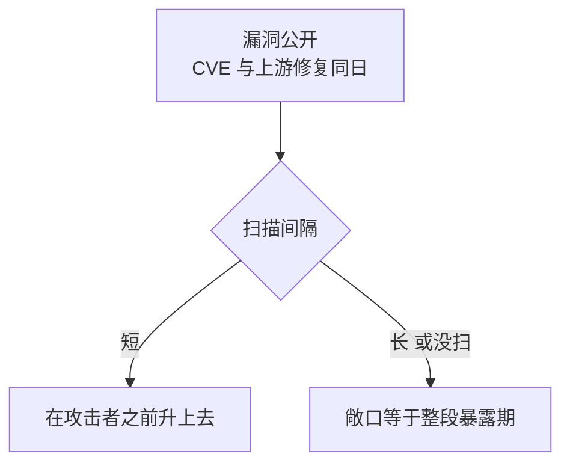
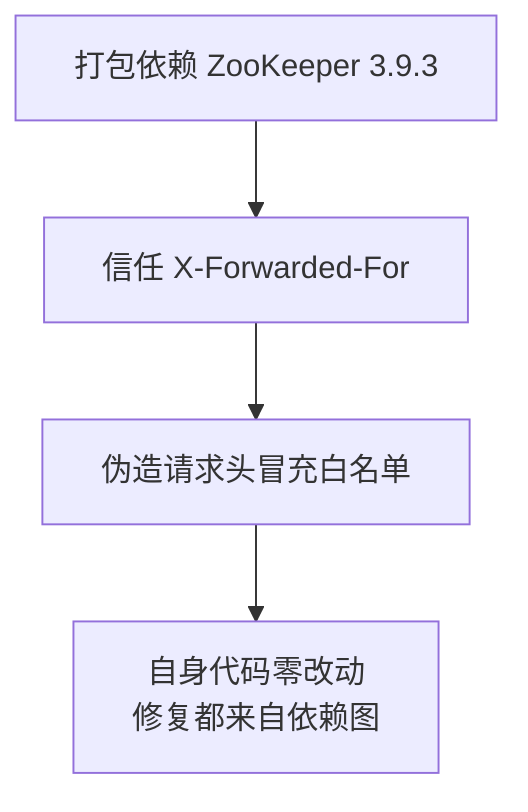
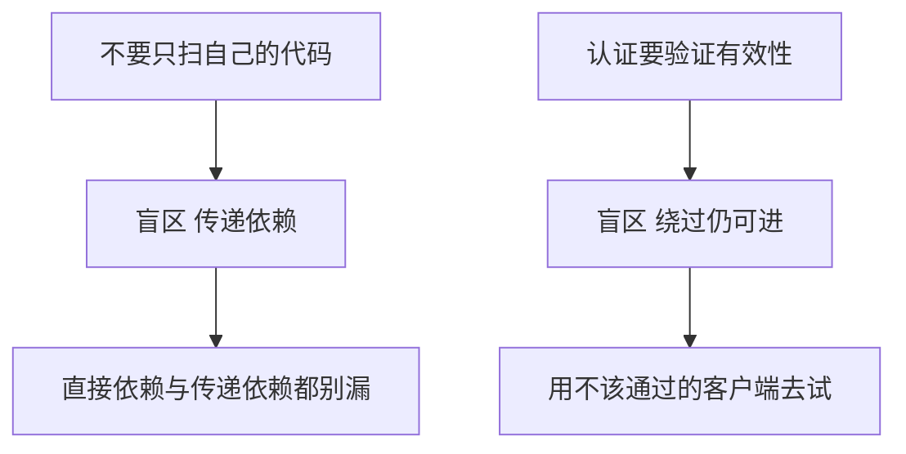

# 案例五：安全两例——认证绕过与带漏洞依赖

**安全问题不一定出在你写的代码里，打包进来的组件可能自带认证绕过或已知漏洞**。读完这一页你能理解例行依赖扫描买的是什么，以及为什么升级要赶在被利用之前。

> **要点**：安全风险不必来自你的代码：打包的 ZooKeeper 存在认证绕过、Vert.x（JVM 上的响应式工具集）带着 CVE（公开披露的安全漏洞编号）。两条都靠升级依赖关闭，而例行的依赖扫描买的正是"漏洞公开到被人利用"之间的时间差。

安全缺陷和其余五个家族有一条根本区别：**它的暴露不靠故障，靠别人**。功能缺陷等你的用户撞上它，安全缺陷等一个主动寻找它的攻击者——**两者的时间尺度和恶意程度完全不同**。这一篇解剖 BookKeeper 的两个真实病例，它们代表了安全缺陷的两个来源：**自己的代码逻辑错了，和自己的依赖带着伤**。

## 安全缺陷从哪两个口子进来：要解决的问题

先把形状说成一件事：安全缺陷的两个口子像一栋楼的两种隐患——第一种是自己家装修时把消防通道的门装成能从外面推开（自己组件的认证绕过：门是自家的，但装法留了缝）；第二种是请来的装修队里有一个人没查背景（带漏洞的依赖：人不是自家的，进场前没核验）。**查第一种要逐扇门自己试开，查第二种要看装修队的花名册对通缉名单**。两个病例各占一个口子，暴露条件、攻击者视角与修复路径在病例里展开。

## 病例一：开着的管理端口怎么被绕过认证（P0）

### 这件事发生在什么场景

BookKeeper 用 ZooKeeper 做元数据存储，多租户场景下元数据里存着各租户的账本信息。ZooKeeper 自带一个 Admin Server（HTTP 管理端点），默认用 IPAuthenticationProvider 做 IP 白名单认证，设计意图很直接：只有**白名单内的 IP **才能执行 snapshot、restore 这类管理命令。

小区门禁只认「访客自报的楼栋号」是同一个信任缺口：保安不核卡，访客说「我住 3 栋」就放行（信任可自报的字段），冒充者报个白名单号码就能进——比喻到「自报不算凭证」为止：小区冒充者顶多进楼，这里冒充成功可以读走全部租户元数据，所以**凭证必须不可伪造**。

### 缺陷出在哪

目标版本打包的 ZooKeeper 3.8.3 虽不含此漏洞（该 CVE 影响 3.9.0 至 3.9.3 之前的版本），但同系列的 3.9.x 版本存在 CVE-2024-51504（CVSS 9.1）：**IPAuthenticationProvider 默认信任 HTTP 请求头里的 `X-Forwarded-For` 来判定客户端 IP，而这个头可以由请求方任意伪造**。绕过之后，**攻击者可以冒充白名单 IP 执行 snapshot、restore 等管理命令，读取到多租户元数据，或干扰服务可用性**。

### 修复改了什么

（[上游 commit 7cba2a66](https://github.com/apache/bookkeeper/commit/7cba2a665abc6b7568b4628aafb2d3f928620dfc)）：升级打包的 ZooKeeper 依赖，**认证判定回到不信任可伪造请求头的实现**。注意修复的动作——**它没有改 BookKeeper 自己的一行代码，改的是依赖的版本**。

物业换掉的是信「自报楼栋号」的旧门禁机、装上认卡的新门禁机（**升级依赖让判定回到不可伪造的凭证**），你家门锁一个没换——比喻到「换的是门禁不是门锁」为止：换门禁一小时的活，线上换依赖版本要跑回归测试（改动后重跑旧用例、确认没有破坏既有功能），所以**升级要走影响判断流程**。

## 病例二：服务里带漏洞的依赖从哪儿来（P0）

### 这件事发生在什么场景

BookKeeper 提供一套 HTTP 管理服务（删除账本等管理操作走它），服务基于 Vert.x 构建，运行时携带 Vert.x 4.5.7。这个版本存在已公开的安全漏洞 CVE-2024-8391，弱点分类号 CWE-770（资源消耗不受控）。

问题出在 gRPC server 不限制消息最大长度（gRPC：Google 开源的高性能接口调用框架），**外部请求可以提交超大消息耗尽内存**。受影响的是 io.vertx:vertx-gRPC（Google 的 RPC 框架，基于 HTTP/2 与 protobuf）-server/client 4.3.0 至 4.5.9。

Vert.x-gRPC 是 Google 的 RPC（Remote Procedure Call，远程过程调用：像调本地函数一样调远端服务）框架 gRPC 的 Java 封装，基于 HTTP/2 与 protobuf（Google 的二进制序列化格式，用预定义结构压缩数据）。漏洞所在组件是 gRPC server，与 HTTP 管理服务同属一个 Vert.x的版本树，打包清单升级把两个组件一起带到修复版本。

银行柜台不设单笔限额是同一个敞口：柜员（共享入口）对外的窗口开着，来人递一卡车硬币（超大消息）就能把整个营业厅堵到瘫（耗尽内存）——比喻到「入口不设限就是敞口」为止：银行可以临时拉闸，共享入口被打满连累的是同端口上所有业务。

### 缺陷出在哪

这个病例的源头与病例一同型，**BookKeeper 自身代码没有漏洞，带漏洞的是打包进二进制的依赖**。暴露面是真实的：这个 REST（Representational State Transfer，用 HTTP 动词操作资源的接口风格）服务是共享入口，拿着对外端口——**共享入口的价值在「多个业务共用一个门」，风险也在「一个门被堵，所有业务跟着堵」**，gRPC server 不设消息上限正是**把整个入口暴露给超大消息**。

### 修复改了什么

（[上游 commit baffa345](https://github.com/apache/bookkeeper/commit/baffa345d3d128905c099776f0e555b327661962)）：vertx 升级到 4.5.11（4.5.10 已含 CVE-2024-8391 修复），**关闭消息长度不设限这个缺口**，消除共享入口被超大消息耗尽内存的风险。银行总行统一下发「单笔限额、超限拒收」的新柜台规程（升级到含修复的版本），各分行窗口的排班一个没动（自身代码零改动）——比喻到「规程升级堵口子」为止：银行新规次日生效，线上依赖升级要验证回归，所以**修复时点要赶在被利用之前**。

## 这一类为什么特别危险

**认证绕过与带漏洞依赖，都是信任边界画错了地方**。守门人的思路正是把边界显式化：**请求先过守门人做鉴权与清洗，通过后才转给真正处理业务的后端——验证点集中在一处**。

「短时凭证换受限访问」在云架构里有标准形态：Valet Key 模式——客户端向服务请求资源时，服务生成一个限定范围与时限的 token 返回，客户端拿 token 直接访问资源，权限在令牌本身而不是**客户端的自报身份**。微软 Azure 架构模式文档画的正是这个四步流转，病例一里伪造的 `X-Forwarded-For` 恰好是它的反面——判定建立在了请求方可自报的字段上：

*图源：Microsoft Azure 架构模式，Valet Key pattern，CC BY 4.0，https://learn.microsoft.com/zh-cn/azure/architecture/patterns/valet-key。*

**两条病例的修复动作是同一个，但两条的暴露窗口由不同的时钟决定**：

两个病例同源不同型，放在一起能看清安全缺陷的全貌：

- **病例一是逻辑漏洞**：认证机制本身的实现有缺陷，修复要等上游发布新版本。它提醒你：**"启用了认证"不等于"认证有效"**——启用的是一个机制，机制本身可能带伤。
- **病例二是依赖带伤**：你的代码一行没改，风险从依赖升级的疏漏里进来。它提醒你：**二进制里打包的每一个第三方库都是你代码的一部分**——**LICENSE 文件里列着的那些版本号，攻击者一样会读**。
- **两者都修于"升级依赖"**，这个巧合本身就说明：**现代服务的安全边界，一半画在自己代码上，一半画在依赖图上**。

## 上游怎么修：修复

两条修复都是依赖升级，但升级的"出处"不同：病例一升级的是 ZooKeeper（元数据存储的运行时依赖），病例二升级的是 vertx（HTTP 服务的框架依赖）。共同点：召回汽车配件是同一个形态：**召回的对象是供应商批次有问题的安全气囊（打包依赖），整车厂装的发动机（自身代码）不用动，换完气囊车照开**——比喻到「换的是部件不是整车」为止：车主换件免费且即换即走，线上升级依赖要回归验证，所以**升级要按影响判断流程走**。

- 两条修复都靠**把上游依赖提到含修复的版本**，**BookKeeper 自身代码零改动**——安全缺陷的修复经常就是"跟上别人的修复"。
- 两条都由例行依赖扫描发现，而非被人攻击后发现。**CVE 公开到被利用有时间差，例行扫描买的正是这段时间**。

把两条修复对照着看一遍：

两个病例的对称结构：**入口都是打包依赖，缺陷都在依赖里，修复都是升级版本，自身代码零改动**。

认证边界要与绕过尝试对账——**预写按公告给出的组合尝试应被拒绝**，实测未授权客户端可伪装成集群成员，**与预期对不上即为真实缺陷**。

## 这套防法在哪儿会失效：边界与教训

- **不要只扫自己的代码**。**依赖图里每一层（直接依赖、传递依赖、打包进二进制的运行时）都要扫**——病例一和病例二的依赖都在根 pom 显式声明，**扫描时直接依赖与传递依赖一个都不能漏**。
- **认证要验证有效性，不只验证存在**。**定期用一个"不该通过"的客户端去试**——绕过类漏洞的暴露面，**只有攻击者视角能看见**。
- **升级依赖不是无风险操作**，它可能引入行为变化——**按影响判断的流程走，安全修复也不例外**。
- **对安全类缺陷，修复时点就是风险敞口的关闭时点**。它**不像稳定类缺陷可以"下次维护再修"**。

四条教训各自补上一类盲区，合起来才覆盖安全的两个来源：

第一条和第三条是同一件事的两端：**扫描要覆盖依赖图里每一层，而升级这个修复动作本身又带风险，可能引入行为变化，所以扫描要全、升级要走影响判断**。第二条说的是验证角度——**绕过类漏洞的暴露面只有攻击者视角能看见，定期用一个"不该通过"的客户端去试，比检查认证逻辑是否存在更有效**。第四条是排期纪律：安全类缺陷不像稳定类缺陷可以"下次维护再修"，**修复时点就是风险敞口的关闭时点**。

## 想自己复现一遍怎么动手：验证

1. 上游对照：到 BookKeeper 的提交 7cba2a66 与 baffa345 里核对两处改动，**确认升级后的 ZooKeeper 与 vertx 版本，以及这两处修改都不涉及 BookKeeper 自身代码**。
2. 认证边界复现：在启用 Admin Server IP 白名单认证的配置下，**伪造 `X-Forwarded-For` 请求头冒充白名单 IP 请求管理命令**，修复前（3.9.0 至 3.9.2）请求被放行，升级 3.9.3 后认证边界恢复。
3. 依赖漏洞复现：对 REST 管理服务携带的 vertx 版本按公告方式提交超大 gRPC 消息，**确认内存耗尽可被触发，升级 4.5.10+ 后消息长度受限、不可触发**。
4. 清单核对：**列出打包产物中的第三方库及版本，与公开的漏洞信息逐项比对，确认没有遗漏的已知漏洞**。
5. 断言锚点：**依赖版本清单可查，认证与依赖两类风险各自有复现或验证记录，升级动作与修复版本对应**。

## 接着读哪几篇：同在缺陷分析里的相邻问题

- 认证与授权分别在守什么——[[工程知识/后端系统：在并发、失败与变化中维持服务/服务设计/认证授权决定请求能看什么和做什么.md]]。
- [[工程知识/缺陷分析：从个案到体系/缺陷分析方法——三分离、判定树与五步法.md]] · [[工程知识/缺陷分析：从个案到体系/资源与容量/案例六：容量与泄漏——连接泄漏和 SST 堆积]] · [[工程知识/缺陷分析：从个案到体系/缺陷分析：从个案到体系——导读与开源地图.md]] · [[工程知识/缺陷分析：从个案到体系/安全/主机名校验的解析边界：谁先解析 URL 谁定规则.md]] —— 讲校验逻辑依赖解析器世界观的机制与纵深防线，本病例 Jetty 升级背后的方法面 · [[工程知识/缺陷分析：从个案到体系/安全/解析器的递归深度：对端可以决定你的调用栈有多深.md]] —— 解析器安全家族的又一形态：升级让运行时内建的深度限制生效，与带漏洞依赖病例同一条防线 · [[工程知识/缺陷分析：从个案到体系/安全/最小权限把爆炸半径变成设计输入：从能力枚举到撤权闭环.md]] —— 判定不能建立在请求方可自报的字段上，能力枚举与撤权的完整闭环
