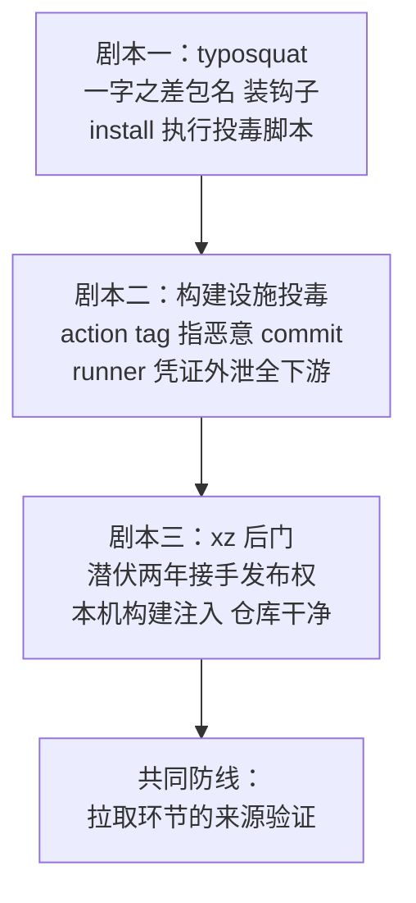
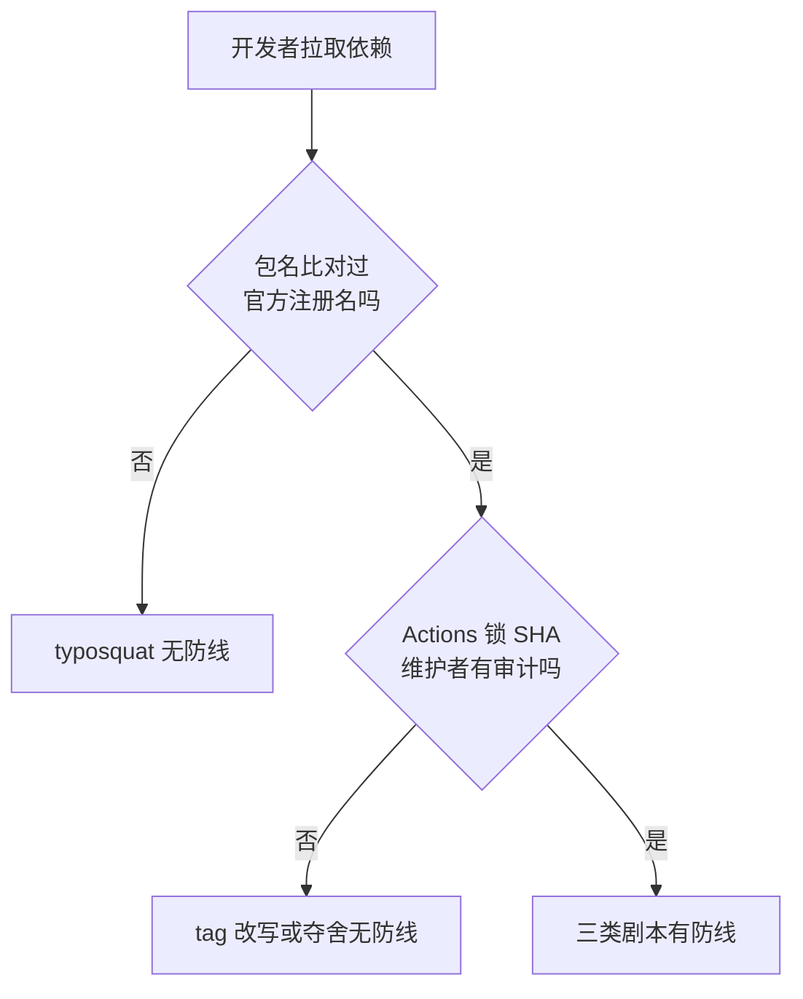

# 案例四十四：投毒不是写错，是写给你看——依赖投毒的三个真实剧本

**被动漏洞等你升级就关上了，主动投毒不等你做错任何事——攻击面不在你的代码里，在你拉包的那条链路上**。读完这一页你能认出三种投毒剧本各自的攻击面，并知道对应的防线该设在哪里。

> **要点**：案例五讲的是"依赖带伤"（被动），这篇讲的是"依赖被人下了毒"（主动）。三个公开真实剧本（PyPI typosquat、GitHub Actions 投毒、xz 后门）给出三种不同的攻击面与对应的防线。

## 投毒跟漏洞扫描为什么是两回事：要解决的问题

案例五里带 CVE（公开披露的安全漏洞编号）的依赖与主动投毒有一个根本区别，在于**时间维度反转**。被动漏洞是"已存在的伤口"，**扫描器能看见它，升级能关闭它**，漏洞公开到被利用之间的时间差是你买的保险。主动投毒反过来，**它在你的扫描器看见它之前就在等你拉取，你拉一次就中一次，零交互、零利用成本**。

这个区别决定了防线不同。先用一个比喻记住形状：被动漏洞像家里一扇本来就装歪的门锁（扫描器是查锁的师傅，换锁就能关上）；主动投毒是有人冒充电信员工敲门上门"免费检修"（**查锁的师傅查不出来，因为威胁不在锁上，在"开门这个动作"上**）。**查锁靠师傅定期上门，防冒充靠开门前核实工单——两道防线管的是两个动作**。这个比喻到"核实工单"为止——现实里三个剧本各骗的是哪个动作，下面逐案展开。

## 病例一：包名打错一个字会怎样（P1）

### 真实发生的病例是什么样的

2023 年 PyPI 出现大量与热门包一字之差的抢注包，公开报告过的案例包括 `request` 冒充 `requests`、`colourama` 冒充 `colorama`（后者曾劫持开发者剪贴板窃取加密货币钱包地址）。**开发者打错一个字母、`pip install` 随即执行投毒脚本**。这个剧本的攻击面是人类输入的不可靠性：**包管理器不做包名的模糊匹配，注册门槛低，抢注几乎零成本**。抢注包存活到被 PyPI 下架为止，窗口从数小时到数周不等。

### 它是怎么做到的

typosquat 的杀伤链条：注册与热门包一字之差的包名 → 开发者手滑装上 → install 钩子执行任意代码 → 窃取凭证/挖矿/横向移动。**三个环节每个都不高明，合在一起形成一条零交互攻击链**。

比手滑更隐蔽的一层在解析环节。包管理器拿到一个包名后，会同时把公共注册表与私有注册表当作候选来源，**两边都查、按版本号高低选一个**。私有注册表里只放内部包时，**攻击者把内部包名原封不动发布到公共注册表，并且发布一个版本号更高的同名包，解析就会选中公共注册表里那个**——不需要近似名，不需要开发者手滑。这个剧本叫依赖混淆，它和 typosquat 共享同一个攻击面：**解析环节没有来源约束**。

> 图：依赖混淆的解析流程，包管理器对公共与私有注册表同时查询后按版本号择优；改画自 [Web Security Lens](https://websecuritylens.com/)，机制说明见 [SLSA 依赖混淆与抢注分析](https://slsa.dev/blog/2024/08/dep-confusion-and-typosquatting)。

### 这件事留下了哪些可复用的教训

- **锁定精确包名**：requirements.txt / package.json 里的包名是唯一真源，**人的输入不可信**。CI（Continuous Integration，持续集成：每次改动都自动构建与测试）里**直接引用 lock 文件（pip freeze / package-lock.json），不用人手敲包名**。
- **安装前验证内容**：pinned hash（`pip install --require-hashes`、npm（Node 的包管理器） 的 integrity 字段）让"包名对但内容被人换过"直接失败。**hash 锁下 typosquat 无处藏身：包名错了装不上，包名对但内容换过 hash 对不上，两条路都被封闭**。

## 病例二：构建机怎么会变成投毒点（P1）

### 真实发生的病例是什么样的

近年 GitHub Actions 生态出现三种公开的投毒剧本：
1. **action 仓库被接管**：热门 action 的维护者账号被盗（或放弃维护被接管），旧 tag 被改指向恶意 commit。你的 workflow 引用 `action@v1`，拉到的是被篡改的 v1。

不可变引用保护不了你——tag 是可变的，它只是指针。
2. **self-hosted runner 投毒**：投毒者向公共仓库提恶意 PR（Pull Request，请求把改动合入主干的申请），触发配置不当的 self-hosted runner 执行任意代码。

这个剧本的攻击面是基础设施信任的错配：**你以为 runner 是可信执行环境，它实际暴露着你的 CI 凭证（GITHUB_TOKEN、缓存凭证、自签证书）**。
3. **tj-actions/changed-files 事件（2025）**：攻击者取得维护者 token 后改写了历史 tag，**所有引用旧 tag 的仓库在下次 CI 运行时拉到恶意版本，泄漏的凭证从 runner 传播到所有下游仓库**。

### 它是怎么做到的

构建基础设施投毒的共同病根，是 **CI 凭证的高权限配上 action 来源验证的缺失**，攻击者改一个 tag 就能让下游仓库替他执行恶意代码。runner 持有的 GITHUB_TOKEN 能写仓库、能拉私有镜像；action 的引用基于 tag/sha，**tag 可变、sha 引用很少人遵守**。**攻击者只要改一个 tag，成千上万个下游仓库的 CI 在下一次运行中变成恶意代码的执行环境——投毒的成本是一次 commit，传播的代价由所有下游承担**。

### 这件事留下了哪些可复用的教训

- **引用 commit SHA 而非 tag**：`actions/checkout@<full-sha>`，**sha 不可变，tag 改写攻击对 sha 引用无效**。
- **最小化 runner 凭证**：**GITHUB_TOKEN 权限最小化（只读仓够用就别给写权限）、per-job 的 OIDC（OpenID Connect，基于 OAuth2 之上加身份层的认证协议）短期凭证替代长效 PAT**。
- **runner 隔离**：**self-hosted runner 不跑公共仓库的 PR，或者至少凭证隔离 + 一次性环境（每次 job 后销毁容器）**。
- **审计 workflow 日志里的出站请求**：**凭证外传必有网络痕迹，对 CI 子网做出站监控是事后的最后防线**。

## 病例三：一个贡献者怎么埋进底层库（P0）

三个剧本的攻击面各不相同：

三个剧本的差异与共性：**攻击面分别在包名输入、构建链路凭证、维护者信任，但都卡在"拉取环节无来源验证"这一个缺口上，防线因此收敛到同一处**。

### 真实发生的病例是什么样的

2024 年 3 月，xz 5.6.0/5.6.1 被发现携带后门（CVE-2024-3094）。投毒者以 "Jia Tan" 身份潜伏两年多：**先通过持续贡献建立信任、成为共同维护者、接手 release 权限，然后在自己的构建机上产出带后门的发布 tarball（后门不在上游 Git 仓库里）**，后门被触发的条件是被投毒的 liblzma 链接进 sshd——systemd（Linux 的服务管理器，开机自启与守护进程）是 Linux 发行版广泛使用的初始化与服务管理系统，该后门可让攻击者远程执行命令。发现者是 Andres Freund，**他在 Debian unstable 上排查 sshd 性能异常时偶然发现此事，当时带毒版本距离进入主流稳定发行版只差几周**。

### 它是怎么做到的

xz 后门是依赖投毒目前已知最完整的形态，它演示了两个新东西：

1. **社会工程学的时间尺度**。攻击者没有攻破任何系统，他"成为"了系统的一部分——**两年多的时间里贡献代码、建立信任、获取 release 权限**。**你的依赖治理里没有任何防线针对"维护者本身就是攻击者"这个场景**。
2. **构建产物的来源欺骗**。**后门不在 Git 仓库里（上游 commit 历史干净），只在发布 tarball 里（构建脚本在维护者本机注入）**。"从源码构建"这个防线要求"源码"与"产物"来自同一来源，**而这里发布产物与公开源码在构建环节被分离**。

木马是"来源与内容分离"最古老的教材：特洛伊人验收的是一具祭品木马的外观，而马腹里的东西由建造者单独装填——**验收者看到的来源（祭品）与实际内容（士兵）在"建造环节"被分离**。xz 的发布 tarball 同款：git 仓库是干净的外观，后门在维护者本机的构建环节装进去。**可复现构建要堵的就是这条缝——让任何人都能验证外观与内容出自同一次建造**：

*图源：Wikimedia Commons，Jorge Royan，CC BY-SA 3.0，https://commons.wikimedia.org/wiki/File:Munich_-_Trojan_wooden_horse_at_K%C3%B6nigsplatz_-_5440.jpg。*

### 这件事留下了哪些可复用的教训

- 可复现构建（reproducible builds）是唯一硬防线：**任何人能从同一源码构建出 bit-for-bit 相同的产物，则"构建者私自注入"在数学上无处藏身**。xz 事件中发布 tarball 与官方构建产物的差异正是暴露线索之一。
- **警惕维护者变更**：**一个项目突然被无名新维护者接手、release 节奏突变、贡献者集中度异常（一人包办全部关键 commit），都是社会工程学的信号**。OpenSSF scorecards 的 Maintained、Signed-Releases 等检查项覆盖部分信号，**维护者变更本身要靠自己的审计清单**。
- **最小化安装面**：xz 这种"无处不在的基础库"被后门意味着**几亿设备的潜在暴露**。基础库的依赖治理要升格：**不只是"我们用了什么"，还要"我们的基础库被谁维护、维护者怎么产生的、release 怎么构建的"**。

## 拉取环节的来源验证矩阵怎么搭：防线

**防线的共同点是验证的依据存放在攻击者改不了的地方**。下图是 YubiKey 5C NFC（Near Field Communication，近场通信）硬件安全密钥：签名（用私钥对数据生成可验证的防篡改标记）与校验的私钥封在硬件里，拉取依赖时用它验证来源，**攻击者改了注册表里的包，哈希（把任意长度数据压成固定长度指纹、不可逆）对不上，拉取直接失败**。

> 图：YubiKey 5C NFC 硬件安全密钥，来自 [Wikimedia Commons](https://commons.wikimedia.org/wiki/File:YubiKey_5C_NFC.jpg)，CC BY 4.0，摄影 Daniel Aleksandersen。

| 剧本 | 攻击面 | 防线 |
| --- | --- | --- |
| typosquat | 包名输入错误 | lock 文件锁定精确包名 + pinned hash |
| action tag 改写 | tag 指针可变 | 引用 commit SHA |
| runner 凭证外泄 | CI 凭证高权限 | 最小权限 token + OIDC 短期凭证 + 一次性 runner |
| 维护者接管 | 社会工程学 | 维护者变更审计 + scorecards |
| 构建产物分离 | tarball 与源码不一致 | 可复现构建 |

防线矩阵怎么自查：三问分别对应三个剧本的攻击面，**任何一问答否，对应剧本在你仓库就没有最低防线**。

## 这套防法在哪儿会失效：边界

- 与案例五互为反面：案例五是"依赖带伤"（被动、可扫描、可升级关闭），本案例是"依赖被下毒"（主动、拉取即中、来源验证是唯一防线）。
- 与案例二十六正交：案例二十六讲权限模型内的越权（门禁内绕行），本案例讲权限模型外的人（维护者本身就是攻击者）。
- 软件构建域的理论篇[[工程知识/软件构建：让变化可以理解、验证与交付/开发工具/依赖供应链需要锁定来源与构建输入]]已给出锁源框架；本案例补上"为什么"的三个公开实例与每种的触发条件。
- 三个剧本都基于公开事件（PyPI typosquat、GitHub Actions 事件、xz 后门），内部细节以公开报告为准，不引入任何非公开案例。

## 想自己验一遍怎么动手：验证

最小验证：在你自己的仓库把来源验证的三步各跑一遍——① **lock 文件里的包名与官方注册名逐一比对（找 typosquat）**；② **GitHub Actions 引用里 tag 引用改 full commit SHA（找 tag 可变风险）**；③ **挑一个你依赖的基础库，读它最近一次 release 的维护者与构建流程（找维护者变更信号）**。三步全过说明你的拉取面至少对这三类剧本有了最低防线。

关系：[[工程知识/缺陷分析：从个案到体系/安全/案例五：安全两例——认证绕过与带漏洞依赖]] · [[工程知识/缺陷分析：从个案到体系/安全/案例二十六：公告栏没查门禁——Redis 的 ACL 键名泄露与解析崩溃]] · [[工程知识/软件构建：让变化可以理解、验证与交付/开发工具/依赖供应链需要锁定来源与构建输入]] · [[工程知识/软件构建：让变化可以理解、验证与交付/开发工具/维护者信任是供应链信任的地基：贡献者治理与维护者变更审计]] · [[工程知识/缺陷分析：从个案到体系/兼容与升级/案例四十三：升级把前提带走了——依赖行为变更引发的下游失效]] · [[工程知识/缺陷分析：从个案到体系/安全/最小权限把爆炸半径变成设计输入：从能力枚举到撤权闭环]]