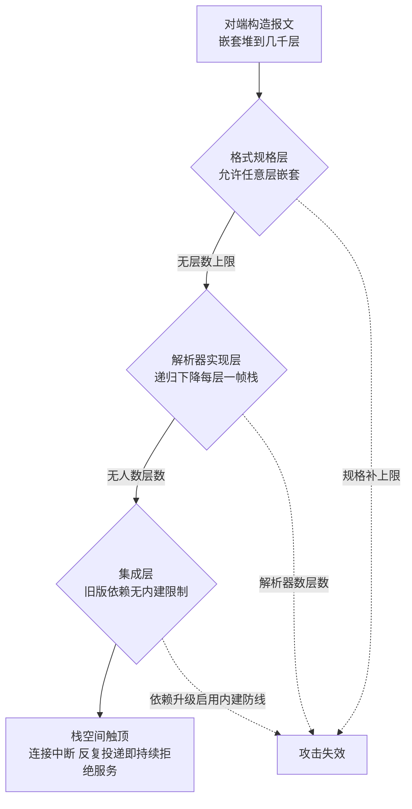
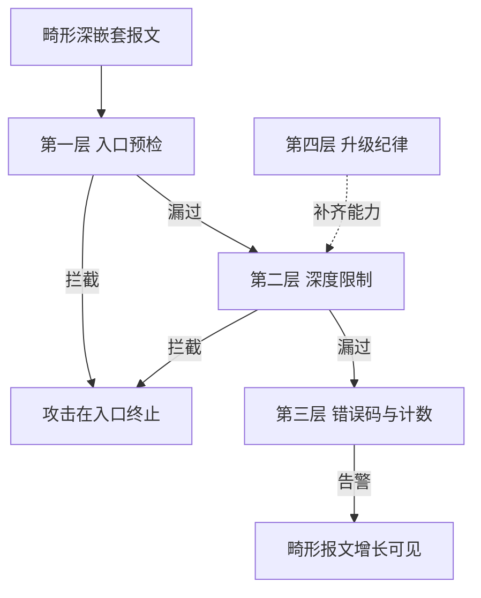

# 解析器的递归深度：对端可以决定你的调用栈有多深

> **要点**：自递归的消息格式遇到递归下降的解析器，报文嵌套多少层、解析器递归就多深——对端用一条报文决定你调用栈的深度，栈溢出即造成服务中断，反复投递即构成持续拒绝服务。

## 要解决的问题

数据格式的规格定义里常有自引用结构（嵌套消息、嵌套分组、任意层级的树），解析器的自然实现是递归下降——遇到嵌套就调自己。这两件事单独看都正常，组合起来是一条攻击通道：**报文由对端构造，对端把嵌套堆到几千层，解析器的调用栈就跟到几千层，栈空间耗尽，解析崩溃**。

Apache BookKeeper 的一个真实病例（上游修复 commit b9c567cb，可查）：**对端向 bookie 端口发送嵌套数千层未知 group 字段的 protobuf（Google 的二进制序列化格式，用预定义结构压缩数据）报文，解析入口没有递归深度限制，解码时栈溢出、连接中断**——单条报文即可让这台被多客户端共享的存储节点无法处理正常请求，**攻击者反复投递即构成持续拒绝服务，且服务不会自愈**。

这类缺陷的杀伤力来自三个放大器。共享节点：**bookie 是多账本共享的存储层，打瘫一台，上面全部租户的读写都受影响**；低成本：攻击的代价是**一条几 KB 的报文**，防御的代价是**服务的可用性**；不自愈：栈溢出发生在解码线程，崩溃的连接不会带崩进程，但**反复投递让"可用窗口"趋近于零——修复前的系统在攻击面暴露期间实际等于下线**。

protobuf 官方安全指引把递归深度限制列为核心防线，各语言运行时随后内建了深度上限——**但上限只在解析器启用了对应版本才存在**。BookKeeper 的病例正是解析入口没有做深度校验：依赖声明停在旧版 protobuf，上游修复的动作之一就是把版本升到 3.25.5，**让运行时内建的限制生效**。

## 调用栈深度是怎么被对端决定的：机制

把解析一条报文要经过的信任链摆出来，断裂点清晰可见。「一层套一层」的实物原型是俄罗斯套娃——外壳里藏着同构的内层，打开多少层由拿在手里的那只决定：


*图源：Wikimedia Commons《Many matryoshka dolls》，作者 LR0725，CC BY-SA 4.0，https://commons.wikimedia.org/wiki/File:Many_matryoshka_dolls.jpg。*

解析器的处境与打开套娃的手一样：**报文里嵌套多少层，它就得递归多深**——规格允许无限层、实现跟着递归、集成又没装计数器时，一只手工打磨的「巨型套娃」就能把手撑爆。

递归不是唯一选择。**正则类语法用状态机逐字符推进就能处理，状态与转移是固定的几张表，输入多长都不增加调用栈深度**——下面这张图里从起始状态 X 出发，读到 1 进状态 0，读到第二个 1 进状态 1，一路读到末尾接受状态 3 就结束，整个过程只用到当前状态：


*图源：Wikimedia Commons《Relatively small NFA》，CC BY-SA 4.0。*

**有递归才有深度风险**：凡是把语法写成递归下降、把嵌套对象交给递归函数处理的实现，**深度都由输入的嵌套层数决定**。同样的语法写成状态机或显式的工作栈，**深度就与输入层数脱钩**。

### 规格允许嵌多少层：格式规格层

规格层定的是「最多能嵌几层」。这和环形队列的容量是同一类约束：**头尾指针在环上循环推进，写满之前一切正常**。


*图源：腾讯云开发者社区《图解原理 Linux I/O 神器之 io_uring》，CC 4.0 BY-SA，https://cloud.tencent.cn/developer/article/2187655。*

环形队列与嵌套规格是同一类约束：**容量有限、写满要有明确行为**。protobuf 的 wire format 允许 group 嵌套 group，**规格本身不设层数上限——规格关注表达能力，安全边界留给实现**。XML（可扩展标记语言，用标签树组织文档与数据）、JSON（嵌套对象）、YAML（锚点引用）各有各的自引用形态。

### 解析器跟着递归会走多深


### 集成时防线装在哪：调用方集成层

运行时可能内建了深度上限（新版本 protobuf 的 recursion limit），但**集成方停留在旧版本、或调用的是绕过限制的底层 API，防线就停在"别人有、我没有"的状态**。

攻击者的操作是把三个层次的缝隙连起来：**规格允许嵌套 → 实现按嵌套递归 → 集成没有限制 → 一条报文决定你的栈深**。**信任链上任何一环补上限，攻击即失效——这就是纵深防御在这一类缺陷上的具体含义**。

三层信任链的缝隙连成攻击通道，每层补上限攻击即失效：

三个层次单独看都合理——规格要表达能力、递归下降与文法同构、集成方按文档接依赖。**通道是三条缝隙接起来才出现的，所以断掉任意一条就够**。



三条虚线汇到同一个「攻击失效」，说明**这三层是「或」不是「与」**：BookKeeper 的修复选在最外层（升级依赖启用内建限制），正因为规格层与实现层都不在自己手里——**能动的那一层就够了**。

攻击通道的构成与截断点：三个层次各自正常（规格关注表达能力、递归下降与文法同构、集成方按文档接依赖），**缝隙连起来才有通道——报文嵌套深度直接映射调用栈深度**。三条虚线是纵深防御的具体位置：**任何一层补上限制，通道断在那一层**。

## 为什么平时发现不了、审计才揪出：暴露规律

**功能测试造不出几千层嵌套（没有业务场景需要），缺陷在正常流量下永不触发，"发现它"的路径只有主动构造畸形输入**。这决定了两个工程事实：

**模糊测试是主要发现手段**：对解析入口做结构感知的 fuzzing（按格式规格生成深嵌套、超长字段、畸形标记），是发现这类缺陷的标准方法。**没有 fuzzing 的解析器，等于把健壮性押在"所有客户端都善意"上**。

**发现它的人大概率是攻击者**：不设防的解析入口在公网或半可信网络上，**被发现的顺序几乎注定是"先被外部发现，后被自己发现"**。安全缺陷的修复时点由暴露面决定，由不得排期。

## 防线怎么一层层装：修复与防线

上游修复靠升级启用了解析器内建的深度限制，按纵深排四层：




**解析器带深度限制**：启用支持递归深度限制的解析器版本，**限制值按合法业务的最大嵌套深度设定**（protobuf 的默认递归限制：C++ 运行时 100 层、Java 运行时 64 层，均远高于正常业务）。**这是地基——集成层的一切防线都以"解析器会数层数"为前提**。

**入口做结构预检**：报文进入解码前做轻量结构检查（长度上限、嵌套深度粗查），**把明显畸形的报文挡在完整解析之前**。预检用迭代遍历实现（显式栈或计数器），**自身不引入新的递归通道**。

**崩溃与攻击的监控区分**：栈溢出类错误要有独立的错误码与计数，运维能看到"解析失败"的分布——**畸形报文的持续增长是攻击在敲门，与偶发的解析错误是两种信号、两种响应**。

**依赖升级的时效纪律**：解析器运行时的深度限制是逐版本补齐的，**依赖停留在旧版本等于主动放弃上游修好的防线**——这与本库安全域"带漏洞依赖"病例同源，**升级不只是功能追新，是防线的组成部分**。

## 这套防线在哪儿会失效：边界

三条边界防止防线变形。

**深度限制要有业务校准**：限制值不是越小越安全——**合法业务真的需要深层嵌套时（某些序列化树、嵌套表达式），过低的限制把正常请求变成故障**。按业务 P99（把所有请求响应时间从小到大排，第 99 百分位的值，99% 的请求比它快）嵌套深度加余量设定，**并监控被限制拒绝的请求数（拒绝率骤升可能是限制过紧）**。

**深度只是攻击面之一**：长度超限、字段数超限、压缩炸弹（小报文解出大对象）是同一家族的其他形态，**解析入口的防御是"资源预算"整体（深度、大小、时间），只防深度是纸糊的纵深**。

**内部流量不豁免**：内网服务间调用的解析器同样要设限——**本病例的 bookie 就在"内部"网络上，横向移动的前提正是内网互信**。**防线按解析入口部署，不按网络位置部署**。

## 想自己验一遍怎么动手：验证

验证要拿的账是：**畸形报文的嵌套深度与解析端的存活状态对不对得上**——对照深度正常解析，超过上限的深度预期被明确拒绝且服务持续可用；**栈溢出、连接中断即对不上，深度限制未生效**。

1. 构造畸形报文：**按格式规格生成嵌套 N 层（N 取 1000、5000、10000）的报文，另备合法深度（10 层）的对照报文**；
2. 未修复基线（正常状态下的指标水平、用来对比异常）：发送深嵌套报文，**观察解析端栈溢出、连接中断，对照报文正常，捕获一次即为缺陷证据**；
3. 修复后重跑：**深嵌套报文被深度限制拒绝（明确的错误响应），服务与连接持续可用，对照报文不受影响**；
4. 断言锚点：**任意深度的畸形报文不中断服务、不占用异常资源**；被拒绝请求有独立计数可观测。

```text
可用断言 = 发送畸形报文后，正常请求持续成功
可观测断言 = 深度拒绝计数出现，错误码独立
```

"畸形输入之后服务还活着"是解析器健壮性的终局判据——**把畸形集固化进持续集成的安全用例，任何回退（升级时关掉限制、重构成递归实现）都会当场红**。验证时预期与实际的对照规则提前写明：**深嵌套报文预期被深度限制拒绝并返回明确错误**，对不上（栈溢出、连接中断）即限制未生效或被绕过；**对照报文预期不受任何影响**，对不上（合法业务被拒绝）即限制值过紧需要校准。

## 接着读哪几篇：解析器安全家族的兄弟篇：解析语义的信任边界

- [[工程知识/缺陷分析：从个案到体系/安全/案例五：安全两例——认证绕过与带漏洞依赖]] —— 同批上游安全缺陷的案例侧写，依赖升级防线的同源
- [[工程知识/缺陷分析：从个案到体系/安全/主机名校验的解析边界：谁先解析 URL 谁定规则]] —— 解析器安全家族的兄弟篇：解析语义的信任边界
- [[工程知识/后端系统：在并发、失败与变化中维持服务/基础设施/服务网格控制面与数据面：mTLS与流量治理]] —— 内网互信与横向移动的暴露面治理
- [[工程知识/数据系统：在并发与故障中保存事实/事务与存储/存储引擎的两大路线：B树与LSM的写读取舍]] —— 被共享存储层的机制背景
