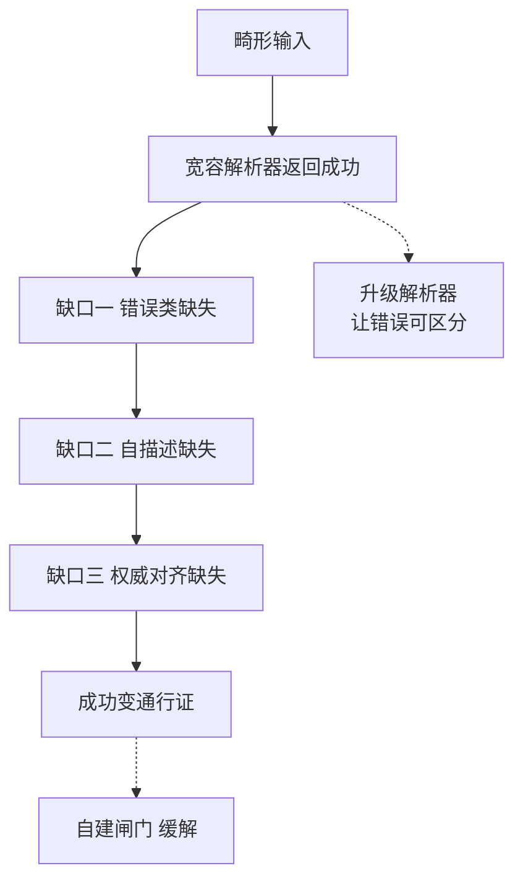
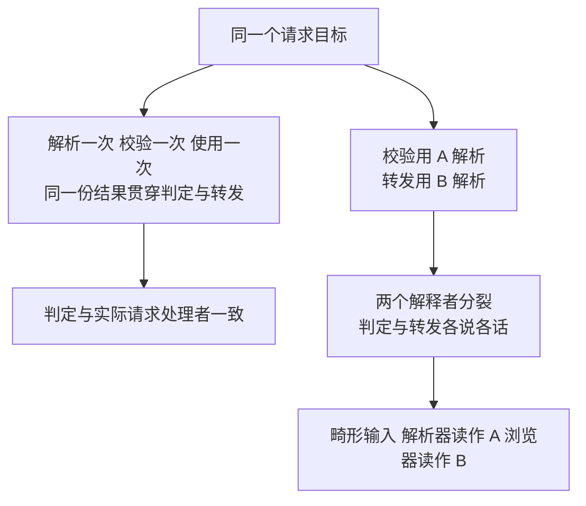

# 解析边界的第二课：解析器没有错误类，调用方就要自己分

> **要点**：解析器对含非法成分的输入返回"解析成功"，成功结果与权威解释各不相同——校验方与浏览器各用一套解析，放行与拒绝的判定分裂；升级让解析器获得错误类，分歧在源头消失。

## 要解决的问题

URL 这类结构化输入有一个特点：**语法由标准定义，宽容度由实现决定**。同一串字符，标准说非法——非法成分分两类：authority 里带空格、井号这类语法上就不合法的字符，userinfo 这类语法合法但语义有歧义的成分，**宽容的解析器照样返回一个"可用"的结果**。

校验方拿到解析结果做主机名比对，浏览器按自己的规则解释同一串字符——**两个解释者对同一输入各说各话时，校验就成了猜谜**。Apache BookKeeper 的真实病例（上游修复 commit cda3c6b6，可查）：指标服务的 HTTP 端点用旧版 Jetty 的 `HttpURI` 解析请求目标，**含 userinfo、空格、井号的畸形 authority 不报错，解析出的主机名与浏览器不一致**；以该主机名做来源校验的调用方被绕过，请求可被引向攻击者指定的地址。修复是升级 Jetty 到 9.4.57——**新版解析器把这些非法 authority 判为错误，分歧从源头消失**。

这是本库安全域"主机名校验的解析边界"一文的续篇，边界不变、课业升级：前篇讲谁先解析谁定规则（**校验方要在与攻击者相同的解析规则下做判定**）；本篇讲解析器没有错误类时调用方要自己建。理想世界里解析器对非法输入抛错，调用方捕获即拒绝，判定天然一致；现实是**宽容解析器的产物无处不在，调用方手里只有"解析成功的结果"，没有"这个结果可信吗"的信号**。两个真实病例（add68082 与 cda3c6b6，均已真实复现）在库内已有侧写，本篇补的是方法面：**面对宽容解析器，调用方自己补的那道闸门长什么样**。

## 它是怎么做到的：宽容解析的三个信号缺口

宽容解析的问题在于**链上每一环都只做自己那一小段，没有一环对整体结果负责**。管道与筛选器本来是优点，但当「结果对不对」没人认领时，它就变成了缺口。

管道与筛选器本身是企业集成里的成熟形态：消息经队列缓冲，逐个过滤器做自己的转换，最后输出完全转换后的消息。微软 Azure 架构模式文档画的正是这个流转——优点成立的前提是**每个过滤器对"自己那一段的结果对不对"负责：**


*图源：Microsoft Azure 架构模式，Pipes and Filters pattern，CC BY 4.0，https://learn.microsoft.com/en-us/azure/architecture/patterns/pipes-and-filters。*


宽容解析器有规则，但规则里没有拒绝分支。对调用方，它缺三样东西：

### 错误类缺失时调用方失去什么

非法输入走成功路径，错误类型系统里没有"畸形输入"这个类目。**调用方想做"畸形即拒绝"，连可判定的依据都没有——除非自己重做一遍解析**。

### 结果自描述缺失时调用方怎么被误导

**解析结果不声明"自己做了哪些归一化"**——userinfo 有没有被剥离、井号后算不算 authority、百分号解码发生在哪个环节。调用方拿到的主机名是解析器私有解释的产物，**语义上等价于黑盒（不接触代码内部、只看输入输出的测试或分析方式）输出**。

### 与权威解释不一致时怎么裁决

浏览器、代理、WAF（Web Application Firewall，Web 应用防火墙）各有一套 URL 解释规则，**宽容解析器不承诺与任何一方一致**。校验的成立前提是**"我的判定要和真正的请求处理者一致"**，解析器的私有解释恰恰不保证这一点。

三个缺口叠出来的攻击面：攻击者构造一串"解析器解释为 A、浏览器解释为 B"的输入，**把"解析器说合法"变成通行证**。责任在这里错位了——**结构化输入的合法性本该由解析器判定，宽容解析器把这个职责转嫁给了每个调用方，而多数调用方不知道自己在接**。

宽容解析器的行为可以拿一台"来者不拒"的门禁读卡器来对照：卡片信息残缺、格式可疑，它不亮红灯而是照样给绿灯——**因为它的规则表里没有"拒绝"这个输出类**。下游每扇门都把"读卡器亮绿灯"当通行依据，**实际放行的是解析器私有解释过的结果**。升级解析器补上错误类，就是给这台读卡器装上红灯：


*图源：Wikimedia Commons，Sezeruludag，CC BY 4.0，https://commons.wikimedia.org/wiki/File:BioAffix_Cardreader_Wall.png。*

三个信号缺口如何叠成攻击面，结构如下：



三个缺口的结构关系：宽容解析器对同一份畸形输入给出三个维度的缺失——**判定的依据（错误类）、结果的透明（自描述）、判定的一致（与权威解释相符）**，三个缺口各自独立又互相放大，叠出来的是「解析成功」变成通行证的攻击面。虚线指出责任错位：**合法性判定本是解析器的职责，宽容实现把它转嫁给每个调用方，应对形态因此落在调用方一侧**。

## 修完之后靠什么防住复发

补齐的办法是在解析层外面加一层转换：**把外部格式的概念翻译成本域能理解的结构，两域的假设不再直接相撞**。缺失的错误类在这一层补齐，调用方拿到的就是自描述的结果。


上游修复（升级 Jetty）把拒绝分支补进了解析器，判定回到源头。防线体系按"能不能升级"分两层：

**优先升级到带错误类的解析器**：解析器版本落后时，畸形输入的行为是未定义的——**升级是根治**，本库安全域"带漏洞依赖"病例的同一条防线。升级后回归用畸形样本集验证：非法 authority、双重编码、超长字段——**每个样本都应得到明确的错误响应**。

**升级不可行时，调用方自建闸门**：白名单字符集校验（host 只允许字母数字点连字符）、拒绝含 userinfo/井号/空格的输入、解析前后做规范化比对（规范化两次结果不一致即拒绝）。**自建闸门的每条规则都要写明防的是什么，防止下次重构时被当冗余删掉**。闸门的账要算清楚：收益是**畸形输入在进入业务逻辑前被拒绝**，绕过类攻击失去可乘之机；代价是**维护一套与解析器并行的判定规则**，以及闸门过紧时误拒合法流量的运营成本——**这套补偿代码存在的每一天都在提醒升级的必要性，收益随时间递减、代价恒定，退役条件要预先写明**。


责任分两侧：解析器的责任在「能不能报错」，校验方的责任在「用谁的解析结果」——同一份请求目标走一次解析还是两次解析，结局分道扬镳：



**分裂一旦出现，畸形输入就有了可乘之机；同一次解析贯穿到底则把两个解释者压回一个，闸门建在哪份结果上都是同一份**。

**校验与使用用同一次解析**：解析一次、校验一次、使用一次——**同一份解析结果贯穿判定与转发**。校验用 A 解析、转发用 B 解析，等于自己制造两个解释者的分裂，这正是前篇"谁先解析谁定规则"的纪律。

**畸形输入的观测**：拒绝要有计数与采样（只采集一部分数据以控制记录开销）日志，**畸形率骤升是扫描或攻击在敲门**——观测面把解析边界从"静默放行/静默拒绝"变成**可见的攻防现场**。

## 这套说法在哪儿会失效

三条边界防止防线走形。

**严格不等于拒绝一切**：畸形判定的标准是 RFC 3986（互联网标准的编号体系文档）用 ABNF（Augmented Backus-Naur Form，扩展巴科斯范式：写语法规则的标准记法）定义的语法，**按标准合法的输入（合法百分号编码、IDN 域名）必须放行**。闸门太紧把合法流量挡在门外，运维会迫于压力把它撤掉，**防线在松动中丧失作用**。

**自建闸门是过渡态**：调用方补闸门的每一行代码都是对解析器缺陷的补偿，**升级条件具备时闸门应退役**——长期维护两套判定，分歧会以新形态回来。

**解析边界与信任边界是两回事**：本篇讲的是"解析结果可信吗"，认证授权讲的是"请求者可信吗"，**两道闸门都要有，互相不能替代**——主机名校验通过了不代表请求者已认证。

## 怎么自己动手验证

验证要拿的账是：**同一批畸形 URL 与合法对照在本端解析器与参照实现下的解释结果对不对得上**。

1. 构造畸形样本集：**authority 带 userinfo、空格、井号、非法百分号的 URL，各配一个合法对照样本**；
2. 未修复基线（正常状态下的指标水平、用来对比异常）：样本打到指标端点，**记录解析结果与浏览器（或标准实现）解释的差异，分歧存在即为缺陷证据**；
3. 修复后重跑：**同一批样本全部得到明确错误响应，对照样本正常放行**；
4. 断言锚点：**畸形样本的响应是拒绝，且拒绝计数可见**；任何一次依赖升级后重跑样本集，解析行为无回退。

```text
样本集 = 畸形 authority N 种 + 合法对照 M 种
一致断言 = 解析器判定 == 标准判定（畸形拒绝，合法放行）
观测断言 = 拒绝计数与采样日志存在
```

**样本集固化进持续集成后，解析器升级、代理引入、框架更换都会被同一把尺子重新度量——解析边界的回归无处藏身**。对照规则提前写明：**畸形样本对不上（解析成功、结果与标准解释分歧）即错误类未生效**；**合法对照样本对不上（被误拒）即闸门过紧需要校准**。

## 接着读哪几篇：前篇：解析规则与校验判定的一致性纪律

- [[工程知识/缺陷分析：从个案到体系/安全/主机名校验的解析边界：谁先解析 URL 谁定规则]] —— 前篇：解析规则与校验判定的一致性纪律，本篇补宽容解析器下的调用方闸门
- [[工程知识/缺陷分析：从个案到体系/安全/解析器的递归深度：对端可以决定你的调用栈有多深]] —— 解析器安全家族：深度限制与依赖升级的同构防线
- [[工程知识/缺陷分析：从个案到体系/安全/案例五：安全两例——认证绕过与带漏洞依赖]] —— 同批上游安全缺陷的案例侧写
- [[工程知识/后端系统：在并发、失败与变化中维持服务/基础设施/服务网格控制面与数据面：mTLS与流量治理]] —— 统一入口治理让解析边界收编到一处
