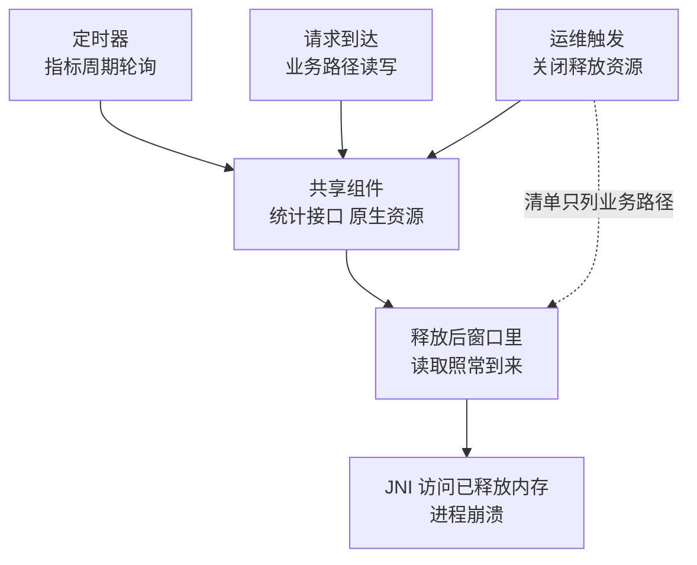
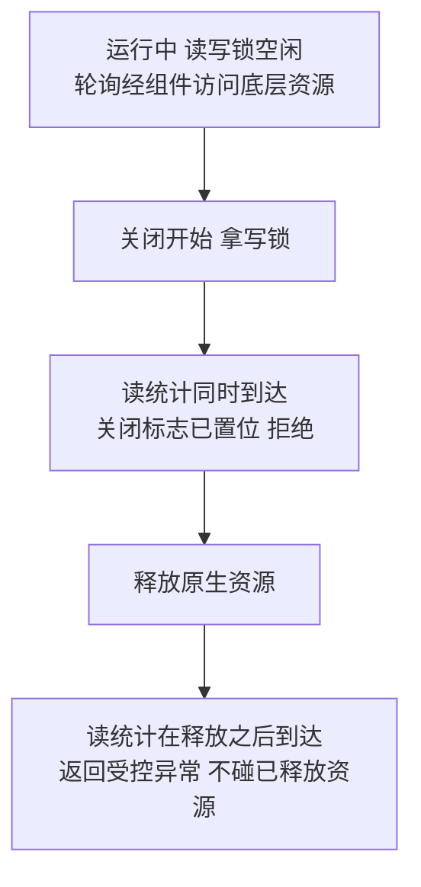

# 关闭与观测的并发错位：生命周期边界要算上读它的人

> **要点**：组件关闭时释放底层资源，监控还在周期性读它的统计值——关闭方以为"没人再用"的时候，观测路径正在下一次轮询的半路上；生命周期管理只盯着业务调用方，漏掉了读指标的人。

## 要解决的问题

给带原生资源的组件做生命周期管理，通常会问"谁在用它"：请求处理完了才能关、连接排空了才能关。这份使用者清单经常漏掉一个隐蔽的成员——**指标采集**。监控系统周期性调用组件暴露的统计接口（条目数、大小、命中率），**轮询永远在跑，与组件的生命周期毫无耦合**。组件关闭、底层资源释放之后，下一次轮询照常到来，**读到的却是一个已经不存在的对象**。

Apache BookKeeper 的一个真实病例（上游修复 commit 3795f559，可查）把后果演示到了底：存储引擎关闭后，指标轮询仍调用它的计数接口，底层 RocksDB 的原生内存已经释放，**通过 JNI（Java Native Interface，Java 调用本地代码的接口）的访问直接把进程打成 core dump——整个节点的读写随之中断**。修复的模式是关闭标志加读写锁（允许多读并发、写时独占的锁）：**关闭后调用统计接口返回异常**。

RocksDB 是嵌入进程的原生存储引擎，它的数据全在 MemTable（内存写缓冲）与多层数据文件（SSTable）里，Java 层只持有原生内存的句柄（程序持有的资源引用标识）——「读个数」就是读这些原生结构：


*图源：USENIX FAST'21 论文《Evolution of Development Priorities in Key-value Stores Serving Large-scale Applications: The RocksDB Experience》Figure 1（https://www.usenix.org/system/files/fast21-dong.pdf），作者 Siying Dong 等，facebook/RocksDB（嵌入式键值存储引擎，LSM 树实现） 团队。图中白色矩形是 SSTable（有序字符串表，磁盘数据文件），Level 0 由 MemTable 刷盘（把内存中暂存的数据写入磁盘持久化）直接生成，Level 1-4 由后台压缩逐层合并而来。英文标签对照：MemTable=内存写缓冲，Level=层级，SSTable=有序字符串表。*

「存储引擎关闭、原生内存释放」说的就是这些结构的销毁：**指标接口读的条目数、大小，全部来自这棵树的原生内存统计**。轮询在关闭之后照常到来，**读的已经是一棵被拆掉的树**。

## 它是怎么做到的：三条独立触发源，一个共享资源

把参与方列出来，错位的结构一目了然。

**业务路径**：处理请求、读写数据，生命周期被显式管理——**请求结束、连接排空，这些"用完"的信号是关闭方知道的**。

**观测路径**：指标框架按固定周期拉统计值，**触发源是定时器，与组件状态无关**；它假设"组件在，我就能读"，**从不先问**。

**关闭路径**：组件下线时释放底层资源，**触发源是运维或故障处理**。

三条路径由三个不同的触发源驱动，彼此没有感知。**关闭路径以为使用者清单上只有业务路径；观测路径以为自己只是"读个数"，算不上使用者**。错位在两者相遇的瞬间兑现：**释放与读取并发，读取发生在释放之后的窗口里。**

三条独立触发源驱动同一个共享资源，错位的结构长这样：



图：错位的结构——**三条路径各被独立的触发源驱动（定时器、请求、运维），彼此没有感知，全部汇聚到同一个共享组件上**。关闭路径释放资源时，**定时器驱动的下一跳轮询可能正在半路上——读取发生在释放之后的窗口里，错位在那一刻兑现**。虚线标注清单漏掉观测者的原因——**统计接口长得不像使用，读指标被当成旁观而非使用**。

对原生资源（JNI，Java Native Interface，Java 调用 C/C++ 原生代码的接口）、FFI（外部函数接口）、mmap（内存映射文件，把文件按页映射进进程地址空间）这个窗口的后果格外严重：**Java 层的并发错误通常是异常，可以捕获、可以兜底；原生层的访问违例直接由操作系统裁决——进程崩溃，所有在途请求陪葬**。这就是"观测压垮服务"的机制：**一根只读的轮询，终止了整个写入服务**。

## 为什么清单总会漏掉观测者

工程师没有忘记清单，漏掉的根源是**统计接口长得不像使用**。业务调用有请求-响应结构，天然被当成"使用"；统计接口是一个无状态的读，**代码评审里它安静得像一行日志**。三个认知偏差叠加：

- "只是读一下"——**读原生资源的状态同样是访问，释放后读就是访问已释放内存**；
- "监控永远该在"——**观测的可用性被默认为全生命周期，恰恰是这条假设让它从不参与生命周期协商**；
- "关闭时把指标也关掉"想起来了，但**实现成"摘除注册"，注册摘了定时器里的下一跳还在飞**。

共同点是把观测者当成了**旁观者**。修正认知的动作只有一个：**凡是从组件读信息的路径都是使用者，读数据的算，读指标的也算，全部进生命周期清单**。

## 修完之后靠什么防住复发

上游修复是通用模式的教科书实现，两层防线各管一段。

**关闭后拒绝（volatile 标志）**：组件持有关闭标志，统计入口先查标志，已关闭立即抛出受控异常。**这一层把"访问已释放资源"变成"收到明确错误"**——指标框架对一次失败的抓取完全能处理（丢一个点），业务无损。

**关闭中互斥（读写锁）**：释放动作与读取动作都用读写锁保护，关闭拿写锁、读取拿读锁。**这一层处理"正在关闭"的并发窗口**：关闭进行到一半时到来的读取要么在释放前完成，要么等释放后拿到拒绝，**没有第三种中间态**。

两层防线各自覆盖的时间段不同，合起来才没有缝：



第二段是读写锁管的窗口——**关闭进行到一半时到的读取被挡在锁外**；第三段是 volatile 标志管的窗口——**资源已经释放，标志让调用在碰资源之前就返回**。**少了任何一层，中间或后段就会漏**。

「巡夜的人也是用车的人」的实物原型是铁路提灯：站台上每晚有人提灯巡查车辆——车已停运入库，提灯人不明就里，照旧每晚来敲车轴、拉车门；停运的车主以为"车都不跑了没人碰"，漏算了巡夜人。停运登记（关闭标志）加上"巡查前先看停运牌"（入口检查），灯才照不到已拆的车上：


*图源：Wikimedia Commons，作者 Mr. Guide07，CC BY-SA 4.0，https://commons.wikimedia.org/wiki/File:Lantern_Old_type_light_for_Railway.jpg。*

指标轮询就是那盏每晚准点来巡的灯：组件下线（车停运）后轮询照常到来——**关闭标志是"停运牌"（统计入口先查），读写锁是"停运期间不许靠近"（关闭中互斥），摘除注册再等一个轮询周期是"先撤巡查班次再封车"（关闭顺序）**——**四道防线合起来，灯照的永远是活着的车**。

把这套对照推广出去，得到一份可执行的防线清单：

- **生命周期清单元必列观测者**：设计关闭流程时，**"谁在读我"与"谁在写我"列在同一张清单上**；
- **原生资源包装层统一拦截**：JNI/FFI 访问收口到一个包装层，**在入口检查关闭标志——散落的裸调用拦不住**；
- **统计接口定义失败语义**：**关闭后抛受控异常是正确行为，要写进接口语义**，让指标框架按"组件下线"处理而非按"组件故障"告警；
- **关闭顺序把指标摘除放最前**：**先从监控注册处摘除、等一个轮询周期、再释放资源，用顺序消灭窗口**。

## 这套说法在哪儿会失效

两条边界避免防线走形。

**拒绝是语义，报错是崩溃的对立面**：关闭后统计接口抛异常，**调用方（指标框架）要按预期失败消化它**；如果指标框架把任何异常都升级成告警，**防线反而制造噪音**。**失败语义要在两侧一起定义**。

**锁的粒度要配得上路径的长度**：统计读取通常是毫秒级，读写锁的代价可忽略；如果"读"是长操作（导出、快照），写锁饥饿（参与者长期抢不到资源、一直被推迟）问题反转，**要用别的协调方式**。防御措施的适用边界随操作的时长变化，**不是一把锁包打天下**。

## 怎么自己动手验证

可复现的验证路径：

1. 并发构造：**一个线程循环调用统计接口，另一个线程反复关闭再重建组件（或直接关闭）**；2. 未修复版本预期出现崩溃或原生错误（**在测试环境观察一次即可，不要反复令进程崩溃**）；
3. 修复后重跑同一压力：**关闭后的调用必须收到受控异常，进程存活，无任何原生崩溃信号**；4. **把"关闭后调用抛异常"写进组件的接口测试，作为永久回归项**。

```text
并发压力 = 读统计循环 + 关闭循环
修复后断言 = 进程存活 && 关闭后调用抛受控异常
```

这条测试的价值在防回归：**包装层后来新增任何绕过检查的调用路径，测试会当场红**。

## 接着读哪几篇：观测信号与组件状态之间的时效错位

- [[工程知识/缺陷分析：从个案到体系/并发/案例二十：关闭之后还有人在用——生命周期的时序竞态]] —— 同一上游缺陷的案例侧写
- [[工程知识/后端系统：在并发、失败与变化中维持服务/分布式可靠性/健康检查只能提供有时效的失败证据]] —— 观测信号与组件状态之间的时效错位
- [[工程知识/后端系统：在并发、失败与变化中维持服务/服务设计/优雅停机的完成语义：排空连接与任务交接]] —— 关闭顺序设计的通用入口
- [[工程知识/软件构建：让变化可以理解、验证与交付/语言与运行时/内存模型决定并发读写何时可见]] —— volatile（禁止编译器缓存、强制每次读写都走内存的关键字） 标志与读写锁的可见性基础
- [[工程知识/缺陷分析：从个案到体系/并发/只读旁观者不能改变被观察对象的状态]] —— 观测方的权限边界：读指标与写共享槽位的代价差异