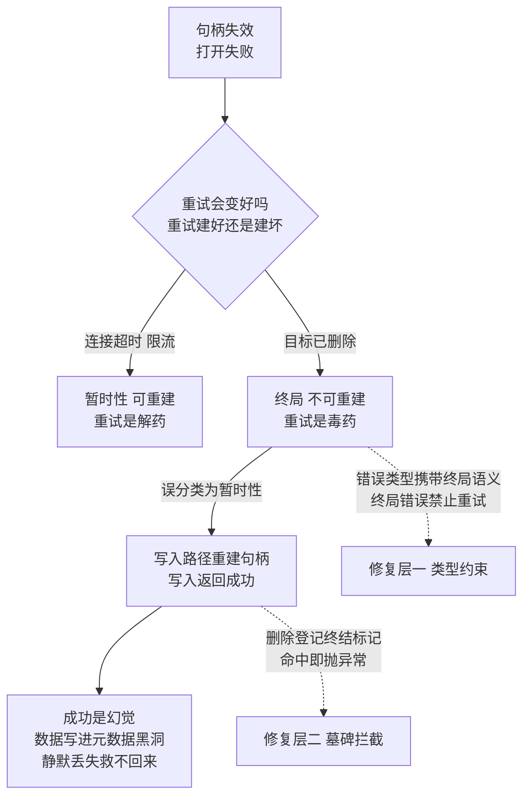
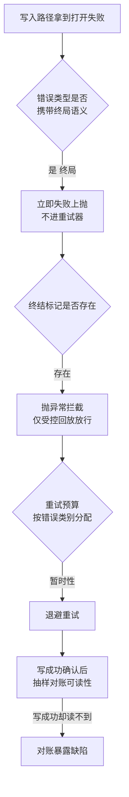

# 句柄的终局判定：失败可能重试，终局必须不重试

**错误分两类：能重试的暂时性失败，和不能撤销的终局判定**。**把终局当暂时性失败去重试，重试路径会重建一个已经失效的状态**。**读完这一页你能区分这两类错误，避免生产者拿到成功确认而数据永久不可读**。

> **要点**：句柄指向的目标已不存在时，错误分两类——可重试的暂时性失败与不可撤销的终局判定；把终局判定当暂时性失败重试，重试路径会重建失效状态，生产者拿到成功确认，数据却永久不可读。

## 句柄的终局为什么必须判准：判错会发生什么

**分布式系统里持有远端对象句柄（文件句柄、账本句柄、会话句柄）的写入方，迟早会撞上"句柄失效"：目标在另一条路径上被删除了**。此时打开失败，通用的容错直觉是重试与重建——"打开失败就再开一次"在连接类故障上是金科玉律。**Apache BookKeeper 的一个真实缺陷（上游修复 commit 93118aa5，可查）展示了撞上之后的完整链条：一个账本被客户端确认删除后，另一个持有旧句柄的写入方继续提交，发现内存句柄已被移除，写入路径重新创建句柄并继续写入——写入返回成功，账本元数据已被删除，写入的数据无法被读取**。**生产者收到成功确认，消费者收不到消息，静默丢失，重放与重试都救不回来**。

**这类缺陷的结构在所有句柄型系统里同构：删除走元数据，写入走句柄，两条路径对对象是否存在的判定不一致**。银行柜面同名账户的销户纠纷是同一结构：销户走核心系统（元数据），柜员手里的凭条还印着账号（句柄）——**凭条上的账号"存在"过，销户后它什么都不指；柜员按凭条记账，账就记进了一个已注销的户头**。

本库并发域"删除与写入的并发窗口"一文已从并发窗口的角度解剖过这条缺陷（复活句柄），本篇把其中最锋利的一个点抽出来单独成篇：失败分类里终局判定与暂时性失败的区分。**重试是暂时性失败的解药，是终局判定的毒药——对"目标已不存在"这种不可撤销的状态，每次重试都在重新制造不一致，而且重试成功了（错误意义上的成功）：写入路径真把句柄建回来了**。

## 它是怎么做到的：错误分类的两象限

**句柄失效后每次操作可能得到的错误，按两个维度分类：持续性（重试会变好吗）与状态可重建性（重试会把坏状态建回来吗）**。

| | 可重建（重试建好） | 不可重建（重试建坏） |
| --- | --- | --- |
| 暂时性 | 连接超时、限流（限制单位时间内放行的请求数量）：重试是正确动作 | 罕见，多数场景不成立 |
| 终局 | 目标已删除但重建无害（幂等创建） | 目标已删除且重建即静默破坏 |

右上象限的常见例子是"删除后重建语义合法"的对象（临时文件、缓存条目），重试无害；**右下象限就是 93118aa5 的形态：账本已从元数据删除，重建的句柄写入的所有数据都指向一个元数据上不存在的账本——写成功了，但成功是幻觉**。**写入方视角"重建成功"与"恢复成功"无法区分，只有下游读取失败才能暴露，而那时数据已经写进了黑洞**。医生的处方笺同款：名字拼错重开一张（可重建），药重配就是了；过敏原录错而病人已注射（不可重建），重开处方救不回来——**两类"开错了"后果天差地别，处理前先要分清是哪一类**。

**为什么终局判定会被误分类？因为 API 返回的错误类型没有携带终局信息："打开失败"可能是网络抖动（暂时性）也可能是对象已删除（终局），写入路径拿到一个笼统的失败就套用通用重试逻辑**。**分类的缺失发生在错误设计层，破坏发生在重试执行层——修复也就分两层**。

错误分类的两象限与误分类的破坏链：



**误分类的完整破坏链：同一个「打开失败」下藏着两种性质截然不同的错误——暂时性失败重试是解药，终局判定重试是毒药**。**误分类后写入路径重建句柄、写入返回成功，但成功是幻觉：账本元数据已删除，数据写进黑洞，只有下游读取失败才暴露**。**两条虚线对应两层修复：错误类型系统携带终局语义（终局错误禁止重试），删除时登记终结墓碑（在线写入命中即抛异常，日志回放这类受控路径放行）**。

**终局判定为什么不可重试，桥梁工程里有实物注脚：伊兹桥的东桥墩是往河床沉箱里浇筑混凝土建成的——浇筑一旦完成，桥墩的位置与地基从此不可更改，后续所有工序只能在它之上进行**：


*图源：Wikimedia Commons，公有领域，https://commons.wikimedia.org/wiki/File:Eads_Bridge_construction_sinking_the_east_pier.jpg。*

**「目标已删除」正是这样的浇筑时刻：账本元数据被删除是不可撤销的既成事实，重试不会让桥墩回到未浇筑状态，只会往上再叠一层错误的工序——写入路径重建句柄、继续写入、返回成功，全部发生在一个已经不存在的地基上**。**工程师区分「可以返工的失败」与「不可撤销的既成事实」，错误分类的终点也是这条线**。

**「消息先落半账、终局确认后才可投递」的交互全貌，RocketMQ（Apache 旗下的分布式消息队列）官方文档画了完整的时序：发送方先发半消息（对消费者不可见），执行本地事务后提交 Commit 或 Rollback；服务端没等到二次确认时主动回查，按回查到的终局状态决定投递或丢弃——半消息阶段的每个动作都带着明确的终局语义，Commit/Rollback 没有重试空间**：


*图源：Apache RocketMQ 官方中文文档《事务消息》，https://rocketmq.apache.org/zh/docs/featureBehavior/04transactionmessage/。半消息对消费者不可见、二次确认携带终局语义、回查按终局处理——每个阶段的失败分类都是显式的。*


## 终局判定该怎么修、靠什么兜底

**上游修复抓住的是"刚被删除"这个过渡状态：删除时记录一个短期的终结标记，在线写入路径命中标记即抛出异常，仅日志回放这类受控路径放行**。**整套防线像海关的分层查验：类型系统是免检通道的名单（持终局护照的直接拦下），墓碑是布控名单（名单上的人一律开箱），重试预算是查验窗口的调度（不同类别走不同窗口），对账是出关后的抽查（漏网的最少在此现形）**。**比喻到"各层各查各的"为止：每一层具体怎么设，看下面四节**。防线体系按层排：

### 怎么让错误类型带上终局语义

**对象管理系统对"目标不存在"设计专门的错误类型（HTTP 410 Gone 对 404 的区分是同一个思想），调用方拿到终局错误时禁止重试——这是把分类从文档约定升级为类型系统的约束**。**生活里的对应是快递系统的两种拒收：404 是"查无此地址"，可能是门牌写错，换个写法再投就行；410 是"此地址已注销"，再投多少次都不会有人收——快递单上的拒收理由直接决定还要不要跑第二趟，错误类型对调用方就是这张理由栏**。

**四层防线各自拦在写入路径的不同位置，一层漏了下一层还有机会**：



**最下面那层是唯一不依赖分类正确的兜底：前三层都要先认出这是终局错误，对账层只问"写成功的是不是真的可读"，认不出来它照样能抓到**。**代价是它发生在写入之后，数据已经进了黑洞，能报警但不能挽回——所以它是对最后一道确认，不是替代前面几层**。

### 为什么删除要登记成终结状态

**删除动作在元数据之外留下一个短期可查的终结标记（墓碑），并发路径的写入在"句柄不存在"与"终结标记存在"同时成立时明确失败**。**日常对应是营业厅的注销登记：客户销户后系统里先挂"已注销"的牌子，窗口看见这个牌子直接拒绝办理，而不是按"查无此人"重新开一个新户——牌子上保留着旧身份信息，就是为了挡住拿着旧证件来办事的人**。**墓碑的时效要有界（配合真正的元数据清理），否则墓碑自己变成待删账本式的泄漏**。

### 重试预算怎么按错误分类分配

**暂时性错误走退避重试，终局错误立即失败上抛**。**混在一个通用重试器里的代价是终局错误被预算反复消耗——重试预算的粒度应该是错误类别的函数**。**医院分诊是现成的对照：发烧感冒进候诊区排队等叫号（退避重试），骨折进急诊通道立即处置（立即失败上抛），两类人挤同一条队伍，急诊病人会被候诊队列拖到错过处置时机——重试器就是那条队伍，预算分配就是分诊台**。

### 成功确认之前要拿什么不变量对账

**本库正确性域的对账纪律在这里的具体形态是"写成功 ⇒ 可读"——抽样验证刚确认的写入真的可读，句柄复活类缺陷会在对账里以高置信度现形**。**性质等同于出厂抽检：装配线每道工序都报"合格"，质检台不问工序怎么说，直接从成品里随机开机通电——工序报表与通电结果对不上，说明某道工序在自欺，抽检是唯一不依赖前道工序自我报告的关卡**。

## 这套说法在哪儿会失效

三条边界防止防线变形。

### 终局判定为什么有时效

**终结标记是过渡状态，不是永久状态**；**"永远失败"的对象（名字永不复用的删除）与"名字可复用"的对象（重建合法）要用不同的标记时效**。**把终局标记做成永久，会挡住合法的重建语义**。**参照是企业注销的公示期：注销公告挂 45 天是给债权人留主张窗口，期满注销生效、名字可以再注册——公告若永久挂着，这个名字就永远不能再用了，合法的新设企业被误伤**。**墓碑的时效就是这段公示期，长短取决于"还有谁可能拿着旧句柄"**。

### 日志回放为什么要刻意放行

**内部恢复路径需要从旧数据重建状态，它持有的是受控的旧句柄——例外通道要显式命名、限定调用方、与在线路径隔离，防止"内部例外"演变成"第二入口"**。**场馆管理的员工通道是同一件事：员工通道绕过检票口是为了散场后清场与补给，闸机只认员工卡，且通道与观众入口物理分开——一旦观众摸清员工通道也能进场，检票就形同虚设；例外通道不隔离，就会变成绕过全部防线的后门**。

### 终局错误为什么也要可观测

**立即失败与静默失败是两回事——终局失败要有独立的错误码与计数，运维能看到"有多少写入撞上了已删除对象"，这个数字本身是调用方代码有问题的信号**。**仓库管理里"投递到已注销地址"的件数单独记账：不为找回这一件货（货已经找不回），而是这件数一涨，就说明上游录入系统的地址校验有洞——台账不为追回，为暴露上游的洞**。

## 怎么自己动手验证

**验证要拿的账是：删除与写入竞争结束后，写入方拿到的成功确认与这条数据在后续读取时的可访问性对不对得上**。**做法像交通事故还原：不问两辆车各自的司机怎么说，用监控把两车的位置对到同一根时间轴上——本篇的"监控"就是测试调度控制的时序，先让删除与提交在窗口内相遇，再看写入确认与实际可读性是否互相印证**。

1. 构造并发窗口：客户端 A 持句柄持续写入，客户端 B 打开同一账本并删除；窗口对齐后 A 继续提交（测试调度控制时序）；
2. 未修复基线（正常状态下的指标水平、用来对比异常）：A 的写入返回成功，随后读取该账本报条目不可读——成功确认与不可读并存即为缺陷证据；
3. 修复后重跑：同一时序下，A 命中终结标记得到明确异常，无假成功；日志回放路径按预期放行；
4. 断言锚点：写入返回成功则元数据存在且条目可读（抽样对账）；终局失败有独立计数。

```text
时序 = B 删除 && A 提交（句柄已移除）
修复前断言 = A 成功 → 数据不可读（缺陷）
修复后断言 = A 得到终局异常，无假成功；重放路径正常
```

"成功确认 ⇒ 可读"与并发窗口的对账结合，构成句柄类静默丢失的完整检测面。

## 接着读哪几篇：同一缺陷的并发窗口视角：窗口

- [[工程知识/缺陷分析：从个案到体系/并发/删除与写入的并发窗口：复活句柄是静默丢数据的机器]] —— 同一缺陷的并发窗口视角：窗口、栅栏与墓碑的完整讨论
- [[工程知识/缺陷分析：从个案到体系/正确性/静默失真的检测靠对账与不变量而不是报错]] —— "写成功⇒可读"不变量的方法论出处
- [[工程知识/后端系统：在并发、失败与变化中维持服务/任务与并发/幂等性的完整谱系：从操作语义到删除接口的天然陷阱]] —— 删除接口语义与重建合法性的完整讨论
- [[工程知识/后端系统：在并发、失败与变化中维持服务/分布式可靠性/重试的正确姿势：退避、抖动与重试预算]] —— 重试纪律的总纲，本篇给"按错误分类分配预算"补充了终局维度
