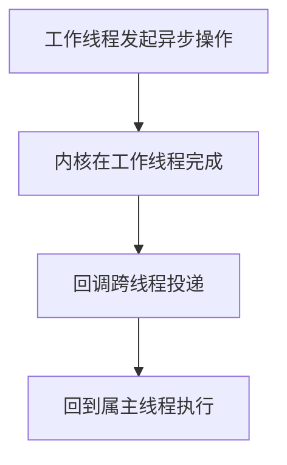
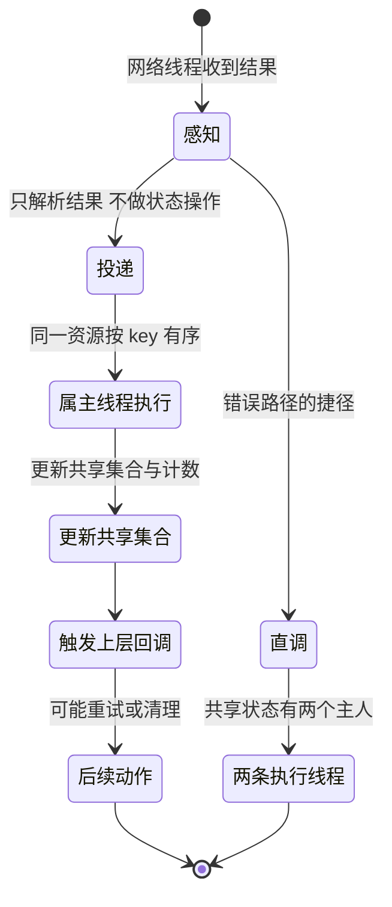
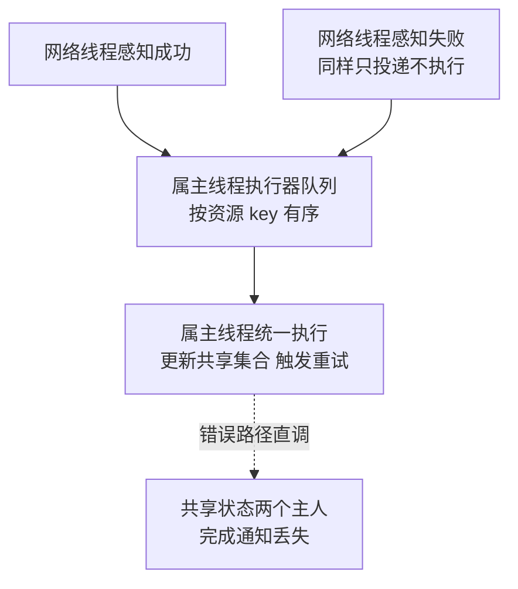

# 回调必须回到属主线程：完成通知的线程归属纪律

**完成回调会碰到共享状态，那它就必须在状态的属主线程上执行**。读完这篇你能说清错误路径上的回调为什么最容易出事，以及线程归属该怎么管。

> **要点**：**完成回调是"碰共享状态"的动作，它的执行线程必须与状态属主的串行域一致**；**错误路径上的回调最容易在别人的线程上直接执行，一致性在那一刻被换掉了主人**。

## 要解决的问题



回调在哪里完成，不变量就归谁所有：


**错误分支是回调线程归属这条防线上最容易被绕过的一段**。成功路径的回调通常规规矩矩投递回属主线程，错误路径却常常**以"尽快通知、别耽误重试"的名义，在感知到错误的线程上直接调用**——而**感知错误的线程几乎总是网络 I/O 线程**，并不**拥有被回调触碰的那些状态**。

**这不是理论担忧**。BookKeeper 客户端的两个真实缺陷——上游修复 commit 804b2b61 与 47c3fc37 都发生在"完成通知由谁执行"这个点上：**前者是错误回调在网络线程上与账本工作线程并发进出共享集合，部分写入收不到完成通知；后者是管理接口在请求线程上新建客户端对象后直接回调释放逻辑，用完不关，线程与连接按调用次数累积**。两个病例、两种表现，**同一个根源：回调的执行线程没有回到状态属主的串行域**。

## 它是怎么做到的：线程归属是状态一致性的隐含参数

一次完成通知（成功或失败）要做的事：**更新共享集合或计数、触发上层回调、可能发起后续动作（重试、清理）**。每一步都可能触碰"属主线程拥有的状态"：**医院病历车是同一个规矩——病历（共享状态）只在一辆推车上（属主线程），谁要改都得把申请递到推车这儿，由推车的医生动笔**；护士在外面嘴上说「我帮你记一笔」（错误路径直调），**病历从此有两个主人，字迹对不上时谁也说不清哪笔是真的**。比喻到「一支笔一个主人」为止：**医院还能靠笔迹鉴定追责，并发代码里两个线程同时改内存，结果是静默的数据错乱，追责都找不到字迹**。



### 成功时这条路径怎么走

通常设计成：**网络线程只做报文解析，把完成事件投递到属主线程的队列里，属主线程统一处理**。这条路径上，**线程归属是显式设计过的**。**前台收发室是同一个安排：外面快递员只把件放进收发室（解析并投递），签收登记、拆件处理都由收发室管理员按顺序来（属主线程统一执行）——快递员从不动登记簿**。比喻到「谁碰登记簿」为止：**收发室忙不过来可以加管理员，线程归属纪律管的是「谁有资格碰」，不是「几个人干」**。

### 出错时这条路径怎么走

**诱惑在于：错误往往在网络线程上被感知（连接断开、超时到期），"顺手"在当前线程调用失败回调，省一次投递。省掉的这次投递，恰好把一致性约定撕开——从此完成通知有两条执行线程，共享状态有两个主人**。

**错误路径的辩护词通常是"错误通知无状态，只是转告"。辩护词在多数情况下不成立**：**失败回调要移除在途项、要更新重试计数、要决定是否重连——这些都是属主状态**。**消防演练里「顺口喊一嗓子」的失误是同一个形状：报警人只想尽快转告（无状态转告的辩护词），但一嗓子喊错楼层，疏散的人全跑错了地方（转告本身改了共享的疏散状态）**——比喻到「转告也会改状态」为止：**喊错一嗓子还能再喊纠正，线程里错的写入不会自己撤销**。**真正的无状态转告极少；"看起来无状态"是因为状态藏在上层回调的闭包里，评审时看不见**。

## 可复用的修复模式是什么：出口收敛

把这类问题的修复抽象成一个可复用的模式：**出口收敛**。**完成通知无论成功失败，收敛到一个出口——属主线程的执行器**。实现上有三个要点。**医院检验科出报告是同一个收敛：不管是急诊标本还是常规标本（成功或失败），结果一律汇到报告窗口统一发（收敛到一个出口），从没有检验员拿着结果满医院找人送**——比喻到「一个窗口发报告」为止：**检验科发错窗口有人追，线程里通知发错线程就丢了，所以出口收敛之外还要兜底**。

### 投递点为什么该放在感知侧

投递点与执行点分开，结构上就是发布订阅（发送方不指定接收者、由订阅关系分发的消息模式）：发布方把消息投给主题，各订阅方按自己的需要接收，双方互不认识。感知侧只管投，属主线程只管收。


*图源：Microsoft Learn 中文文档，CC BY 4.0，https://learn.microsoft.com/zh-cn/azure/architecture/patterns/publisher-subscriber。*

网络线程（或任何非属主线程）感知到结果后，**第一动作是投递，不执行任何状态操作**。**感知侧代码应短到"解析结果、投递、结束"**。**收发室的墙洞是同一个安排的实物版：快递员从墙洞塞件进来（投递点放在感知侧），手够不着里面的登记簿（碰不到属主状态）——墙洞这个结构让「乱动」在物理上不可能，比「叮嘱快递员别动」可靠**。比喻到「结构性隔离」为止：**墙洞大小固定，投递队列还要管满了怎么办，那是下一小节兜底的事**。

### 执行器按 key 有序带来什么

按 key 有序意味着**同一 key 的回调必须排队等前一条完成**——这是顺序护送的典型形态：正确性换来了吞吐上限，队列一积压，后面全部跟着等。


*图源：同上（Microsoft Learn 中文文档），CC BY 4.0。*

同一资源（账本、连接、会话）的完成通知**进同一串行域，不同资源之间并行**。**ordered executor 是这个语义的标准实现**。

### 投递本身为什么要有兜底

**执行器拒绝或关闭时，投递的失败通知要有出路（同步执行、记录后放弃），兜底路径也要过评审——它是错误路径的错误路径**。**总机值班员下班后的来电是同一个问题：转接分机这条路（执行器）关了，来电不能凭空消失，要落留言机（记录后放弃）或由值班长直接接手（同步执行）**——比喻到「关门也要留出口」为止：**留言丢一条可以回拨，完成通知丢一条就是状态永久不一致，所以兜底路径的评审标准比主路径更严**。

**出口收敛之后，"哪些代码在哪个线程上跑"从口头约定变成结构保证：属主串行域之外，没有任何代码碰得到共享状态**。**线程归属纪律由此从"记得"变成"做不到错"**。



**虚线是被禁止的捷径：错误路径顺手在感知线程上直调失败回调，省下的那次投递恰好把一致性约定撕开，完成通知从此有两条执行线程，部分写入收不到通知**。

## 要付什么代价，在哪儿会失效

**投递的开销是常数，漏投递的代价是**事故：**每次回调多一次队列往返**，微秒级；**并发缺陷的一次事故是小时级定位加不可解释的线上表现**。**这笔账在压测报告里算不平（压测不注入故障），在故障复盘里才算得平**。**评审要压住"这里可以优化掉投递"的冲动**。

**判断是否需要投递的判据只有一条：回调是否触碰属主串行域内的状态（直接或经闭包间接）**。**碰就投递，不碰才允许直调**。判据可执行，但"间接触碰"要靠评审盯闭包——**这是该纪律残余的人工成本**。

**嵌套回调要防重入（重入：回调 A 执行期间又被属主线程同步触发一次）**：属主线程执行回调 A 时，A 内部同步触发了回调 B 的投递，B 排在队列里等当前执行完——**这是正确行为**；如果 A 内部直接调用 B 的处理函数，**串行域内出现嵌套，重入问题回来了**。**收敛纪律要覆盖嵌套场景：回调内部再触发通知，同样走投递**。

## 怎么自己动手验证

可复现的验证路径：

1. **线程审计：在共享状态的所有修改点打上执行线程标记（测试断言或运行时检查"当前线程 == 属主线程"），跑全量测试与故障注入**；
2. **竞态（多个执行流争抢资源、结果取决于时序）压力：并发写入 + 周期性故障注入（连接中断、超时），统计"提交数 == 完成通知数"，不等即有丢失或重复**；
3. **修复后回归：同一压力下断言恒成立，并保留为持续集成里的常规用例**；
4. **关闭路径单独压：执行器关闭瞬间的在途回调要有确定结局（完成或收到兜底处理），不允许静默消失**。

```text
审计断言 = 共享状态修改点的当前线程 == 属主线程
压力断言 = 提交数 == 完成通知数（成功 + 失败）
```

**线程审计断言是这条纪律的机械化检查：改代码的人不需要记住纪律，违反时测试当场红**。跑验证时预期与实际的对照要对应到两个数上：**提交数与完成通知数必须相等，对不上即存在丢失或重复；属主断言的违规次数必须是零，任何一次"回调在别人的线程上碰了共享状态"都说明收敛有缺口**。

## 接着读哪几篇：串行域之外的"线程安全"为什么不算数

- [[工程知识/性能工程：从用户等待到资源瓶颈/处理器与内存/无锁数据结构的证据门槛：CAS与内存序]] —— 串行域之外的"线程安全"为什么不算数
- [[工程知识/缺陷分析：从个案到体系/并发/案例三：并发两面——写回调卡死与心跳竞态]] —— 同一上游缺陷的案例侧写
- [[工程知识/后端系统：在并发、失败与变化中维持服务/任务与并发/并发控制先定义共享状态和完成条件]] —— 属主与完成条件的设计入口
- [[工程知识/缺陷分析：从个案到体系/并发/并发缺陷的复现策略：压力放大与确定性调度]] —— 本文验证节的压力构造出处
