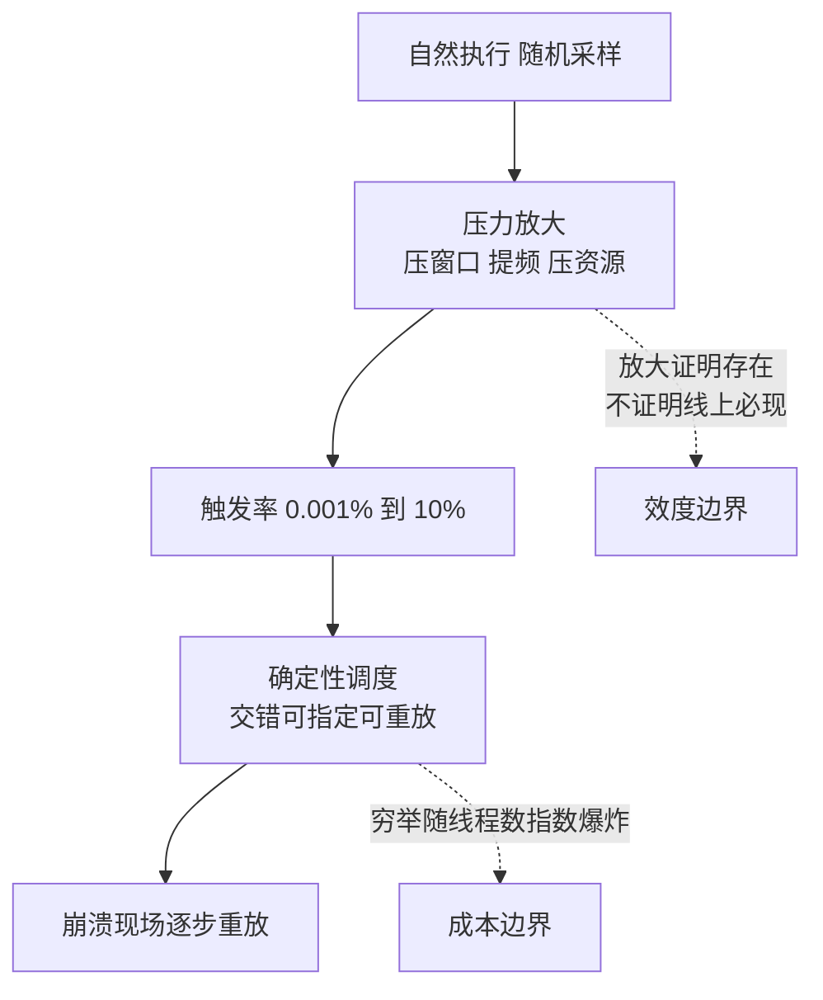

## 要解决的问题

**并发 bug 的复现概率像中彩票：压测一百万次出现三次，本地跑一夜零次，改一行"无关代码"后突然频发**。原因：**并发缺陷的触发依赖多个线程的执行交错（interleaving）恰好位于缺陷窗口——竞态窗口只有几条指令宽，而自然执行的交错由调度器随机摆布，概率低且不可控**。复现策略的本质是**把等运气改写成造条件：要么把窗口放大**（压力放大：让本来窄的窗口变宽、让触发条件更密集），要么把调度收拢（确定性调度：让交错可指定、可重放）**。两条路各有射程，配合使用才有完整复现能力。**

## 它是怎么做到的

### 压力放大怎么把概率抬高到可实验

**四个杠杆。压紧窗口竞争**：把竞态资源的关键区段人为减速（在窗口内加 sleep/IO/断点——"慢化注入"让两线程同时在窗内的概率大增），**这是复现竞态的经典手法：在怀疑点插桩延时，跑 N 次统计触发率，插桩位置对则触发率从 0.001% 跳到 10%+**。

**提频**：循环次数拉高（让低概率事件在大样本里必然出现），配种子控制（每次运行记录随机种子，失败可回放同一批随机输入）。**压资源**：把并发数、CPU 数、连接数推到极限（资源紧张放大调度切换频率，交错多样性暴涨）。

**换调度环境**：单核机器强制多线程切换（cgroup（Linux 的资源限制机制）/taskset 绕核反而减少交错时，反向操作——放开绕核、加噪声进程抢核）。

信号传播延迟造成竞态的最小电路样本——门延迟 Δt1 与 Δt2 直接决定输出毛刺（延迟曲线上偶发的短时尖峰）的宽度，硬件世界与软件世界在这一点上同构：

*图示：两个执行流交错访问同一份共享状态。图源：Wikimedia Commons「Race condition」，作者 Dhollm，许可 [CC BY-SA 3.0](https://commons.wikimedia.org/wiki/File:Race_condition.svg)。*

### 确定性调度怎么把随机变成可控

**三条技术线**。**线程调度器插桩**：测试框架接管调度（Java jcstress 的 executor 编排、专用框架如 CHESS 的模型检查式穷举，系统地枚举交错而非采样），**每个线程的停走由测试控制，交错成为测试参数**。

**内存模型放宽**：**TSan（ThreadSanitizer）不调度但检测——运行时监控所有内存访问的 happens-before（判断一个操作的结果对另一操作可见的先后关系） 关系，数据竞争当场报警（比等崩溃早一万倍）**，代价是 **5-15 倍减速与内存放大**。**确定性重放**：记录与回放（rr、Oracle 的确定性 JVM、QEMU（通用机器模拟器）的 record/replay）把一次执行的调度决策记下来，**崩溃现场可以逐指令重放（并发 bug 从"不可调试"变"可单步"）**。

### 复现用例怎么缩到最小

从能触发到最小用例。**触发了只是半程：一个 200 线程压 3 小时的复现脚本没法定位、没法做回归测试**（改动后重跑旧用例、确认没有破坏既有功能）。最小化流程：**触发后逐步削减（减线程数、减循环、减无关逻辑），每次削减后验证仍触发，直到删无可删（N 线程各 M 步的最小剧本）**。**最小用例的价值：交错空间小到可枚举（2 线程 4 步的全部交错是几十种，肉眼可推演哪个交错触发）、可进 CI（Continuous Integration，持续集成：代码合并后自动构建与测试）做回归断言（修复后该用例必须不再触发）**。

### 复现要统计到什么程度才停手

**复现不是"出现一次就算"：偶发现象可能是无关噪声——GC 停顿、邻居干扰**。判定要统计化——**N 次运行触发 K 次的比率，与无缺陷版本的基线（正常状态下的指标水平、用来对比异常）对照——基线也偶发 0.1%，你的 0.3% 就不是信号**。停手线：**放大手段全上仍触发率低于可实验水平（如 0.01%），转路线——上 TSan 静态等竞争检测、上模型检查工具、或按代码审查逻辑推断（复现成本超过推理成本时，推理先行、复现后补）**。

"出现一次不算数，比率对上基线才算"的裁决方式，法槌是它的实物注脚：法庭不定"某人做过一次坏事"，定的是"在多少次同类场合中出现了多少次、与正常基线差多远"——孤例与噪声被程序挡在门外，比率过线才定案；同样，0.3% 的触发率要和基线的 0.1% 对过账才能立为缺陷证据：

*图源：Wikimedia Commons，作者 Blogtrepreneur，CC BY 2.0，https://commons.wikimedia.org/wiki/File:Legal_Gavel_(27571702173).jpg。*

**统计判据（N 次运行 K 次触发、与基线对照、停手线 0.01%）就是把"定案"的门槛写进复现流程：触发了只是立案受理，比率过线才判缺陷成立**；不过线的，转 TSan、模型检查或代码推理，换一条路取证。

压力放大要放大的那扇「时间窗」长什么样，Brendan Gregg 的 off-CPU 时序图给出了实物形态：应用线程在 syscall 后 block，进入 Off-CPU 等待区，直到依赖线程链逐级 wakeup 把它唤醒——竞争窗口就是 block 到 wakeup 之间那段空白，慢化注入加宽的就是它，确定性调度枚举的就是它内部的交错点：

*图源：[Brendan Gregg《Off-CPU Performance Analysis》](https://www.brendangregg.com/FlameGraphs/offcpuflamegraphs.html)，作者官网图，文档引用。*

来源：[美团技术团队《Java线程池实现原理及其在美团业务中的实践》](https://tech.meituan.com/2020/04/02/java-pooling-pratice-in-meituan.html)（CC 4.0 BY-SA）

## 它从哪儿来，要付什么代价

并发缺陷的系统化复现从学术界走到工业：模型检查的 CHESS（Microsoft Research，2008 前后）代表穷举派；谷歌的 ThreadSanitizer（2009+）代表检测派，TSan v2 用 shadow memory 实现 happens-before 追踪；Java 的 jcstress（OpenJDK，Doug Lea 体系）把并发实验做成微基准式框架；Mozilla 的 rr（2010s，基于 gdb 的录制回放调试器）让 Linux 用户态（普通程序运行的低权限受限状态）确定性调试免费可用。

**把"并发正确性"从概率现象改写成可控实验变量**：**自然世界的交错是随机采样（一次运行采一个样本），压力放大是加权采样（把坏样本的概率调大），确定性调度是全量枚举（把样本空间收小到可走完）**。三个层次对应三种实验能力，也对应三类可下的结论——**触发率高≠必然 bug（放大后的交错可能实际不可达，如线程池大小限制了并发路径）**，这一点是放大法的效度边界：**放大复现证明缺陷存在，不证明线上必然发生，严重性评估要回到未放大的触发率估计**。代价：**确定性调度的开销（插桩减速、穷举的交错数随线程数指数爆炸——3 线程 10 步已是天文数字，穷举只对小用例可行）**；**TSan 的漏报与误报面（只报数据竞争，死锁与 check-then-act 类逻辑竞态不在射程，跨进程的竞争检测不到）**；**慢化注入本身改变时序——竞争窗口被 sleep 拉宽时可能反而错开本该碰撞的路径，所以插桩位置要多个候选轮换试**。

三条路线对交错空间的处理各不相同，能力层次一目了然：

两条虚线是各自的射程边界，也是选路线的依据。

## 这套说法在哪儿会失效

- **数据竞争与逻辑竞态是两族问题**：**TSan 抓的是内存级数据竞争（无同步的并发访问），check-then-act（先查后用，两步间状态被改）在内存上无竞争（有锁）但逻辑上竞态**。**后者只有确定性调度与用例设计能覆盖，TSan 靠不住**。
- **复现环境与生产环境的差异要显式列出**：核数、调度器版本、内存序（ARM 弱序的交错在 x86 强序机器上不可达）、JIT（Just-In-Time，即时编译：运行时把热点代码编译成机器码）/GC 行为——**复现成功的用例在哪个环境成立要说清，跨环境搬运复现脚本是常见坑**。
- **死锁（多个执行流互相等待对方释放资源）的复现走另一条路**：死锁的触发条件是资源获取顺序的交错，**压力放大对死锁效率低（死锁窗口相对宽，自然触发率高）**，重点在**静态分析（锁顺序图检测环）与动态检测（运行时锁矩阵，jdb/Valgrind 的 deadlock 检测）**。
- **CI 里的并发回归用例要控制时长**：秒级跑完的确定性小用例适合进 CI 常跑；要跑几分钟才触发的放大型进夜间或按需。**CI 的并发用例还要防 flaky——偶发失败污染主干的信号：断言带重试与统计，连续 N 次不触发才算过**。

## 怎么自己动手验证

- **慢化注入复现实验**：写一个已知竞态（check-then-act 的计数器丢更新），未插桩跑 10 万次统计触发率，再在窗口内插 sleep 重跑。预期：触发率从千分之几跳到百分之几十，插桩位置偏移后效果消失。放大杠杆有效性与位置敏感性的证据。
- **TSan 对照**：同一程序（含数据竞争与逻辑竞态各一处）分别跑 TSan 与普通构建。预期：TSan 报数据竞争（含调用栈），对逻辑竞态沉默——检测射程的一手确认。
- **rr 重放实验**：用一个偶发崩溃的多线程程序在 rr 下触发一次崩溃，随后重放两次。预期：两次重放在完全相同的指令位置崩溃，可断点、可单步。确定性重放把并发调试变串行调试的证据。

## 接着读哪几篇：内存序与 CAS 是并发缺陷的机制背景

- [[工程知识/缺陷分析：从个案到体系/复现与回归/从复现到回归——让证据走完一圈.md]] —— 本篇是复现段在并发域的专门展开，回归段衔接最小用例
- [[工程知识/性能工程：从用户等待到资源瓶颈/处理器与内存/无锁数据结构的证据门槛：CAS与内存序.md]] —— 内存序与 CAS（比较并交换、无锁更新共享数据的原子指令） 是并发缺陷的机制背景，本篇是它的复现侧
- [[工程知识/软件构建：让变化可以理解、验证与交付/测试与交付/覆盖率的三种读法：行分支与路径覆盖的证据强度.md]] —— 并发交错是路径爆炸的极端形态，覆盖率的证据强度分析在此放大
- [[工程知识/缺陷分析：从个案到体系/并发/写入路径的串行化边界：回调换了线程，不变量就换了主人]] —— 串行域缺陷的压测构造与完成数对账验证
- [[工程知识/缺陷分析：从个案到体系/复现与回归/内存错误的检测要靠影子内存：红区、悬垂隔离与代价账.md]] —— TSan 只是 sanitizer 家族的一员，ASan 管内存边界错误的另一半，射程与代价账在那里对齐
