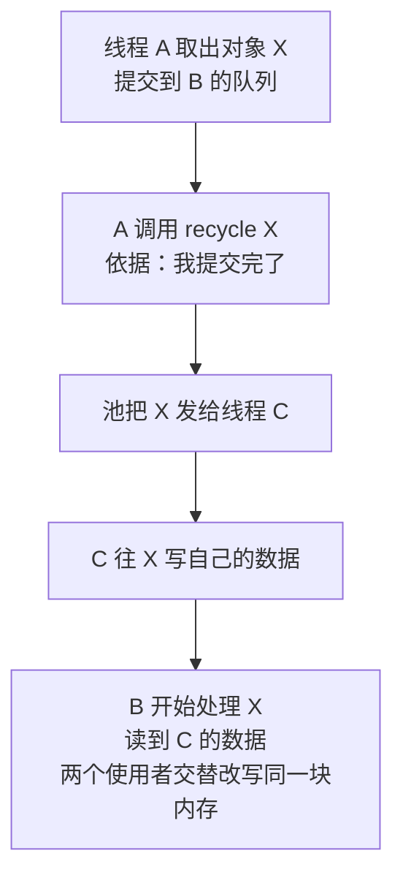
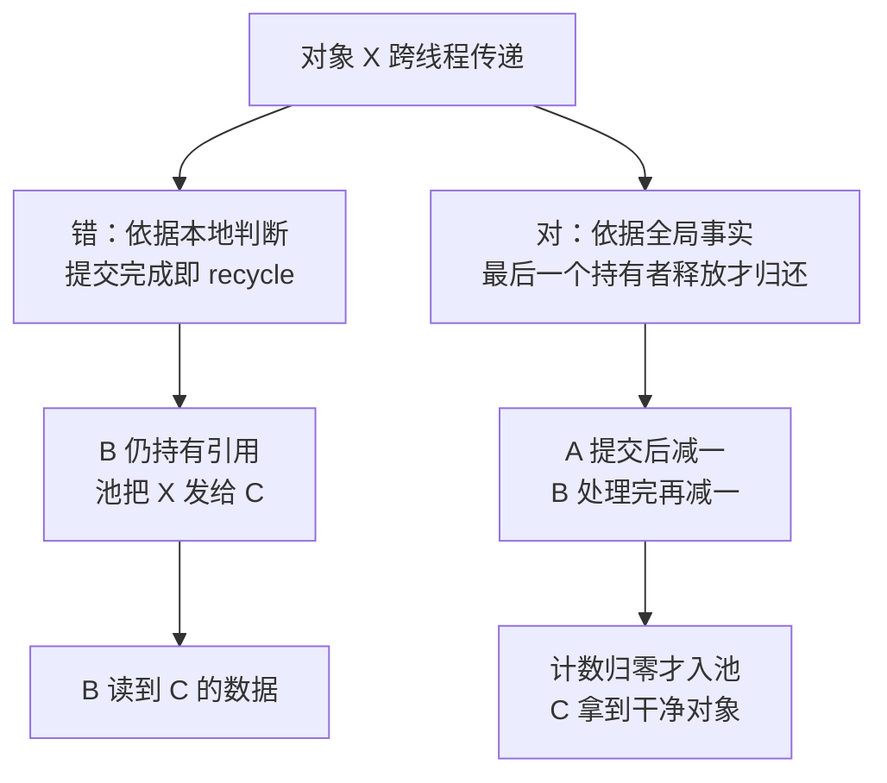

# 案例三十一：回收之后还在飞——跨线程复用可回收对象

**回收复用对象的前提是它已经没人引用**。**读完这篇你能判断对象何时才算真的空闲，也知道省下的内存为什么抵不过损坏的数据**。

> **要点**：**回收复用对象的前提是对象在复用前已无人引用。它还在另一个线程的处理链上时，两个使用者会同时改写同一块内存，省下的内存抵不过损坏的数据**。

**对象池是一项以复杂度换内存的技术**。它把"用完即弃"改成"用完归还、下个人接着用"，代价是引入了一条新的正确性约束：**归还的时刻，必须没有任何一方还持有引用**。**这条约束在单线程里容易满足，跨线程时极易违反**。本篇要解决的问题是：**跨线程时"归还"这个动作的前提怎么被悄悄破坏**。Apache Pulsar（分布式消息队列）的这组病例展示了两种形态。

## 这个案例发生在什么场景

**项目**：Apache Pulsar——分布式的消息与流处理平台。它的 broker 为减轻分配压力而回收复用临时对象，复用的前提是否成立，就是本篇追问的事。

**Broker 面对高吞吐场景，每条消息的处理都会产生临时对象**：位图（记录批内确认状态）、读取操作上下文（`OpReadEntry`）等。**这些对象数量巨大、生命周期短，频繁分配会给 GC 造成压力**。

**标准解法是对象池：用 `Recycler` 这类机制回收这些对象，归还后复用**。这些对象通常带有 `recycle()` 方法，处理完成后调用它把对象还回池里。

引入对象池的同时，引入了一个关键约束：**调用 `recycle()` 意味着"我用完了，别人可以改它了"**。这个声明必须是真的。

## 要解决的到底是什么：两种越界的复用

**病例 A（[上游 commit 498571de](https://github.com/apache/pulsar/commit/498571defea6)，P1）**：**同一个 `ConcurrentBitSetRecyclable` 在不同线程之间被复用。位图对象记录批内哪些消息已确认，它在处理链上被传递；某个环节提前回收了它，而另一个线程仍在使用——两个使用者随后改写同一块内存**。

**病例 B（[上游 commit f68bf2be](https://github.com/apache/pulsar/commit/f68bf2be85cf)，P1）**：**Broker 因等待游标过多而 OOM（Out Of Memory，内存或显存不够分配而崩溃），同时复用了已回收的 `OpReadEntry`**。**这里除了正确性问题还有容量问题：等待游标的数量不受控，积压导致内存耗尽**。

两个病例的共性：**对象的实际生命周期长于回收方假设的生命周期**。回收方认为"处理完了"，实际还有另一方持有引用。

来源：[小林coding《揭开 Buffer Pool 的面纱》](https://www.xiaolincoding.com/mysql/buffer_pool/buffer_pool.html)

## 为什么是问题：错误发生在别人的代码里

**症状出现在无辜的地方。** **对象被复用后，两个使用者交替写入。当使用者 A 读到被使用者 B 改写的内容时，A 的代码会表现出逻辑错误——这个错误的根因在回收方。堆栈指向 A，责任在别处**。

**它以数据损坏的形态出现。** **复用不会抛异常，只会让读到的数据变成别人的数据**。表现为"确认状态莫名其妙变了"、"读到的条目不属于这个订阅"这类无法解释的现象。

**概率极低且不可复现。** 需要两个线程的处理在特定的时间窗内交叠。在负载低时永远不发生，在负载高时偶发。这让它在测试中几乎抓不到，在生产中表现为"偶发的诡异问题"。

**调试会破坏现场。** 加日志、加断点、降低并发都会改变时序，问题随之消失。**这是所有并发缺陷的共同特征，对象池复用尤为严重——复用本身依赖精确时序**。

**内存优化与正确性在此对立。** **引入对象池的目的是省内存。保证复用安全需要引用计数或所有权转移，这些机制本身有开销。这是一个真实的取舍，"小心一点"抵不掉这笔账**。

## 本质是什么：归还的语义是"所有权转移"，必须真的无人持有

回旋镖是所有权转移的一件教具：**掷出的人默认它会飞回来被自己接住，这条隐含约定成立的前提是飞行路径上没有别人**——半路被旁人接走或者撞上，掷出者的"它会回来"就落空。对象池的 `recycle()` 是同一条约定的代码版：调用方声明"我扔回去了，池子可以把它给别人"，这个声明的真值取决于此刻真的没有第二个人还攥着它：

*图源：Wikimedia Commons，A.Savin，FAL 1.3，https://commons.wikimedia.org/wiki/File:Wooden_boomerang_asv2021-05.jpg。*

把归还这个动作隐含的前提抽象出来，骨架是：

> **回收一个对象等价于声明"我不再使用它，所有权交还给池"；这个声明成立的前提是没有任何其他方持有引用。跨线程时，"处理完成"与"无人引用"是两件事——前者是本地判断，后者是全局事实。**

这条骨架的关键区分是**本地判断与全局事实**。

**回收方能看到的是"我这段代码处理完了"。这是本地判断，它在本线程内是准确的。它看不到的是"是否有别的线程还拿着这个对象的引用"。这是全局事实，需要跨线程的可见性才能获得**。

单线程场景下，两者等价——本线程处理完，就没有别人在用。跨线程场景下，两者分离：**本地处理完成不蕴含全局无人引用**。

第二个要点是**所有权这个概念在池化场景下是显式的**。**不使用对象池时，对象由 GC 管理，只要有人引用就不会被回收——引用本身就是所有权的体现，且这个机制是自动正确的**。使用对象池后，所有权交还变成了手动动作，**正确性从"由语言保证"退化成"由程序员保证"**。**这是对象池的真实成本，也是为什么它应当排在优化手段的最后**。

第三个要点是**传递链越长，判断越难**。**对象如果在一条长的处理链上被传递（线程 A 创建 → 线程 B 处理 → 线程 C 回调），任何一个环节都无法单独判断"现在还有没有人用"**。链上每个参与者都需要知道自己在链上的位置，而这个知识通常是局部的。

## 打个什么比方：餐桌翻台时上一位客人的菜还没吃完

餐厅为了多接客人，采用翻台：一桌客人用完，服务员立刻清台，下一桌坐下。

正常情况没问题。但假设上一位客人其实还没走——他去结账了，还打算回来拿留在座位上的东西。服务员看到座位空了（本地判断：我这边没人了），就清台并安排了新客人。

新客人开始点菜、摆餐具。上一位客人回来，发现自己的东西没了，桌上摆着别人的菜。他可能直接拿走"自己"的东西——那其实是新客人的。

问题不在新客人（他被告知这桌是他的），也不完全在服务员（他看到座位确实空了）。问题在于**"座位空了"这个判断不足以推出"上一位客人不会再回来"**。需要一个明确的信号——比如客人说"我走了，东西都拿齐了"。

**对象池里的 `recycle()` 就是服务员的"清台"。它需要的前提是"所有会用到它的人都真的用完了"，"我这边处理完了"离这个前提还差一段距离**。

## 它是怎么做到的：回收点与使用点分离

被复用的对象在芯片上没有自己的地址——它只是几个核共享的缓存与寄存器之间流转的一段内存。下图是一枚微处理器的裸片显微照片：可见的区域里绝大多数是执行单元与缓存，线程之间「谁在什么时候用什么」的约定，全靠代码自己维持。

> 图：Ferranti F100-L 微处理器裸片，来自 [Wikimedia Commons](https://commons.wikimedia.org/wiki/File:Ferranti_F100-L_Microprocessor_Die_Photograph.jpg)，CC BY 4.0，摄影 Revaldinho。

两个上游提交的改动分布在客户端与 broker 两侧的处理路径上：客户端侧涉及位图与消息实现（`pulsar-client` 的 impl 包），broker 侧涉及读取操作上下文与游标（`pulsar-broker` 的 service 包）。具体文件与改动内容以两个 commit 的 diff 为准，本篇不展开。

这类复用收敛成一个典型的风险形态：

1. 线程 A 创建一个可回收对象，填入数据，交给处理链。
2. 处理链跨越线程边界——对象被提交到另一个线程的执行队列。
3. **线程 A 侧的逻辑认为"我提交完了"，调用 `recycle()`**。
4. **线程 B 尚未开始或正在处理，它持有的是已被归还的引用**。
5. **线程 C 从池中取出同一个对象，填入自己的数据**。
6. 线程 B 读取到线程 C 的数据。

三个线程与池之间，同一个对象在时间轴上换了几次手：

图："第 3 步与第 6 步之间隔了什么"——**A 归还的那一刻 B 还没开始，池不知道 B 手里有引用，于是把 X 发给了 C。B 与 C 都以为 X 只属于自己**。

这里第 3 步是错误发生的地方，但它在线程 A 的视角里完全合理——提交动作确实完成了。**错误在于把"提交完成"等同于"处理完成"**。异步编程里这两者天然分离，对象池却要求它们一致。

`ConcurrentBitSetRecyclable` 这个类名有自己的误导性：它是"并发的位图"且"可回收的"。**前缀 `Concurrent` 保证的是多线程同时访问不破坏内部结构，与"是否可以被安全地回收复用"完全是两件事**。这与 [[工程知识/缺陷分析：从个案到体系/并发/案例十九：在回调里改自己——清理路径的重入与回收后复用|案例十九]] 中的观察一致：**线程安全不等于生命周期安全**。

**上游修复的方向是确保回收只发生在真正无引用时：要么让对象的生命周期不跨线程（在单一线程内完成使用与回收），要么引入引用计数，让回收在所有持有者都释放后才真正归还**。

## 怎么发现：让复用暴露出来

**在池化对象里加"代际"标记。** 每次被取出时递增一个序号，使用时记录取出时的序号，操作前校验序号未变。序号变了说明对象已被回收复用——这能把数据损坏变成一个可捕获的错误。五种手段里它兼顾了检测可靠性与实现成本：毒药值只能发现部分复用，小池测试只适合排查阶段，代际标记则在每个使用点持续校验。

**回收时写入毒药值。** `recycle()` 时把关键字段填充为明显的非法值。使用者读到毒药值就知道自己拿到了已回收的对象。这能让问题在开发期暴露，而不是在生产中表现为诡异的逻辑错误。

**在测试中提高并发与池的压力。** 把池大小调到极小（比如 1），迫使对象被快速复用。原本概率极低的碰撞会变成必然发生。这是把并发缺陷变成确定性缺陷的标准手法。

**审查时追踪对象的完整传递链。** 对每个 `recycle()` 调用点，列出所有可能持有该引用的路径，确认它们都已完成。这个清单在异步代码里往往比想象的更长。

**监控池的分配速率异常。** **如果对象被复用得异常频繁（分配次数远高于活跃对象数），可能存在提前回收——本该在使用中的对象被还回了池**。

## 上游怎么修

**两处修复的方向一致：让回收时机跟随真实生命周期**。具体形态包括确保对象不在线程间共享、在确认所有持有者都完成后才回收、以及（在病例 B 中）限制等待游标的数量以避免 OOM。（内存耗尽，进程申请不到需要的内存）"什么时候可以归还"这个判断依据换掉之后，结局怎么变：

图："修复改了哪个判断"——两条路里 `recycle()` 的调用点都还在，改的是它生效的条件——从"我这一段结束了"改成"所有人都结束了"。

病例 B 同时处理了容量问题：等待游标过多导致 OOM。这说明**回收相关的缺陷常常与容量问题相伴**——对象之所以被提前回收，往往是因为池不够用、压力太大。只修回收逻辑、不解决容量，问题会以另一种形式回来。

**修复前的实测里，仍有线程持有引用时回收没有被阻止，两个使用者交替改写了同一块内存——回收前提在修复前不成立，这就是缺陷本身**。修复后预期：有引用未归还时回收被阻止，改写不再发生。

## 这套说法在哪儿会失效，代价换来了什么教训

- **`recycle()` 的语义是所有权交还**，前提是全局无人引用，本地处理完成只是其中一半。
- **线程安全不等于生命周期安全。** **并发容器不保证对象可以被安全复用**。
- **异步场景下"提交完成"不等于"处理完成"。** 对象池要求这两者一致，它们却天然分离。
- **对象池把正确性从语言保证退化成程序员保证。** 这是它的真实成本，应是最后手段。
- **用代际标记与毒药值把复用变成可捕获错误。** 否则它只会表现为无法解释的逻辑错误。
- **测试时把池调极小**，让概率性碰撞变成确定性失败。
- **回收缺陷常与容量问题共生。** 只修回收不解决压力，问题会换形态回来。

## 怎么自己动手验证

1. 上游对照：到 Pulsar 的提交 498571de 与 f68bf2be 里核对两种复用越界形态，确认正文的机制描述与修复方式一致。
2. 机制复现：**让 `ConcurrentBitSetRecyclable` 在一条跨越多个线程的处理链上传递，在仍有线程持有引用时调用 `recycle()`，修复前两个使用者交替改写同一块内存，表现为确认状态莫名改变**。

3. 容量侧复现：**持续增加等待游标数量直至内存耗尽，同时观察 `OpReadEntry` 是否在回收后被再次使用，两个问题按各自的判据分开记录**。
4. 边界核验：**把对象的使用范围限制在单线程内、处理完成即归还时行为正确；确认复用只在引用跨越线程边界时越界**。

5. 断言锚点：**复现需要精确时序且加日志会破坏现场，因此记录的是构造出的时序条件与内存改写证据，而非普通功能测试结果**。

## 接着读哪几篇：同在缺陷分析里的相邻问题

- 内存模型决定并发读写何时可见——[[工程知识/软件构建：让变化可以理解、验证与交付/语言与运行时/内存模型决定并发读写何时可见]]。
- 并发控制先定义共享状态——[[工程知识/后端系统：在并发、失败与变化中维持服务/任务与并发/并发控制先定义共享状态和完成条件]]。
- [[工程知识/缺陷分析：从个案到体系/并发/案例十九：在回调里改自己——清理路径的重入与回收后复用]] 讲回收后复用的另一种入口，清理路径的重入。
- [[工程知识/缺陷分析：从个案到体系/资源与容量/案例六：容量与泄漏——连接泄漏和 SST 堆积]] 讲病例 B 里那一半容量问题的通用形态。
- 导读见 [[工程知识/缺陷分析：从个案到体系/缺陷分析：从个案到体系——导读与开源地图]]。
