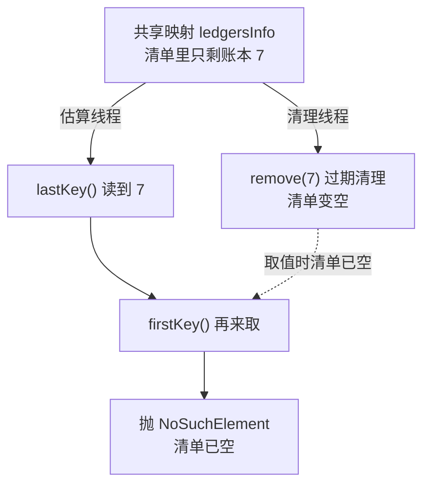
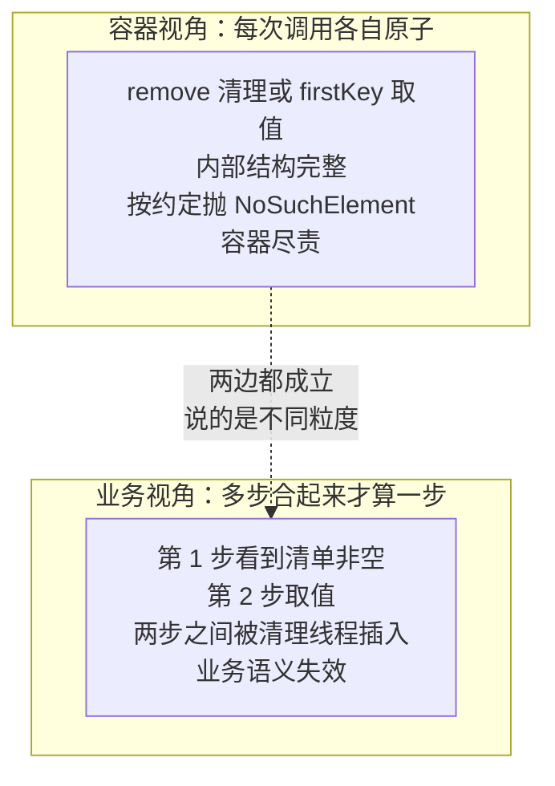
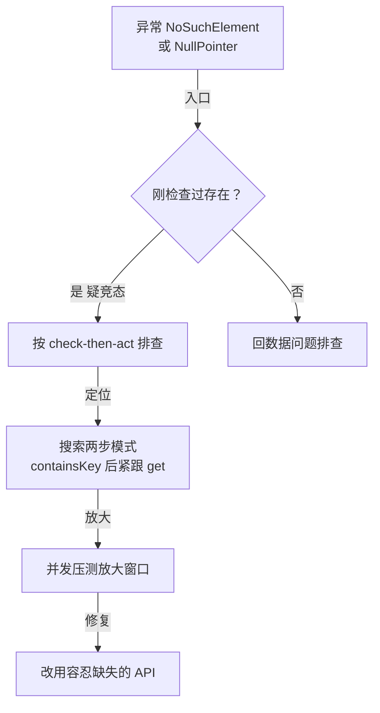

# 案例三十二：取到了已经不存在的那个——估算器的读取竞态

> **要点**：**从并发容器里"先判断存在、再取值"是两个操作，合起来没有原子性**；**两步之间元素可能被移除，取值就会抛"没有这个元素"——检查通过不代表取得到**。

**并发容器提供了很多原子操作（不可分割、要么全做要么不做的操作），但"检查然后取值"是两个操作**。**这个组合在并发下不成立，而它在代码里看起来天衣无缝**。本篇要解决的问题是：**这种组合为什么容易被误判为"不可能发生"，以及修它时该先问什么**。下面这个来自 Apache Pulsar（一个分布式的消息与流处理平台）的病例是一个干净样本。

## 这个案例发生在什么场景

项目：Apache Pulsar——分布式的消息与流处理平台。它的账本条目数估算器（estimator：不精确计数、只给一个"大概多少条"的估值供决策用的组件）在并发下必须返回一个数值，检查与取值之间的窗口构成本篇的问题。账本（ledger）是一段只追加的消息日志，一个主题的数据由一串账本接起来。

**`EntryCountEstimator` 用于估算从某个读取位置开始、给定字节数大约对应多少条消息**。**这个估算用于决定一次读取拿多少条，它不需要精确值——这是"估算"的意义——但它需要不抛异常**。

估算的依据是 `ManagedLedger` 维护的账本清单 `ledgersInfo`：**一个按账本 ID 排序的并发有序映射（`NavigableMap`，实现是 `ConcurrentSkipListMap`），记录每个账本的条目数与大小**。**随着账本的创建与过期清理，这个映射持续增减，读写并发发生**。

## 要解决的到底是什么：检查与取值之间，元素消失了

上游报告的现象见 [PR（Pull Request，拉取请求：请求把我的分支改动合入主干） #25177](https://github.com/apache/pulsar/pull/25177)，合并提交为 9b70ba30。P1 是本系列给缺陷定的严重等级，P0（最高级：崩溃、丢数据一类）次之，数字越大越轻。**现象是 `EntryCountEstimator` 抛出 `NoSuchElementException`**。

异常的来源是竞态（结果取决于执行时序、因而不可重现的并发缺陷）：**估算器先按"清单非空"的前提调整读取位置，调用 `ledgersInfo.firstKey()`、`lastKey()` 取最早与最新的账本 ID；另一个线程恰好在这之间把最后一个账本清理掉，清单变空**。**`NavigableMap` 对空映射调用 `firstKey()` 按约定抛出 `NoSuchElementException`**。

修复前的形态是这样的（按上游 diff 缩写），问题出在标注的两行：

```java
// 前面按 ledgersInfo 非空推进，调用方以为清单一定有东西
if (readPosition.getLedgerId() > ledgersInfo.lastKey()) {      // 另一线程此时 remove 掉最后一个账本
    Map.Entry<...> lastEntry = ledgersInfo.lastEntry();        // 可能已是 null
    ...
} else if (readPosition.getLedgerId() < ledgersInfo.firstKey()) {   // 空映射：抛 NoSuchElementException
    ...
}
```

**同一结构的更常见写法是 `containsKey` 后 `get`，或者从流里 `findFirst().get()`**。**这些代码在无并发时完全正确，评审时也很容易放行——"先检查再取"是顺序编程里最基本的防护模式**。**问题在于这个防护在并发下不成立：检查通过是过去的事实，取值是现在的动作，两者之间没有绑定**。


来源：[CSDN @bjmayor《图解分布式事务模式》](https://bjmayor.blog.csdn.net/article/details/154004146)（CC 4.0 BY-SA）

## 为什么是问题：它让估算功能整体失效

**异常发生在估算路径上，影响的却是读取。** **估算本身允许不精确，但它的调用方是读取逻辑：估算抛异常，这一次读取就失败，消费者拿不到消息**。**这类问题容易被当作"偶发异常，重试就好"而忽略，重试只是把失败推给下一次**。

**它是概率性的，且概率随并发度上升。** 低负载下两步之间的窗口极小，几乎不发生；账本频繁滚动与清理的高负载下频繁出现。**这让它在测试环境（低并发）完全不可见，在生产高峰暴露**。

**异常类型具有误导性。** **`NoSuchElementException` 听起来像"数据不存在"——一个业务意义上的空状态。排查时会去找"为什么这个主题没有账本"，而真实原因是"它有过账本，但在取值瞬间被清理了"**。**异常的名字把排查引向了错误的方向**。

**同一个组件上还积累着另一类缺陷。** [[工程知识/缺陷分析：从个案到体系/正确性/案例三十三：估算不等于算术——按大小推条目的错算]] 讲的是这个估算器的公式在边界输入上失真，与竞态是两类不同的缺陷——估算器这种"非关键但被多处依赖"的组件，容易同时积累多种问题。

## 本质是什么：检查与使用的组合不是原子操作

把这段检查与使用的序列抽象出来，骨架是：

> **先检查再使用（check-then-act）在并发下不成立，因为检查所依据的状态在使用发生时可能已经改变**；**唯一可靠的做法是使用一个本身包含检查的原子操作，或者接受失败并处理它**。

**这条规律的经典名称是 check-then-act 竞态，它有很多变体：**

- `containsKey` 然后 `get` —— 本例的形态。
- `isEmpty` 然后 `getFirst` —— 空集取首个元素。
- `isConnected` 然后 `send` —— 检查连接状态后发送。
- `exists` 然后 `read` —— 文件存在性检查后读取。这类窗口在安全领域有个名字：TOCTOU（time-of-check to time-of-use，检查时刻到使用时刻之间状态发生了变化），与本篇估算器的处境同构。

所有变体的共同结构是：**用一个过去的事实，为一个现在的动作做担保**。而并发下，过去的事实不为现在的动作担保任何事。

这类缺陷**不能靠"更快的检查"解决**。窗口再小也是窗口。**也不能靠 `synchronized` 随手包一下解决——除非读与写两侧用同一把锁保护，否则加锁只覆盖了一侧，竞态依然存在**。**修复必须让检查与使用成为一个不可分割的操作**，或者让使用本身能容忍缺失。

后一种思路在多数场景下更实用：**`getOrDefault`、`computeIfAbsent`、`Optional.orElse`、`pollFirstEntry`（取不到返回 null 而非抛异常）这些 API 之所以更好，正是因为它们把"取不到"变成了正常返回值**。这带来的收益在语义层：**把竞态从需要避免的问题降级为可以处理的结果**，写法简洁只是副产品。

## 打个什么比方：看了一眼货架就去拿

超市里被拿空的那格货架，是竞态窗口的实物形态——看的那一眼永远是几秒前的货架：


*图源：Wikimedia Commons《Empty bread shelf at supermarket》，作者 Maksym Kozlenko，CC BY-SA 4.0，https://commons.wikimedia.org/wiki/File:Empty_bread_shelf_at_supermarket.jpg。*

**看一眼与伸手拿是两个动作，中间隔着别人拿走商品的时间——货物消失不需要任何人做错事，每位顾客都按规则行动**。**并发清单的条目消失同理：清理线程按规则过期账本，估算线程按规则取值，NoSuchElementException 出在两段规则交错的地方**。

顾客在货架前看了一眼——那件商品在（检查通过），于是转身去拿（使用）。

就在他转身的两秒里，另一个顾客把那件商品拿走了。他伸手时货架空了。

"看了一眼"这个动作在他转身的那一刻是真实的，但它是**过去的事实**。它不能为"伸手能拿到"做担保。

有两个办法。一是**伸手就是检查**：不去"看一眼再拿"，而是直接伸手——拿到就有，拿不到就换一个。这对应 `getOrDefault` 这类原子 API，把检查与使用合并成一个动作。二是**接受可能拿不到**：伸手空了也不意外，本来就有这个可能，换了就是。

**对应不上的是"看得更仔细一点"——无论看得多仔细，转身的两秒里发生的事都看不到**。

## 它是怎么做到的：并发容器不保证组合操作的原子性竞态窗口所在的这一个类：

```
managed-ledger/src/main/java/org/apache/bookkeeper/mledger/impl/EntryCountEstimator.java
```

`ledgersInfo` 是 `ConcurrentSkipListMap`。这类容器的约定是：**单个方法调用是原子的**。`firstKey` 是原子的，`lastEntry` 是原子的，`remove` 是原子的。但它们的组合不是——容器没有任何机制知道你接下来要调用什么。

估算线程与清理线程在这几步之间的交错，容器每一步都正常，业务语义在组合处失效：



**一个常见的误解要澄清：并发容器保证的是内部结构的完整性，业务逻辑的原子性它不管**。`ConcurrentSkipListMap` 保证 `firstKey` 与 `remove` 交错时不会破坏内部链表结构，但它完全允许 `firstKey` 在上一个调用刚看到非空之后抛出"没有元素"。**容器工作正常，业务语义失效：上一步读的时候清单里还有账本，这一步取的时候清单已空，容器对这两次调用都尽了责**。

竞态的物理舞台是多个核心同时访问同一份共享数据。下图是 Apple M2（苹果 2022 年发布的电脑芯片，8 个核心）芯片的 CPU 性能功耗实测曲线——多核芯片上每个核心都在并行发出读写请求，估算线程与清理线程的交错就是这些并行请求流里的一对。


> 图：Apple M2 与 M1 的 CPU 性能功耗对比（WWDC22 发布材料），来自 [Wikimedia Commons](https://commons.wikimedia.org/wiki/File:Apple-WWDC22-M2-chip-CPU-perf-vs-power-01-220606_big.jpg.large.jpg)，公有领域，Apple Inc.。

这与 [[工程知识/缺陷分析：从个案到体系/并发/案例十九：在回调里改自己——清理路径的重入与回收后复用]] 与 [[工程知识/缺陷分析：从个案到体系/并发/案例二十：关闭之后还有人在用——生命周期的时序竞态]] 属于同一族——三者都在说：**并发原语提供的保证，与业务代码需要的保证，是两件事**。差别在于：案例十九是重入语义，案例二十是生命周期，本例是组合操作的原子性。

三种缺陷看起来不同，落到同一张图上就是同一件事——两侧的粒度不匹配：



上半部分每一步都符合容器约定，下半部分合起来才是一次业务操作。**容器保证的是一次调用内部不出错，业务需要的是"看一眼再拿"这两步之间没人插进来——容器没有立场保证后者，它不知道调用方接下来要做什么**。

## 怎么发现：把"不可能"的异常当线索

**把 `NoSuchElementException`、`NullPointerException` 这类异常当作竞态信号。** **尤其当异常发生在"刚刚检查过存在"的路径上时，几乎可以确定是 check-then-act。这条决定排查方向，排在其余手段之前**。

排查这类缺陷的路径由四步串成——异常类型入口、模式匹配定位、并发压测放大、选用修复——其中模式匹配是唯一能自动化的那一步。



**在代码里搜索两步模式。** `containsKey` 后紧跟 `get`、`isEmpty` 后取元素、`firstKey`/`lastKey` 这类空集合会抛异常的方法、`isXxx` 后 `doXxx`。这些模式在并发上下文中都是嫌疑人。**静态检查工具通常不报这类问题，需要靠模式匹配与人工审查**。

**用并发压力测试暴露。** 让读写在同一批键上高频交错。把线程数调高、把检查与取值之间人为插入延迟（测试专用），能让窗口放大，把概率性变成必现。**在测试里故意放大竞态窗口，是发现这类缺陷最有效的手段**。

**记录异常发生时的并发上下文。** 异常日志里带上"当时有多少线程在这个结构上操作"，能帮助判断是否竞态。

**审查时对每个"检查"问一句：这个检查的结果在多长时间内有效？** 如果答案是"只在当前这一瞬间"，那么任何依赖它的后续操作都需要重新审视。

## 上游怎么修

**修复走的是"接受失败并处理它"这条路**，三处改动都在 `EntryCountEstimator` 里：**进入估算前先查 `ledgersInfo.isEmpty()`，空清单直接返回 1（估算做不出来时的保守值，读取至少拿一条）**；**把调整读取位置的逻辑抽成 `adjustReadPosition`，外面包一层 `catch (NoSuchElementException)`，同样返回 1，注释写明"清单在调用前一刻被清空的竞态"**；`lastEntry()` 的返回值加空检查并核对键没变。附带的三个单元测试用 mock（替真实对象挡在测试里的替身对象，可指定它的行为）让 `firstKey()`、`lastKey()` 分别在 `isEmpty()` 返回 false 之后抛异常，把"检查通过之后才变空"这个窗口直接钉进测试。

**修复没有加全局锁。加锁能解决问题，但会把一个高频读的路径串行化——对于估算器这种被多处调用、又允许不精确的组件，代价不划算**。**选择合适的处理方式比加锁更符合这里的场景**：**估算允许不精确，那么"取不到就按最小值算"是完全可接受的业务语义**。

这提示了一个判断顺序：**先问业务能否容忍缺失，能容忍就让缺失变成正常返回值；不能容忍才考虑加锁或用更强的原子结构**。跳过第一步直接加锁，是常见的过度设计。

## 这套说法在哪儿会失效，代价换来了什么教训

- **check-then-act 在并发下不成立。** 过去的事实不为现在的动作担保。
- **并发容器保证结构完整，不保证业务原子。** 单个方法原子，组合不是。
- **`NoSuchElementException` 常常是竞态信号，不是数据缺失。** 排查方向不要被异常名误导。
- **优先让缺失变成正常返回值，加锁放在后面考虑。** 先问业务能否接受缺失。
- **测试里人为放大竞态窗口**，把概率性失败变成必现。
- **"检查"的有效期只有一瞬间。** 任何依赖它的后续操作都要重新审视。


## 怎么自己动手验证

1. 上游对照：到 Pulsar 的 PR #25177 里核对修复方式，预期看到 `isEmpty()` 前置检查、包住 `adjustReadPosition` 的 `catch (NoSuchElementException)` 与 `lastEntry()` 的空检查三处，**修复方向是接受失败并返回保守值 1，没有加锁**。
2. 机制复现：让一个线程反复调用估算，同时另一个线程清空 `ledgersInfo`（或按上游测试用 mock 让 `firstKey()` 在 `isEmpty()` 返回 false 之后抛异常）。**预期修复前抛出 `NoSuchElementException`、修复后返回 1；判定标准是单线程下不抛异常、引入并发后才抛，若单线程也抛说明另有原因**，不归入本例。
3. 边界核验：**把并发度降到单线程时行为正确，确认症状只在检查与取值之间存在并发窗口时出现**；核对 `containsKey` 加 `get`、`firstKey()` 与从流里 `findFirst().get()` 三种写法是否都存在同一问题。
4. 调用点核验：**检查估算结果被哪些读取逻辑消费，确认修复前的异常会让那一次读取失败**。
5. 断言锚点：**复现脚本固定并发窗口、异常类型与调用位置有记录、修复后同场景不再抛出**。

## 接着读哪几篇：同在缺陷分析里的相邻问题

- 并发控制先定义共享状态与完成条件——[[工程知识/后端系统：在并发、失败与变化中维持服务/任务与并发/并发控制先定义共享状态和完成条件]]。
- 内存模型决定并发读写可见性——[[工程知识/软件构建：让变化可以理解、验证与交付/语言与运行时/内存模型决定并发读写何时可见]]。
- [[工程知识/缺陷分析：从个案到体系/正确性/案例三十三：估算不等于算术——按大小推条目的错算]] 讲同一估算器上的另一类缺陷，公式在边界输入上失真。
- [[工程知识/缺陷分析：从个案到体系/并发/案例三十一：回收之后还在飞——跨线程复用可回收对象]] 讲另一种"过去的判断为现在的动作担保"——归还时以为没人再用。
- [[工程知识/缺陷分析：从个案到体系/并发/案例二十：关闭之后还有人在用——生命周期的时序竞态]] 讲检查与使用之间被关闭挤进来的同族竞态。
- 导读见 [[工程知识/缺陷分析：从个案到体系/缺陷分析：从个案到体系——导读与开源地图]]。
