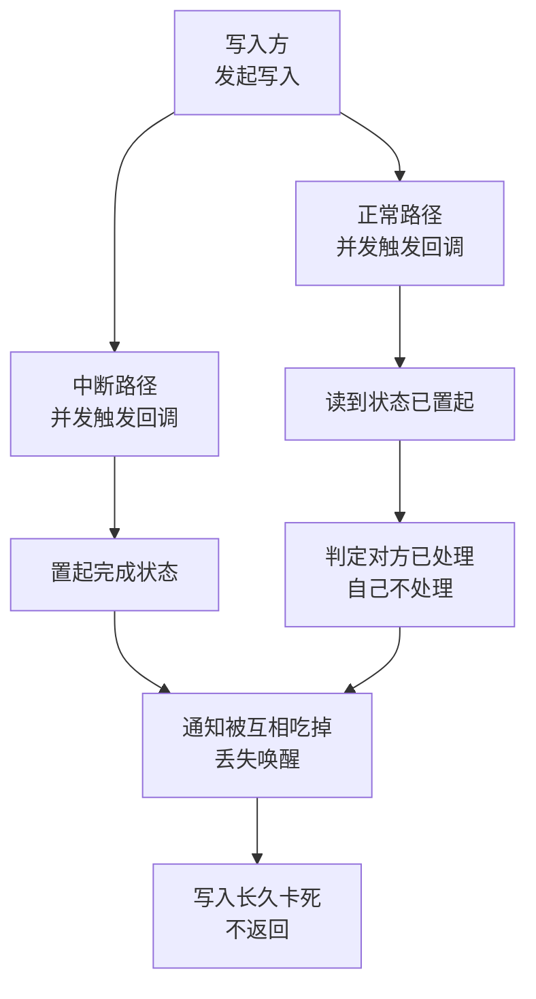
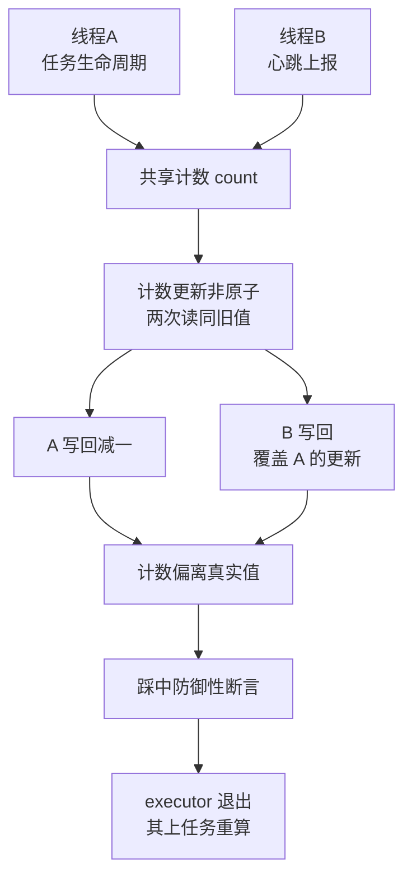

# 案例三：并发两面——写回调卡死与心跳竞态

> **要点**：并发缺陷的两个出口：写完成回调的丢失唤醒让一条写入永久卡死；指标计数的竞态让 executor 断言退出、全部任务重算。解法分别是把回调入口收敛成一个、把共享计数改成原子操作。

并发缺陷有两种典型出口：一种是**卡死**——资源等一个永远不来的通知，流程停在那里；一种是**崩溃**——两个更新抢一个变量，计数错乱，触发断言直接退出。这一篇解剖两个真实病例，一个来自 BookKeeper 客户端，一个来自 Spark executor（Spark：分布式计算引擎，靠内存计算加速大规模数据处理；executor 是其执行任务的进程），**正好一左一右**。

## 要解决的问题是什么：写回调为什么会卡死（BookKeeper，P1）

背景：客户端向账本写入条目时连接中断。中断本身有处理逻辑——**失败回调通知上层重试**。问题出在回调的并发上：**完成回调可以从多条路径并发触发**，两条路径同时进入时，写完成的通知被对方"吃掉"，**该条目的写入长久卡死不返回**。

### 写回调为什么互相吃掉通知：病例一机制

先把形状说成一件事：丢失唤醒像两个人合守一部电话、约定"铃响谁先听到谁接"——突然同时来电，两人都瞥了一眼对方以为对方会接（都读到"已置起"的共享状态），结果铃声停了话没人接（通知被互相吃掉），打电话的人永远等不到回音（写入卡死）。修复就是立一条新规矩：这部电话只有一个值班员（回调按账本串行化，单一入口）。这个比喻到"单一值班员"为止——现实里值班员还要记值班日志（失败回调通知上层重试），交接规则要看代码的并发结构，下面展开。

写入的完成路径没有做串行化。连接中断与正常完成是**两个可能的回调来源**，谁先到谁处理；并发到达时，**双方都从同一个共享状态读到"已置起"，据此判定对方已完成处理，结果谁都没真正完成——经典的丢失唤醒**。[上游 commit 804b2b61](https://github.com/apache/bookkeeper/commit/804b2b611c6a11b42ca0307dd9803c16b9cc3915) 的修复是**把写完成回调按账本串行化执行**，让**"处理完成"这件事永远只有一个入口**。

两条回调路径并发到达时互相吃掉通知，写入从此等一个不会来的完成信号：



## 病例二：心跳竞态（Spark，P1）

背景：Spark executor 上有一个指标计数，任务启动/结束和后台心跳（周期性发送用于确认存活的信号）上报并发更新。**某个竞态窗口里计数会丢失**，executor 进程断言退出——**它上面跑着的所有任务全部失败重算**。

### 计数怎么被改错的：病例二机制

计数更新**不是原子操作**（不可分割、要么全做要么不做的操作），任务生命周期事件和心跳轮询两个线程交错读写时，**一次更新被覆盖**。计数随后偏离真实值，踩中防御性断言，**进程自杀**。[上游 commit b43e38b3](https://github.com/apache/spark/commit/b43e38b38ee132ff974f12e506bf5bf4457fb038) 的修复是**把计数改成原子操作，关闭竞态窗口**。


来源：[CSDN @bjmayor《图解分布式事务模式》](https://bjmayor.blog.csdn.net/article/details/154004146)（CC 4.0 BY-SA）


来源：[小林coding《TCP 三次握手与四次挥手面试题》](https://www.xiaolincoding.com/os/1_hardware/tcp_interview.html)（CC 4.0 BY-NC-SA）


## 这一类为什么比一般缺陷难抓


竞态那一侧的关键在「读—改—写」三步之间的窗口——两个线程读到的是同一个旧值，谁的更新被吃掉决定了**断言会不会触发：**



交错窗口里被吃掉的那次更新，最终以断言退出的形式表现出来——这就是竞态类要用原子操作关掉窗口的理由。

两个病例放在一起看，并发缺陷的共性很清楚：

- **触发依赖时序，不是所有环境都能复现**。负载轻的时候竞态窗口可能几天不出现，一上量就频繁爆发——这也是它常被误判为"环境问题"的原因。
- **卡死比崩溃更难排查**。崩溃留下断言信息和 core dump，**卡死只有"不返回"——没有错误、没有日志**，任务挂在那里。你首先要发现"它卡了"，然后才能问"卡在哪"。
- **爆炸半径不可控**。Spark 那条的竞态在指标计数上，看起来只是监控数据的事——结果断言挂在计数上，**executor 整个退出，上面所有任务重算**。看起来无害的共享状态，炸起来波及的是整台进程。

## 上游把闸门装在哪：上游的修复

两个修复给出并发缺陷的两种标准解法，按场景选用：

Spark 那条的竞态窗口用一段时序就能说清：

```
线程A（任务结束）：  更新计数 count -= 1
线程B（心跳上报）：  读取 count，断言 count 与任务数一致
交错：A 更新到一半时 B 恰好读取 → 计数偏离真实值 → 断言退出
```

这类缺陷的代价在**于归因：卡死的不报错**，崩溃的信息又指向无辜的断言，需要的是**把时序本身当成可以构造、可以重复的实验条件**——这也是并发缺陷的复现成本高于其他家族的原因。

- **卡死类：把并发入口收敛成一个**。完成路径串行化、回调按账本有序执行——**同一时刻只有一条路径处理完成，丢失唤醒失去存在条件**。

入口收敛的实物原型是四合院的大门：一座院子几十间房、几十口人，进出只走这一扇门——所有通行在同一个门口排队，谁也不会错过谁：


*图源：Wikimedia Commons，作者 Joakim_Emanuelson，CC BY-SA 3.0，https://commons.wikimedia.org/wiki/File:Colorful_hutong_gate_in_Beijing.jpg。*

丢失唤醒的病灶是**两条回调路径各开了一扇「门」，通知在两扇门之间互相错过**；上游修复做的正是拆掉其中一扇——**写完成回调按账本串行化，全部完成事件从同一个入口进出**，"对方已处理"的误判从此没有产生条件。
- **竞态类：把非原子的读写换成原子**。计数、状态标志这类**单个变量的竞争**，用原子操作关闭窗口；**跨多个变量的不变量则要用锁或把状态收敛到单线程**。

阻塞复现要与两条路径同时触发对账——预期在连接中断与正常完成两条路径同时回调时该写入应完成，实测长久不返回，与预期对不上。

## 这两个病例留下什么教训：边界与教训

- **修复之后压测要加量**。并发修复的价值要用高并发验证——**修复前的竞态窗口可能只在千分之一的时序里出现，普通功能测试测不出区别**。
- **断言是双刃剑**。它让"计数错了"变成"进程立刻退出"，防止错误数据扩散——但也**把一个数据问题升级成可用性问题**。挂断言之前先想清楚**爆炸半径**。
- **回调路径和主路径要当成两条代码路径来审**。它们共享的状态、各自的触发条件、交叉时的先后——**并发审查审的就是这张交叉表**。
- **"偶尔发生"是并发缺陷的常态而非疑点**。复现要靠**构造时序**，不能靠多跑几次碰运气。

它影响的不只是那一个卡住的写入——**卡死的回调会占住账本的处理槽位，同账本后续写入全部排队**；断言退出则让 **executor 上所有任务重算**。修复的收益也在这里：**串行化与原子化不只是修一个症状，而是把整类时序窗口一起关掉**。


## 修复后怎么验证：验证

1. **上游对照**：到 BookKeeper 的提交 804b2b61 与 Spark 的提交 b43e38b3 里核对两处修复，确认**一处把写完成回调按账本串行化、一处把计数改为原子操作**。
2. **机制复现（卡死类）**：在连接中断与正常完成两条路径上**同时触发**票据写入的完成回调，修复前**该条写入长久不返回、同账本后续写入全部排队**。
3. **机制复现（竞态类）**：让任务启动结束事件与后台心跳上报并发更新同一计数，修复前**计数偏离真实值并触发防御性断言，executor 退出、其上任务全部重算**。
4. **边界核验**：压测量加大后再验证修复效果，**普通功能测试的并发强度测不出差异**；确认**单路径顺序调用不触发症状**。
5. **断言锚点**：构造出的时序条件、**卡死时无日志无错误这一特征**、断言退出的爆炸半径，三项都留档。

## 接着读哪几篇：期望与现实的偏差

- [[工程知识/缺陷分析：从个案到体系/缺陷分析方法——三分离、判定树与五步法]]
- [[工程知识/缺陷分析：从个案到体系/稳定性/案例一：垃圾回收线程的终止——BookKeeper 磁盘写满]]
- [[工程知识/缺陷分析：从个案到体系/缺陷分析：从个案到体系——导读与开源地图]]
- [[工程知识/缺陷分析：从个案到体系/并发/写入路径的串行化边界：回调换了线程，不变量就换了主人]] —— 讲串行域机制与"回调回属主"的通用纪律，是本病例修复动作背后的方法面
- [[工程知识/缺陷分析：从个案到体系/并发/回调必须回到属主线程：完成通知的线程归属纪律]] —— 讲错误分支回调的线程归属与出口收敛模式
- 相关变体：[[工程知识/缺陷分析：从个案到体系/并发/案例十四：一方取消，旁观者陪葬——RocksDB 状态加载的并发陷阱]]
- [[工程知识/后端系统：在并发、失败与变化中维持服务/任务与并发/分布式锁的正确与错误用法：fencing与租约.md]] —— 并发时序病理的案例解剖
- 两个更新交错时谁先谁后由什么决定——[[工程知识/软件构建：让变化可以理解、验证与交付/语言与运行时/内存模型决定并发读写何时可见]]。
- 设计并发逻辑前先回答哪两个问题——[[工程知识/后端系统：在并发、失败与变化中维持服务/任务与并发/并发控制先定义共享状态和完成条件]]。


- [[工程知识/缺陷分析：从个案到体系/并发/计数的语义取决于读的时机：两遍读数与重新取值是并发界的老坑]] —— 计数读时机这一并发老坑的方法面
