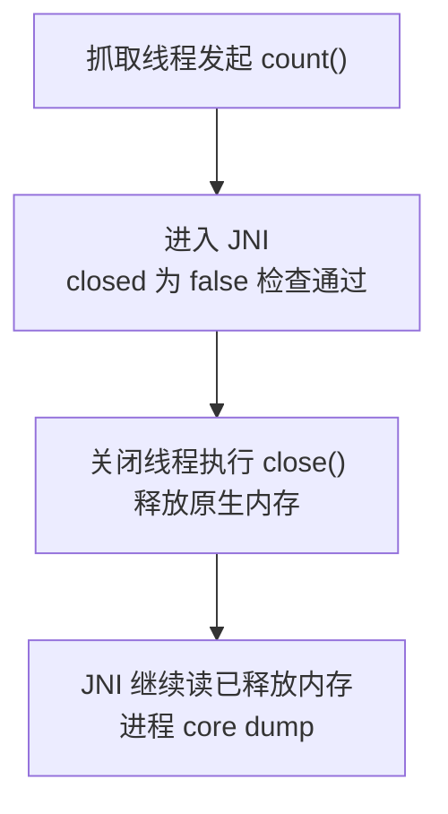
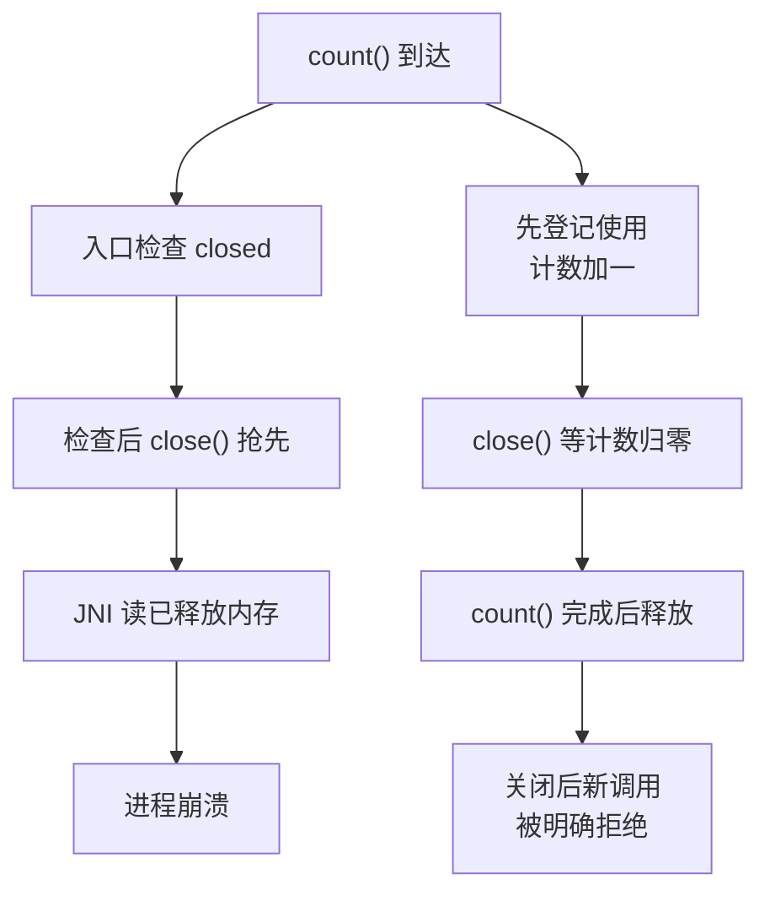

# 案例二十：关闭之后还有人在用——生命周期的时序竞态

**关闭和使用是两条独立触发的路径**。**读完这篇你能把"正在使用"计入关闭的等待条件，挡住使用者拿到已释放句柄（程序持有的资源引用标识）这类事故**。

> **要点**：资源的关闭与使用是两条独立触发的路径；**当"正在使用"这件事没有被计入关闭的等待条件，关闭就会在使用完成前发生，使用者拿到的是一个已释放的句柄**。

**关闭一个资源，代码上是一行 `close()`。但语义上，它意味着"此后不再有人使用"**。**这个"此后"要靠谁来保证？如果关闭方不知道还有人在用，那么这行调用就是在赌**。本篇要解决的问题是：**谁来保证关闭时刻已经无人使用**。Apache BookKeeper 的这个病例展示了赌输的样子——**进程直接 core dump（进程异常终止并转储内存现场）**。

## 这个案例发生在什么场景

**项目**：Apache BookKeeper——为日志条目提供低延迟、可持久化写入的分布式日志存储服务。它的元数据组件封装了 RocksDB（嵌入式键值存储引擎）实例，关闭路径与使用路径谁先谁后，就是本篇追问的事。

观测路径在 Kubernetes（容器编排平台，负责容器的部署、调度与自愈）里被做成了显式机制：官方文档把启动、就绪、存活三类探针（向系统注入的检测点或检测请求）并列，「区分进程活着和可以接收业务」写成文档章节——探测源独立于业务线程，探针调用的接口在组件关闭后的行为因此必须被定义：


*图源：[Kubernetes 官方文档](https://kubernetes.io/docs/tasks/configure-pod-container/configure-liveness-readiness-startup-probes/)（页面截图，2026-09-27）。本病例的观测路径（周期性 `count()` 抓取）与这条机制同构：观测方不关闭组件，但观测方调用的方法必须保证关闭后安全返回。*

Bookie（BookKeeper 里负责存数据片段的服务实例）节点用 RocksDB 存储若干元数据，封装在 `KeyValueStorageRocksDB` 这类组件里。**RocksDB 实例的生命周期与它所属的组件绑定：组件关闭时，底层的 RocksDB 数据库随之关闭，本地分配的原生内存被释放**。

同时，这些组件对外提供统计接口。**例如 `count()` 返回条目数量——它会被监控系统周期性调用**——上游报告里明确提到，触发源很可能是 Prometheus（主动拉取并存储指标的开源监控系统） 即开源指标监控与告警系统的指标抓取。

于是两条路径并存：**运维路径**（组件关闭、数据库释放）与**观测路径**（周期性拉取统计、调用 `count()`）。它们的触发源完全独立，彼此不知道对方的存在。

## 要解决的到底是什么：在已释放的内存上继续读

上游报告的现象（[上游 commit 3795f559](https://github.com/apache/bookkeeper/commit/3795f559e006)，P0）是进程 core dump，崩溃点位于 `KeyValueStorageRocksDB.count()` 的调用路径上。

**崩溃的时机是：RocksDB 数据库已经关闭，而 `count()` 仍在执行或刚开始执行**。数据库关闭会释放原生内存与句柄；**此后通过 JNI（Java 与原生 C/C++ 代码互调的接口）访问这些原生资源的操作，访问的都是已经不属于自己的内存**。这类访问的后果不由 Java 层决定：没有 `NullPointerException` 可以捕获，**进程直接崩溃**。

这里要分清两种错误。"空指针"是逻辑错误，调用了不该调用的东西；本例是**生命周期错误**，调用的东西没错，错在**调用发生的时刻，被调用的对象已经不在了**。


来源：[CSDN @bjmayor《图解分布式事务模式》](https://bjmayor.blog.csdn.net/article/details/154004146)（CC 4.0 BY-SA）


## 为什么是问题：崩溃、不可捕获、归因难

**它不可捕获。** Java 的异常机制管不到原生层的内存访问。代码里写满 `try/catch` 也无济于事——崩溃发生在 JNI 边界之外。**"加个异常处理"对它无效，只能在时序上解决**。

**它概率极低。** 关闭是一个短暂动作，指标抓取是周期性动作，两者重叠的时间窗极窄。这个缺陷可能在一个集群上跑几个月才出现一次。**低概率让它在测试中几乎不可能复现，也容易让它在生产环境被归为"偶发崩溃"而不了了之**。

**它伴随进程退出。** **core dump 意味着整个节点退出，比一次请求失败严重得多。对于存储节点，这会触发副本切换与数据恢复流程，影响远超一个节点**。

**归因困难。** 崩溃堆栈指向 `count()`，看起来像是 `count()` 写错了。真正的错误在"谁允许它在数据库关闭后被调用"——这个责任方在堆栈上不出现。这与 [[工程知识/缺陷分析：从个案到体系/稳定性/案例一：垃圾回收线程的终止——BookKeeper 磁盘写满|案例一]] 的情形一致：**暴露点与发生点分离**，日志与堆栈都无法直接连接两者。

## 本质是什么：关闭的语义要求"无人使用"，但没人检查这个前提

把关闭这个动作的前提抽象出来，骨架是：

> **当一个操作的前置条件是"没有其他操作正在使用目标对象"，而这个前置条件没有被显式检查或等待，那么操作只能在概率上成立。前置条件被违反时，后果由最底层的内存语义决定。**

这句话里"在概率上成立"是要害。这类代码有个特点：**它在绝大多数时候是对的**。没有并发冲突时，关闭就是安全的。逻辑没有写错，错在把一个**必须成立的前提**当成了**通常成立的背景**。

可以把它与引用计数做个对照。**引用计数是一种显式的"有人在用"记账：计数归零才允许释放**。本例的关闭路径没有这样的记账——它只是被调用了，就执行了。它缺的东西叫**使用状态的可见性**，加一把锁并不能补上。

开合桥把"关闭前确认无人使用"做成了实体流程：**桥面要升起来给船只让路之前，栏杆先落下拦住车辆、警示灯亮起，确认桥面上没有车没有人才开始抬升——关闭动作与使用状态之间有一套显式的确认协议**。**BookKeeper 的关闭路径缺的就是这套协议：close() 被调用时没有人检查"还有人正用着"**：


*图源：Wikimedia Commons，Juliancolton，公有领域，https://commons.wikimedia.org/wiki/File:Mystic_River_Bascule_Bridge_3.JPG。*

## 打个什么比方：打扫时还有人在房间里

办公楼的清洁工在晚上清场，流程是：进房间、收走所有设备、锁门。他的判断依据是"到点了"。

某天晚上，一个会议室里还有人在开会。清洁工不知道——没有人告诉他房间是否还在使用。他照流程进去，把投影仪和电源撤走，锁了门。

房间里的人不会"收到一个错误提示"。他们面对的是：设备没了，灯灭了，门打不开了。而清洁工的日志上写着"房间已清理，正常完成"。

问题不在清洁工的操作（撤设备、锁门都合规），也不在开会的人（会议是正常安排的）。问题在于**清场这个动作缺少一个前置检查：房间当前是否有人**。这个信息不是不存在——只要有人记录"会议进行中"，清洁工就能查到。缺的是把这个信息纳入清场流程。

**修复方式很自然：清场前查一次房间状态，有人就跳过或等待；或者会议室的使用登记与清场流程共用同一份状态**。

## 它是怎么做到的：两个线程，一个窗口

从上游提交改动的文件能定位到案发地，竞态（结果取决于执行时序、因而不可重现的并发缺陷）的结构按时间先后展开：

```
bookkeeper-server/src/main/java/org/apache/bookkeeper/bookie/storage/ldb/KeyValueStorageRocksDB.java
```

关闭与使用这两步的时序是：

1. 线程 A（关闭路径）：组件收到关闭指令，调用 RocksDB 的关闭，原生资源被释放。
2. 线程 B（观测路径）：指标抓取调用 `count()`，进入 JNI 访问原生数据库。

**若步骤 2 的 JNI 访问发生在步骤 1 完成之后，访问的是已释放内存。若完全在步骤 1 之前，则一切正常。两者之间的时间窗就是崩溃窗口**。窗口具体开在哪一段，按时间轴摆出来：



图："入口检查为什么挡不住"——**`count()` 在检查 closed 时数据库确实还开着，检查通过之后才被关闭，崩溃发生在检查之后、返回之前**。这段时间里没有任何 Java 层的机会再看一眼状态。

上游提交里有一句关键描述：`fix race when count op in process and db gets closed`。这说明修复针对的是**操作正在进行时数据库被关闭**这个具体窗口：操作"在关闭前发起、在关闭后才完成"，与"在关闭后发起"是两回事。这种情况下，调用方在调用前检查了状态也没用：**检查通过之后、操作完成之前，状态变了**。

这里有一个重要的区分值得摆到台面上——两种保护方式挡得住的窗口不一样：

- **调用前检查**：能挡住"关闭后发起的新调用"，挡不住"关闭前发起、跨越关闭点的调用"。
- **使用期间持有引用**：能挡住两者，因为关闭必须等待引用释放。

只有后者是完整的解法。这也是为什么这类缺陷的正确修复几乎总是**引入使用计数或读写锁（允许多读并发、写时独占的锁）**（使用期间与关闭互斥）；在方法入口加一个 `if (closed) return;` 只挡得住前一种调用。两种做法各自走到什么结局：



图："差在哪一步"——**左路的检查与使用之间有空隙，关闭可以挤进去；右路把"我在用"登记成关闭必须等待的条件，空隙被结构消除，关闭之后再来的调用也有明确去处**。

相关的另一条修复（[上游 commit 47c3fc37](https://github.com/apache/bookkeeper/commit/47c3fc37a075)）处理的是资源泄漏——若干类里获取的资源在部分路径上没有释放。**它与本例是同一枚硬币的两面：一个管"该释放时没释放"，一个管"释放时还有人在用"。完整的生命周期管理必须同时覆盖这两端**。

## 怎么发现：把生命周期当作可观测状态

**让"正在使用"成为显式状态。** 组件维护一个使用计数或读写锁，关闭操作必须等待计数归零。这是根本解法，也让状态可被监控。

**关闭后的调用要显式报错。** 如果出于兼容考虑保留了调用前检查，检查失败时应当抛出明确的异常，让调用方知道发生了什么；返回一个默认值会把时序错误伪装成数据错误。

**给关闭动作加等待超时与日志。** **关闭如果需要等待使用方，等待多久、等到了谁，都应当记录。等待超时说明有使用方没有正确释放——这本身就是需要告警的异常**。

**在压力测试中交叉触发关闭与访问。** 单一路径的测试发现不了竞态。需要构造"关闭进行中同时发起访问"的场景，并且要覆盖"访问跨越关闭点"这个具体形态。

**关注 core dump 的堆栈位置规律。** **如果多个不同的崩溃都发生在同一个组件的访问方法上，而那个组件近期有关闭逻辑，优先怀疑生命周期而非方法实现**。

## 上游怎么修

**修复方向是消除那个窗口：让关闭操作与使用操作互斥，关闭必须等待正在进行的使用完成**。具体到实现，**是在数据库访问路径上引入使用计数或读写保护，使关闭不能在一个操作执行中途生效**。

修复没有改变任何一方的触发源——指标抓取照旧周期调用，关闭照旧由组件生命周期触发。改变的是**两者之间的时序约定**：从"祈祷不重叠"变成"结构上不可能重叠"。

预期组件关闭后周期统计再调用 `count()` 会被安全拒绝；修复前实测进程崩溃，与预期对不上，说明使用状态记账没有覆盖到该路径。

## 这套说法在哪儿会失效，代价换来了什么教训

- **`close()` 的语义是"此后无人使用"，这个前提必须被检查或等待。** 只检查调用时刻不够，要覆盖已在进行中的操作。
- **调用前检查挡不住跨越关闭点的调用。** 完整解法是使用期间持有引用，让关闭等待。
- **JNI 边界外的崩溃不可捕获。** 涉及原生资源时，时序错误的后果是整个进程退出。
- **释放与泄漏是同一件事的两端。** 只修一端会留下另一端的缺口。
- **低概率不等于不存在。** 时间窗窄的竞态在常规测试里几乎测不出来，只能靠结构消除，不能靠重试规避。
- **暴露点不等于发生点。** 崩溃堆栈指向访问方法，根因在关闭路径，排查时要主动跨路径找责任方。


## 怎么自己动手验证

1. 上游对照：到 BookKeeper 的提交 3795f559 里核对崩溃点位于 `count()` 调用路径、修复方式是给关闭路径补上使用状态记账，与正文的分析路径一致。
2. 机制复现：让组件先执行关闭使 RocksDB 释放原生内存，随后由周期性统计抓取调用 `count()`。**修复前进程 core dump，修复后调用被安全拒绝或返回已关闭状态**。
3. 边界核验：**核对关闭动作与统计抓取周期的时间窗，确认症状只在两者重叠时出现**；在单线程里先关闭再调用 `count()` 的顺序场景下不触发崩溃。
4. 断言锚点：**崩溃堆栈指向 `count()`、关闭路径存在使用状态可见性、修复后同场景不再崩溃——三项齐备才算走完证据链**。

## 接着读哪几篇：同在缺陷分析里的相邻问题
[[工程知识/缺陷分析：从个案到体系/并发/死锁的四条件与检测恢复：等待图找环、牺牲者选择与工程纪律.md]]

- 资源生命周期与清理责任——[[工程知识/后端系统：在并发、失败与变化中维持服务/任务与并发/任务生命周期必须覆盖进程、日志、超时与清理]]。
- 为什么结构检查证明不了行为正确——[[工程知识/软件构建：让变化可以理解、验证与交付/架构与代码/静态分析发现结构问题但不能证明行为正确]]。
- [[工程知识/缺陷分析：从个案到体系/并发/关闭与观测的并发错位：生命周期边界要算上读它的人]] 讲观测路径为何必须进生命周期清单，是本病例的方法面。
- [[工程知识/缺陷分析：从个案到体系/正确性/原生资源的关闭语义：count 应该抛异常而不是崩溃]] 讲关闭后接口行为的显式定义，是同一修复的另一层语义。
- [[工程知识/缺陷分析：从个案到体系/并发/案例十九：在回调里改自己——清理路径的重入与回收后复用]] 讲清理路径上的另一种回收后复用。
- [[工程知识/缺陷分析：从个案到体系/资源与容量/案例六：容量与泄漏——连接泄漏和 SST 堆积]] 讲生命周期的另一端"该释放时没释放"。
- [[工程知识/软件构建：让变化可以理解、验证与交付/开发工具/崩溃现场三件套：core dump、ptrace与调试器的停止语义]] 讲 core dump 的生成条件与读取方法，是本例"堆栈位置规律"那件证据的机制层。
- 导读见 [[工程知识/缺陷分析：从个案到体系/缺陷分析：从个案到体系——导读与开源地图]]。
