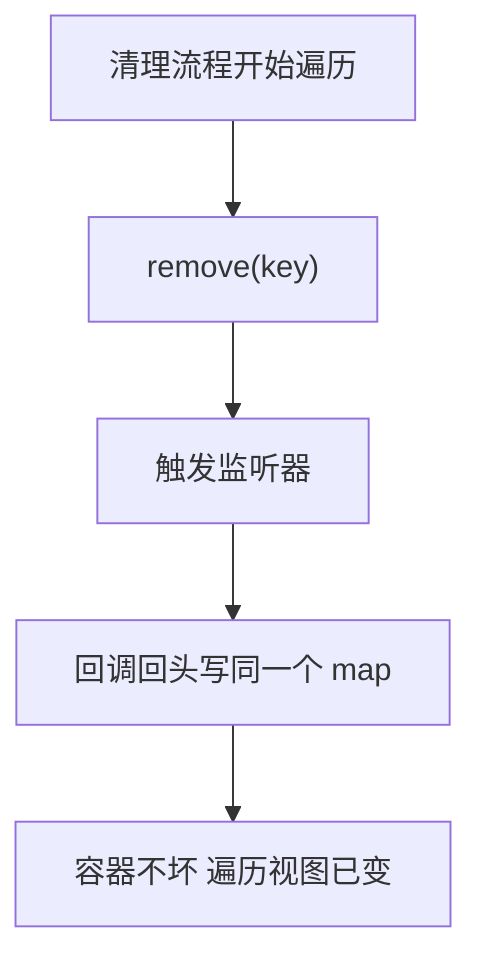
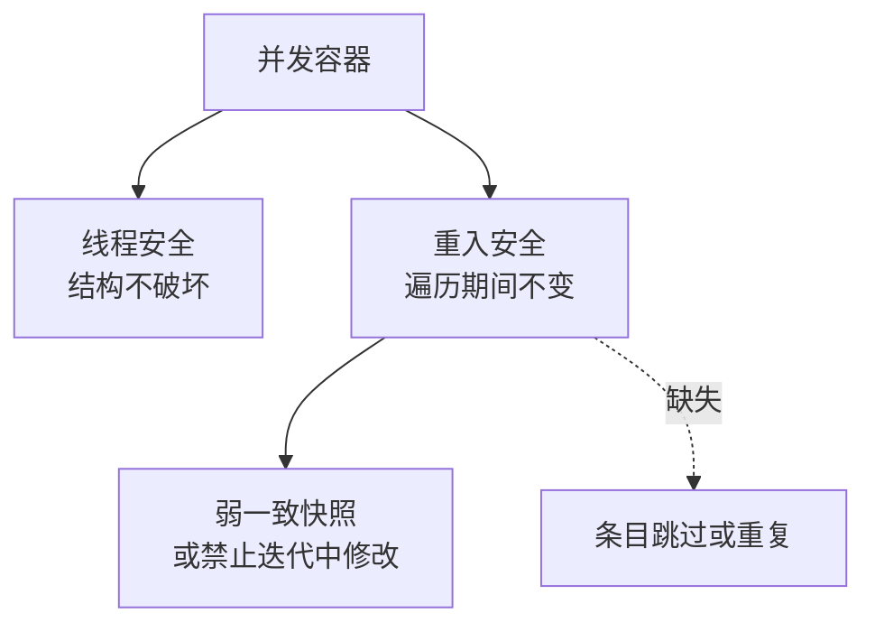
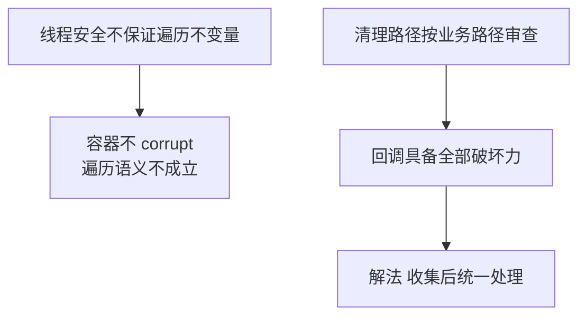

# 案例十九：在回调里改自己——清理路径的重入与回收后复用

**清理动作和正常操作共用一个容器，清理中触发的回调会回头改这个正在被清理的容器**。

> **要点**：清理动作如果和正常操作共用同一个容器，清理过程中触发的回调会回头修改这个正在被清理的容器——迭代被破坏，对象被提前回收后又遭复用。

读完这一页你能认出清理路径里的重入（**清理流程还没走完，又被同一个线程再次触发**）与回收后复用，**会把待清理对象先摘出容器再逐个处理**，**也能判断哪些崩溃其实是释放之后还在用**。

有一类并发缺陷与锁无关。两个线程抢同一把锁之外还有一类：**一个线程在遍历某个结构的过程中，这个结构被自己触发的动作修改了**。**遍历与修改发生在同一条调用栈上，看起来是单线程操作，却具备了并发破坏的全部特征**。Apache Pulsar（分布式消息队列）的这组病例（上游修复 commit 可查）把这条路径展示得很完整。

## 案例背景（要解决的问题：一次清理怎么毁掉了正在服务的对象）

项目：Apache Pulsar——分布式的消息与流处理平台，其 **broker 端的多类缓存要在条目过期、连接关闭与订阅删除三条路径上逐项清理**。

Broker 端维护着若干缓存：**主题策略缓存、连接表、游标集合**。这些缓存需要清理——条目过期、连接关闭、订阅删除。**清理动作通常是一次遍历：找出该删的，逐个删除**。

复杂的地方在于，**删除一个条目往往不是纯粹的内存操作**。**删除连接会触发监听器，删除策略会触发回调**，而这些监听器与回调属于正常业务路径的一部分——**它们会去读写那些缓存**。

于是一个结构性的风险出现了：**清理触发了业务动作，业务动作回头修改正在被清理的容器**。

## 要解决的到底是什么：两种破坏，一个来源

### 病例 A：非触发器调用怎么让后端崩溃

[上游 commit bda4fedd](https://github.com/apache/Pulsar/commit/bda4fedd6a3b)，P1：**策略缓存清理时在 `ConcurrentHashMap` 上发生递归更新**。**清理流程遍历缓存、移除过期条目；移除动作触发的回调又向同一个 map 写入**。

结果是**遍历过程中的结构被修改——某些条目被跳过、某些被重复处理，清理语义失效**。上游 commit 页的标题行直接点名这条链路（"Avoid recursive update in ConcurrentHashMap during policy cache cleanup"），**修复动作是把 `exceptionally` 换成 `exceptionallyAsync` 并交回执行器线程池**（**预先建好一组线程反复取用、避免频繁创建销毁**）——**同步回调链从清理路径上解开**：


*图源：Apache Pulsar 仓库 commit bda4fedd 页实拍（playwright 截图，2026-09-28），https://github.com/apache/pulsar/commit/bda4fedd6a3b。首屏可见提交说明「[fix][broker] Avoid recursive update in ConcurrentHashMap during policy cache cleanup (#24939)」与 `SystemTopicBasedTopicPoliciesService.java` 的关键 diff——同步的 `initFuture.exceptionally(...)` 换成 `exceptionallyAsync(..., pulsarService.getExecutor())`，异常回调不再挤在触发它的那条调用栈上。*

### 病例 B：回收后复用怎么变成悬空引用

[上游 commit e98e8443](https://github.com/apache/pulsar/commit/e98e8443c526)，P1：**关闭连接时的竞态**（**多个执行流争抢资源、结果取决于时序**）导致栈溢出。**关闭流程触发的清理回调再次进入关闭路径，形成递归**；**竞态条件下递归深度不受控，最终栈溢出**。上游 commit 页同样把这条链路写进标题（"Fix stack overflow caused by race condition when closing a connection"），8 个文件的修改集中在连接关闭与分发器回调路径：


*图源：Apache Pulsar 仓库 commit e98e8443 页实拍（playwright 截图，2026-09-28），https://github.com/apache/pulsar/commit/e98e8443c526。首屏可见提交说明「[fix][broker] Fix stack overflow caused by race condition when closing a connection (#24934)」与改动文件清单（AbstractBaseDispatcher、AbstractDispatcherSingleActiveConsumer 等 8 个文件，+125 -3 行）——修复覆盖的是整条「关闭连接 → 清理回调 → 再进关闭路径」的递归链，而非单点补丁。*

**两个病例的触发点不同，来源相同：清理路径与业务路径共享可变状态，且清理会触发业务**。

**清理与业务在同一条调用栈上互相触发，遍历到一半的容器被自己触发的回调改写**：



**这条链上每一步单独看都正常，接起来就破坏了遍历所依赖的不变量**：**移除必须触发监听器（这是业务语义），监听器必须写缓存（这是它存在的意义），而遍历必须假定容器结构不变（这是遍历的前提）**。**三个要求同时成立时，第三项被前两项破坏**。

## 为什么是问题：它长得像单线程故障

**这类缺陷的排查难度在于它的外观**。

**没有明显的并发**。 从堆栈看，遍历和修改在同一条调用栈上。工程师按"单线程逻辑"去读代码，**会认为这是顺序执行的，不会想到要去检查重入**。`ConcurrentHashMap` 这类"线程安全"的容器**更强化了错觉**——它是线程安全的，但线程安全不等于**重入安全**。

破坏是概率性的。 是否触发取决于**删除时恰好有没有回调、回调写的是不是正在遍历的桶**。同样的代码路径，大部分时候正常，偶发一次破坏。这使得它在测试里几乎不可复现，只在生产环境的特定时序下出现。

后果分散。 病例 A 的后果是缓存清理不干净（长期看是内存缓慢增长），病例 B 的后果是栈溢出导致连接处理线程崩溃。两者都不会立刻指向"清理回调重入"这个根因——前者看起来像内存泄漏，后者看起来像递归写错了。

## 本质是什么：操作不能修改自己正在读的不变量

把清理回调的重入行为抽象出来，骨架是：

> 当一个操作依赖于它正在遍历或修改的容器保持某种结构，而这个操作触发的副作用又能修改同一个容器时，**操作所依赖的不变量在它自己执行的过程中被破坏了**。

**两件被混为一谈的事，区分它们的保证范围是这个病例的核心认知**：



线程安全不等于**重入安全**。 并发容器的保证是"**多个线程同时操作不会破坏内部结构**"，它不保证"**一个线程在遍历期间，容器内容保持不变**"。**后者是遍历不变量，需要额外的约定**（例如**迭代期的弱一致性快照语义，或显式禁止在迭代中修改**）。

**清理不是特权操作**。 **清理看起来是"系统内部维护"，容易被默认成安全的、原子的**。但**只要清理会调用业务回调，它就具备业务操作的全部破坏力**。**把它当作特权操作来设计，是这类缺陷的共同起点**。

## 打个什么比方：一边点名一边改名单

**老师拿着花名册点名，点到一个名字，就让学生出去**。规则是：学生出去前要交一份表，收表的人会在花名册上做标记。

问题在于，**收表人做标记时可能划掉别的行、也可能在册子中间插入新行**。**老师手里的册子正在被翻，页码位置已经记在脑子里——册子在点名过程中被改了**。

**册子没坏（纸还在，字还在），坏的是点名这件事的语义：有人被点了两次，有人一次都没点到**。**老师说"我点完了"，实际没点完**。

如果规则改成：**老师先复印一份花名册，照复印件点名，原件上的修改等点完名再统一处理**——问题就消失了。或者：**学生交表时不许改花名册，只把改动记在另一张纸上，点名结束后老师再合并**。

两种方案的共同点是：**遍历所依据的那份结构，在遍历期间不再被修改**。

## 它是怎么做到的：回调把维护路径接回了业务路径

**清理路径与业务路径接在同一处，读一个正在被改的结构就不可避免**。**外部配置存储给了对照**：**本地缓存一份副本，配置存储变更时通知应用刷新**——**读的是副本，改的是另一份，两者之间允许短暂不一致**。


*图源：Microsoft Learn 中文文档，CC BY 4.0，https://learn.microsoft.com/zh-cn/azure/architecture/patterns/external-configuration-store。*

**上游提交改动的文件位置直接指向案发地**，两处修复分别落在策略缓存与连接关闭目录：

```
pulsar-broker/src/main/java/org/apache/pulsar/broker/service/.../ policy cache / connection
```

病例 A 的结构是这样的：

1. **清理任务遍历策略缓存，识别过期条目**。
2. 对识别出的条目执行移除。
3. **移除动作触发策略变更监听器**。
4. **监听器响应变更，向同一个缓存写入新值**（例如重新加载策略）。
5. **遍历继续，但它所依据的桶结构已经与开始时不同**。

`ConcurrentHashMap` 在这里是"线程安全但重入不安全"的典型：它保证步骤 4 不会破坏 map 的内部结构（不会 corrupt），但**完全允许步骤 4 改变 map 的内容**。**结构不坏，语义坏了**——**这正是它难以被发现的原因，因为没有任何一方报错**。

病例 B 的递归路径类似，但**后果升级为栈溢出：关闭连接触发清理，清理回调再次进入关闭路径**。这里的关键是**竞态**——**单看代码，关闭路径有重入保护**；但**当两个线程分别处于关闭的不同阶段时，保护所依赖的状态判断会同时成立，导致保护失效**。这与 [[工程知识/缺陷分析：从个案到体系/并发/案例十四：一方取消，旁观者陪葬——RocksDB 状态加载的并发陷阱]] 展示的中断连坐是同族问题：**一方的状态变化影响了另一方的路径，而保护逻辑没有把这种跨方影响纳入判断**。

上游修复的共同方向是**切断清理与业务的同步耦合**：**让清理过程中触发的变更不直接作用于正在遍历的容器，而是先收集、遍历结束后再应用**；**或者让清理路径明确不触发业务回调**。

## 怎么发现：把"清理"当成普通代码路径审查

**把每个清理任务都当作会调用业务代码的普通路径来审查。** **列出它在删除一个条目时触发的所有监听器与回调，逐个问：这个回调会不会写我正在遍历的容器？**只要有一个回答"会"，遍历不变量就不成立。

**为遍历加一致性校验。** **遍历开始与结束时记录容器的版本号或大小，若期间发生变化且与本操作的预期修改量不符，记录一条警告**。**这是唯一能在生产环境提前发现这类问题的信号**。

**刻意构造重入测试。** **在单元测试里注册一个会写回同一容器的监听器，然后触发清理**。**这类测试不测功能，专门测重入安全性，是发现这类缺陷成本最低的手段**。

**对递归深度设硬上限。** 病例 B 的栈溢出如果能被限制在"深度超过 N 就中止并报错"，**至少不会以崩溃的形式出现，且会留下可定位的堆栈**。

## 上游怎么修

**两处修复都没有引入锁——加锁解决不了重入，因为这里是同一条调用栈**。修复在**切断同步耦合**：**清理过程中的变更不再直接写回正在遍历的容器，改为延后应用**；**关闭路径的重入保护改为覆盖跨线程的状态判断**。

这印证了一个判断原则：**当问题的形态是"操作修改了自己依赖的结构"时，正确的修复方向是解耦（让修改延后或改道），而不是互斥（加锁）**。**互斥解决的是"两个操作同时改"，这里只有一个操作——是它自己在改自己依赖的东西**。

**病例 B 的栈溢出之所以是结果而非原因**，看调用栈的构造就清楚：**每次子程序调用都会压入一个栈帧（frame）**，**帧里依次是参数、返回地址与本地的变量**，**栈帧一层层向上累积，帧指针与栈指针分别标出当前帧的边界与栈顶位置**。**正常调用会逐层返回并弹帧，而重入是同一批栈帧被反复压入**——**每一轮递归都在原有的高度上再加一层**，直到把这块区域用完。**栈容量调大只是把这个上限推远，压帧的循环仍在**。


*图源：Wikimedia Commons（Call stack layout），CC BY-SA 3.0，https://commons.wikimedia.org/wiki/File:Call_stack_layout.svg。*

## 这套说法在哪儿会失效，代价换来了什么教训

- **线程安全的容器不保证遍历不变量。** **容器不 corrupt，不代表遍历语义成立**。
- **清理路径要按业务路径的标准审查。** **会触发回调的清理，具备业务操作的全部破坏力**。
- **凡是"遍历中删除"，都要确认删除动作不回头写这个容器。** **收集后统一处理是通用的解法**。
- **重入保护要把跨线程的状态纳入判断。** **单看一个线程成立的保护，在竞态下可能同时失效**。
- **调用栈溢出是结果，递归入口才是原因。** **看到调用栈溢出先找"谁在递归进入自己"，调大调用栈容量不会消除它**。

五条教训按层次排，从上到下是"现象 → 原因 → 解法"：



**中间两条原因合起来解释了这个病例的破坏力来源**：**清理动作本身会触发回调，而重入判断里只看单线程状态，于是保护在竞态下同时失效**。最后一条单独拎出来是因为它最容易被误治——**调用栈溢出看着像容量问题，实际是递归入口问题，调大容量只是把触发点推远**。


## 怎么自己动手验证

1. 重入复现：**构造清理回调里触发同对象清理的压力场景，预期复现回收后复用（ASAN 报 use-after-free）**；修复后同场景预期干净跑完。
2. 归属验证：**审计清理回调的目标集合与业务回调的目标集合，预期两集合在结构上互斥**（或加互斥锁保护）。
3. 断言锚点：**清理路径不自触发、互斥项进代码评审清单**。

## 接着读哪几篇：同在缺陷分析里的相邻问题

- 任务生命周期与清理责任——[[工程知识/后端系统：在并发、失败与变化中维持服务/任务与并发/任务生命周期必须覆盖进程、日志、超时与清理]]。
- 并发保护为什么覆盖不了跨方影响——[[工程知识/后端系统：在并发、失败与变化中维持服务/分布式可靠性/超时、重试与幂等共同定义调用语义]]。
- [[工程知识/缺陷分析：从个案到体系/并发/案例十四：一方取消，旁观者陪葬——RocksDB 状态加载的并发陷阱]] · [[工程知识/缺陷分析：从个案到体系/并发/案例三：并发两面——写回调卡死与心跳竞态]] · [[工程知识/缺陷分析：从个案到体系/缺陷分析：从个案到体系——导读与开源地图]]
