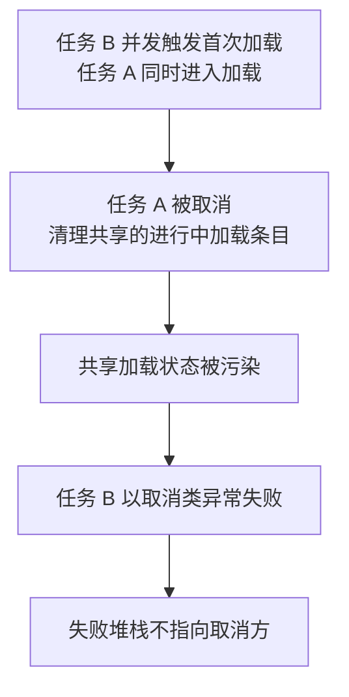
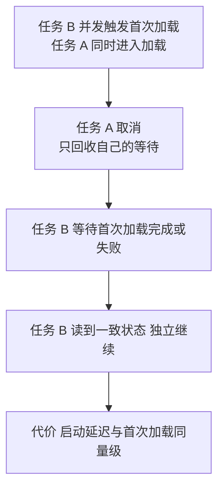

# 案例十四：一方取消，旁观者陪葬——RocksDB 状态加载的并发陷阱

**两个任务并发加载同一个状态存储，一方被取消时把共享状态搅乱，另一方跟着失败**。读完这篇你能让取消操作也具备并发安全，不再让旁观者陪葬。

> **要点**：两个任务并发加载同一个 RocksDB 状态存储，一方被取消时把共享的加载状态搅乱，另一方因线程状态异常跟着失败——取消操作也需要并发安全。

## 要解决的问题是什么：一方的取消动作为什么污染另一方的共享状态随之失败

项目：Apache Spark——其 Structured Streaming 用 RocksDB 做流式状态存储。

状态存储的首次加载是一个较重的初始化过程，Spark **允许多个任务并发触发它，共享加载结果**。缺陷在于：当并发调用者中**一方被取消或中断**时，**取消的清理动作污染了共享的加载状态，另一个无辜的调用者以取消引发的线程状态异常直接失败**（[上游 commit f80559fc](https://github.com/apache/spark/commit/f80559fc4605b3f3d9e8d7631a9a5c9e1439efe6)，P1，并发类，已真实复现）。

## 它是怎么做到的：取消也是一次并发写

大多数开发者把"取消"理解为"那个任务自己退出"。**从并发视角看，取消是一次对共享状态的写操作：中断标志、线程状态、清理回调，全都在其他线程还在读取的状态空间里发生**。加载流程走到一半，同伴的取消打断了它依赖的执行环境——**失败的是还在正常执行的这一个，被取消的那个反而没事**。

这也是并发缺陷里最反直觉的一种：**受害者与肇事者是两个不同的任务**。排查时顺着失败者的堆栈走，看到的全是无辜代码；真正的**时序交错发生在另一个人已经消失的执行流里**。

两个调用者共享一次加载，取消方的清理动作落在了另一方的执行环境里：

「一家的火苗烧到邻居」在服务里的实物对应是共享缓存与清理动作：一个执行流超时被取消时，**它的清理逻辑顺手把公共的加载缓存清掉（辘轳被拆）**——取消方的请求确实终止了，**同一进程里正在等待这份缓存的旁观者请求全部落空**；受害者与肇事者隔着一次超时，现场留下的只有一片失败堆栈：

*图源：Wikimedia Commons，Seeweb，CC BY-SA 2.0，https://commons.wikimedia.org/wiki/File:HP_BladeSystem_c7000_Enclosure.jpg。*

修复的等待语义就是「各家自备水桶」：**取消方的清理只回自己（辘轳归公家管、谁也不许拆），旁观者按井台的规矩排队打水（等待首次加载完成）**——**每个执行流的副作用（操作对外部状态产生的额外影响）约束在自己身上，井台不再是风暴中心**。

来源：[CSDN @bjmayor《图解分布式事务模式》](https://bjmayor.blog.csdn.net/article/details/154004146)（CC 4.0 BY-SA）

来源：[小林coding《进程、线程基础知识》](https://www.xiaolincoding.com/os/4_process/process_base.html)

## 这类问题还在哪儿出现过

和 [[工程知识/缺陷分析：从个案到体系/并发/案例三：并发两面——写回调卡死与心跳竞态]] 的两个病例并排放着看，并发缺陷的出口集齐了三种：BookKeeper 客户端是卡死——**等一个永远不会来的完成回调**；Spark 心跳（通信双方定期互发小报文、确认连接还活着）竞态（多个执行流争抢资源、结果取决于时序）是崩溃——**计数被覆盖后踩中断言**；这一条是连坐——**一方的取消污染共享状态，旁观者陪葬**。出口不同，不变量相同：**多个执行流交错的顺序是代码没有显式处理的隐藏输入**。 修复方向也一致——**把"谁先谁后"从运气变成设计**。

## 上游怎么修

修复的思路是给共享加载加**等待语义**：第二个调用者不再与取消动作并发竞争，而是**等待第一个加载完成（或失败）后再行动**。取消依旧合法，只是它的**副作用被约束在自己身上，不再外溢给旁观者**。

修复后同一组交错里，**取消的副作用被约束在谁身上、旁观者改走哪条路**，时序上是这样的：

**等待语义换来的确定性就写在最后两步里**，代价是** B 的启动延迟升到与首次加载同量级**。

代价是**明确的：等待语义让第二个调用者的启动延迟上升到与首次**加载同量级——原先它是并发进入、可能更早拿到结果。**这个取舍换来的是可靠性**：流式作业里，一次状态加载失败意味着**整个查询重启**，代价远高于多等一次初始化。**上游选择用延迟换确定性**。

## 这套说法在哪儿会失效，代价换来了什么教训

- **取消路径要按并发代码审查**，而不是**当成人畜无害的清理**。它会读写共享状态，它也有自己的时序。
- **失败者的堆栈不指向肇事者**。并发连坐的归因要靠时序重构，不能只看失败现场。
- **"共享初始化"是并发问题的高发地**：**谁触发、谁等待、一方失败时其他人怎么办**——这三个问题在写第一行加载代码之前就该有答案。

## 怎么自己动手验证

对账规则：把取消动作与旁观任务的固定时序固化，修复前后各跑一遍——**预写修复后旁观任务应独立获得结果，实测它被连带失败，与预期对不上**。

1. 上游对照：到 Spark 的提交 f80559fc 里**核对修复方式是给共享加载补上等待语义**，确认取消的副作用被约束在取消方自身。
2. 机制复现：**让两个任务并发触发同一状态存储的首次加载**，在其中一方进入加载中途时对其实施取消，**修复前旁观者以取消类异常失败且堆栈不指向取消方，修复后旁观者等到加载完成并拿到一致状态**。
3. 边界核验：**回归用例必须固定「取消发生在加载窗口内」这一时序**；只测两个任务并发加载时，修复前后都会通过，测不出缺陷。
4. 断言锚点：复现脚本**固定了取消时机、失败堆栈与肇事方分离已确认、等待语义带来的启动延迟量级有记录**。

## 接着读哪几篇：写回调卡死与心跳竞态

- [[工程知识/缺陷分析：从个案到体系/并发/案例三：并发两面——写回调卡死与心跳竞态]]
- [[工程知识/缺陷分析：从个案到体系/稳定性/案例十二：调度线程的永久等待——广播写锁不释放]]
- [[工程知识/缺陷分析：从个案到体系/缺陷分析：从个案到体系——导读与开源地图]]
- [[工程知识/数据系统：在并发与故障中保存事实/可靠性与运维/恢复点目标要先算账：RPO 是数据的时间边界，不是备份频率的同义词]] —— 恢复能力的时间账
- 同类模式：[[工程知识/缺陷分析：从个案到体系/并发/只读旁观者不能改变被观察对象的状态]] —— 第二位参与者写入共享状态，代价由原持有者承担
- 并发可见性由什么决定——[[工程知识/软件构建：让变化可以理解、验证与交付/语言与运行时/内存模型决定并发读写何时可见]]。
- 设计并发逻辑前先回答哪两个问题——[[工程知识/后端系统：在并发、失败与变化中维持服务/任务与并发/并发控制先定义共享状态和完成条件]]。
