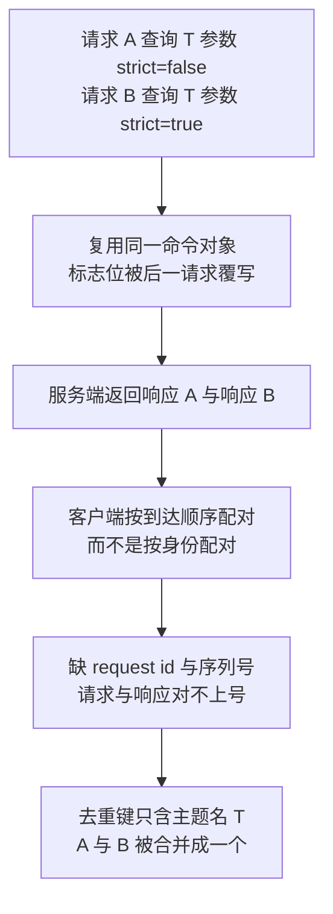
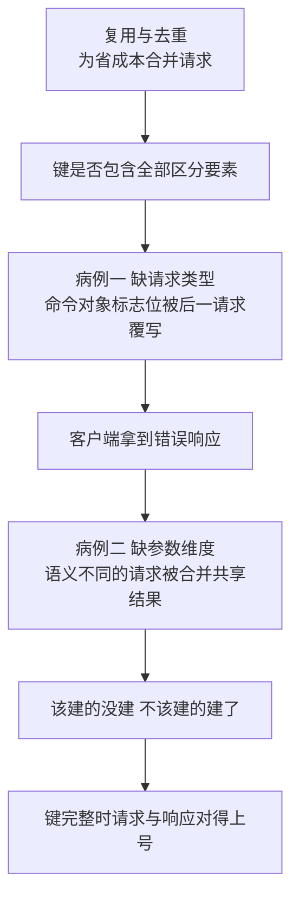

# 案例四十：谁在回答谁——Pulsar 连接复用与去重的键不完整

**复用与去重的键少一个区分要素，参数不同的请求就会拿到同一个结果**。读完这篇你能把键补全到包含请求的全部区分要素，不再答非所问。

> **要点**：同一连接上的请求复用同一个协议命令对象导致标志位互相覆写，并发查询按"只看主题名"的键去重导致参数不同的请求拿到同一个结果——两个病例共享同一不变量：复用与去重的键必须包含请求的全部区分要素，少一个就会答非所问。

## 要解决的问题是什么：连接复用后请求与响应为什么对不上不足以区分来源

项目：Apache Pulsar——分布式消息系统，客户端与服务端之间用长连接（建立后保持不断开、多次通信复用同一条连接）承载多种请求（查询元数据、分区元数据、生产、订阅）。

长连接省掉握手成本的前提是**请求与响应能对上号**。两个病例都在"对号"环节失守——[上游 commit 4600efea](https://github.com/apache/Pulsar/commit/4600efead6818221397a85457e5bca8ab4777f6b) 与 [上游 commit fac8f15c](https://github.com/apache/Pulsar/commit/fac8f15cec4eddb3ab8f7ae9d3b1752fdb7d415b)，两者均为 P1、已真实复现。

## 病例一：复用的命令对象互相覆写

同一连接上混合发送查询请求与分区元数据请求时，**两个请求复用了同一个协议命令对象——后一个请求把前一个的标志位覆写**。客户端拿到错误响应，甚至创建主题失败。

### 病例一机制

协议命令对象是有状态的（类型、标志位、序列化缓冲）。"复用对象省一次分配"的前提是**两次使用之间对象状态被完整重置**，或者两次使用天然串行且互不交叉。**混合请求打破了第二个前提；不完整重置打破了第一个**。


来源：[小林coding《TCP 三次握手与四次挥手面试题》](https://www.xiaolincoding.com/os/1_hardware/tcp_interview.html)（CC 4.0 BY-NC-SA）


## 病例二：去重键只看主题名

并发查询同一主题的分区元数据时，客户端对请求做去重（同一主题的查询合并成一个，结果共享）。**去重键只用了主题名——参数不同的两个请求（比如要求不同的元数据细节）被当成同一个，拿到同一份结果**。出现"只查分区却把主题建出来"或"该建的主题没建"这类行为错乱。

### 病例二机制

去重的收益是省请求，前提是**去重键相同的请求语义必然相同**。**键里少了参数维度，语义不同的请求被错误合并**——这和缓存用错键导致脏读（读到别的事务尚未提交的数据）是同一个模型。

两个请求的对照：

```text
请求 A：查询主题 T 的分区数（参数 strict=false）
请求 B：查询主题 T 的分区数（参数 strict=true，不存在则建）
去重键（旧）：T            → B 拿到 A 的结果 → 该建的没建
去重键（新）：T + 两个参数 → 各自正确
```


两个病例在一条长连接上的时序是什么样——复用对象与去重键分别在哪一步把请求与响应的配对弄丢：



时序上丢的是配对身份，结构上看就是键少了一个区分要素——**两个病例失守的是同一条要求**。

两个病例的失败位置不同，失守的是同一条要求——**键少了一个区分要素**：



## 这类问题还在哪儿出现过

两个病例并排，不变量是一句话：**复用与去重，本质上都是在说"这两个东西是同一个"——判定"同一个"的键必须覆盖请求的全部区分要素：连接、类型、参数、标志位。** **少写一个维度，就在那个维度上答非所问**。

与 [[工程知识/缺陷分析：从个案到体系/并发/案例十四：一方取消，旁观者陪葬——RocksDB 状态加载的并发陷阱]] 也相关：那里的连坐是"取消动作污染共享状态"，这里是"混合请求污染共享对象"——**共享可变状态的并发写入，是并发家族里最常见的发生点**。

## 上游怎么修

复用本身不该禁止，问题出在复用的边界没被结构化。Apache Pulsar 官方文档的订阅模式图给出了长连接之上「谁在回答谁」的另一种正解：Failover 模式下多个消费者同时接入同一订阅，**任一时刻只有一个活跃消费者接收消息，其余消费者保持着连接但只做热备，活跃者掉线时热备者接管**——**连接存在与消息归属是两个独立事件**：


*图源：Apache Pulsar 官方文档《Subscription modes》Failover 模式配图，Apache-2.0，https://pulsar.apache.org/docs/3.2.x/concepts-messaging/#subscription-modes。连接一直在、回答消息的可能是另一个消费者——这正是「请求与响应要对上号」在订阅模型里的对应物。*

管道与过滤器给出了可参照的形态：把处理拆成一串过滤器，各段之间用管道连接，段与段之间不共享可变状态。


*图源：Microsoft Learn 中文文档，CC BY 4.0，https://learn.microsoft.com/zh-cn/azure/architecture/patterns/pipes-and-filters。*

**把复用放在段之间而不是段之内，命令对象的覆写问题就没有发生的场合**。这个改法的代价是**每多一段就多一次交接**，交接本身有成本。


- 病例一：各请求读取**独立的命令副本**，不复用可变对象——从根上取消"复用前提"。
- 病例二：去重键改为**主题名 + 两个请求参数**共同构成——把"什么算同一个请求"定义完整。

去重正确性要与键的完整性对账——**预写两种不同参数的并发请求应各自得到对应结果，实测相互覆写标志位，与预期对不上，键还缺参数**。

## 这套说法在哪儿会失效，代价换来了什么教训

- **任何去重/缓存/合并的代码，先写出键的完整定义**，然后逐项检查：**请求之间在这个维度上真的无差别吗？少一个维度就是少一道隔离**。
- **可变对象的复用要配套状态重置**，且**重置必须覆盖全部字段——漏一个标志位就是一次"答非所问"**。
- **长连接多路复用（一条连接上同时承载多个请求、互不阻塞）的协议客户端，最容易出这类缺陷**：**请求-响应的配对机制（request id、序列号）必须显式设计**，不能靠"同一个连接上的请求天然串行"的假设。


另一面：键算错了对象会答非所问；对象已经不存在时，请求还会被静默丢弃——[[工程知识/缺陷分析：从个案到体系/稳定性/订阅者断线之后路由指向谁：请求被静默丢弃的识别]]。


## 怎么自己动手验证

1. 上游对照：到 Pulsar 的提交 4600efea 与 fac8f15c 里核对两处修复，确认**一处改为各请求读取独立的命令副本、另一处把去重键补上请求参数**。
2. 机制复现（病例一）：在同一连接上混合发送查询请求与分区元数据请求，**修复前后一个请求覆写前一个的标志位，客户端拿到错误响应甚至创建主题失败**。
3. 机制复现（病例二）：并发查询同一主题的分区元数据，两种参数各发一次，**修复前两者被合并成一个请求、拿到同一份结果，表现为该建的主题没建**。
4. 边界核验：逐维度核对去重键是否覆盖连接、类型与全部参数；**核对复用对象的状态重置是否覆盖全部字段，含标志位与序列化（把内存对象转成可存储或传输的字节格式的过程）缓冲**。
5. 断言锚点：复现脚本对请求与响应的配对身份逐条核对，**去重键的维度清单与对象状态字段清单都留档**。

## 接着读哪几篇：同在缺陷分析里的相邻问题

- 等待与完成的语义约定——[[工程知识/后端系统：在并发、失败与变化中维持服务/任务与并发/并发控制先定义共享状态和完成条件]]。
- 共享状态的可见性规则——[[工程知识/软件构建：让变化可以理解、验证与交付/语言与运行时/内存模型决定并发读写何时可见]]。
- [[工程知识/缺陷分析：从个案到体系/并发/案例十四：一方取消，旁观者陪葬——RocksDB 状态加载的并发陷阱]] · [[工程知识/缺陷分析：从个案到体系/并发/案例三：并发两面——写回调卡死与心跳竞态]] · [[工程知识/缺陷分析：从个案到体系/缺陷分析：从个案到体系——导读与开源地图]]
