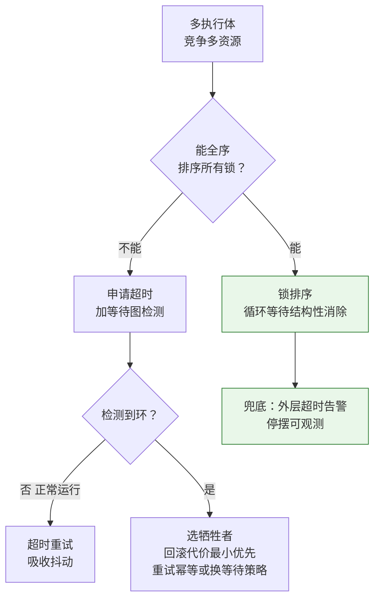

# 死锁的四条件与检测恢复：等待图找环、牺牲者选择与工程纪律

**死锁（deadlock，两个以上执行体互相等待对方持有的资源、谁都无法推进的状态）的成立需要四个条件同时满足——破坏任意一个即不可能死锁，这是全部防御手段的统一坐标系**。 读完你能回答：**四条件各对应哪类防御、等待图找环怎么做、牺牲者按什么标准选、锁排序为什么是工程里最常用的解**。

## 要解决的问题

**死锁不报错、不崩溃、不超时（除非外层有超时），表现为一批任务集体停摆、资源占用率归零**。**它的成立条件是教科书内容，工程价值在于把每个条件映射到可落地的防御**：

| 条件 | 含义 | 破坏手段 |
| --- | --- | --- |
| 互斥 | 资源同一时刻一方独占 | 资源池化、无锁结构、Copy-on-Write |
| 持有并等待 | 持有 A 再申请 B | 一次性申请全部、持有期禁申新锁 |
| 不可剥夺 | 已持资源不能被强制收走 | 带超时的锁申请、可中断获取 |
| 循环等待 | 等待链成环 | 全局锁排序（最常用） |

**数据库、消息队列、连接池、线程池——凡是「多个执行体竞争多个资源」的地方四条件全部适用，防御手段也全部适用**。

## 机制：三层防线按成本排序

### 第一层：锁排序消灭循环等待

**给全部锁一个全序（按资源 ID 排序、按层级编号），所有代码路径按同一顺序获取——环在数学上不可能形成**。**这是成本最低的确定性防御：一条编码规约（静态检查可辅助）换一类问题归零**。**工程要点：全序要覆盖全部锁，包括看起来「不会同时用」的锁——死锁的环常常由两条从不相交的代码路径偶然组成**。**嵌套获取时按序，事务里多表更新时按主键序（PostgreSQL 官方建议），避免锁升级乱序**。

### 第二层：超时与检测，兜住排序覆盖不到的

分布式场景与外部资源（远程调用、第三方锁服务）无法统一排序，靠两层兜底：**申请带超时**（try-lock 超时后释放已持有的重试，破坏持有并等待）；**等待图检测**（数据库内置：PostgreSQL 检测到等待环立即终止一个事务并报 deadlock detected；应用层自建则维护「谁等谁」的图，定时找环）。**等待图找环的标准算法是深度优先搜环，环存在即死锁成立**。

### 第三层：牺牲者选择与恢复

检测到死锁后必须选一个牺牲者回滚。**选择标准按代价排：回滚代价最小（事务完成度低）、优先级最低、重试收益最大**。**恢复后配套重试语义：被终止方的上层要能重试且重试安全（幂等）——死锁处理不是「检测到就结束」，是「检测→牺牲→重试」的完整链路**，**重试不安全时牺牲策略要换（宁可等不可杀）**。

## 案例：锁粒度与临界区的相邻问题

[[工程知识/后端系统：在并发、失败与变化中维持服务/任务与并发/锁的竞争要按临界区治理：缩小范围、读写分离、分片加锁三路走]] 处理的是死锁的邻居问题——**锁竞争（锁太粗导致排队）；死锁是锁太乱导致成环**。**两者的共同上游是「锁的设计没有按共享结构显式规划」：临界区治理管每一把锁的粒度，锁排序管全部锁的顺序，合起来才是完整的锁纪律**。[[工程知识/缺陷分析：从个案到体系/并发/案例十四：一方取消，旁观者陪葬——RocksDB 状态加载的并发陷阱]] 提供了取消路径与锁交互的真实样本：**取消信号在锁持有路径上被处理，清理代码再次申请锁——生命周期事件与锁顺序的交互是排序规约里最常漏的一环**。

## 怎么测

- **压测复现：并发压测下监控「活跃线程数下降但 CPU 空闲」「任务完成率归零」的死锁指纹，jstack/thread dump 找互相等待的栈对**。
- **排序规约检查：静态检查（如 clang thread safety 注解、Go 的 lockorder lint）或 code review 清单核对嵌套获取的顺序一致性**。
- **检测演练：故意构造两个事务交叉更新两张表，验证数据库死锁检测的触发、牺牲者选择与上层重试闭环**。
- **停摆告警：对长持有锁的路径挂监控（锁等待时长 P99），死锁停摆在分钟级被发现而非到天**。

## 哪些认识一看就错

- **「加了超时就不会死锁」——超时只解开单个等待者的卡住，环里的成员轮番超时重试可能形成活锁（livelock，都在动但无人推进）；超时要配退避与随机化**。
- **「死锁只发生在数据库」——线程池与信号量、连接池与业务锁、分布式锁与本地锁的组合都能成环；凡等待都可成环**。
- **「锁排序影响性能不值得」——排序的成本是申请顺序的约束，与锁粒度优化正交；先消灭死锁这类停摆级故障，再谈粒度调优**。
- **「检测到死锁杀一个就完事」——牺牲者的上层重试不安全（非幂等）时会造成重复副作用；恢复策略要按业务语义选，不是按算法选**。

## 效果从哪来、要付什么代价

**锁排序让最大的一类死锁（循环等待）结构性归零，超时与检测兜住排序管不到的外部资源，牺牲与重试把停摆恢复成自动化的短中断**。**代价是纪律成本：全序要维护**（新增锁要入序）、**重试语义要设计**（幂等性要审计）、**检测参数要调**（检测间隔与误杀率）。**防御的收益按事故等级结算：死锁是「服务整体停摆且不报错」的最高级别故障，防住它的成本远低于它在深夜爆发一次的代价**。

关系：[[工程知识/缺陷分析：从个案到体系/性能/锁内的长动作：临界区里藏着的延迟放大器]] —— 锁纪律的另一半：粒度与竞争治理。[[工程知识/缺陷分析：从个案到体系/并发/案例十四：一方取消，旁观者陪葬——RocksDB 状态加载的并发陷阱]] —— 取消路径与锁交互的真实案例。[[工程知识/后端系统：在并发、失败与变化中维持服务/分布式可靠性/租约必须配合FencingToken阻止过期持有者]] —— 分布式场景的锁语义：租约与 fencing 补上排序管不到的维度。
