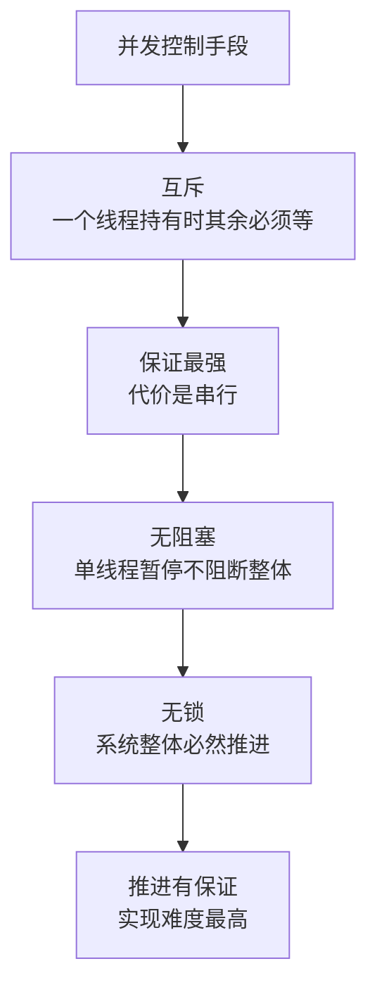
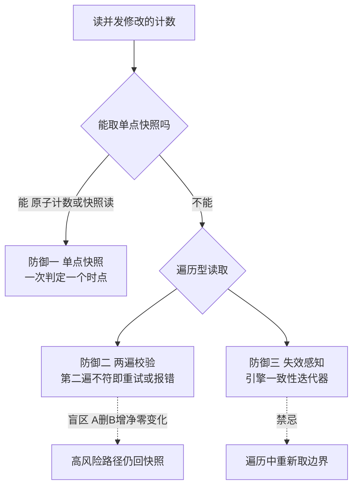

# 计数的语义取决于读的时机：两遍读数与重新取值是并发界的老坑

**并发下读一个被改动的计数，读两次和读一次是两个语义**。**混用两种时点的数，边界判定就会建立在漂移的快照上**。**读完这篇你能按次序防御这类事故**。

防御的次序：**能取单点快照就取（原子计数器或一致性读），必须两遍就校验一致性（二遍不符即重试或报错），绝不混用两种时点的数**。

## 要解决的问题：读数是并发操作，时点错位怎么判

**"取个数"看起来是只读操作，在并发修改的环境里它是一次与写入者赛跑的读**——**count 的两种实现形态**：**维护原子计数器（O(1) 读，与写入同步增减）与现场遍历统计（O(n) 读，读的是遍历过程的动态集合）**。两种形态混用、或遍历中"再取一次计数"做边界判断，产生**时点错位**：**第一个数来自 t1，第二个数来自 t2，t1 与 t2 之间集合被修改**——**按两个时点的数做的判定（如"还有 N 个没读完"）在并发下不成立**。**本库"取到了已经不存在的那个"（估算器读取竞态）是同族个案**；本篇给这类缺陷的**通用判定与防御**。

## 它是怎么做到的：三种防御的适用与次序

**并发控制手段不是只有"加锁"和"不管"两种**。**按阻塞性质划分，至少有三类：互斥（一个线程持有时其余必须等）、无阻塞（单线程暂停不影响整体推进）、无锁（系统整体必然推进）**。**先认清自己在哪一类，再讨论防御次序**。



*图示：按阻塞性质划分的三类并发控制。选定类别决定了能做哪些保证。*

**防御一：单点快照（首选，能取就取）**。**把"取数"变成原子操作（不可分割、要么全做要么不做的操作）**：**原子计数器（写入路径同步增减，读路径一次读）**、**快照读（RocksDB 的 GetSnapshot，或 MVCC 多版本并发控制下的一致性读：写生成新版本、读按事务起点取一致旧版本）**——**快照的代价**：**计数器要维护一致性（增减与事务同提交，崩溃恢复时重建）**；**快照读有持有成本（引用计数阻止 compaction 回收）**。**判定的标准**：**count 的用途如果要求"与后续遍历一致"，只有快照能保证**；**如果只要求"约数"（监控指标，原子计数器最便宜）**。

**防御二：两遍校验（遍历型读取的护栏）**。**必须"先取边界再遍历"的场景（无快照可用时），第二遍取同样的数并比对**——**不一致即并发修改的实锤**，**选择重试（拿新值重来）或报错（fail-fast，本库 fast-fail 纪律）**，**绝不拿着不一致的两个数继续**。两遍校验的盲区：**两遍恰好读到相同的值但集合内容变了（A 删 B 增的净零变化）**——**校验是概率防御**，**高风险路径仍以快照为正解**，两遍校验是低成本场景的退让。

**防御三：失效感知（迭代器与句柄的配合）**。**遍历用的迭代器对底层修改的感知方式因引擎而异**：**RocksDB 迭代器基于快照语义（遍历中看不到后续写入，天然一致）**；**裸哈希表迭代器遇扩容/删除直接失效（core dump（进程崩溃时内存状态的完整快照文件）的正源）**——**用对迭代器**：**能选引擎自带一致性迭代器就不手搓遍历**；**必须手搓时，遍历中重新取值（size）做循环边界是禁忌**——**边界在遍历开始前固定，或遍历每步自判有效性**，**两种都可以，混用必炸**。

**上游缺陷的定位**：**count 的 core dump 组合了两个错误——遍历中重新取 count（时点错位）+ 无快照语义的裸迭代（修改后迭代器指向已释放内存）**。**修复的方向**在防御一与三：**计数走引擎的快照读，或迭代器用引擎提供的一致性游标（逐行读取查询结果的指针）**。



图：三种防御的选择次序——能取单点快照就取（原子计数器或快照读，一次判定只用一个时点），快照不可用时遍历型读取配两遍校验（第二遍不符即重试或报错，绝不拿不一致的两个数继续）与引擎一致性迭代器（游标自带失效感知）。两条虚线是各自的边界——两遍校验挡不住「A 删 B 增」的净零变化，它是低成本退让，高风险路径仍回快照；遍历中重新取边界做循环条件是禁忌——边界在遍历开始前固定，或每步自判有效性，混用必出时点错位。

这些防御在数据库里各有现成实现。**支付与取消撞在一起时，靠 WHERE 条件防并发，影响行数为 0 就自动退款**——**条件更新本身就是一次原子判定**：


来源：[CSDN @bjmayor《图解分布式事务模式》](https://bjmayor.blog.csdn.net/article/details/154004146)（CC 4.0 BY-SA）

**快照读的时点判定在 InnoDB 里由 Read View 完成**：**按事务 ID 数轴做可见性判定，小于最小活跃事务的可见，大于等于最大事务的不可见，落在中间的再查活跃事务列表，自己写的数据总是可见**——**同一个事务内两次读数用的是同一个 Read View**，**这正是「单点快照」在存储引擎里的形状**：


来源：[小林coding《事务隔离级别（并发事务互相可见程度的分级）是怎么实现的？》](https://www.xiaolincoding.com/mysql/transaction/mvcc.html)


## 读完这一段你能判断什么：现场排查的三个问题

**排查时先分清线程处在什么状态：在处理器上运行、等待处理器、还是阻塞在锁或 IO 上**。**三类状态的占比决定了该往哪个方向查——阻塞占比高就是争用问题，运行占比高才是算力问题**。


*图示：线程状态的划分（来源：Brendan Gregg 等待分析页）。**先定性再定量，避免把争用当成算力不足**。*

遇到"遍历崩溃/计数不对"先问三问：**一问计数从哪来**（**原子变量、每次现场统计、还是缓存值——来源决定它代表哪个时点**）；**二问遍历用什么游标**（**引擎一致性迭代器、裸指针、还是带校验的自定义——游标决定并发修改的后果**）；**三问边界判定用了几个时点的数**（**一个时点的快照、两遍校验、还是两个时点混用——缺陷嫌疑**）。

**三问的答案组合直接定位**：**混用时点 + 裸游标 = 高危（core dump 候选）**；**混用时点 + 一致性游标 = 逻辑错误（结果不准但不崩）**；**单时点快照 = 达标**。

**修复优先级**：**引擎快照语义（根治）> 两遍校验（护栏）> 加锁串行化（最重，能不用就不用**——**锁把读的并发性牺牲掉**，本库"锁的竞争按临界区治理"的成本核算）。

## 这套说法在哪儿会失效

三条边界防止防线走形。

**"只读"不等于"无并发"**：**读操作之间也会赛跑（两个 reader 各自遍历同一动态集合）**，**快照的需求来自"与写入的一致"，也来自"自身步骤间的一致"**——防御设计按后者自查时容易漏，**评审要问"这几次读数要求是同一时刻吗"**。

**快照的成本有下限约束**：**长持有快照阻止回收（compaction、GC、内存释放）**——**快照的持有期要短且显式释放（try-with-resources 类结构保证）**，**长事务持快照**是存储引擎膨胀的经典成因（本库"虚拟内存与文件系统"的页缓存类比）。

**统计类用途不追强一致**：**监控指标、容量估算用约数（原子计数器）足够，追快照一致性是把强一致的成本花在不需要的地方**——**用途决定语义，语义决定实现**，**反向推导（实现决定用途）会让简单计数背上事务成本**。

## 怎么自己动手验证

可复现的验证路径：

1. 竞态（多个执行流争抢资源、结果取决于时序）复现：**并发写 + 遍历统计的压力测试，混用时点的实现预期出现计数错乱或崩溃，快照实现预期稳定**——**复现即完成验证判定法**；
2. 两遍校验验证：**注入遍历中的并发修改，校验逻辑检出不一致并重试/报错，日志含两次读数**；
3. 快照成本验证：**长持有快照的负载下观测 compaction 停滞（空间不回收），释放后恢复——成本边界的实证**；
4. 断言锚点：**count 来源在代码注释里写明时点语义、遍历游标统一用引擎一致性接口、评审清单含"多时点读数"检查项**——**三件齐备，计数类并发缺陷在代码评审层就被拦住**。

```text
时点断言 = 一次判定只用一个时点
游标断言 = 遍历游标有失效感知
用途断言 = 强一致只花在强需处
```

**计数的并发语义本质是时点语义**：**两个数能不能代表同一时刻，决定了判定是否成立**——**快照给确定，校验给护栏，混用给 coredump（核心转储：进程崩溃时的内存现场文件）**，**三选一的纪律写进评审习惯，这类老坑就能在写代码的时候绕开**。

## 接着读哪几篇：并发窗口的同类形态

- [[工程知识/缺陷分析：从个案到体系/并发/案例三十二：取到了已经不存在的那个——估算器的读取竞态.md]] —— 同族竞态个案
- [[工程知识/缺陷分析：从个案到体系/并发/删除与写入的并发窗口：复活句柄是静默丢数据的机器.md]] —— 并发窗口的同类形态
- [[工程知识/后端系统：在并发、失败与变化中维持服务/任务与并发/锁的竞争要按临界区治理：缩小范围、读写分离、分片加锁三路走.md]] —— 加锁的成本核算
- [[工程知识/数据系统：在并发与故障中保存事实/事务与存储/快照隔离与MVCC：多版本如何在不阻塞读写的前提下挡住脏读.md]] —— 快照语义的机制层
