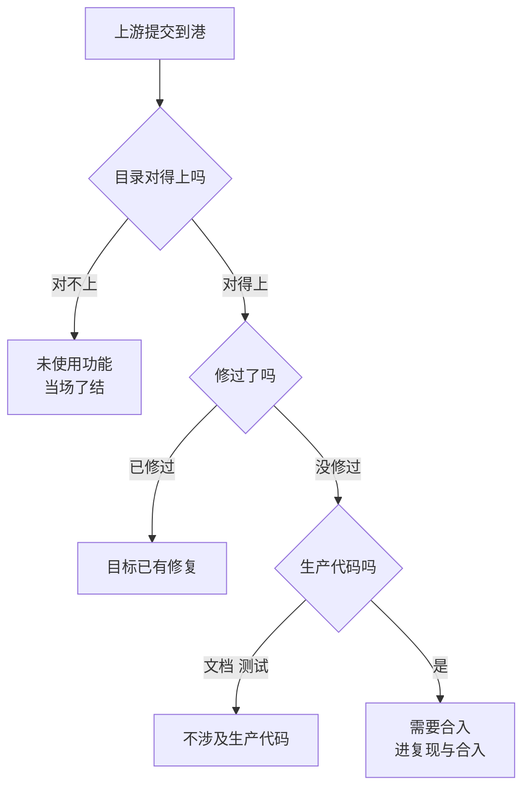
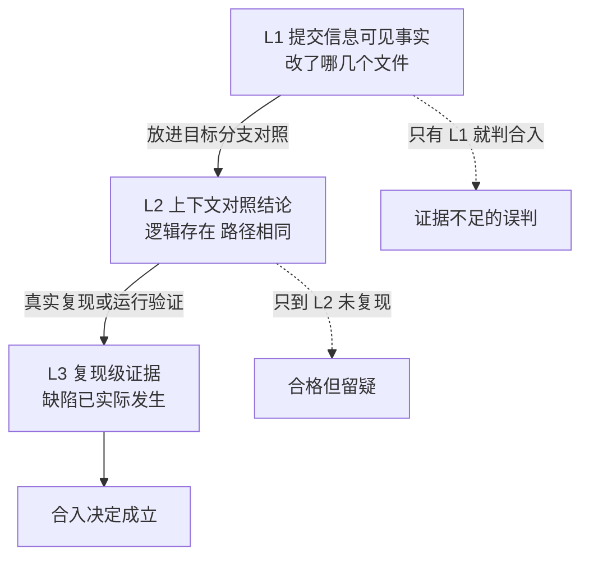
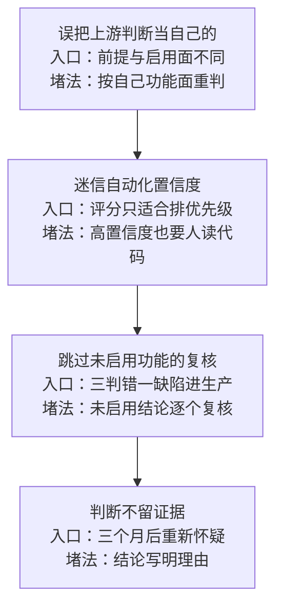
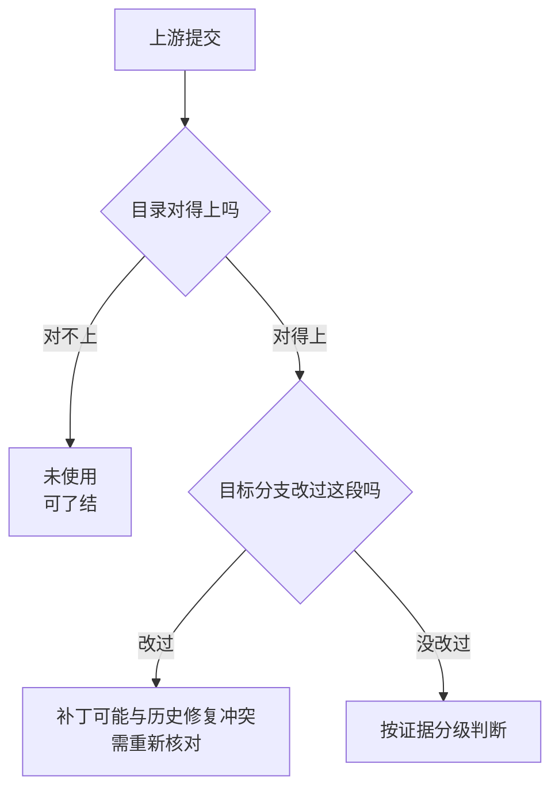

# 影响判断——这条修复值不值得跟

**海关是这个问题的好比喻**。**上游提交是一件到港的包裹，你是海关关员**。放行之前要问三句话：**这批货和我的通关目录对得上吗**（功能在我这儿存在吗）、**它是不是我早就放行过的**（目标分支已经修过了吗）、**它真是货物而不是空箱**（改的是生产代码还是文档）。**三问之后，绝大多数包裹当场了结，只有剩下的少数进入人工查验**。**这个比方只到「先问三句再决定跟不跟」为止**，**怎么判断功能在本项目里存在要看正文**。

## 要解决的问题

**上游社区每天有新提交涌过来，每一条都看一遍不现实，全部合入更不可能**——**很多修复针对的功能在分支上根本没有启用**。本篇要解决的问题是：**在看过与要处理之间立一道闸门，用几句可以回答的提问把绝大多数提交当场了结，把有限的人力对准真正受影响的少数**。

## 逐条判断会得出哪四种结论

**对上游扫到的提交逐条判断，结论只有四种**：

| 结论 | 含义 |
|---|---|
| 需要合入 | 缺陷存在、目标分支受影响，必须跟 |
| 不涉及生产代码 | 改的是文档、测试、注释——没有可"感染"的代码 |
| 目标已有修复 | 以另一种方式修过了，不用重复 |
| 未使用相关功能 | 缺陷在的功能路径，分支上没有启用 |

**这个分布本身就是信息**：**只有少数提交值得进入后续流程**。**没有这道闸门，后面复现、合入、回归的投入会浪费在多数无谓条目上**；**有了它，人力对准真正受影响的提交**。

**闸门的松紧由两类判断错误的代价不对称性决定**：**漏跟**（真实受影响却放走）的代价是带病运行，可能几个月后才爆；**误跟**（不受影响却投入）的代价是一次复现与合入的人力。**前者伤生产，后者伤效率**——**所以闸门对"疑似受影响"的提交宁可收紧：多花一小时确认，好过漏掉一个 P0**。

例如同批扫到的两条："bookie shell recover 指定复制速率不生效"——**功能在用、缺陷真实、修复只改一处参数传递，属于典型的"需要合入"**；**而那批只改文档、测试和注释的提交，当场归入"不涉及生产代码"，看完 diff 就了结**。**两条花的判断时间差不多，后续投入差出一个量级**。

闸门的三问把每条提交分流成四种结局，分流的形状见下图：



图：闸门的分流结构——三问按顺序问下来，每问当场了结一批——功能没启用（对不上通关目录）、目标分支已修过（早放行过）、改的不是生产代码（空箱），三问全过的少数才进人工查验。复现、合入、回归的投入只对准需要合入的那部分。

闸门逐条放行的物理形态，与配电箱里的断路器一样：下图是一个打开的 Eaton 断路器面板，每条回路一只开关，通与断逐路决定——**上游提交进不进后续流程，也是一路一路判断后各给各的结论，没有全屋总闸**。


> 图：打开的 Eaton 断路器配电面板，来自 [Wikimedia Commons](https://commons.wikimedia.org/wiki/File:Eaton_circuit_breaker_panel_open.JPG)，CC BY-SA 3.0，摄影 BrokenSphere。

**四种结论里最需要警惕的是"目标已有修复"**。**同一个缺陷可以有多种修法——上游改了 A 处，而目标分支早就从 B 处绕过去了**。**这时直接合入上游补丁，轻则重复修，重则两套修法互相打架**。**判断依据在于逐行读目标分支的对应逻辑，"关键词搜不到"担不起这个判断**。

## 证据按强弱分几级

**判断不能靠印象，靠的是证据，而证据有强弱**。**证据按强弱分三级**：

**分级的第一步永远是回到原始载体**：下图是一台 DuKane 缩微胶片阅读机，审查者把拍摄在胶片上的源代码逐帧投影审读——**L1 证据就是"胶片上写了什么"，L2 之后的对照与推断都建立在这一帧帧原文上，跳过原文的判断没有资格升级**。


> 图：DuKane 缩微胶片阅读机与源代码胶片，来自 [Wikimedia Commons](https://commons.wikimedia.org/wiki/File:Microfiche_reader_and_source_code.jpg)，CC BY-SA 3.0，摄影 Autopilot。

- **L1**：**从提交信息和改动文件直接可见的事实**——改了哪几个文件、属于哪个模块。**它只够回答"这是什么"，不够回答"对我有没有影响"**。
- **L2**：**把改动放到目标分支的上下文里对照得出的结论**——**这段逻辑在目标分支存在、参数含义一致、调用路径相同**。影响判断的合格线。
- **L3**：**有真实复现或运行证据支撑的结论**。**这一级才能支撑"必须合入"的决定**。

拿 Bookie 垃圾回收那条（P0）来说：L1 是"改了 GarbageCollectorThread 和 DefaultEntryLogger 两个文件"；L2 是"目标分支的 GC（垃圾回收）周期机制与上游一致，异常同样没有兜底"；L3 是"复现路径完整可查——GC 线程终止后已删除数据不再回收，证据链落在公开工单与上游讨论"。**三级都齐，合入决定才站得住**。



## 版本与历史修复为什么最危险

**即使三条全过，还有一个上游判断管不到的环节**：**目标分支和上游的代码形态还对得上吗**。**分支停在一个旧基线（正常状态下的指标水平、用来对比异常）上、或者同一片代码曾被别的修复动过，都是潜在冲突点**。

两种典型的排异形态。一种是**基线漂移**：**补丁按上游某个版本的代码写成，目标分支停在更早的基线，补丁假设存在的代码在分支上还不存在或已改形**——**同一条修复搬到不同 release 分支，经常要手工解决冲突，这不是谁的问题，上游自己搬也一样**。另一种是**历史修复残留**：**目标分支上同一个函数曾被其他修复动过，跟补丁假设的形态对不上**，**补丁原样套上，编译都过，运行时语义已经变了**。

基线漂移的实物长这样——BookKeeper 把 CLI（命令行界面工具）的 recover 限速修复从主干拣选（cherry-pick）到 branch-4.16 维护分支：页面标注「cherry picked from commit a3e3668」与「branch-4.16 release-4.16.7」，改动只有 BookieShell.java 一处一行。**同一条修复要在主干与每个维护分支各存在一份、各自对各自的基线**，这正是「上游自己搬也一样」这句话的样子：


*图源：[Apache BookKeeper commit 9877db9](https://github.com/apache/bookkeeper/commit/9877db9e29143cfe3671a1faff7cf0d069801b68) 页面截图（playwright 实拍，2026-09-28）。cherry picked from=从另一提交拣选而来，branch-4.16/release-4.16.7=维护分支与对应发布版本，recover command=账本恢复命令，rate limit parameter=限速参数。*

规则因此改写成：**影响判断的结论是"要不要跟"，不是"能不能直接合"**。**能不能直接合，由合入前的差异比对单独回答**——那是复现与合入那一篇的主题。

**影响结论要与依据分级对账**——**预写判为必须合入的条目应有真实复现级证据支撑，只有提交信息支撑却判必须合入，与预期对不上**。

## 这套说法在哪儿会失效，容易踩的坑是什么

- **不要把上游的判断当成自己的判断**。**上游标（逐行读取查询结果的指针）记"关键缺陷"的前提是他们的使用方式，你的功能启用面、数据规模、调用路径（游标，即代码里实际跑到的分支）都可能不同**。
- **不要迷信自动化置信度**。**扫描器给每个判断带置信度评分，它适合排优先级，不适合替代人读那十几行代码**。
- **不要跳过"未使用相关功能"的复核**。**三个"功能没启用"的判断里，只要有一个判断错了，那个缺陷就活在你的生产环境里——而且没人盯它**。
- **判断要留证据**。结论不写理由，三个月后同一个人会重新怀疑同一个判断。

**四条误区各自堵住一个判断失效的入口**，对照见下图：



**第三条最危险：另外三条的后果是判断质量下降，还有复核机会**；**"功能没启用"这类结论一旦判错，那个缺陷就活在你的生产环境里，而且没人盯它——三个判断里错一个就够**。**第四条保证的是判断能被复查**：结论不写理由，三个月后同一个人会重新怀疑同一个判断，**等于白做一遍**。

**这套"先分类再处置"的思想不只用在缺陷上**——[[工程知识/AI 系统工程：从模型能力到生产能力/质量与运营/失败要分类才能对症下药]]讲的是同一件事：**失败的类别决定处置的动作，类别错了，后面全白做**。


## 动手跑一遍会看到什么：判断的账

**闸门给出四类结论之后**，**「需要合入」的条目怎么排期，取决于波及面、严重度、紧迫度与版本核对四个变量的取值**。下面是一条通用推演的形态——四变量的展开见 [[工程知识/缺陷分析：从个案到体系/影响判断/影响面估算先于修复——从改一行到伤多少服务]]：

```text
一条上游缺陷的影响判断推演（通用形态）：

波及面：受影响函数在调用图上的可达路径 → 调用方 3 个模块 + 定时任务 1 处
  严重度：崩溃但触发条件苛刻（未初始化字段 + 并发窗口）→ 低频高危
  修复紧迫度：分支上是否已触发？日志检索该症状 → 半年 0 次 → 跟进优先级降档
  版本核对：缺陷引入版本 v2.3，分支基线是 v2.1 → 暂不受影响，升级前必须复核
处置归档：判断结论（四类之一）+ 处置动作（升级吸收/移植适配/暂缓观察/明确忽略）+ 复查条件

证据分级决定结论权重：
    官方补丁说明 > 复现脚本 > 维护者分析 > 他人Issue描述 > 猜测
```

**判断结论与处置动作是两个环节**：闸门先给四类结论之一（需要合入/不涉及生产代码/目标已有修复/未使用相关功能），**「需要合入」的条目再按影响面选处置动作并写明复查条件**。

**低波及误判成高危的实录——上游宣布崩溃级缺陷，团队全员加班升级；按调用图一查，受影响函数分支上无人调用（只看了严重度没算波及面）**。反向的实录——**低危内存泄漏被"暂缓观察"，半年后 32G 内存的网关（站在客户端与后端服务之间的入口层，集中处理路由、鉴权与协议转换）进程被缓慢吃满**（**泄漏速率 × 进程寿命 = 必然事故，判断时要算这条乘法**）。

**版本误判的实录——版本号字段比对显示"不受影响"，升级依赖树后传递依赖悄悄带入了带缺陷版本**（`依赖树里查实际解析版本`要成为核对动作，结论按四种之一归档并写明复查条件）。影响判断在缺陷五步法中的位置见 [[工程知识/缺陷分析：从个案到体系/缺陷分析方法——三分离、判定树与五步法.md]]、归类入口见同篇第二部分判定树。

## 怎么自己动手验证



**判断沿两条线索推进，历史修复残留是最容易被忽略的一支**：


1. 结论复核：**对每一条上游提交写下四类结论之一，并注明依据；重点复核「未使用相关功能」的条目，确认该功能路径在本分支确实没有启用**。
2. 证据分级：**把结论的依据标到 L1（提交信息与改动文件）、L2（在目标分支上下文里对照得出）、L3（有真实复现或运行证据）三级，确认「必须合入」的决定有 L3 支撑**。
3. 已修复判定：**对判为「目标已有修复」的条目逐行读目标分支的对应逻辑，确认不是靠关键词搜不到得出的结论**。
4. 排异核对：**对确定要跟的补丁，核对目标分支的基线版本与历史修复位置，确认补丁假设的代码形态在目标分支存在**。
5. 上游对照：到 BookKeeper 的提交 9877db9e 与 52d779ae 里核对改动范围，与判断步留档的四种结论对得上。
6. 断言锚点：**结论带理由与证据等级，未启用功能的判断经过复核，合入决定有复现或运行证据**。

## 接着读哪几篇：同在缺陷分析里的相邻问题

- [[工程知识/缺陷分析：从个案到体系/缺陷分析方法——三分离、判定树与五步法]] · [[工程知识/缺陷分析：从个案到体系/复现与回归/从复现到回归——让证据走完一圈]] · [[工程知识/缺陷分析：从个案到体系/缺陷分析：从个案到体系——导读与开源地图]]


- [[工程知识/缺陷分析：从个案到体系/影响判断/影响面估算先于修复——从改一行到伤多少服务]] —— 影响判断的输入
