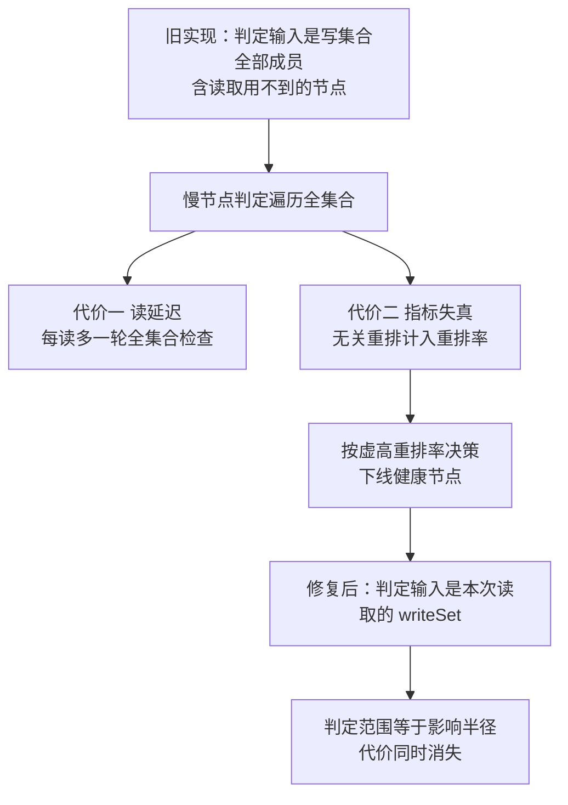
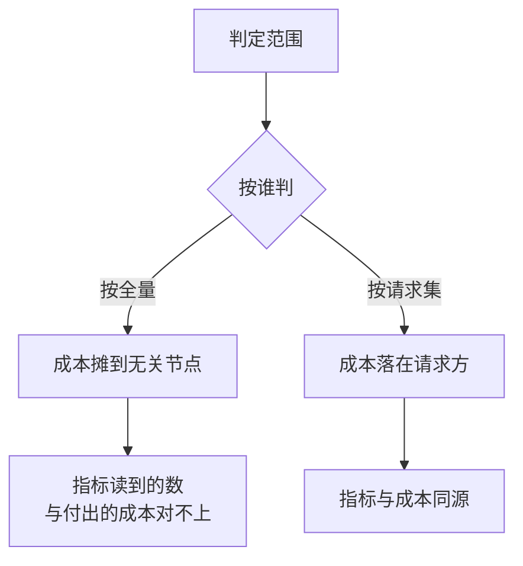

# 判定范围的口径错位：按谁判，就在谁头上加成本

> **要点**：**重排读序列的慢节点判定遍历了整个写集合，而本次读取只涉及其中几个成员**——**判定范围大于受影响范围时，无关节点的状态也触发全量重排，开销随集合规模上涨，指标被虚高污染**。

## 要解决的问题

**分布式读取有一类优化叫"读序列重排（布局或尺寸变化触发重新计算排版）"**：**客户端从多个副本读数据时，把响应慢或不可用的副本排到队尾，优先问快的**。重排的前提是一次"慢节点判定"，而判定的**范围**是个容易被忽略的决策点——Apache BookKeeper 的一个真实病例（上游修复 commit 33a1985c，可查）**演示了范围选错的三重代价**。

背景：**账本的副本分布在一个写集合（ensemble，如 3 个 bookie 组成的条带）里，每次读取只涉及其中按条带映射出的个别成员（writeSet）**。**重排判定本应只看本次读取涉及的成员**，旧实现却**遍历整个写集合**判断慢或不可用——**集合里任何一台这台客户端没在用的机器变慢，都会触发本次读取的完整重排流程**。

**三重代价随之而来**。**读延迟**：**每次读请求多做一轮全集合的状态检查与重排计算，开销随集合规模线性涨——三副本的集合里三分之二的检查是白做的，大集合里浪费比例更高**。**指标失真**：**重排计数把"无关节点慢引发的例行重排"也算进去，监控看到的重排率远高于真实的感知问题率，按这个指标做容量决策会把人引向歧途**。**行为噪声**：**重排改变了实际读取的成员顺序，与判定目标无关的读请求被无谓搅动，排查延迟问题时多了一层"这个读为什么换了节点"的迷惑**。

**代价的直观对照可以从队列调平模式看**：**任务先进队列，消费者按自身节奏处理，源头的成本被限定在队列本身的量级——这是"判定范围与影响范围一致"的正面形态**。微软 Azure 架构模式文档里的队列负载调平图画的正是这个形态，**成本与队列深度同源，指标与成本对得上账**：


*图源：Microsoft Azure 架构模式，Queue-Based Load Leveling pattern，CC BY 4.0，https://learn.microsoft.com/en-us/azure/architecture/patterns/queue-based-load-leveling。*



上游修复只改了遍历范围：**只遍历本次读取的 writeSet 判定**。**判定范围与受影响范围一致后，三重代价同时消失**——**只改遍历范围的改动，延迟、指标、行为三笔账同时清掉**。

## 它是怎么做到的：三类常见错位

**"判定范围大于受影响范围"在系统里反复出现，错位的形态有三种**。

**全局状态参与局部判定**：**本病例的形态——局部动作（一次读）的判定引用了全局状态（整个集合的成员状态）**。**全局状态里总有局部动作不关心的部分，引用它的成本（遍历、锁、一致性等待）全部摊进局部动作的延迟**。

**历史数据参与当前判定**：**判定用了过大的时间窗——"过去一小时慢"参与"现在这一秒要不要重排"**。**时间维度上的范围错位同样放大触发面**：**陈旧的慢节点记录让本已恢复的节点持续被绕开**（配合熔断即依赖持续报错时暂时切断调用、防止拖垮自己，与半开机制（熔断恢复前先放少量请求试探的场景）尤其要审时间窗）。

**聚合指标参与个体判定**：**用聚合统计（平均延迟、全队列深度）做个体动作（单请求路由、单任务准入）的判定依据时，聚合的方差全部转化为个体判定的噪声**。**聚合口径回答得了"系统整体健康吗"，回答不了"这个请求该去哪"**。

三种形态的共同根子：**判定逻辑写的时候拿了手边最方便的状态集合，没问"这个判定的物理影响半径是多大"**。**写序列重排的物理影响半径就是本次 writeSet——其余成员慢不慢，改变不了这次读取该问谁**。

**判定范围必须与影响半径同界**，**事件溯源的读写分离（写入走主库、查询走从库的架构）给了现成的实物参照**：**事件存储按序追加只写不改（事件的唯一事实源），读侧任何报表都由事件回放投影得出**——**报表错了回放哪次事件一查便知，判定口径与实际发生的事严格对应**；微软 Azure 架构中心的事件溯源参考架构把这条通路画全了，命令侧写入事件存储，事件处理器回放事件更新只读视图并对接外部系统：


*图源：Microsoft Azure Architecture Center《Event sourcing pattern》（Microsoft Learn 文档，可自由引用并注明来源），https://learn.microsoft.com/azure/architecture/patterns/event-sourcing。*

## 为什么指标失真最值得警惕



**按谁判定，成本就计在谁头上，口径错位会让指标与实际成本脱钩**，三种错位各对应一种失真：


**三重代价里，延迟与行为噪声在故障排查时能被发现，指标失真的伤害是长期的**：

**监控指标是决策的输入**：**重排率被拿来做"集群是否需要扩容""慢节点是否该下线"的判断**。**虚高的重排率制造"集群慢节点很多"的假象，引导出错误的运维动作（下线健康的节点、做不必要的扩容）**。

**虚高让真实问题失去显著性**：**当基线（正常状态下的指标水平、用来对比异常）重排率本身是虚的，真实的感知问题（某台机器真的慢了）混在虚高里，告警阈值的信噪比恶化**——**要么阈值调高放过真问题，要么保持阈值忍受常态告警疲劳**。

**修复后指标回落是验证信号**：**范围修正的修复上线后，重排计数通常大幅回落（虚高的部分消失）——回落本身是修复生效的证据，也量出了"指标之前失真了多少"**。

## 修完之后靠什么防住复发

**上游修复的动作极小，改动只有几行；真正值钱的是它背后的防线体系，值得展开成四层**：

**判定范围 = 影响范围，写成设计纪律**：**每个"按状态做选择"的逻辑，评审时问一句"这次选择的物理半径是多大"**——**一次读的半径是 writeSet，一次路由的半径是候选节点列表，一次准入的半径是目标队列**。**半径之外的引用要给出理由，没有理由就是缺陷候选**。

**指标与语义对账**：**每个"动作计数"类指标（重排次数、重试次数、驱逐次数）定期对账"计数的语义是不是用户关心的语义"**。**本病例修复后，重排计数才真正度量"用户感知到的慢节点重排"**。

**开销随规模审视**：**任何在"每次请求"路径上的遍历，标注它的遍历对象规模与预期规模增长**——**集合扩大时，按全集合遍历的判定成本随集合规模线性涨，按 writeSet 遍历的只随读取参数涨**。**把"随什么规模涨"写进设计文档，是延迟回归的第一道防线**。

**触发面审计**：**定期审计"谁会触发这个动作"——重排被全集合任何成员的状态触发，就是触发面失控的信号**。审计方法很简单：**列出动作的全部触发条件，逐条问"这个条件在我职责范围内吗"**。

## 这套说法在哪儿会失效

**三条边界防止防线过度**。

**全局判定有它的合法场景**：**健康检查、容量上报、拓扑感知这类动作的语义就是全局的，按全局做判定不是缺陷**——**缺陷的判定标准是"动作的影响半径"与"判定的数据半径"是否匹配，两者都全局或都局部都正常，错位才有问题**。

**writeSet 随访问模式变化**：**读写混合负载下，writeSet 的计算要跟条带映射走，修复的遍历范围是"本次读取实际会访问的成员"**，**按写路径的映射套读路径会引入新的错位**。

**指标修复要留变更说明**：**重排计数断崖回落会改变监控基线，发布说明里要写明"指标语义收窄，历史曲线不可直接对比"**——**否则下一次容量评审会有人拿曲线下跌当"集群变好了"的证据**。

## 怎么自己动手验证

防线有没有生效，可复现的验证路径：

1. 构造错位：部署三副本集合，对**不在本次读取 writeSet 的成员**注入人为延迟tc（Linux 流量控制工具，限速与整形）或测试桩，开启读重排；
2. 未修复基线：**观察读延迟随注入波动、重排计数上升——被注入的成员根本不在读取路径上，这是范围错位的直接证据**；
3. **修复后重跑：同一注入下，读延迟与重排计数纹丝不动**；对 **writeSet 内成员**注入时重排正常触发（判定能力没有被削弱）；
4. 断言锚点：**集合外成员的状态变化不影响本次读取的延迟与重排行为**；**重排计数与真实 writeSet 内的慢节点事件一一对应**。

```text
注入 A = writeSet 外成员延迟 → 预期：读延迟与重排计数不变
注入 B = writeSet 内成员延迟 → 预期：重排触发，读取绕开慢成员
指标断言 = 重排计数 ⇔ writeSet 内真实慢节点事件
```

**两条注入一正一反：A 验证"不再误伤"，B 验证"没有误杀"——范围口径的修复必须同时过这两关**。

## 接着读哪几篇：副本读取策略的机制面

- [[工程知识/缺陷分析：从个案到体系/性能/案例三十七：锁自己变成了瓶颈——争用背后的临界区错配]] —— 同为"范围口径"家族：临界区的保护半径大于数据访问半径
- [[工程知识/缺陷分析：从个案到体系/稳定性/案例三十六：写被自己的回调堵住——挂起的 add 回调]] —— 引用本病例的上游修复关联
- [[工程知识/数据系统：在并发与故障中保存事实/可靠性与运维/复制的三种模式：主从、多主与无主的失败形态]] —— 副本读取策略的机制面
- [[工程知识/缺陷分析：从个案到体系/正确性/静默失真的检测靠对账与不变量而不是报错]] —— 指标与语义对账的方法论出处
